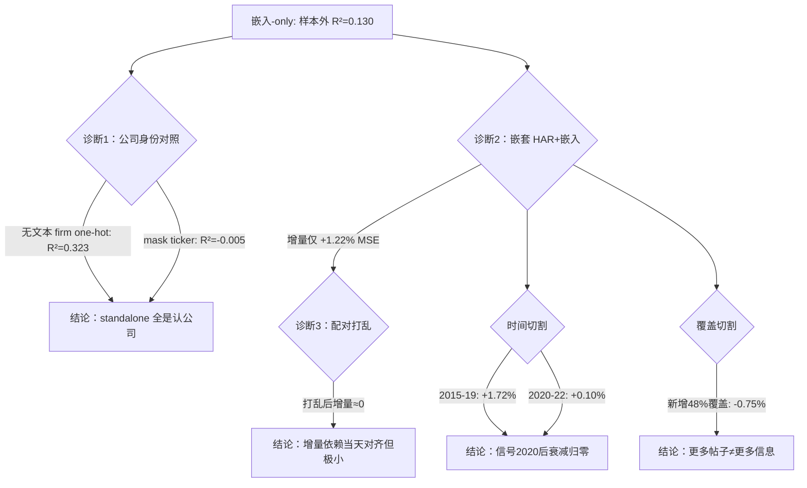

## TL;DR

GameStop 逼空之后，r/WallStreetBets 的帖子被越来越多地拿来预测股价波动率，LLM 嵌入模型动辄报告 0.13 的样本外 R²，看起来像真有料。但一篇 ICAIF '26 的论文用一套三层诊断协议证明：这 0.13 里几乎全是模型记住了"在讨论哪只股票"——把帖子里的股票代码全部抹掉，R² 直接跌到 −0.005。真正来自"当天帖子内容"的日级别增量，在经典 HAR 基准之上只有约 1.2% 的 MSE 改善，而且 2020 年之后基本归零；把覆盖从交易时段扩大 48%（加入盘后和周末帖子）带来的甚至是负增量。这篇论文的价值不是又贡献一个涨点技巧，而是给所有人敲了一记警钟：**standalone 精度会严重高估文本的真实预测价值，不做公司身份剥离，任何 LLM 金融预测 pipeline 都在把"身份记忆"误当成 alpha。**

## 论文信息卡

- **标题**：More Mentions, Less Information? Diagnosing Identity and Alignment in Reddit Embeddings for Volatility Forecasting
- **作者**：Zhiyu Zheng（University of Chicago；致谢 Ayan Bhattacharya、Lars Peter Hansen、Diana Petrova）
- **发表渠道**：7th ACM International Conference on AI in Finance (ICAIF '26)，2026 年 11 月 14–17 日，米兰；正文 9 页
- **arXiv**：arXiv:2610.25468v1 [q-fin.ST]，2026 年 10 月 18 日提交；DOI: 10.1145/3858063.3858739
- **原文链接**：https://arxiv.org/abs/2610.25468

## 背景

2021 年 GameStop 逼空是分水岭。在此之后，r/WallStreetBets 从一个散户亚文化论坛，变成了学术界研究"散户情绪-价格传导"的标准数据源。Rahimikia 等人 2021 年用财经新闻词嵌入预测已实现波动率，Chen-Kelly-Xiu 2024 年用 LLM 嵌入预测股票收益率，Bradley 等人 2024 年在 RFS 上发文证明 WSB 的 DD（深度分析）推荐在逼空前能预测收益、逼空后失效。一条文献脉络看起来在讲同一个故事：**文本里有 alpha**。

但这篇论文盯住了一个所有前人都没系统回答过的问题：嵌入的预测力，到底来自波动率历史、公司身份，还是当天文本内容？这是个致命的盲区——一只常年高波动的 meme 股，它任何日子的帖子嵌入都天然"闻起来像高波动"，根本不需要当天帖子有什么具体信息。一个证券的社交媒体嵌入里，天然编码了"这是哪家公司、什么行业、什么讨论风格"。预测拟合度高，不等于当天文本有增量信息。作者的诊断协议，就是专门为剥离这三层来源设计的。

## 方法拆解

### 数据：十年 WSB 帖子变成日级别嵌入面板

第一步是数据构建，作者做得相当细致。取 2012–2022 年 WSB 帖子（Pushshift 归档），用标题/正文中出现的大写 ticker 字符串匹配股票，再用 CRSP 的股票名历史把 ticker 映射到**预测日当天有效**的 permno——这点很关键，ticker 会变、会重用，映射必须按当天有效性来。

棘手的是撞上 ticker 的普通词：DD、YOLO、ON 这些 WSB 黑话恰好都是股票代码。作者的启发式是看 cashtag 写法比例：$GME 有 16% 写成 cashtag，$TSLA 有 27%，而 DD 只有 0.1%。出现 ≥50 行且 cashtag 比例 <5% 的字符串判为普通词，只有明确写成 $XXX 才算提及。6,957 个候选字符串里判出了 271 个普通词。

每个去重文本用冻结的 **Llama-3.1-8B base（8-bit 量化）** 嵌入一次：截断 192 token（只有 4.8% 超长，帖子中位数仅 17 token），取第 32 层 token 均值池化、L2 归一化，得到 4,096 维向量；同一（permno, 预测日）有多篇帖子就取均值。波动率标签用 TAQ 盘中价格：15 分钟对数收益（26 个日内区间加隔夜 bin），平方和再年化、取对数。基准是 Corsi (2009) 的经典 **HAR**：1/5/21/63 天 log-RV 滑动平均，预测下一个有效观测的 log-RV。

### 诊断协议三件套

这是全文的方法论核心，作者设计了三层嵌套评估：

**第一层：嵌套增量。** 2–1–1 滚动窗口（2 年训练、1 年调参、1 年测试，2015–2022 共 8 个不重叠测试年）。第一阶段用 pooled OLS 估计 HAR 并固定，第二阶段用 ridge 回归（24 个惩罚值，验证集可以"拒绝"嵌入，即选极大惩罚相当于不用文本）把 4,096 维嵌入拟合到 **HAR 残差**上。这保证了测到的是 HAR 之外的增量。显著性用等日期 estimand 加 moving-block bootstrap（5 天块）95% 置信区间。

**第二层：公司身份对照。** 用正则化 permno one-hot（训练窗内各公司的 HAR 残差均值向 0 收缩），对比 HAR+firm 和 HAR+firm+embedding；另设无 HAR 的 firm-mean standalone 基准。如果嵌入的增量只是"认公司"，one-hot 基准就能吃掉它。

**第三层：日-文本配对打乱。** 在每个公司-年份内随机重排每日嵌入与目标的配对（1,000 个 seed），保留公司-年份分组、只破坏"当天对齐"。如果增量依赖的是当天文本的真实信息，打乱后增量应该消失；如果增量只是公司身份，打乱后基本不动。permutation p 值按 (c+1)/(n+1) 计算。

### 两个切割

作者还做了两个关键切割：一是时间切割（2015–2019 vs 2020–2022，看信号是否衰减）；二是覆盖切割——same-day panel（只用当日 16:00 ET 之前的帖子）vs session-window panel（加入盘后和周末帖子，覆盖扩大 48%），对比 previously covered 和 newly covered 两组的增量。

## 实验与数据

### 面板规模

主 panel 共 202,145 个 mentioned stock-day（样本外测试 198,564）；same-day 面板 136,333，新覆盖组 64,327。测试年 2015→2022 的计数：5,549 / 12,346 / 15,571 / 16,892 / 18,540 / 39,042 / 65,747 / 24,877。每日被提及的证券数从约 56 只涨到约 173 只（3.1 倍），2021 年峰值约 262 只/天。测试样本中 74.3% 是训练窗见过的公司——这正是身份泄漏的温床。

### 结论一：standalone 几乎全是"认公司"

这是全篇最漂亮的一组数字。嵌入-only 模型的样本外 R² = 0.130（在训练见过的公司上 0.127）。而**完全不用任何文本**的正则化 permno one-hot 基准，在见过公司上的 R² = 0.323，firm-mean 基准也有 0.276——**远超文本模型**。换句话说，只知道"这是哪只股票"，比读十年的 WSB 帖子更能预测波动率。

打乱实验坐实了这一点：保留公司-年份分组打乱日-文本配对，standalone 保留了 89.2%/92.1%（打乱中位数 R² 0.116/0.117，p=0.001）。而最狠的一刀是 **mask 掉帖子里的 ticker 字符串后，standalone R² 直接跌到 −0.005**。模型根本没在读帖子内容，它只是在读"GME"三个字母。

### 结论二：HAR 之上的增量又小又脆

HAR → HAR+嵌入：等日期 MSE 改善 **+1.22% [0.94, 1.49]**（RMSE 口径约 +0.61%）；QLIKE 口径 +5.47% [4.59, 6.34]。打乱后增量中位数 −0.07%，1,000 个打乱值无一达到观测值（p=0.001）——说明这点增量确实依赖当天对齐，不是公司身份的残留。但作者诚实地承认：分不清这是"帖子预见未来"，还是"帖子只是在描述当天已经发生的大波动/大事件"。

### 结论三：信号随时间衰减，2020 年后归零

2015–2019 年增量 +1.72% [1.34, 2.09]，2020–2022 年仅 +0.10% [−0.19, 0.37]，差值 1.61 个百分点 [1.15, 2.09]；绝对 MSE 下降 0.016 vs 0.001。逐年看：2020 年 +0.01%、2021 年 +0.24%、2022 年 +0.07%（只有 2022 的置信区间勉强不含零）。这与 Bradley 等人在收益维度发现的"WSB DD 信号逼空后消失"遥相呼应。作者明确**不把衰减归因于 COVID 或 meme 股事件**——原因未解释，是开放问题。

### 结论四：覆盖扩大 48%，增量为负

same-day vs session-window 的配对对比：previously covered 组增量 +1.80% [1.48, 2.12]，newly covered 组 **−0.75% [−1.19, −0.32]**，配对差 +2.55 [2.02, 3.08] 个百分点；分时期看，pre 时期 +3.33 [2.56, 4.11]、post 时期 +1.00 [0.62, 1.36]，新覆盖组在两个时期都为负。按星期拆：新覆盖组周五 −2.48% [−3.39, −1.60]、周四 −1.57% [−2.43, −0.71]，周一到周三置信区间含零。作者的解释是：周五的目标包含周末隔夜收益，盘后/周末帖子的信息窗口与预测目标错位，噪声淹没了信号。这正是标题"More Mentions, Less Information"的实证落点：**数据越多越好，在这里是错的**。

### 鲁棒性

Table 5 的鲁棒性检查也很扎实：上下文放大到 4096 token，standalone 升到 0.141，但增量 +1.04%，post 时期甚至显著为负 −0.54% [−0.96, −0.15]；第 16/24 层 standalone 仅 0.027/0.057，增量相似；换 Llama-2-7B，standalone 0.051、增量 +0.31% [0.05, 0.57]；mask ticker 后增量 +1.24% 不变（再次证明增量与身份无关）；只用帖子数量的模型 R² = −0.12；ticker 匹配规则从宽到严，增量 +0.94% → +1.28%，结论稳定。

## 相关工作对比

与 Rahimikia et al. 2021（财经新闻词嵌入预测已实现波动率）相比，本文换成了散户论坛加上下文 LLM 嵌入，但真正的增量不在数据源，而在**评估方法**——首次系统分解"波动率历史 / 公司身份 / 日对齐"三个来源。与 Chen-Kelly-Xiu 2024（LLM 嵌入预测收益率）相比，本文指出了对方可能存在的**公司身份泄漏**问题，mask ticker 实验是点睛之笔，并给出了一套模型无关的诊断协议，任何嵌入模型都能套用。与 Bradley et al. 2024（RFS，WSB 的 DD 推荐逼空前有效、之后消失）相比，本文在波动率维度复现了类似的**时间衰减**，并用滚动样本外设计把它量化成了 1.72% → 0.10%。方法上则借鉴了 NLP probing 文献（Alain & Bengio 2017；Belinkov 2022）"线性探针加对照"的逻辑，把它改造进了金融面板回归的框架。

## 局限与开放问题

- 测到的增量无法区分"帖子包含前瞻信息"和"帖子只是在描述当天已发生的事件"——作者明确承认这是识别上的天花板。
- 时间衰减的原因完全没有解释，作者拒绝归因，留作开放问题。
- 回顾性评估存在**前视偏差**：Llama-3.1 的预训练数据超出样本期，增益不能解读为实时可实现的表现。
- 只试了线性增强（冻结嵌入 + ridge），没有试非线性 head；只试了 Llama 家族。
- 样本限定在 WSB 提及的美股 stock-day、等日期加权、次日 RV，不涉及全市场横截面、更长预测 horizon 和其他平台；**结果不意味着交易可盈利**。
- 只做了精确文本去重，近似重复帖被多计了权重；作者自己披露，采用 date-valid panel 的决定是在看过结果之后做的，是一个 specification 上的瑕疵。

## 一点思考

这篇论文最值得实盘从业者记住的不是"WSB 文本能预测波动率"，而是它的反面教材价值：任何把 LLM 嵌入直接塞进预测模型的 pipeline，如果不先剥离公司身份，都是在把"身份记忆"误当成 alpha。我的判断是：社交文本对波动率的真实增量（HAR 之上约 1.2%，且 2020 年后归零）太小、太脆，不值得作为生产级波动率或期权策略的独立特征，最多是正常市场环境下预测集成的边际补充。实操建议只有一条：如果要用 LLM 文本做金融预测，先跑本文的三件套诊断（嵌套强基准、无文本公司对照、组内打乱），通不过就别上线——不然你以为模型在读情绪，它只是在认股票代码。

## 原文链接

https://arxiv.org/abs/2610.25468（PDF：https://arxiv.org/pdf/2610.25468）
