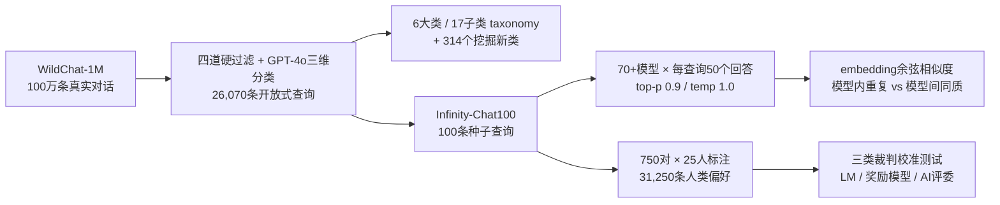

## TL;DR

你以为 GPT、Claude、Gemini、DeepSeek、Qwen 是五个独立的大脑？NeurIPS 2025 最佳论文《Artificial Hivemind》用 2.6 万条真实开放式问题、70+ 个模型、3.1 万条人类标注证明：**它们在开放式创作上几乎是同一个大脑**。同一模型连问 50 次，79% 的情况下回答两两相似度超过 0.8；不同公司、不同架构的模型之间，相似度照样高达 0.81–0.82，甚至出现逐字相同的短语。更麻烦的是第二部分：奖励模型和 AI 评委在"质量差不多、但人类偏好分歧大"的回答上，与人类评分的相关性直接掉成负数——**对齐管线奖励的是"共识"，惩罚的是"个性"**。论文的警告很直白：我们正在用 AI 的同质输出，反向塑造人类思想的同质化。

## 论文信息卡

- **标题**：Artificial Hivemind: The Open-Ended Homogeneity of Language Models (and Beyond)（人工蜂群思维：大语言模型的开放式同质性及其之外）
- **作者**：Liwei Jiang、Yuanjun Chai、Margaret Li、Mickel Liu、Raymond Fok、Nouha Dziri、Yulia Tsvetkov、Maarten Sap、Alon Albalak、Yejin Choi（共 10 人）
- **单位**：华盛顿大学、卡内基梅隆大学、艾伦人工智能研究院（Ai2）、Lila Sciences、斯坦福大学
- **会议**：NeurIPS 2025，**Best Paper Award（最佳论文奖，Datasets & Benchmarks 赛道 Oral Poster）**，2025 年 12 月大会公布
- **原文链接**：https://arxiv.org/abs/2510.22954（v2 为 camera-ready 版，CC BY 4.0 开放许可）
- **开源**：代码 https://github.com/liweijiang/artificial-hivemind ，数据集 Infinity-Chat 收录于同名 HuggingFace 合集

## 背景：评测只考"答对"，没人考"答得不一样"

主流评测（MMLU、GSM8K、HumanEval……）考的全是"有没有标准答案"的问题。但用户每天问 chatbot 的大量问题根本没有标准答案："给我想个创业点子""写个关于时间的隐喻""帮我选 offer"。这类开放式查询的"好"本身就是多元的——10 个人类会给出 10 种完全不同的好答案。

问题在于：过去没有可扩展的方法来度量"模型输出到底有多同质"。已有的多样性研究要么局限在随机数生成、人名生成这种玩具任务，要么只测单个模型重复采样。于是社区长期活在一个未经检验的假设里：**调高温（temperature）就能变多样，模型集成（ensemble）就能凑出多样性**。

这篇论文要做的，就是第一次在真实开放式查询上，把"模型到底有多同质"这件事，用 70+ 个模型的实测数据算清楚。NeurIPS 授奖词也点明了分量：这是"对现代大模型多样性、多元性与社会影响理解的实质性贡献"，直指"人类创造力、价值多元与独立思考的长期风险"。

## 方法拆解：先造题库，再做"人口普查"

### 第一步：造一个"没有标准答案"的大规模题库 —— Infinity-Chat

数据源是 WildChat-1M（100 万条真实用户与 GPT-4 的对话）。先做四道硬过滤：英文、被标注为无毒无害、指向 GPT-4、长度 15–200 字符，得到 37,426 条高质量单轮查询。

关键一步：用 gpt-4o-2024-11-20 按三个维度自动分类，只留下"开放式"查询：

1. **Meaningful Information**：是否在问一个有意义的问题；
2. **Greeting/Model Inquiry**：排除问候和询问模型自身；
3. **Response Type**：期待的是单一确定答案（Single）还是多个合理答案（Multiple）。

最终留下 **26,070 条开放式查询**（另有 8,817 条封闭式被剔除），这就是 Infinity-Chat。同时论文给出**首个开放式查询分类体系**：6 大类、17 子类（创意内容生成占比最高，另有头脑风暴、思辨与假设场景、技能发展等），还从数据里额外挖掘出 314 个新类别。人工验证（86 名 Prolific 参与者，每题 3 人多数投票）：81.27% 的查询允许 3 种以上答案，34.66% 允许 20 种以上——题库确实"开放"，不是换了个马甲的封闭题。

### 第二步：Hivemind 评测协议 —— 给每个模型 50 次机会"不一样"

取 100 条人工验证过的代表性查询（Infinity-Chat100）做种子。每个模型、每条查询，**独立生成 50 个回答**：nucleus sampling（top-p 0.9、temperature 1.0）、最长 2048 tokens。70+ 个开闭源模型（正文详写 25 个），HuggingFace 模型跑在 A100/H100 上，超大模型走 TogetherAI。注意解码参数是故意给"高随机性"的——已经是在给模型"变多样"的最大机会。

多样性度量：用 OpenAI text-embedding-3-small 把回答变成句向量，算每条查询 50 个回答的**平均成对余弦相似度**。相似度越高，多样性越差。

### 第三步：3.1 万条人类标注，看"机器打分"和"人类品味"差多远

随机取 50 条查询 × 每条 15 个去重回答 = 750 个（查询，回答）对。绝对评分：1–5 分整体质量，每对 25 名独立标注者 → 18,750 条；成对偏好：每条查询 10 个回答对（5 级粒度：强烈/轻微偏好 A、差不多、轻微/强烈偏好 B），500 对 × 25 人 → 12,500 条。**合计 31,250 条人类标注**，2,296 名标注者（美 43.5%、英 29.3%、加 12.5%，平均年龄 39.9 岁）。每对 25 个标注的密度是故意的：开放式回答的"好"本来就是分歧的，要先把分歧本身测准。

模型侧派出三类"裁判"：**56 个 LM**（用 perplexity 给回答打分，perplexity $=\exp(-\frac{1}{N}\sum_i \log p(x_i|x_{<i}))$）、**6 个 RewardBench 顶级奖励模型**、**4 个 LM judge**（含 gpt-4o 配 Overall/HHH 两套 rubric），看它们的打分与人类平均分之间的 Spearman 相关系数。

## 实验与数据：所有模型，无一幸免

### 发现一：模型内重复 —— 同一个模型，自己抄自己

标准采样下，**79% 的（模型，查询）组合里，50 个回答的平均成对相似度超过 0.8**。看完整分布更直观：相似度 0.9–1.0 的占 33.65%，0.8–0.9 的占 36.47%——**七成回答对的相似度在 0.8 以上**，0.7 以下的只有约 13%。

"调高温就行"的假设也被证伪：换用多样性导向的 min-p 解码（p=0.1），仍有 81% 的回答对相似度 >0.7、61.2% >0.8，只是 0.9 以上的极端重复少了。**解码技巧救不了，这是模型分布本身的问题。**

### 发现二：模型间同质 —— 不同公司，同一个答案

这才是"蜂群"二字的由来。不同模型对同一查询的平均成对相似度普遍高得离谱：**DeepSeek-V3 与 qwen-max-2025-01-25 达到 0.82**；GPT 系列与 Qwen API 系列之间互相似度 **0.81**——跨公司、跨架构，照样高度趋同。

实例级的证据更刺眼：不同模型会输出**逐字相同的短语**，比如 iPhone 手机壳文案里的 "Elevate your iPhone with our"、"sleek, without compromising"；"写一篇 30 词的全球变暖短文"任务里，一对跨模型回答的相似度高达 **0.996**，近乎逐字相同。最狠的一个实验：每条查询取全部 25×50=1250 个回答里最相似的 Top-50，统计它们来自多少个不同模型——**平均 8 个**，部分查询超过 10 个。最相似的 50 个回答不是来自同一个模型，而是均匀散布在 8 个不同模型里：**趋同是跨模型的集体行为**。

连"换个问法"都救不了：用 gpt-4.1 给每条原提示生成 4 个改写（150 条提示、42 个模型各 20 个回答），原提示内平均相似度 0.821，跨改写 0.781——**改写提示几乎不改变同质性**。同质化不在措辞层，在语义层。

论文的 Figure 1 是全场最佳注脚：让 25 个模型各写 50 个"时间的隐喻"，1250 个回答做 PCA 降维，只聚成两个簇——**"时间是一条河"和"时间是一个织布工"**。无限种可能，人类能想出一百种，70 个模型只交出两种。

### 发现三：裁判也瞎 —— 对齐管线奖励"共识"，惩罚"个性"

全集上，三类裁判和人类评分的 Spearman 相关系数本来就不高：LM perplexity 0.361、奖励模型 0.330、AI 评委 0.305。但真正的杀招是两个困难子集：

- **相似质量子集**（去掉明显好/坏的离群点，只留质量接近的回答）：相关性显著下滑；
- **高分歧子集**（25 个人类标注者分歧最大的样本）：**三类裁判的相关系数直接掉成接近零甚至负数**——LM perplexity 从 0.361 掉到 **−0.108**，奖励模型 0.330 → **−0.073**，AI 评委 0.305 → 0.070。

单模型例子：Tulu-3-8B-RM 从 0.462 掉到 −0.055，gpt-4o（Overall rubric）从 0.434 掉到 −0.093。翻译一下：当人类自己都众说纷纭、但每个回答质量都不差时，现有对齐管线里的打分器不仅看不懂人类，甚至**系统性地打反**。根因论文点得很透：PPO/RLHF/DPO 这套管线默认"质量"是单一共识，训练目标就是往平均品味收敛——它奖励的是不冒犯任何人的"最大公约数"回答，惩罚的正是有个性的回答。**Hivemind 不是偶然，是这套对齐范式内生的。**

## 相关工作对比：先做"人口普查"，再谈"治病"

论文把相关工作分成三条线，定位很清晰。

第一条是**多样性坍缩的成因研究**：训在合成数据上（Shumailov 等的"模型自噬"）、对齐本身（RLHF 收敛品味）、训练数据多样性不足；已有缓解思路包括训语料多样化、改训练算法、换解码策略（min-p）、调提示词——但全都没在"真实开放式查询 + 70+ 模型"的规模上被系统验证过，这是本文的增量。

第二条是**创造力度量**：DAT、AUT、TTCT 这些心理学量表，以及 Wenger & Kenett 做的跨 LLM 创造力同质性研究——本文的差异是资源：第一个基于真实用户查询的大规模题库 + 首个开放式查询 taxonomy。

第三条是**分歧与多元对齐**：pluralistic alignment 早就指出 RLHF 学的是 monolithic value（单一价值观）；本文的推进是方法——不依赖预设 persona，而是用每样本 25 个密集标注，直接度量"个体特异偏好"长什么样，再证明现有裁判接不住它。

一句话总结创新点：**别人都在"怎么让模型更多样"上打补丁，这篇论文先做了"多样性到底崩到什么程度"的第一次大规模人口普查**——没有这张普查表，后面的缓解都是盲打。

## 局限与开放问题

- **只是快照**：26K 查询是开放式问题无垠空间里的一个切片，结论的外推边界未知。
- **英文中心**：全部查询来自 WildChat 的英文 GPT-4 对话，非英语语言、非西方文化的开放式表达完全没覆盖。
- **自动标注的天花板**：taxonomy 用 GPT-4o 标注，与人工的一致率 74.7%，分类噪声会传导到子类别结论。
- **"河 vs 织布工"可能过度简化**：二分簇是 PCA 可视化的结果，创造性表达的多维结构被压扁了。
- **度量单一**：只用了文本嵌入余弦相似度——语义之外的风格、结构、修辞多样性没被度量。
- **只看了两个维度**：多样性与质量，事实性、安全性等多目标下的同质性还是空白。
- **开放方向**：把测试床扩展到**未经指令微调的基础模型**（看看到底是预训练还是对齐惹的祸）；设计**显式奖励多样性的训练目标**；把 Hivemind 检测集成进**红队工作流**。

## 一点思考

这篇论文最狠的不是 79% 或 0.82 这些数字，而是它把"AI 让人类越想越一样"从玄学变成了可测量的工程问题。对普通用户最实在的判断是：**别再指望"换个模型"就能换来新想法**——70 个模型的实测告诉你，它们大概率给你同一个答案的不同措辞。对做产品的人，判断更直接：在需要发散的场景（头脑风暴、创意、命名）里，模型集成的多样性红利是幻觉，真正的多样性得从提示设计和后处理里挤。以及一个更扎心的：RLHF 对齐在"不冒犯任何人"的目标上越成功，人类思想的方差就被压缩得越厉害——安全与多元之间，社区第一次有了实测的 trade-off 曲线。

## 原文链接

- 论文：https://arxiv.org/abs/2510.22954
- HTML 全文：https://arxiv.org/html/2510.22954v2
- 代码：https://github.com/liweijiang/artificial-hivemind
- 数据集：HuggingFace 上 liweijiang/artificial-hivemind 合集（含 Infinity-Chat）
- NeurIPS 2025 获奖介绍：https://howaiworks.ai/neurips-2025-best-paper-awards-announcement/
