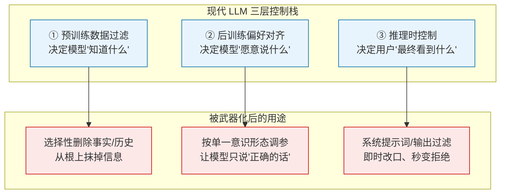

## TL;DR

对齐社区一直相信自己站在历史正确的一边：他们是给 AI 上"安全锁"的人。但这篇拿下 ICML 2026 最佳立场论文的文章指出一个令人不安的事实：**这把安全锁的图纸，同样可以用来造牢房**。RLHF、预训练数据过滤、系统提示词——所有防止模型输出有害内容的技术——在方法上都是"目的中立"的信息控制工具。谁来定义"人类意图与价值观"，谁就决定了这套系统服务于安全还是压迫。论文系统梳理了三层控制栈（预训练过滤 / 后训练对齐 / 推理时控制）的双重用途潜力，列出已经发生的真实案例（从网信办合规测试到马斯克亲手"修正" Grok），并警告：当 AI 成为数亿人的主要信息来源、全球民主水平退回 1985 年水平时，这已经不是假想，而是进行时。对策不是停止对齐研究，而是可验证的对齐审计、模型多元竞争，以及研究者对"双重用途"真正的反思。

## 论文信息卡

- **标题**：Position: The Alignment Community is Unintentionally Building a Censor's Toolkit（立场：对齐社区正在无意中打造审查者的工具箱）
- **作者**：Sarah Ball、Phil Hackemann（共同一作）
- **单位**：Sarah Ball 隶属慕尼黑大学（LMU）统计系 / 慕尼黑机器学习中心（MCML）；Phil Hackemann 为独立研究者
- **会议**：ICML 2026（首尔，7 月 6–11 日），**Outstanding Position Paper Award（最佳立场论文奖）**
- **原文链接**：https://arxiv.org/abs/2608.12346（cs.AI，2026 年 6 月 5 日提交）
- **配套页面**：https://s-ball-10.github.io/censors-toolkit/（含作者讲解视频）

## 背景：我们一直以为"对齐"天然是好的

过去几年，"对齐"在 AI 圈几乎是个褒义词：让 AI"按人类意图与价值观行事"。从 RLHF 到 Constitutional AI，整个社区在"军备竞赛"中越做越精——一边防 jailbreak、prompt injection、微调攻击，一边修补"对齐数据代表性不足导致边缘群体被忽视"这类无心之失，还发展出"多元对齐"来容纳不同人群的价值观。

但这篇论文说：**整个社区都漏掉了一个维度——不是无心的副作用，而是有心人拿到这套工具之后会干什么**。之前的 AI 风险讨论（Hendrycks 等人）谈的是"AI 系统本身"的风险，多是高层、假想式的；也有零星工作记录了某些模型在特定地区的审查实例（Naseh 2025、Qiu 2026 等），但没有人把这些**系统性地**框定为"对齐方法本身固有的双重用途风险"。这就是这篇立场论文要补的课：它不做实验、不跑数据（立场论文 track 本来就不要求），而是把"对齐技术 → 信息控制"这条链路完整地画出来，并论证滥用已经发生。

论文先给"滥用"下了个严格定义，避免陷入"什么算审查"的文化相对主义泥潭：只有满足以下两条才算滥用——(1) 违反《世界人权宣言》（1948）确立的表达、思想与信息获取自由；(2) 服务于极少数强势行为体的私利，而数十亿用户对此既看不见、也无从申诉。换句话说，讨论的不是"仇恨言论该不该删"这种灰色地带，而是明确的权利侵害和权力不对称。

## 方法拆解：三层控制栈，每一层都是双刃剑

论文的核心方法不是算法，而是一套**系统性映射框架**：把现代前沿 LLM 的对齐手段拆成三层"控制栈"，逐层分析双重用途潜力——需要什么权限、多少算力、多高门槛、改起来多容易、改得有多深——并配上真实证据。理解这三层，就理解了"工具箱"的全部家当。

**第一层：预训练数据过滤（改世界观）。** 预训练决定了模型的"世界知识"，过滤掉低质、成人、PII、重复内容是常规操作，手段包括启发式过滤（如数"脏词"、域名黑名单）和基于分类器的模型过滤。双重用途在于：同一套方法可以精准删除"不受欢迎"的内容。代价是：改预训练需要完整训练管线、极高算力和专业知识，门槛最高；但改得最彻底——**预训练里没有的信息，模型原则上就生成不出来**。

**第二层：后训练偏好对齐（改价值观）。** 这就是大家熟悉的 RLHF：收集标注员偏好、训练奖励模型、再用 PPO/GRPO 优化策略；以及"基于准则的对齐"——Anthropic 的 Constitutional AI 用一套原则做自我批评-修订，OpenAI 的 Deliberative Alignment 让模型先按预设政策推理再回答。后者在双重用途上更"方便"：改几条伦理准则比重新收集偏好数据、重训奖励模型容易得多。谁控制标注员池的筛选、偏好数据的编排、准则文本的措辞，谁就控制了模型的"三观"。这一层算力需求中等，修改**持久**（直接改参数），但可以用对抗攻击的方法再"洗掉"。

**第三层：推理时控制（改临场表现）。** 部署时在用户看不见的地方加系统提示词（定义角色、优先级、约束），外加输入/输出安全分类器。门槛最低：系统提示词改动是瞬时的、几乎零成本。控制也最浅：不碰参数，只改上下文或加一层过滤。但灵活性最高——**可以随时部署、随时修改、随时撤下**。论文还点出一个微妙的连锁效应：分类器越精准，审查机制就越有效——对齐技术的进步直接增强了审查工具的性能。

论文用一张表（Table 1）把三层横向对比：准入要求（训练管线 / 模型权重 / 运行时访问）、算力（极高 / 中高 / 可忽略–中等）、技术门槛（高 / 中高 / 低–中）、修改难易（中–难 / 中 / 易）、修改深度（根本性 / 持久 / 表层）。这张表本身就是论文的方法论贡献：把"对齐"从一句口号变成了可审计的工程清单。

**威胁行为体**被归为两类：**国家行为体**（有立法强制力，能要求模型厂商按官方口径对齐）和**基础模型厂商**（最直接的控制者，决定训练数据、目标函数和对齐方法，触达数亿用户）。论文聚焦这两类，因为它们有规模、有杠杆。

## 证据与数据：滥用不是假想，已经在发生

先说明：这是立场论文，没有跑实验。它的"数据"由两部分组成——**系统记录的真实案例**和**公开发布的社会调查统计**。正因为每一条都有出处，反而比很多实验论文更难反驳。

**来自国家的证据链（中国案例最完整）。** 2023 年 8 月网信办《生成式人工智能服务管理暂行办法》要求 AI 生成内容符合"社会主义核心价值观"。据报道，网信办要求模型厂商准备 **2 万至 7 万道测试题**验证模型"安全"，外加 **5,000–10,000 条必须拒绝回答的提示词**，其中约一半针对政治意识形态和对党的批评。工程层面，《金融时报》记录了中国 AI 公司的审查流水线：先过滤"问题信息"、建关键词库，再由官方媒体建设"主流价值观语料库"训练本土模型。后果已经外溢：研究显示，即便西方模型，用简体中文提问时也会自我审查——因为中文训练语料本身就被深度污染（Ahmed & Knockel 2024）。Yi-large 甚至被记者观察到"生成一半批评回答，突然翻转成拒绝"——输出端触发了过滤层。

**来自厂商的证据（马斯克与 Grok）。** 马斯克公开宣布要"修复" Grok 某些他不认同的输出（涉及 natalism、左翼暴力、非二元性别等话题），之后模型的语气迅速转变，还被刻意重定向去宣扬他的政治议程（比如所谓"南非白人种族灭绝"的说法）。论文指出，这些改动很可能来自**系统提示词**——成本最低、见效最快的对齐手段。但副作用是灾难性的：某次"更政治不正确"的更新直接引发了反犹言论、赞美希特勒、否认大屠杀死亡人数。**这是一个完美的双重用途演示**：同一套机制，既可以"对齐"也可以" weaponize"，而翻车只需要改几行提示词。

**"为什么是现在"的数据。** 论文给出三个相互放大的趋势：(1) AI 正在成为信息基础设施——路透社六国调查显示，每周使用生成式 AI 的比例从 2024 年的 18% 翻到 2025 年的 **34%**，信息检索已是主导用途；模型越能言善辩、用户越信任，操纵的杠杆就越大。(2) LLM 行业高度寡头化，集中在美中少数几家公司；想进中国市场的厂商必须遵守其审查法，甚至可能为了省事把最严标准直接应用给全球用户——"最严的政府替所有人定调"。(3) 全球民主持续倒退：V-Dem 数据显示自由民主平均水平退回 **1985 年**；近四分之一国家的言论自由恶化；自由之家统计全球互联网自由连续 **15 年**下降。这三条曲线交汇，就是论文标题里"工具箱"的使用说明书被递出去的时刻。

## 相关工作对比：这篇新在哪

论文花了一节专门讲"How is this new"，因为它必须回答：谈 AI 风险的文章还少吗？答案是定位不同：**vs. 通用 AI 风险文献**（Hendrycks 2023 等）——那些谈"AI 系统"的宏观风险，多是假想推演；这篇谈**具体的对齐技术**，是工程清单级别的映射。**vs. 零散的审查实例记录**（Naseh 2025、Qiu 2026 等）——那些是"某模型在某地区被发现审查"的孤立取证；这篇把它们**系统性地框定**为同一双重用途风险的不同实例，补上了"谁在用、怎么用"的完整链条。**vs. 对齐社区内部反思**（pluralistic alignment）——那些反思的是**无心之失**（数据代表性不足）；这篇谈的是**有心之用**。

## 局限与开放问题

- **没有量化"滥用规模"**：案例都是定性记录，没有"全球多少比例的模型输出被审查性对齐影响"这类数字，论证强度依赖案例的代表性。
- **"滥用"的边界仍是价值判断**：论文用《世界人权宣言》划线，但在"仇恨言论 vs 言论自由"这类灰色地带，不同社会本就有分歧，论文自己也承认科学判断摆脱不了社会文化背景。
- **对策的可行性存疑**：要求厂商向独立审计披露对齐数据和方法，但论文也承认——如果厂商在立法管辖之外、或者国家本身就是行为体，审计就失效了；黑盒评估基准（全球覆盖、动态更新）怎么做，仍是开放问题。
- **"竞争多元"与现实的张力**：呼吁模型多元竞争（Fisher et al. 的"Neutrality Through Diversity"），但预训练的资本门槛决定了寡头格局短期无解，多元更多是愿景。
- **替代视角未被证伪**：论文自己列了反方——政府不用对齐也能审查（直接封禁模型）、民主国家的法律（欧盟 DSA/AI 法案）能约束滥用；但它反驳说这要求"强法治"，而很多国家根本没有，且美国第一修正案甚至可能**保护**私营主体的操纵行为。这些反驳是论证性的，不是实证的。

## 一点思考

这篇论文最狠的地方不是列举案例，而是把矛头对准了对齐社区的自我认知：我们习惯把"对齐"当褒义词，却忘了它在技术上只是一套"让模型听话"的工程方法，而"听谁的话"从来不在数学里。**对普通用户真正有用的提醒是：以后信模型的回答时，多问一句"它的拒绝和倾向是谁调的"**——和看新闻要看信源是同一个道理。论文开的药方（审计、多元、素养教育）都偏"正确但缓慢"；短期内更现实的防御，可能恰恰是论文"替代视角"里那个讽刺性的存在：jailbreak 作为"自由保险"。

## 原文链接

- 论文：https://arxiv.org/abs/2608.12346
- ICML 2026 获奖页面：https://icml.cc/virtual/2026/awards_detail
- 作者配套页面（含讲解视频）：https://s-ball-10.github.io/censors-toolkit/
