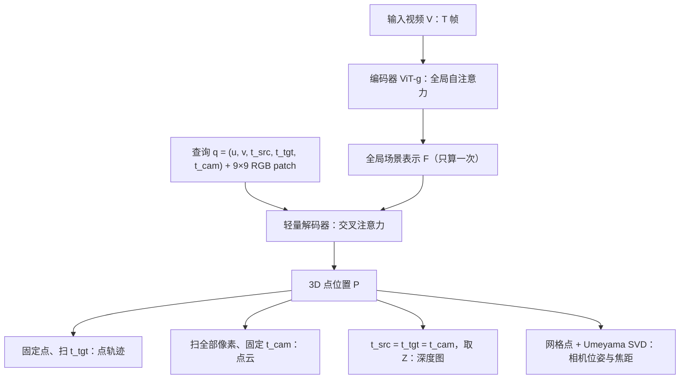

## TL;DR

传统 3D 重建的思路是“把所有东西一次性全算出来”：深度一个头、位姿一个头、点云一个头，动态部分再另起一套追踪。CVPR 2026 最佳论文 D4RT 把这个问题整个换了个问法：视频只编码一次，得到一份全局场景表示；之后你想知道什么，就向它提一个查询——“源帧里这个点，在目标时刻、相对于这台相机，3D 位置在哪？”一个 5 元组查询、一个轻量解码器，就能问出点轨迹、点云、深度图和相机内外参。结果是精度和速度同时赢：位姿估计 200+ FPS，比 VGGT 快 9 倍、比 MegaSaM 快 100 倍，动态场景的 3D 追踪、点云和深度也全部刷新纪录。这篇的真正贡献不是某个单项指标，而是一次接口层面的统一：4D 感知的竞争，正在从“堆解码头”转向“统一查询、按需解码”。

## 论文信息卡

- **标题**：Efficiently Reconstructing Dynamic Scenes One D4RT at a Time
- **作者**：Chuhan Zhang、Guillaume Le Moing、Skanda Koppula、Ignacio Rocco、Liliane Momeni、Junyu Xie、Shuyang Sun、Rahul Sukthankar、Joëlle K. Barral、Raia Hadsell、Zoubin Ghahramani、Andrew Zisserman、Junlin Zhang、Mehdi S. M. Sajjadi
- **单位**：Google DeepMind、伦敦大学学院（UCL）、牛津大学
- **会议**：CVPR 2026 最佳论文（Best Paper），16,092 篇投稿中脱颖而出，接收 4,089 篇
- **原文链接**：https://arxiv.org/abs/2512.08924

## 背景：动态世界难倒了“全算出来”的老路

给一段视频，恢复出场景的几何和运动——这就是 4D 重建。它听起来像 3D 重建加了个时间维，实际却难得多：相机在动、物体也在动，同一片像素在不同帧里可能属于不同物体，还会被遮挡。经典路线是 SfM/MVS，以 COLMAP 为代表：增量式估计稀疏几何和相机位姿，几何一致性强、可解释，但计算重、对动态和弱纹理脆弱，一段路人走过的视频就能让它吃力。

前馈（feedforward）模型改变了游戏规则。DUSt3R 证明 Transformer 可以直接从无位姿图像对端到端恢复几何；VGGT（CVPR 2025 最佳论文）把它扩展到多帧，用全局注意力统一处理。但这条线走到动态视频时卡住了：VGGT、MegaSaM、$\pi^3$ 这类方法要么给每个任务配一个专用解码头，要么拼多个现成模型再加测试时优化，而且普遍给不出动态区域的对应关系——天鹅游过去，点云里就会留下天鹅的重影。SpatialTrackerV2 虽然能做动态追踪，却是多阶段迭代精修，速度慢，而且只能从某一帧出发追踪，被第一帧遮挡的区域就永远留空洞。换句话说，前人的瓶颈不在单个任务的精度，而在架构本身：任务一多，解码头就多；动态一来，对应关系就断。D4RT 要解决的正是这个结构问题。

## 方法拆解：先编码一次，然后随便问

### 第一步：把整段视频压成一份“全局场景表示”

D4RT 是编码器-解码器结构。编码器是一个 ViT-g（40 层，帧内局部注意力与全局自注意力交错），输入 48 帧、$256\times256$ 的视频片段，时空 patch 尺寸 $2\times16\times16$，输出一份 latent 表示 $F$，论文称之为 Global Scene Representation。关键在分工：编码器只跑一次，又大又贵（约 10 亿参数）；它负责把“谁在动、相机怎么走、帧与帧之间谁对应谁”全部消化进 $F$。此后无论问多少问题，$F$ 不再变化。这一步的代价被所有查询摊薄，是整个方法“快”的第一来源。

### 第二步：一个查询就是一个 5 元组

解码器非常轻：8 层交叉注意力 Transformer，约 1.44 亿参数。它的输入是一个查询 $\mathbf{q}=(u, v, t_{src}, t_{tgt}, t_{cam})$：$(u, v)$ 是源帧里一个点的归一化 2D 坐标，$t_{src}$ 是它所在的源时刻，$t_{tgt}$ 是你想知道它在哪个目标时刻的位置，$t_{cam}$ 是你希望用哪一帧的相机坐标系来表达这个位置。输出只有一个 3D 点 $\mathbf{P}=\mathcal{D}(\mathbf{q}, F)$。

这里有三处精妙。第一，三个时间下标可以互不相同，空间和时间彻底解耦：你可以在任意时刻“看”任意时刻的点。第二，每个查询独立解码，互不干扰——论文特意指出，早期实验给查询之间加自注意力反而导致性能大跌，独立性不是偷懒，而是刻意的设计。第三，查询里除了坐标和时刻编码，还拼了一个源点周围 $9\times9$ 像素的 RGB 小 patch。别小看这块“局部长相”：消融实验显示，去掉它，Sintel 深度误差 AbsRel 从 0.302 恶化到 0.366，相机平移误差 ATE 从 0.091 恶化到 0.173。全局表示负责“大概在哪”，局部 patch 负责“精确贴合哪条边”。

### 第三步：换查询参数，同一接口吐出全部任务

这套接口的统一方式非常干净。固定一个点、让 $t_{tgt}$ 扫过全部时刻，得到的就是这条点的 3D 轨迹；让 $(u, v)$ 扫过全部像素、固定 $t_{cam}$，得到的就是统一坐标系下的点云——不再需要先估计相机、再把各帧点云拼起来，拼的过程中引入噪声；令 $t_{src}=t_{tgt}=t_{cam}$、只取输出的 Z 分量，就是深度图。相机参数也不需要单独的位姿头：在两帧的网格点上各做一组查询，得到同一批 3D 点在两个坐标系下的表达，用 Umeyama 算法解一个 $3\times3$ SVD 就得到刚体变换；再用针孔模型公式、取中值，就得到焦距。过去需要四个模型、四套训练目标的东西，现在变成了一组查询参数的排列组合。

### 第四步：全像素密集追踪，靠“占位网格”省掉 90% 的活

如果要给视频里每个像素都建一条轨迹，朴素做法需要 $O(T^2HW)$ 次查询，绝大多数是浪费：一个像素一旦被某条轨迹“走过”，就不需要再为它新建轨迹。D4RT 的算法维护一张 $T\times H\times W$ 的占位网格 $G$，只从未访问的像素发起新轨迹，每条完整轨迹走过的所有可见像素都被标记为已访问。实测下来，这一招带来 5–15 倍加速，具体倍数取决于画面运动的复杂程度。能这么玩，恰恰因为解码器又轻又独立：换成每查询都很重的模型，这个算法根本转不动。

### 训练：一个主损失加四个辅助信号

训练端同样克制。主损失是 3D 点位置的 $L_1$，但先把预测点集和真值点集各自按平均深度归一化，再过 $\text{sign}(x)\cdot\log(1+|x|)$ 变换，压住远处点对损失的支配。辅助损失有四项：图像空间 2D 坐标的 $L_1$、表面法线的余弦相似度、目标点可见性的二元交叉熵、点运动向量的 $L_1$，外加一项置信度惩罚 $-\log(c)$，让模型学会对自己的预测打分。消融显示，每项都有自己的分工：2D 位置和法线主要帮深度，置信度对位姿最关键——去掉置信度，Sintel 的 ATE 从 0.091 恶化到 0.217 量级（论文表 8 报告的增量为 +0.126）。训练规模本身也不小：48 帧片段、每步解码 2048 个随机查询、50 万步、64 块 TPU、两天多训完。

## 实验与数据：精度榜和速度榜一起刷

先看最能体现“动态”含金量的 TAPVid-3D 3D 追踪。在不给真值内参的情况下，D4RT 在 DriveTrack 子集上的 Average Jaccard（AJ）为 0.257，而 CoTracker3 + VGGT 的组合只有 0.129，SpatialTrackerV2 只有 0.064；给了真值内参后，D4RT 进一步升到 0.304。也就是说，即便不告诉它相机参数，它也比“追踪模型 + 最强重建模型”的拼接方案好出一倍。

点云和深度同样是全线领先。Sintel 点云的平均 $L_1$ 误差，D4RT 为 0.768，$\pi^3$ 为 1.139，SpatialTrackerV2 为 1.375；ScanNet 上 D4RT 为 0.028，对手最好为 0.030。视频深度在最难的 Sintel 上，scale-only 对齐下的 AbsRel 为 0.171，SpatialTrackerV2 为 0.209，VGGT 为 0.318——动态越强，差距越大，这正是论文要证明的点。相机位姿上，Sintel 的 ATE 为 0.065，优于 MegaSaM 的 0.074 和 VGGT 的 0.168；Re10K 的位姿 AUC@30° 达到 83.5，$\pi^3$ 为 78.7，SpatialTrackerV2 为 75.7。

速度是另一条战线。位姿估计达到 200+ FPS，比 VGGT 快 9 倍、比 MegaSaM 快 100 倍——注意这个对比还是在给基线去掉无关解码头、帮它们提速之后测的。3D 追踪吞吐量表更直观：在 60 FPS 的目标下，D4RT 一秒能产出 550 条完整视频轨迹，SpatialTrackerV2 只有 29 条，DELTA 为 0 条；放宽到 1 FPS，D4RT 是 40,180 条，对手是 2,290 条和 5,770 条。论文总结为 18–300 倍的速度优势。定性对比也印证了数字：MegaSaM 的点云里天鹅出现重影，$\pi^3$ 甚至直接丢了那朵花，SpatialTrackerV2 在天鹅和火车身后留下空洞，只有 D4RT 给出了包含全部像素的完整 4D 表达。

编码器规模的消融则给出了清晰的 scaling 曲线：从 ViT-B（0.9 亿参数）换到 ViT-g（10 亿参数），消融设置下的 Sintel 深度 AbsRel 从 0.319 一路降到 0.191。这说明“查询接口”本身不吃规模红利假象，骨干越大、表示越好，查询结果就越准——接口统一和规模扩展这两件事，在这里是相乘而非相斥的。

## 相关工作对比：它到底新在哪

与 COLMAP 一代相比，D4RT 放弃了显式几何优化，换来前馈速度和对动态的天然支持；与 DUSt3R 相比，它把“图像对”推广到了“视频 + 时间查询”；与 VGGT 相比，它砍掉了按任务分的多个解码头，代价是解码器必须足够通用——而实验证明一个 8 层交叉注意力解码器够用了；与 MegaSaM 相比，它不需要拼模型、不需要测试时优化；与 SpatialTrackerV2 相比，它不需要迭代精修、不局限于单帧出发。每一项对比单独看都不算颠覆，合起来却是一个判断：4D 感知的复杂度不应该长在模型结构里，而应该长在查询接口里。CVPR 2026 把最佳论文给它，评审认可的正是这个转向，而不是某张榜单上的零点几个百分点。

## 局限与开放问题

- 论文没有单独的 Limitations 小节；以下边界来自正文可核查的信息与合理追问，个别点论文未披露。
- 训练混合数据包含内部数据集，具体构成与配比论文未披露，第三方完整复现存在门槛。
- 训练用的是 48 帧、$256\times256$ 的短片段，长视频与高分辨率输入下的表现论文未专门验证。
- 查询之间彼此独立，跨查询的全局一致性只靠共享的 $F$ 兜底，没有显式的全局一致性约束。
- 前馈一次出结果，没有测试时优化兜底；遇到分布外场景时，泛化能力就是全部防线。
- 动态对应依赖可见性预测，严重遮挡、快速非刚性运动下的轨迹断裂仍是开放问题。

## 一点思考

做视频理解、具身智能或自动驾驶的团队，不必先照搬这个 10 亿参数的模型，而应该先借走它的接口思想：把深度、位姿、追踪收敛成同一种输出，管线会立刻变薄。评估时别只看静态室内基准，动态场景里“天鹅重影”式的失败才是区分真假 4D 能力的分水岭。我的判断是：D4RT 拿最佳论文，标志着 4D 感知的竞争焦点已经从“谁的解码头更多”转向“谁的查询接口更干净”，而按需解码、只算你问的部分，将是下一代视频感知模型的默认形态。

## 原文链接

- 论文：https://arxiv.org/abs/2512.08924
- 项目页：https://d4rt-paper.github.io/
- CVPR 2026 最佳论文报道：https://www.newswise.com/articles/cvpr-2026-honors-the-year-s-most-innovative-computer-vision-and-ai-research
