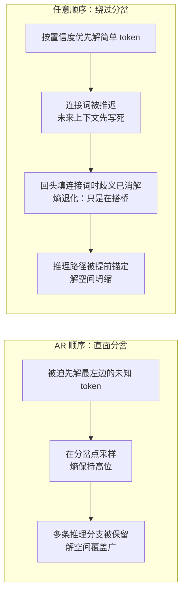

## TL;DR

扩散大语言模型（dLLM）最吸引人的卖点之一是"生成顺序随意"：不像传统模型必须从左写到右，它可以先写有把握的部分、再回头填难的。直觉上，这种自由意味着更大的解空间，推理应该更强。但 ICML 2026 杰出论文《The Flexibility Trap》用扎实的实验证明：**在数学和代码这类通用推理任务上，这种自由反而是陷阱**。模型会系统性地绕开"逻辑分岔点"——"因此""所以"这类高不确定性的连接词，先把简单的部分写死；等回头填连接词时，推理路径早已被未来上下文锚定，模型只是在"回顾性地搭桥"而非做开放式决策。作者称之为**熵退化（entropy degradation）**。

更狠的是下半场：既然任意顺序没用、甚至有害，强化学习就再也不用为保留它付出"灵活性税"。论文提出的 **JustGRPO** 把扩散模型在训练时直接当成自回归模型、用最朴素的标准 GRPO 训练，不做任何扩散特化的改造，结果在 GSM8K 上冲到 **89.1%**，超过一众为扩散量身定制的复杂 RL 方法——而推理时，并行解码能力完好无损。

## 论文信息卡

- **标题**：The Flexibility Trap: Why Arbitrary Order Limits Reasoning Potential in Diffusion Language Models（灵活性陷阱：为什么任意顺序限制了扩散语言模型的推理潜力）
- **作者**：Zanlin Ni, Shenzhi Wang, Yang Yue, Tianyu Yu, Weilin Zhao, Yeguo Hua, Tianyi Chen, Jun Song, Cheng Yu, Bo Zheng, Gao Huang（共 11 人）
- **单位**：清华大学 LeapLab / NLPLab / BNRist、阿里巴巴集团
- **会议**：ICML 2026，**Outstanding Paper Award（杰出论文奖）**
- **原文链接**：https://arxiv.org/abs/2601.15165
- **开源**：代码 https://github.com/LeapLabTHU/JustGRPO，GSM8K 微调模型已发布在 Hugging Face

## 背景：扩散语言模型为什么火，"顺序自由"为什么听起来很美？

过去两年，扩散语言模型（dLLM）成了挑战自回归（AR）范式的最热门路线。代表作 LLaDA、Dream，以及 DeepMind 的 Gemini Diffusion、字节的 Seed Diffusion，思路都一样：把文本生成看作一个**离散去噪过程**——从全是 `[MASK]` 的序列出发，模型反复预测被遮住的位置、逐步解开掩码，直到得到完整文本。训练目标是对掩码位置的加权交叉熵。

相比必须从左写到右的传统模型，dLLM 有两个理论优势。第一是**并行解码**：一次前向同时解开多个位置，推理更快。第二是**任意顺序生成**：解开掩码的顺序可以任意，先写有把握的词、把难的留到后面。理论上，不受约束的生成顺序构成的解空间是固定自回归轨迹的严格超集——自由度更大，潜力理应更强。早期在数独、斑马拼图这类约束满足任务上，非顺序生成也确实展现过优势。

于是整个社区形成了一个默认前提：**用强化学习激发 dLLM 的推理能力时，必须保留任意顺序的灵活性**。围绕这个前提，d1、ESPO、SPG、wd1、d-TreeRPO、GDPO、LLaDOU、TraceRL 等一众方法卷起了复杂度：处理组合爆炸的去噪轨迹、近似算不出来的边际似然。但这篇论文问了一个没人认真问过的问题：**这个前提本身，成立吗？**

## 方法拆解（一）：先证明"自由"有害——Pass@k 与熵退化

### 为什么用 Pass@k 度量"推理潜力"？

直接比较"RL 训完谁更强"太贵，论文用了一个更干净的代理指标：**Pass@k**——独立采样 k 次，至少一次答对的概率。逻辑是：当前主流的 RLVR 本质上是在"磨尖"基座模型的分布，它只能强化采样中出现过的正确路径，**变不出采样空间里不存在的路径**。所以基座模型的 Pass@k，就是 RL 之后能达到的推理上限的代理。

### 实验设计：3 个模型 × 4 个基准

作者在 LLaDA-Instruct、Dream-Instruct、LLaDA 1.5 三个主流 dLLM 上，对比两种解码模式：**任意顺序**（标准的基于置信度的自适应解码，block 大小 32）和 **AR 顺序**（强制最左优先、纯从左到右）。评测覆盖 GSM8K、MATH-500、HumanEval、MBPP 四个数学与代码基准，生成长度 256、256 步解码、温度 0.6。

结果非常反直觉：**任意顺序在 k=1（单次采样）时往往有竞争力，但 Pass@k 曲线明显更平**——k 增大时，AR 顺序能发现的正确解多得多。换句话说，任意顺序"一次答对"的本事不差，但"多试几次总能蒙对"的潜力差了一大截，而后者恰恰是 RL 最需要的东西。

- 在 HumanEval 上，**21.3% 的问题只能被 AR 顺序解出，反过来只有 0.6%**——任意顺序能解的，几乎是 AR 解集的子集。
- 把 block 大小 B 从 1（纯 AR）往大扫，**Pass@k 随 B 单调下降**：给模型的"选词自由"越大，推理潜力越低。这不是两个极端设置的巧合，而是一条单调的规律。

### 机制：熵退化（entropy degradation）

为什么会这样？关键在推理的**非均匀性**：一段推理链里，真正决定走向的是稀疏的"分岔 token"——通常是"因此""所以""因为"这类逻辑连接词。在这些分岔点，熵天然很高：选不同的连接词，整条推理就走向不同的分支。

AR 顺序逼模型**直面**不确定性：在分岔点必须采样，多样性被保留。而任意顺序的自适应解码按置信度选词，天然**绕过**难词：先把有把握的未来部分写出来，等回头填"因此"时，上下文已经把答案锚定了——模型不再是在岔路口做开放式抉择，而是在给既定结论"回顾性地搭桥"。作者统计了被绕过的 token：清一色是 Therefore、Thus、Since 这类连接词；附录里把 25 个常见连接词全测了一遍，现象稳定。全局平均熵两者差不多，但**分岔点的熵在任意顺序下显著塌陷**——这就是"熵退化"。

论文还排除了"换个采样器就行"的侥幸：试了 Neg-Entropy、Margin 等更聪明的采样算法，Pass@k 确实比默认置信度采样好，但**依然追不上 AR**；而且 Pass@k 越高的采样器，其逐题表现与 AR 的相关性越高（Neg-Entropy 达到 0.970）——想变强，就得学得更像 AR。

## 方法拆解（二）：JustGRPO——既然自由有害，那就扔掉它

上半场的结论直接动摇了现有扩散 RL 方法的立足点。作者算了一笔"灵活性税"：为了保留任意顺序，现有方法被迫承受三重代价——

1. **token 级分解含糊**：dLLM 的生成状态依赖于随机的解掩码轨迹，不存在唯一的 $\pi(o_t \mid s_t)$，重要性比率 $\rho_t$ 都不好定义，信用分配是糊的；
2. **序列似然算不出来**：AR 模型似然可分解为连乘，dLLM 则要对全部去噪轨迹求边际，轨迹空间是 $O(N!)$ 量级，只能退而求其次用 ELBO 近似；
3. **采样器-学习器错位**：rollout 时为了高效探索用的是启发式的置信度采样 $\pi_\theta^{\text{conf}}$，优化目标却还是原始分布 $\pi_\theta$，两边对不上，梯度是偏的。

JustGRPO 的思路简单到让人拍大腿：**训练时直接放弃任意顺序，把 dLLM 当成一个自回归策略**。具体做法是构造一个代理 AR 策略 $\pi_\theta^{\text{AR}}$：要算第 $k$ 个 token 在历史 $o_{<k}$ 下的概率，就把序列拼成"过去已观测、未来全掩码"的 $\tilde{x}_k$，喂给扩散模型，只取第 $k$ 个位置的 logits 做 softmax。于是序列似然变成精确可算的连乘 $\pi_\theta^{\text{AR}}(o\mid q)=\prod_k \pi_\theta^{\text{AR}}(o_k\mid o_{<k},q)$，标准 GRPO 公式原样套用，一个字都不用改。

关键的设计澄清：AR 约束**只在 RL 训练时**充当"脚手架"，不碰模型架构（不加因果掩码），所以推理时 dLLM 的并行解码能力原样保留——**"训的时候要探索充分"和"推的时候要并行够快"被解耦了**，这是全文最漂亮的一次概念切割。

## 实验与数据：朴素打败复杂

训练配置：基座 LLaDA-8B-Instruct，全参数微调，不做任务相关的 SFT；数学任务用各数据集官方训练集，代码任务从 AceCoder-87K 筛出 21K 带可验证单元测试的困难样本；16×H100，125 步，batch 64，group 16，学习率 $5\times10^{-6}$，KL 系数 0。

为了公平，作者把 d1、ESPO、SPG 等代表性基线在**统一协议**下（全参数、每步解一 token、生成长度 256）全部复现了一遍，结果如下：

| 方法 | GSM8K | MATH-500 | HumanEval | MBPP |
|---|---|---|---|---|
| d1* | 83.8 | 39.2 | – | – |
| ESPO* | 84.7 | 40.3 | 42.1 | 44.6 |
| SPG* | 86.9 | 41.8 | – | – |
| **JustGRPO** | **89.1** | **45.1** | **49.4** | **52.4** |

（* 为统一协议复现；原论文引用数字因设置不一，作者也列了系统级对比表，结论一致。）

- **长度越长优势未减**：GSM8K 上 128/256/512 三档长度，JustGRPO 为 83.8 / 89.1 / 89.8，全面领先。
- **并行解码不仅保留，还更稳了**：用免训练的 EB-sampler 测试不同并行度，基座模型在激进并行下精度雪崩，JustGRPO 训出的模型则稳定得多——MBPP 上与基座的差距从 1 token/步时的 +10.6% 扩大到约 5 tokens/步时的 **+25.5%**。AR 脚手架磨尖的是底层分布，所以越激进的近似采样越显优势。
- **JustGRPO-Fast**：既然推理潜力藏在稀疏的高熵分岔 token 里，算重要性比率 $\rho$ 时只取熵最高的 25% 位置，省掉 75% 的前向计算，精度-时间曲线反而更好。
- **随机顺序也救不了**：附录里试了固定随机顺序的 JustGRPO-Random，GSM8K 只有 82.2%（AR 版 89.1%）；随机顺序的 Pass@1 在 HumanEval 上跌到 12.4%（AR 为 34.5%）——没有上下文乱猜词，输出直接结构崩坏。
- **通用能力没丢**：MMLU 65.8（基座 65.5）、HellaSwag 74.8（74.6）、ARC-C 87.5（88.5），基本持平，AR 脚手架没有把模型"训成"纯自回归模型。

## 相关工作对比：创新点到底在哪？

把 JustGRPO 放进版图里看，它的锋利之处在于**质疑前提，而不是在前提里卷**：

- **扩散特化 RL 一派**（d1、ESPO、SPG、wd1、d-TreeRPO、GDPO，以及用辅助模块的 LLaDOU、用收缩 MDP 对齐轨迹的 TraceRL）：默认"必须保留任意顺序"，于是把全部聪明才智花在驯服 $O(N!)$ 轨迹空间和不可算似然上。JustGRPO 证明这条路可能是缘木求鱼——约束本身才是瓶颈。
- **Du et al. (2025)**：从预训练的概率视角独立地挑战过任意顺序。两篇工作一个看预训练、一个看推理+RL，结论互相印证：灵活性是有代价的。
- **Ye et al. (2025a)、Kim et al. (2025)**：在数独、斑马拼图等约束任务上，非顺序生成确实占优。论文并不否认这一点——它划清了边界：**通用推理（数学、代码）**和**约束满足**是两回事，前者要的是分支探索，后者要的是全局协调。
- **后续回响 LogicDiff**（arXiv 2603.26771）：走了另一条路——不改权重，只在推理时按"逻辑角色"调度解掩码顺序（先前提、后连接词），GSM8K 从 22.0% 提到 60.7%。它还发现陷阱主要是 zero-shot 现象（8-shot 下改善消失）。训练时修（JustGRPO）还是推理时修（LogicDiff），成了开放的分叉路。

## 局限与开放问题

- **模型覆盖窄**：核心结论建立在 LLaDA 系 8B 模型上，更大参数量、其他架构（及闭源的 Gemini Diffusion / Seed Diffusion）上是否成立，论文未验证。
- **任务边界清晰但也局限**：数学和代码之外的任务——创意写作、长规划、需要全局协调的生成——任意顺序是否仍有价值，仍是未知数。
- **训练开销的结构性代价**：dLLM 没有因果前向的一次性并行优势，精确似然要求每个位置独立前向，per-iteration 开销大；JustGRPO-Fast 缓解了，但还没到"免费"的程度。
- **因果链条仍可加强**：熵退化主要是观测 + 干预实验的证据；随机顺序附录补了一块因果拼图，但"分岔点熵→RL 上限"的完整因果链条值得更直接的验证。
- **通用能力的快照式验证**：MMLU 等四个基准基本持平，但多轮对话、长上下文等能力的长期影响没有追踪。
- **开放方向**：训练时脚手架（JustGRPO）× 推理时调度（LogicDiff）× 双向修正三者能否组合？能否在训练中**自适应**地决定"哪些位置值得 AR、哪些可以并行"，而不是一刀切？

## 一点思考

这篇论文最让我佩服的不是 89.1% 这个数字，而是它示范了一种稀缺的研究品味：**当所有人都在为"保留灵活性"发明更复杂的数学时，它回头问了一句"这灵活性到底值不值"**。对做大模型工程的人来说，教训很实在：给模型的自由度不是越多越好，自由度会重塑探索的分布，绕开难点的"聪明"恰恰是推理的大敌。以及，一个判断：扩散 LM 的 RL 范式接下来很可能会整体向"AR 脚手架 + 并行推理"的解耦路线迁移——毕竟，谁会拒绝"训练更简单、推理还更快"的方案呢？

## 原文链接

- 论文：https://arxiv.org/abs/2601.15165
- 项目页：https://nzl-thu.github.io/the-flexibility-trap
- 代码：https://github.com/LeapLabTHU/JustGRPO
