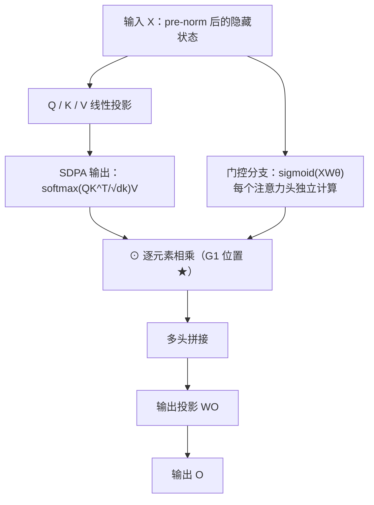

## TL;DR

主流大模型用的标准注意力里藏着一个结构缺陷：V 投影和输出投影是两个连续的线性层，可以合并成一个低秩映射，表达能力被卡住。阿里 Qwen 团队的这篇 NeurIPS 2025 最佳论文做了件"笨功夫"：在 15B MoE 和 1.7B dense 模型上、用 3.5 万亿 token 系统测试了 30 种给注意力加门的变体。结论干净得惊人：**在 SDPA 输出后加一个每个头独立的 sigmoid 门，效果最好**——MoE 模型困惑度降 0.26、MMLU 涨 2 分，超过参数多 4 倍的对照组；学习率翻倍也不发散；还顺手把 attention sink（首 token 吃掉 46.7% 的注意力）压到 4.8%，128k 长上下文的 RULER 从 31.65 翻到 58.82。机制上，门控的贡献被拆成两块：**非线性**（打破 V→O 的低秩线性）加**稀疏性**（query 相关的稀疏门分数过滤无关上下文）。代价是训练时间增加不到 2%。

## 论文信息卡

- **标题**：Gated Attention for Large Language Models: Non-linearity, Sparsity, and Attention-Sink-Free（门控注意力：非线性、稀疏性与无注意力汇聚）
- **作者**：邱子翰（Zihan Qiu）、Zekun Wang、Bo Zheng、Zeyu Huang、Kaiyue Wen、Songlin Yang、Rui Men、Le Yu、Fei Huang、Suozhi Huang、Dayiheng Liu、Jingren Zhou、Junyang Lin（共 13 人）
- **单位**：阿里 Qwen 团队主导，合作者来自 MIT、斯坦福大学、清华大学、爱丁堡大学
- **会议**：NeurIPS 2025，**Best Paper Award（最佳论文奖）**
- **原文链接**：https://arxiv.org/abs/2505.06708（2025 年 5 月提交）
- **开源**：论文称已开源代码与"首个无 attention sink 的模型"（含 dense 与 MoE 版本）

## 背景：注意力里有个被忽视的结构缺陷

门控是神经网络里的老朋友。从 LSTM、GRU、Highway Network，到今天大模型 FFN 里标配的 SwiGLU，再到 Mamba、RetNet 这类线性注意力架构，"用一个门控制信息流"几乎是哪里有效哪里就有它。但诡异的是：**在最标准、最常用的 softmax 注意力里，门控的作用从来没有被系统研究过**。Switch Heads、Native Sparse Attention（NSA）这些工作确实用了门，但它们的门和"选头路由""稀疏注意力"混在一起——性能涨了，功劳到底是门的还是路由的，分不清。这篇论文的起点就是把这笔糊涂账算清楚。

而标准注意力本身确实有个结构上的"暗伤"。把多头注意力的计算展开，第 k 个头、第 i 个 token 的输出可以写成：

$o^{k}_{i}=(\sum_{j}S^{k}_{ij}\cdot X_{j}W^{k}_{V})W^{k}_{O}=\sum_{j}S^{k}_{ij}\cdot X_{j}(W^{k}_{V}W^{k}_{O})$

注意最后一步：$W^{k}_{V}$ 和 $W^{k}_{O}$ 都是线性矩阵，可以直接合并成一个矩阵 $W^{k}_{V}W^{k}_{O}$。而注意力头的维度 $d_k$（通常 128）远小于模型维度 $d_{model}$（几千），这意味着**注意力输出本质上是一个低秩线性映射**——V 到 O 之间没有任何非线性。用了 GQA（grouped-query attention，KV 头共享）之后表达能力还要再打折扣。这就是论文要动刀的地方：在两个线性层之间塞一个非线性。

另一个背景是 attention sink：2023 年 Xiao 等人发现，大模型里首 token 会莫名其妙地吃掉大量注意力，后面有研究把它和"massive activations"（隐藏状态里的极端大值）联系起来。它被怀疑拖累长上下文泛化，但一直没有干净的消除手段。

## 方法拆解：30 种变体，一次讲透"门加在哪"

### 第一步：五个维度的设计空间

论文把"给注意力加门"拆成五个正交维度，排列组合出 30 个变体，逐一实测。门的形式统一为：

$Y' = Y \odot \sigma(XW_{\theta})$

其中 $Y$ 是被调制的对象，$X$ 取 pre-norm 后的隐藏状态来计算门分数，$\sigma$ 是激活函数，$\odot$ 是逐元素相乘。五个维度是：

1. **位置**：Q 投影后（G4）、K 投影后（G3）、V 投影后（G2）、**SDPA 输出后（G1）**、最终输出层后（G5）；
2. **粒度**：elementwise（每个维度独立门分数）vs headwise（整个头共用一个标量）；
3. **头之间**：head-specific（每个头独立的门）vs head-shared（所有头共享）；
4. **作用方式**：乘性（$Y \cdot \sigma$）vs 加性（$Y + \sigma$）；
5. **激活函数**：sigmoid vs SiLU。

这里有两个直觉值得先讲透。乘性优于加性，是因为门在这里是"过滤器"而不是"偏置"：乘性门可以把某个维度彻底关掉（乘以接近 0 的分数），加性门只能平移。head-specific 之所以重要，是因为不同注意力头本来就分工不同——让每个头独立决定"放行多少"，共享门分数会抹掉这种分工，实验里 head-shared 的 PPL（5.801）确实不如 headwise（5.792）。

### 第二步：为什么 G1 最好——非线性的解释

对照背景里的公式就能看懂：在 G1（SDPA 输出后）或 G2（V 投影后）加门，相当于在合并后的低秩映射 $W^{k}_{V}W^{k}_{O}$ 中间插入非线性——

$o^{k}_{i}=\text{Non-Linearity-Map}\left(\sum_{j}S^{k}_{ij}\cdot X_{j}W^{k}_{V}\right)W^{k}_{O}$

而加在 G5（$W_O$ 之后）则完全不碰这个低秩瓶颈，实验里也确实零提升（PPL 6.017 vs 基线 6.026，基本没动）。这是一个很漂亮的"理论预测实验结果"的例子：**门只有加在能打破低秩线性的位置才有效**。

还有一个更细的区分：G2（V 投影后）和 G1（SDPA 输出后）都能引入非线性，但位置不同——G2 是在注意力混合**之前**对每个历史 token 的 value 做非线性（只和 $X_j$ 有关），G1 是在混合**之后**对当前 query 的聚合结果做非线性（和 $X_i$ 有关）。实验里 G1（5.761）明显好于 G2（5.820），说明**和当前 query 相关的调制比和历史 key/value 相关的调制更重要**——门要回答的问题是"这个 query 现在需要什么"，而不是"过去的 token 各自有多重要"。

上图：最优方案就是在 SDPA 输出之后（G1）做乘性门控。门分数由当前 token 的隐藏状态算出，每个头独立，因此是 query 相关的、输入相关的。

### 第三步：稀疏性——门分数长什么样

光有非线性还不够。论文统计了门分数的分布，发现 SDPA 输出门的分数高度集中在 0 附近——平均门分数只有 **0.116**，也就是说门默认把 SDPA 输出的大部分维度"关掉"，只放行 query 真正需要的部分。而 V 位置门的平均分数是 0.221（稀疏性弱一些，效果也差一些）。更关键的是，门分数必须**随输入变化、且每个头独立**：把门改成输入无关的可学习参数（PPL 回落到 5.917），或把 sigmoid 换成限制在 [0.5, 1.0] 的"非稀疏版"NS-sigmoid（PPL 5.900 vs 5.761），收益都明显缩水。结论：**非线性决定"有没有提升"，稀疏性决定"提升有多大"**。

## 实验与数据：3.5T token 规模下的硬数字

实验设置是这篇论文拿最佳论文的重要原因：**30 个变体**，在 **15B MoE**（15A2B：128 个专家、top-8 路由、激活 2.54B 参数）和 **1.7B dense** 两种架构上，训练数据最多到 **3.5 万亿 token**（多语言、数学、通用知识），上下文 4096。消融阶段每个变体训 400B token，评测覆盖 Hellaswag、MMLU、GSM8k、HumanEval、C-eval、CMMLU 和多领域困惑度。

### 结果一：G1 位置断层领先，且不是"参数换来的"

MoE 模型的对照表（400B token）非常说明问题。基线平均 PPL 6.026、MMLU 58.79；SDPA elementwise 门（G1，多 201M 参数）做到 **PPL 5.761（降 0.265）、MMLU 60.82（涨 2.03）**，Hellaswag 73.07→74.64、GSM8k 52.92→55.27、C-eval 60.26→62.20。关键对照：同样加参数甚至加更多参数的基线——KV 头翻倍（+50M）PPL 5.979、query 头加到 48（+201M）PPL 5.953、专家数加 4 个（+400M）PPL 5.964——**全都不如加门**。更夸张的是 headwise 版本：只加 **160 万**参数，PPL 5.792、MMLU 60.05，依然大幅领先基线。位置对比：G2（V 后）PPL 5.820 次之；G3（K 后）6.016、G4（Q 后）5.981、G5（输出后）6.017，基本无效。乘性优于加性，sigmoid 优于 SiLU，head-specific 优于 head-shared——五个维度的结论全部一致。

### 结果二：dense 模型上，训练稳定性是意外之喜

1.7B dense 模型训满 3.5T token：PPL 6.180→**6.130**，HumanEval 34.15→**37.80**，GSM8k 69.07→70.20。更重要的是稳定性：把学习率从 4e-3 翻倍到 8e-3，基线直接训崩（PPL 9.195，甚至发散）；加了门的模型稳如泰山（PPL 7.325），batch 4096 + 学习率 8e-3 的极限配置下基线发散、门控版正常收敛到 7.078。训练 loss 曲线显示 loss spike 几乎消失。论文给出的解释是：门控把 massive activations 从 1053 压到 94，BF16 训练的数值误差自然小了。

### 结果三：非线性 vs 稀疏性，逐个拆开验证

"非线性加稀疏性"的结论不是拍脑袋的，论文做了一组精巧的"只动一个变量"对照。只加非线性、不加门：在 G1 位置直接套一个 RMSNorm（几乎不增加参数），PPL 从 6.026 降到 5.847——**证明光是非线性就有实打实的收益**；只套一个无参数的 SiLU，PPL 5.975，也有轻微提升。反过来，只保留非线性、拿掉稀疏性：把 sigmoid 换成值域 [0.5, 1.0] 的 NS-sigmoid（门关不死，稀疏性没了），PPL 回落到 5.900，明显不如完整版的 5.761。加性门去掉 SiLU（变成纯线性加法）则掉到 5.882。这一组数字把两个机制的贡献拆得干干净净：**非线性是地基，稀疏性是放大器**。

### 结果四：attention sink 被消灭

这是全文最直观的一张图。基线模型平均 **46.7%** 的注意力分数流向首 token（第 21 层某个头高达 83%）；加了门之后，这个数字变成 **4.8%**（该层降到 4%）。注意细节：只在 V 后加门（G2）能压住 massive activations，但**压不住** attention sink——说明 massive activations 不是 sink 的必要条件，之前把两者绑定的解释需要修正。

### 结果五：长上下文泛化翻倍

把模型继续训到 32k 上下文（RoPE base 从 10k 提到 1M，外加 80B token），再用 YaRN 免训练扩展到 128k，在 RULER 上评测：64k 处基线 37.51 vs 门控版 **66.60**，128k 处 31.65 vs **58.82**——接近翻倍。论文的假设是：基线模型依赖 attention sink 来"调节"注意力分布，RoPE 一改 sink 模式就水土不服；而门控模型靠输入相关的门分数控制信息流，对位置编码变化更鲁棒。

## 相关工作对比：功劳终于算清楚了

论文把相关工作分成三条线，定位很清晰。第一条是**门控机制史**：LSTM/GRU/Highway 用门控解决梯度问题，SwiGLU 把门控做进 FFN 成了 LLaMA、Qwen 的标配，Mamba、RetNet、Gated DeltaNet 把门控用在线性注意力里——但这些工作都没回答"门在标准 softmax 注意力里到底起什么作用"。第二条是**被混淆的功劳**：Switch Heads 和 NSA 都用了 sigmoid 门，但门和"选头路由""稀疏注意力"搅在一起；这篇论文补了一个关键对照——Switch Heads 退化到单专家（门只调制 value 输出）时，大部分提升还在，**证明门本身就有独立价值**。第三条是 **attention sink 文献**：Xiao 等人 2023 年正式命名该现象，Sun 等人把它和 massive activations 绑定，Gu 等人解释为"key bias"；已有的缓解手段（sigmoid 注意力、softmax 裁剪）都是小打小闹。这篇是第一个在 3.5T token 规模的 dense 和 MoE 模型上**彻底消除** attention sink 的工作，还顺手证明了它对长上下文扩展的价值。最接近的前人是 Forgetting Transformer（给 softmax 注意力输出加遗忘门）和 Quantizable Transformers（用门消除离群值做量化），但都没有做系统性的位置/粒度消融。

一句话总结创新点：**别人都在"用门"，这篇是第一次把"门为什么有效"拆干净——非线性加稀疏性，两个机制、各自的对照实验、各自的数字。**

## 局限与开放问题

- **理论缺口**：论文自己承认，没有严格的理论解释"消除 attention sink 为什么能提升长上下文泛化"，目前只是假设加实证。
- **非线性的深层影响**：门控引入的非线性对注意力动态和整个训练过程的更广泛影响，还没有被充分探索。
- **规模上限**：实验最大到 15B MoE / 1.7B dense，在 70B+  dense 大模型上是否同样有效，论文未披露。
- **参数代价**：elementwise 版本多 201M 参数（约 1.3%），虽然 headwise 版只要 1.6M，但最优配置仍是 elementwise。
- **只测了解码器 LM**：编码器模型（BERT/ViT 那类）上是否成立未知；也没有做 RLHF/后训练阶段的分析。
- **开放问题**：门控分数的稀疏模式能否直接用于 KV cache 剪枝？门控和 GQA、MLA 这类注意力变体组合会怎样？

## 一点思考

这篇论文最大的价值不是给出了一个新 trick，而是第一次把"门控为什么有效"这件事讲清楚了——非线性与稀疏性被干净地拆开，这意味着以后任何注意力架构的改进都应该先把门控单独拎出来做消融，免得把功劳记错地方。实操层面，headwise 门只加 160 万参数就能吃到大部分收益，性价比离谱，如果你在训自己的模型，加门几乎是零成本的默认选项。我的判断是：门控注意力会像当年的 SwiGLU 一样成为下一代开源大模型架构的标配，Qwen 下一代用上它我一点不意外。但也要冷静：消灭 attention sink 与长上下文变好之间的因果链，论文自己都承认缺理论证明，工程上可以先用，理论上别急着下结论。

## 原文链接

- 论文：https://arxiv.org/abs/2505.06708
- HTML 全文：https://ar5iv.labs.arxiv.org/html/2505.06708
- 代码与模型：论文称已在 GitHub / HuggingFace 开源（含首个 attention-sink-free 模型）
- NeurIPS 2025 获奖介绍：https://blog.neurips.cc/2025/11/26/announcing-the-neurips-2025-best-paper-awards/
