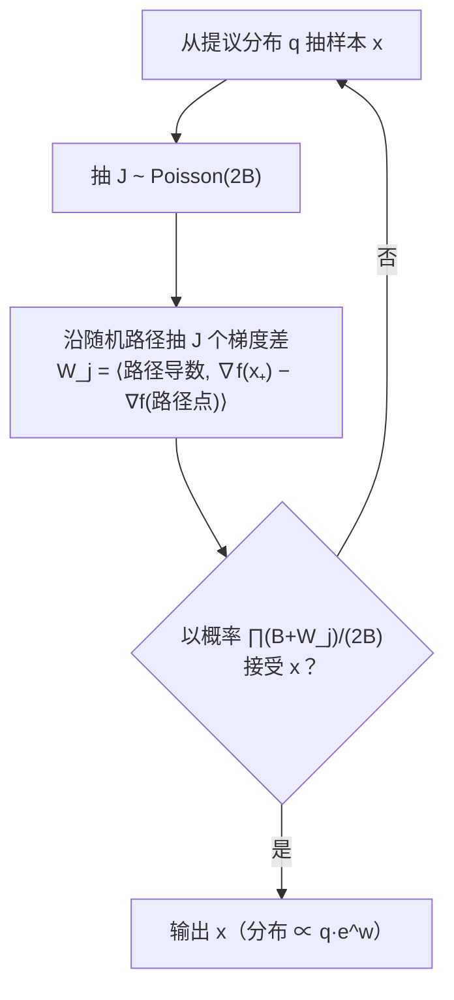

## TL;DR

扩散模型（Stable Diffusion、DALL·E 背后的那类模型）生成图片，本质上是在做一件事：**采样**。你训练好一个"打分网络"（score function），它告诉你每个点的"上坡方向"，然后算法沿着这些方向一步步把噪声变成图片。但一直有个让人不爽的理论事实：你想让采样精度提高 10 倍，步数可能要增加 100 倍——复杂度随精度是 $poly(1/\delta)$ 级别的。ICML 2026 的一篇杰出论文《High-accuracy sampling for diffusion models and log-concave distributions》（Fan Chen、Sinho Chewi、Constantinos Daskalakis、Alexander Rakhlin，MIT+Yale 组合）彻底改写了这条曲线：**他们提出"一阶拒绝采样"（First-Order Rejection Sampling，FORS），只用梯度查询、完全不求密度值，就把复杂度压到了 $polylog(1/\delta)$**——想提 10 倍精度，步数只增加一点点。**这是对所有前人工作的指数级改进**，而且顺手给出了第一个"只用梯度、达到高精度"的对数凹分布采样器。诚实的说明在前：这是一篇纯理论论文，没有任何数值实验，结论一节原话是"实现与实验评估留待未来工作"。

## 论文信息卡

- **标题**：High-accuracy sampling for diffusion models and log-concave distributions（面向扩散模型与对数凹分布的高精度采样）
- **作者**：Fan Chen（MIT）、Sinho Chewi（Yale）、Constantinos Daskalakis（MIT）、Alexander Rakhlin（MIT）
- **会议**：ICML 2026 **Outstanding Paper Award**（与清华的《The Flexibility Trap》同届共享该奖）
- **原文链接**：https://arxiv.org/abs/2602.01338（2026-02-01 初版，2026-04-27 修订）

## 背景

要理解这篇论文为什么重要，先把扩散模型采样的"祖传矛盾"讲清楚。

扩散模型的训练只学一件事：**score function**，即 $\nabla \log p_t(x)$——数据分布被噪声污染后， log 密度的梯度。注意，学的是梯度，不是密度本身。采样的时候，你用学到的 score 去模拟一个"反向扩散过程"，一步一步把纯噪声还原成图片。几乎所有理论工作（DDPM、DDIM、DPM-Solver 的理论分析）都是在离散化某个随机微分方程（SDE）。

问题就出在"离散化"这三个字上。只要你是把连续 SDE 切成离散步来走，**每一步都有离散化误差**，想把总误差压到 $\delta$，步数就得随 $1/\delta$ 多项式增长。2023 年 Chen 等人的奠基性工作证明 DDPM 在几乎无假设下能达到 $1/\delta^2$ 复杂度；后来被一路优化到 $1/\delta$（Li & Yan 2025、Jain & Zhang 2026）。但 2025 年 Jiao 等人证明了一个下界：**对 DDPM 本身，$\Omega(1/\delta)$ 是改不掉的**——想突破，必须换算法。

换算法的路也有人走过：高阶离散化方法能把复杂度做到 $d^{1+1/p}/\delta^{1/p}$（$p$ 是加速阶数），看起来"次多项式"了，但论文指出这其实是障眼法——常数项里藏着对 $p$ 的指数依赖 $e^{\Omega(p)}$，最优取 $p$ 之后实际是 $d\exp(O(\sqrt{\log(d/\delta)}))$，离真正的 $polylog(1/\delta)$ 还差得远。另一条路是用密度求值（Metropolis-Hastings 校正之类）做高精度采样，但这和扩散模型的实践根本不兼容：**你训练出来的只有 score 网络，没有密度**。

所以论文在引言里抛出的核心问题非常锋利：*只用 score 查询、在几乎不假设数据分布的前提下，扩散采样能不能达到"高精度"（polylog 级别复杂度）？*

## 方法拆解

答案是能，靠的是一个叫 FORS 的元算法。它的灵感链条有三环，一环扣一环，讲透了其实很漂亮。

### 第一环：拒绝采样缺的那块拼图

经典拒绝采样想从目标分布 $\nu$ 采样，需要一个提议分布 $q$ 和一个"倾斜函数" $w$，使得 $\nu(x) \propto q(x)e^{w(x)}$，然后以概率 $\propto e^{w(x)}$ 接受从 $q$ 抽出的样本。问题是：**接受概率需要算 $e^{w(x)}$，也就是需要 $w(x)$ 的值**——而我们只有梯度 $\nabla f$，没有函数值。

论文的第一个洞察来自一个 90 年代的概率论小工具："Bernoulli factory"（Keane & O'Brien 1994）。它的抽象任务是：给你一串独立同分布、取值在 $[-1,1]$ 的随机变量 $W_1, W_2, \dots$，它们的均值是 $\mathbb{E}W_1$，你能不能**不估计均值本身**，直接抛出一枚"正面概率为 $ce^{\mathbb{E}W_1}$"的硬币？答案是能，构造美得像魔术：

1. 抽 $J \sim \text{Poisson}(2)$（一个随机个数的 $W$）；
2. 抽 $W_1, \dots, W_J$；
3. 以概率 $\prod_{j=1}^J \frac{1+W_j}{2}$ 输出"接受"。

把指数函数做泰勒展开 $e^{\mathbb{E}W_1} = e^{-1}\sum_j \frac{(\mathbb{E}[1+W_1])^j}{j!}$，你会发现这个随机过程的接受概率**恰好**等于 $e^{-1+\mathbb{E}W_1}$。关键：全程只需要 $W_j$ 的样本，从没算过均值本身。

而 $W_j$ 从哪来？用微积分基本定理：$f(x) = \int_0^x f'(y)dy = \mathbb{E}_{y\sim\text{Unif}[0,x]}[x f'(y)]$。**函数值写成梯度的期望，梯度的无偏估计就有了**。拒绝采样 + Bernoulli factory + 微积分基本定理 = FORS：

定理 3.1 保证：输出分布**精确地**正比于 $q(x)e^{\mathbb{E}[W_1|x]}$，而且单轮用的 $W_j$ 个数以 $1-\delta$ 概率不超过 $3Be^{2B}\log(2/\delta)$——$B=\Theta(1)$ 是个常数，所以每轮代价基本是常数。

### 第二环：把扩散模型的"反向一步"装进 FORS

扩散采样的每一步，是从"反向转移核" $\rho_k(\cdot|x') = \mathbb{P}(X_k = \cdot \mid X_{k+1} = x')$ 里采样。论文的关键观察是：**这个反向核正好是个"高斯倾斜"分布** $\nu(x) \propto \exp(-f(x) - \|x-x_0\|^2/2\eta)$，而 FORS 天生就是为这类分布设计的。

具体装配：提议分布 $q$ 取成对 $f$ 做一阶泰勒展开得到的高斯近似 $q = \mathcal{N}(x_0 - \eta\nabla f(x_+), \eta I)$（均值就是"走一步梯度"的位置）；倾斜函数 $w(x) = \log \nu(x) - \log q(x)$ 恰好能写成**沿一条随机路径的梯度差积分**：

$$W_{r,z,x} = \langle \dot\gamma_{z,r}(x),\, \nabla f(x_+) - \nabla f(\gamma_{z,r}(x)) \rangle$$

其中 $\gamma$ 是论文精心设计的路径函数（用 $\sin$/$\cos$ 参数化，保证路径端点性质和方差控制）。只要步长满足 $\beta\sqrt{d}\,\eta \ll 1$，这个 $W$ 以高概率落在 $[-B, B]$ 里（$B$ 为常数），直接喂给 FORS 就行。注意这里用的**全是 score 查询**（$\nabla f$ 在扩散场景下就是学到的 score $s_k$），没有一次密度求值。

### 第三环：内在维度——复杂度为什么不依赖 $d$

最妙的一步是复杂度分析。朴素想，$d$ 维问题复杂度至少 $\Omega(d)$？论文引入**内在维度** $d_\star$（Li & Yan 2024 的定义）：数据分布支撑集的覆盖数决定的有效维度，恒有 $d_\star \le d$。直观例子：数据躺在 $k$ 维流形上（$k \ll d$，比如自然图像），则 $d_\star = \tilde O(k)$。最终主定理（定理 4.3 / 推论 4.4）：

$$\boxed{\text{复杂度} = d_\star \cdot \log^3\!\left(\frac{d + M_2^2}{\delta^2}\right),\quad D_{BL}(p_{data}, \hat p_1)^2 \lesssim \delta^2 + \text{score 误差项}}$$

假设弱到离谱：**只需要数据分布有有限二阶矩**，score 误差只需要 $L^2$ 意义下 $\tilde O(\delta)$ 精确——这正是标准 score matching 训练实际能给出的保证形式。

更进一步，在"非均匀 Lipschitz"条件（score 的 Jacobian 以高概率有界，Frobenius 范数版本）下，定理 4.9 把复杂度压到 $\boxed{L_{F,\delta} \cdot \log^3(\cdot)}$——**几乎与维度无关**。而这个条件本身"白送"：论文证明它恒成立且 $L \lesssim \tilde O(d_\star)$（推论 E.4），所以这是对主结果的严格加强。

## 理论保证与数字

先说清楚：**这篇论文没有任何数值实验**，"实验与数据"这一节只能老老实实摆定理数字。下表是论文自己给出的复杂度对比（统一在"最小数据假设 + $L^2$ score 误差"设定下，达到 $\delta$ 误差所需的 score 查询次数）：

| 方法 | 复杂度 | 出处 |
|---|---|---|
| DDPM（原始） | $\tilde O(d/\delta^2)$ | Chen et al. 2023 / Benton et al. 2024 |
| DDPM（近期最优） | $\tilde O(d/\delta)$，且 $\Omega(1/\delta)$ 不可改进 | Li & Yan 2025；Jiao et al. 2025（下界） |
| 高阶离散化 | $d\exp(O(\sqrt{\log(d/\delta)}))$（隐含对阶数的指数依赖） | Huang et al. 2025a/b |
| **FORS（本文）** | $\tilde O(d_\star \cdot polylog(1/\delta))$ | 定理 4.3 |
| **FORS + 非均匀 Lipschitz** | $\tilde O(L \cdot polylog(1/\delta))$，几乎无维度 | 定理 4.9 |

几个关键数字值得划线：

- **指数级改进**：从 $1/\delta$ 到 $\log^3(1/\delta)$。$\delta = 10^{-6}$ 时，前人需要百万量级步数，FORS 理论上只需要 $d_\star$ 乘以约 $10^3$ 量级——注意这是渐近意义下的对比，实际常数论文没有优化。
- **近似因子 $C_{apx} = O(1)$**：总误差 = 算法误差 $\delta$ + $O(1)\times$ score 估计误差。很多前人工作的近似因子随 early-stopping 时间多项式增长，对 score 误差极敏感；FORS 把 score 误差的影响压到了常数倍，这是它"实用亲和"的理论证据。
- **附赠成果**：把 FORS 套进 proximal sampler（Lee et al. 2021 的框架），得到**第一个只用梯度查询、达到 $polylog(1/\delta)$ 的对数凹分布采样器**（第 5 节）。此前所有高精度对数凹采样器都要么需要密度求值（rejection/Metropolis-Hastings），要么是 SDE 离散化而被离散化误差卡住。具体数字：在光滑 + log-Sobolev 假设下，$\chi^2$ 误差 $\varepsilon^2$ 只需 $\tilde O(\kappa(d^{1/2}\log^{3/2}(\mathcal{R}/\varepsilon^2) + \log^2(\mathcal{R}/\varepsilon^2)))$ 次梯度查询——恢复了 Fan et al. 2023 的最优结果，但**去掉了密度求值假设**。

## 相关工作对比

论文把相关工作分成了三类，界限划得很清楚。

第一类是**扩散采样的复杂度理论**本身（第 1 节综述的那一长串）：从 Chen 2023 的 $1/\delta^2$，到 Li & Cai 2024 的 $1/\delta^{1/2}$，再到近期的 $1/\delta$，以及高阶方法的次多项式尝试。FORS 跟它们不在一个量级上——它是第一个捅破 $poly(1/\delta)$ 天花板的，而且假设比谁都弱（有限二阶矩 vs 各种光滑性/支撑有界）。

第二类是**用"作弊手段"达到高精度的**：Huang et al. 2024 和 Wainwright 2025 允许查密度值（zeroth-order），分别做到 $\tilde O(d^2\log(1/\delta))$ 和 $\tilde O(\sqrt d \log^3(1/\delta))$；Huang et al. 2025c 要求改训练目标、学一个"量化 score"。论文的评价很直接：这些跟扩散模型的实践不兼容——你训练出的 score 网络给不出密度值，改训练目标则另起炉灶。FORS 是第一个"**只用标准 score 查询**"的高精度方案。

第三类是**同期撞车**的 Gatmiry et al. 2026（arXiv:2601.10708），也拿到了高精度保证，但代价是：要求数据分布是"高斯卷积"（$p_\star * \mathcal{N}(0,\sigma^2)$，$p_\star$ 支撑在半径 $R$ 球内）、score 误差要在次指数范数下有界、且分析只针对加速 ODE 流。FORS 的内在维度框架其实**包含了**他们的设定（$d_\star \le \alpha_0^2 R^2/\sigma_0^2$），只要求 $L^2$ score 误差，而且方法通用到能顺手解决对数凹采样。简单说：同期工作是"特解"，FORS 是"通解"。

## 局限与开放问题

- **零实验**：论文自己承认这是纯理论工作，实现与实验评估留待未来。FORS 每步要抽 Poisson 个数的路径点、做 Bernoulli 工厂接受/拒绝，实际常数和 wall-clock 表现完全未知——理论上 $B=\Theta(1)$ 很美，工程上 Poisson 抽样的尾部可能很丑。
- **度量较弱**：扩散部分的主保证是 bounded-Lipschitz 度量（$D_{BL}$）下的 $\delta^2$，比 TV/KL 弱；KL 保证只在 early-stopped 分布 $p_1$ 上成立，转到真实 $p_{data}$ 需要额外处理。
- **score 误差假设虽弱但紧**：要求 $\tilde O(\delta)$ 精确的 $L^2$ score 估计——精度目标越高，对训练出的 score 网络要求越苛刻，实践中这可能是真正的瓶颈。
- **路径函数是"手工设计"的**：$\sin$/$\cos$ 参数化的路径 (11)(14) 是为了证明服务的，能否学到或自适应出更好的路径，完全开放。
- **PDMP 的先例**：Lu & Wang 2022 的 zigzag 采样器已在强对数凹 + warm start 下做到 $polylog$，FORS 的新意在于去掉 warm start、覆盖扩散模型和一般对数凹——但"无 warm start 的高精度"在更一般的非对数凹设定下是否可能，仍是开放问题。

## 一点思考

这篇论文最打动我的不是 FORS 本身，而是它**重新定义了"扩散采样理论"的天花板**：过去三年整个领域默认"离散化误差"是不可逾越的，现在证明那只是"选错了算法家族"——拒绝采样这条 70 年代的老路，配上 Bernoulli 工厂，居然比所有现代 SDE 离散化都强。对做应用的人来说，别指望明天就把 FORS 装进 Stable Diffusion（没有实验、常数未知、每步开销大），但它给了一个定心丸：**score 网络的信息量在理论上是够用的**，采样器设计的天花板远比我们以为的高。搞理论的读者更值得细读第 3.2 节的路径积分构造——把"函数值"写成"梯度沿随机路径的期望"这一招，是可以迁移到其他"只有梯度、没有函数值"问题的通用技巧。

## 原文链接

- 论文：https://arxiv.org/abs/2602.01338
- ICML 2026 获奖页面：https://icml.cc/virtual/2026/awards（Outstanding Paper）
- 同期相关工作 Gatmiry et al.：https://arxiv.org/abs/2601.10708
