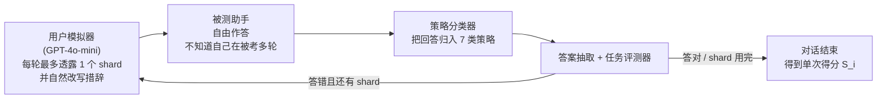

## TL;DR

大语言模型是"对话界面"，但几乎所有评测都只考"单轮问答"。ICLR 2026 杰出论文《LLMs Get Lost In Multi-Turn Conversation》做了个很刁钻的对照实验：**同一批任务、同一份信息，一次性给全 vs 拆成多轮"挤牙膏"式透露**，结果 15 个顶级大模型（GPT-4o、GPT-4.1、Claude 3.7 Sonnet、Gemini 2.5 Pro、o3、DeepSeek-R1、Llama 系……）在六个生成任务上的平均得分从约 90% 跌到约 65%，**平均相对降幅 39%**。更扎心的是分解结果：模型的能力（aptitude）只掉了 16%，但**不可靠性（unreliability）暴涨了 112%，直接翻倍还多**——同一条指令跑 10 次，最好和最坏能差出 50 个百分点。论文的结论简单粗暴：**模型不是变笨了，是变得极不可靠；一旦在对话里走错一步，它就迷路了，而且回不来。** 而降温（temperature=0）、Agent 式的信息复述这些常规手段，基本都救不了。

## 论文信息卡

- **标题**：LLMs Get Lost In Multi-Turn Conversation（大语言模型在多轮对话中迷路了）
- **作者**：Philippe Laban、Hiroaki Hayashi、Yingbo Zhou、Jennifer Neville（共 4 人）
- **单位**：微软研究院（Microsoft Research）、Salesforce 研究院（Salesforce Research）
- **会议**：ICLR 2026，**Outstanding Paper Award（杰出论文奖）**
- **原文链接**：https://arxiv.org/abs/2505.06120（2025 年 5 月发布于 arXiv）
- **开源**：仿真代码 https://github.com/Microsoft/lost_in_conversation ，数据集 https://huggingface.co/datasets/Microsoft/lost_in_conversation

## 背景：评测考的是"单轮"，用户用的却是"多轮"

今天的大模型产品（ChatGPT、Gemini、Claude）全是对话界面，真实用户很少能一次把需求说全——先丢一句模糊的需求，再慢慢补充细节，这是人类对话的常态，语言学里叫"最小努力原则"（principle of least effort），聊天日志研究也证实**欠指定（underspecification）在用户指令里极其普遍**。

但评测侧几乎完全活在另一个世界：主流 benchmark 全是单轮、完整指定的指令。倒是有一些"多轮评测"（MT-bench 及其后续），可论文指出它们本质上是** episodic（分段式）的**：每一轮都是一个可独立评分的子任务，轮与轮之间有关联但不需要真正"融合"多轮信息。这类评测高估了模型的多轮能力——它考的是"多轮上下文理解"，而不是"在信息不全时做决策、并在新信息到来时修正"。

于是出现了一个巨大的错位：**实验室里 90 分的模型，真实多轮对话里可能只有 60 分**，而用户把"AI 不好用"归因于模型笨，实际上可能是评测一直在考错的东西。这篇论文要做的，就是把这个错位量化出来。

## 方法拆解：把一条指令"切碎"，看模型还认不认识它

### 核心设计：Sharding（指令分片）

论文的方法论贡献叫 **sharded simulation（分片仿真）**，思路漂亮得像对照实验的教科书案例：

1. **Sharding 过程**：从 HumanEval、GSM8K 等高质量单轮 benchmark 里取一条完整指令，用半自动流程把它"切"成一组 shards（信息碎片）。Shard 1 永远是高层意图（"你要解决什么问题"），后面的每个 shard 只补充一个细节。所有 shards 合起来与原指令信息完全等价——论文在附录里用五个形式化属性定义了什么叫"合法的分片"。
2. **半自动 + 人工校验**：先用 GPT-4o 提议分片方案并自检，再由作者逐条人工审阅修改。每个任务准备 90–120 条分片指令，六个任务共 600 条，平均每百条要花约 3 小时人工。
3. **对照仿真**：同一条指令，用五种"信息披露节奏"各跑一遍——
   - **Full**：原指令一次性给全（单轮基线）；
   - **Concat**：把 shards 拼成 bullet list 一次性给全（验证基线：去掉"多轮"，但保留分片时的改写）；
   - **Sharded**：多轮，每轮最多透露一个 shard（主实验组）；
   - **Recap**：Sharded 跑完后加一轮"把所有 shard 复述一遍"，再给一次作答机会；
   - **Snowball**：每轮透露新 shard 的同时，把之前所有 shard 滚雪球式复述一遍。

Concat 这个设计很关键：如果模型在 Full 和 Concat 下都行、唯独 Sharded 不行，那就证明**掉分的原因正是"欠指定 + 多轮"本身**，而不是分片改写造成的信息损失。

### 仿真环境：三方角色 + 20 万次对话

三个设计细节值得注意：

- **被测模型是"蒙在鼓里"的**：它只收到最小化的系统指令（比如数据库 schema），不被告知这是一场多轮欠指定对话，也不被鼓励用特定策略——测的是模型的**默认行为**，这才有现实意义。
- **用户模拟器是智能的**：被测模型经常在早期追问某个细节，决定"下一轮透露哪个 shard"并不 trivial，所以用 GPT-4o-mini 扮演用户，根据对话状态选择最自然的 shard 并改写措辞。策略分类、答案抽取也用 GPT-4o-mini。
- **仿真误差可控**：作者人工抽查了数百段对话，模拟器/分类器/抽取器的错误率不到 5%，其中对被测模型不利的不到 2%。

### 指标：把"能力"和"可靠性"拆开

这是全文最锋利的一把刀。同一条指令跑 $N=10$ 次，得到 10 个分数 $S_i$，论文定义了三个指标：

- **平均性能** $\overline{P}=\sum S_i / N$：常规意义上的"考了多少分"；
- **能力（Aptitude）** $A^{90}=\mathrm{percentile}_{90}(S)$：10 次里的第 90 百分位，即"运气最好时能考多少"——代表模型的真实上限；
- **不可靠性（Unreliability）** $U_{10}^{90}=\mathrm{percentile}_{90}(S)-\mathrm{percentile}_{10}(S)$：最好与最坏的差距——**同样的指令、同样的模型，发挥能波动多大**。

附录里有个直观的例子：平均分从 90% 掉到 60%，可能是能力掉了，可能是可靠性崩了，也可能是两者兼有。只看平均分，你永远分不清是哪一种。

### 实验规模

六个生成任务（代码 HumanEval+LiveCodeBench、数据库 Spider 文本转 SQL、API 调用 BFCL、数学 GSM8K、数据转文本 ToTTo、~20 篇文档的多文档摘要），15 个模型（GPT-4o-mini、GPT-4o、o3、GPT-4.1、Claude 3 Haiku、Claude 3.7 Sonnet、Gemini 2.5 Flash/Pro、Llama 3.1-8B、Llama 3.3-70B、Llama 4 Scout、OLMo-2-13B、Phi-4、DeepSeek-R1、Cohere Command-A——特意纳入了 o3 和 R1 两个推理模型），默认温度 $T=1.0$，**总计 20 万+ 次模拟对话**，实验成本约 5000 美元。

## 实验与数据：所有模型，无一幸免

### 主结果：-39%，且与模型强弱无关

Full vs Sharded 的对照结果是毁灭性的：**15 个模型 × 6 个任务，全部下降，平均相对降幅 39%**（绝对分数从约 90% 跌到约 65%，掉了 25 个百分点）。Concat 平均能达到 Full 的 95.1%，证明分片改写不是主因。

| 模型 | Sharded 相对 Full 的保留率 | 相对降幅 |
|---|---|---|
| GPT-4o | 57.9% | 42.1% |
| GPT-4.1 | 61.8% | 38.2% |
| Claude 3.7 Sonnet | 65.9% | 34.1% |
| Gemini 2.5 Pro | 64.5% | 35.5% |
| DeepSeek-R1 | 60.8% | 39.2% |
| o3 | 64.1% | 35.9% |
| Llama 3.3-70B | 64.2% | 35.8% |
| Llama 3.1-8B | 62.5% | 37.5% |

最反直觉的一行结论：**越强的模型掉得一样惨**。Claude 3.7 Sonnet、Gemini 2.5 Pro、GPT-4.1 的降幅（34–38%）和 Llama 3.1-8B、Phi-4 处在同一量级——单轮 90 分+ 的优等生，进了多轮考场一样迷路。论文解释这部分是分母效应（弱模型起点低、下降空间小），但结论不变：**没有一个模型通过了多轮测试**。

两个细分发现：

- **任务不均匀**：Command-A 在 API 调用任务上掉得最少，Claude 3.7 Sonnet 和 GPT-4.1 在代码任务上保得较好，Gemini 2.5 Pro 在数据转文本上最稳——多轮能力不是均匀的，分领域评测有必要。
- **推理模型也救不了**：o3 和 DeepSeek-R1 的降幅（36–39%）和非推理模型无异。分析发现推理模型的回答平均长 33%，而更长的回答里塞了更多**未经证实的假设**，反而更容易把对话带偏——思考得越多，错得越有创意。

### 分解：能力只掉了 16%，不可靠性翻了一倍多

这是全文的高光时刻。单轮设定下，能力越强的模型越可靠（GPT-4.1、Gemini 2.5 Pro 的不可靠性最低）——这是社区熟知的规律。但在 Sharded 设定下：

- **能力（A）平均只下降 16%**，统计上不显著——模型的"上限"基本还在；
- **不可靠性（U）平均暴涨 112%，翻倍还多**——同一条指令跑 10 次，最好和最坏平均能差出 **50 个百分点**；
- 而且**所有模型的不可靠性都拉到了同一高位**，与能力无关。

翻译成人话：模型不是不会做题，而是**时灵时不灵**——这次蒙对了，下次同样的对话可能全盘崩掉。平均分暴跌的罪魁祸首不是"变笨"，是"方差爆炸"。

### 迷路只需要两轮

"逐渐分片"实验（31 条指令 × 2–8 个 shard 粒度，GPT-4o/4o-mini）发现：**只要信息被拆成 2 个 shard 以上，"迷路"现象就出现了**；shard 越多，可靠性越差。唯一能显著改善可靠性的方法是 1-shard——**一次性把信息给全**。对用户来说，信息的"披露粒度"几乎不影响结果：要么一次说完，要么就等着模型抽风。

### 四个"迷路"机制

论文在附录 F 里解剖了 20 万次对话，总结出四个根因：

1. **过早交卷**：信息还不全，模型就急着给出完整答案，过程中对欠指定的细节**自行脑补假设**，后面的对话全建立在错误假设上；
2. **抱着错答案不放**：过度依赖自己之前的错误尝试，回答越改越长、越描越黑（"答案膨胀"）；
3. **顾头不顾腚（loss-in-middle-turns）**：模型过度关注首轮和末轮的信息，中间轮次透露的需求最容易被"引用丢失"——多文档摘要任务里，模型最爱引用第一轮和最后一轮的文档；
4. **话痨**：回答过于冗长，冗长里夹带的假设会淹没用户真正的需求。

一句话总结论文原话的精神：**当大模型在对话里走错一步，它就迷路了，而且回不来**（when LLMs take a wrong turn, they get lost and do not recover）。

### 常规解法基本无效

- **Agent 式复述（Recap/Snowball）**：4o-mini 上 Sharded 50.4 → Recap 66.5 / Snowball 61.8；GPT-4o 上 59.1 → 76.6 / 65.3。Snowball 作为现实可用的方案，只能挽回 Full→Sharded 落差的 **15–20%**，远没回到 Full 水平。论文的判断是：**别指望靠 Agent 框架外包多轮能力，LLM 需要原生支持多轮**。
- **降温（T=0）**：单轮下把温度降到 0，不可靠性下降 50–80%；但在多轮下，4o-mini **毫无改善**，GPT-4o 也只改善 15–20%。即使问答双方温度全设为 0，不可靠性依然高达约 30%。多轮对话里，一个 token 的早期分歧就会级联放大，降温压不住这种结构性发散。
- **反例验证**：第七个任务"文档翻译"（每轮多给两句德语、要求翻译已给的全部句子）三个设定下 BLEU 几乎无差——因为翻译是 episodic 的，每轮可独立完成。这反过来划清了"会迷路"的任务画像：**生成式（非抽取/分类）、足够复杂、答案不可分解**——shard 一改变，整个答案都得重写的那种。

## 相关工作对比：创新点到底在哪？

- **vs MT-bench 一系的多轮评测**：那些工作把多轮对话做成了"子任务拼盘"，每轮可独立评分，天然避开了欠指定融合这个最难的部分。本文用同一批任务做单/多轮严格对照，证明 episodic 评测**系统性高估**了多轮能力——这不是补充，是纠偏。
- **vs 长上下文"Lost in the Middle"（Liu et al. 2023）**：那篇说的是模型在超长上下文里找不到中间位置的信息；这篇发现的是**对话轮次维度**的"顾头不顾腚"（loss-in-middle-turns）。一个是空间维度的遗忘，一个是时间维度的遗忘，互相呼应。
- **vs Agent 框架路线（AutoGen/LangChain）**："把多轮编排交给框架、LLM 只做单轮算子"的思路很流行，但本文的 Recap/Snowball 实验表明，框架层的复述只能挽回 15–20% 的损失——**多轮可靠性是模型内生能力，外包是绕不过去的**。
- **方法论创新**：sharding 把"信息量"和"披露节奏"解耦，让单轮和多轮第一次有了可比的对照组；A/U 分解则把"平均分掉了"这个粗糙结论拆成了"能力掉了多少"和"方差炸了多少"。后者可能是对评测方法论更长久的贡献——以后任何"模型变差了"的结论，都值得先问一句：是上限掉了，还是方差炸了？

## 局限与开放问题

- **全自动仿真 ≠ 真实人类对话**：用户模拟器保证每轮透露一个 shard、最后一轮信息一定齐全，真实用户可没这么守规矩。作者自己承认，实测的 39% 降幅**很可能是低估**，真实场景只会更惨。
- **任务与语言覆盖窄**：六个任务全是英文、分析型任务，创意写作、开放域闲聊等多轮重灾区不在范围内。
- **模拟器误差**：策略分类器、答案抽取器由 GPT-4o-mini 担任，人工抽查错误率 <5%（对被测不利的 <2%），但 20 万次对话的规模下，绝对误差数仍不可忽视。
- **只测了"默认行为"**：被测模型未被告知多轮策略。如果显式提示"先别急着答、信息不全就追问"，掉幅可能收窄——但这恰恰说明当前模型的默认行为与真实使用场景是错配的。
- **开放方向**：多轮可靠性的训练信号长什么样？RLHF 的单轮偏好数据是否在系统性奖励"过早交卷"？以及，论文向 builder 喊话的"可靠 LLM"三标准——单多轮能力一致、多轮不可靠性 $U<15$、在 $T=1.0$ 下达成——目前没有任何模型接近。

## 一点思考

这篇论文最有价值的不是 39% 这个数字，而是它把"用户觉得 AI 不好用"这件事第一次算清楚了账：**实验室 benchmark 的 90 分和用户手里的 60 分，差的不是模型，是评测范式**。对普通用户最实在的两条建议——"一次把需求说全"和"聊崩了就开新会话别硬续"——听起来像土办法，但这是 20 万次对话换来的。对做 Agent 和 Copilot 的人，判断更直接：别再把"多轮"当成 prompt 工程能糊弄过去的东西，在模型原生支持多轮可靠性之前，你的用户每多聊一轮，就是在抽一次 39% 的"迷路彩票"。

## 原文链接

- 论文：https://arxiv.org/abs/2505.06120
- HTML 全文：https://arxiv.org/html/2505.06120v1
- ICLR 杰出论文介绍：https://blog.iclr.cc/2026/04/23/announcing-the-iclr-2026-outstanding-papers/
- 代码：https://github.com/Microsoft/lost_in_conversation
- 数据集：https://huggingface.co/datasets/Microsoft/lost_in_conversation
