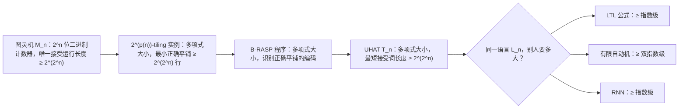

## TL;DR

按"能识别哪些语言"这个老标尺，有限精度的 Transformer 其实不如 RNN——RNN 能识别所有正则语言，Transformer 只能识别正则语言的真子集（子正则语言）。但这篇 ICLR 2026 杰出论文换了个标尺：**简洁性（succinctness）——描述同一个概念需要多大的模型**。结论很震撼：多项式大小的 Transformer，能"装下"那些需要**指数级大**的 LTL 公式、**指数级大**的 RNN、乃至**双指数级大**的有限自动机才能描述的语言，而且这个间隙是紧的、上下界完全匹配。代价也随之而来：问一个 Transformer"它接受的语言是不是空的"、"两个 Transformer 是否等价"，都被证明是 **EXPSPACE-complete**——在标准复杂度假设下，任何算法都需要双指数时间。**Transformer 的超能力不是"会得多"，而是"装得紧"；而"装得紧"的另一面，就是"查不动"。**

## 论文信息卡

- **标题**：Transformers are Inherently Succinct（Transformer 天生简洁）
- **作者**：Pascal Bergsträßer、Ryan Cotterell、Anthony W. Lin
- **单位**：RPTU Kaiserslautern-Landau（德国）、ETH Zürich（瑞士）、MPI-SWS
- **会议**：ICLR 2026 **Outstanding Paper（杰出论文）**——本届只评出 2 篇杰出论文 + 1 篇荣誉提名，另一篇杰出论文《LLMs Get Lost In Multi-Turn Conversation》本站 10 月 16 日已解读，荣誉提名是关于 Muon 优化器的《The Polar Express》
- **原文链接**：https://arxiv.org/abs/2510.19315（2025 年 10 月 23 日首发，v3 修订于 2026 年 5 月 15 日）

## 背景

过去几年，理论界用"表达力"这把尺子量了 Transformer 很多次，量出来的结果其实有点尴尬：在**固定精度**（finite precision，也就是真实硬件上有限位数的浮点数，而非数学上无限精度的实数）假设下，RNN 能识别**所有**正则语言，而 Transformer 只能识别正则语言的真子集——子正则语言（star-free 那一类）。按"谁会得多"排名，Transformer 输了。

但这就怪了：现实中明明是 Transformer 赢了。这篇论文的切入点是：也许我们拿错了尺子。表达力只问"能不能"，不问"要花多大代价"。逻辑和自动机理论里有个经典概念叫**简洁性**（succinctness）：描述同一个语言，不同形式体系需要的"体积"差多少。经典例子是 LTL（线性时序逻辑）：它和 star-free 语言表达力完全等价，但 Sistla 和 Clarke 在 1985 年就证明，LTL 可以比有限自动机**指数级更简洁**——多项式大小的 LTL 公式，翻译成自动机要指数爆炸。作为对等代价，LTL 的判定问题（PSPACE）比自动机的（P）难得多。**越简洁的形式体系，越难被分析**——这是贯穿全文的一条定律。

论文把这套经典剧本搬到了 Transformer 身上：RNN 表达力更强又如何？如果 Transformer 能把同样的概念"装"得指数级、甚至双指数级更紧，那它的实证优势就有了一个迟到但坚实的理论注脚。

## 方法拆解

### 第一步：选一个"诚实"的 Transformer 模型

论文研究的是 **UHAT（unique-hard attention transformer）**：每个位置的注意力不做 softmax 加权平均，而是只取分数最高的那**一个**位置（平局时按最左/最右打破），再叠几层 ReLU。这不是拍脑袋的简化——它是理论界研究 softmax 注意力的标准抽象（Yang et al. 2024 等），而且 Jerad et al. 2025 已经证明：UHAT 上的表达力结论可以传导到固定精度 softmax transformer 上。

关键的一点是精度假设：全部结果都在**固定精度**下成立——这正是最贴近真实硬件（float16/bfloat16 之类有限位数）的设定；而下界（"Transformer 能有多简洁"）甚至在"固定精度**整数**"这种更强的限制下都成立。也就是说，结论不是靠"无限精度实数"这种作弊手段撑起来的。

### 第二步：核心技巧——用注意力实现一个"双指数计数器"

这是全文的技术心脏。论文先用一个具体例子（N=4）展示想法：构造一个 B-RASP 程序（与 UHAT 表达力等价的"类汇编"中间语言），让它恰好接受形如下面这种单词：

$$0000a_1\#0001a_2\#0010a_3\#\cdots\#1111a_{16}\#$$

其中每段 4 位二进制数都比上一段**恰好加一**，且相邻符号 $a_i, a_{i+1}$ 满足一组给定的邻接约束 $H$。检查"加一"靠一个精巧的注意力操作实现：对每个 `#` 位置，用"严格未来掩码 + 最右平局打破"找到左边最近的一个 `#`，然后用 value 谓词验证"当前 4 位数 = 左边那个数 + 1"——本质就是二进制加法：找到最低的翻转位，低位 1→0、该位 0→1、高位保持不变。

4 位计数器只能数到 16，单词长度关于 $N$ 是单指数。但论文把 4 换成 $2^n$：用一台图灵机 $M_n$ 实现一个 **$2^n$ 位**的二进制计数器（先写 $2^n$ 个 0，再逐个加一到全 1；初始化用一个 $n$ 位辅助计数器，只需 $O(n)$ 个状态；递增本身是常数大小的状态机）。这台图灵机的**唯一接受运行长度至少是 $2^{2^n}$**——双指数出现了。

### 第三步：归约链——把"数得很大"变成"模型很小"

接下来是三级跳（van Emde Boas 1997 的经典归约 + 论文自己的构造）：

图灵机的运行被编码成"平铺"（tiling）问题的行，正确平铺对应合法运行；B-RASP 程序用注意力验证平铺的行列约束（行内相邻、列向对齐都靠"找上一个同计数器值的位置"实现）；最后这类特殊形状的 B-RASP 程序可以多项式时间翻译成等价的 UHAT。终点：**一个大小关于 $n$ 多项式的 UHAT，它接受的最短单词长度至少是 $2^{2^n}$**。

### 第四步：下界收网——别人为什么必须那么大

- **LTL**：任何 LTL 公式的最短接受单词长度至多是公式大小的指数（经由 Vardi & Wolper 1994 的 LTL→自动机指数转换）。既然 $L_n$ 的最短单词有双指数长，识别它的 LTL 公式至少得**指数大**（定理 15）。
- **有限自动机**：非空语言必有长度至多关于状态数线性的接受词，所以自动机至少得**双指数大**（定理 17）。
- **RNN**：固定精度 $k$、维度 $D$ 的 RNN 可表为 $2^{kD}$ 个状态的自动机（命题 1），于是 RNN 至少**指数大**（推论 18）；状态空间模型（SSM，如 Mamba）同理被覆盖。

### 第五步：上界——证明间隙是紧的，没有水分

只有下界还不够漂亮，论文还给了匹配的上界，把间隙"钉死"：

- **命题 13**：任何 UHAT 都可以在**指数时间**内翻译成等价的、指数大小的 LTL 公式。这直接把 Yang et al. 2024 的**双指数**翻译改进为单指数。关键观察（命题 12）：UHAT 计算中出现的所有有理数都只需要 $poly(|T|)$ 位精度——可枚举，于是 LTL 公式只需模拟"注意力选了哪个位置"，而不必模拟数值计算本身。
- **命题 16**：反过来，任何 LTL 公式都有**多项式时间**可构造的等价 UHAT（UHAT 对 LTL 是"多项式有界扩张"）。

两边一夹：Transformer 和 LTL 的差距，"普遍情况"下至多多项式，"见证族"上至少指数——**间隙被精确锁定，不多不少**。

### 第六步：验证复杂度——"装得紧"的代价

把 EXPSPACE 完全的 $2^N$-tiling 问题归约到"这个 UHAT 接受的语言是否非空"，得到 EXPSPACE-hard；再经由 UHAT→LTL 指数翻译 + "LTL 非空性 ∈ PSPACE"，得到 EXPSPACE 上界。于是：

- **定理 4**：UHAT 的语言非空性问题是 **EXPSPACE-complete**。
- **定理 19**：判定两个 UHAT 是否等价，同样 **EXPSPACE-complete**（对比：DFA 的等价性是 P，Kozen 1997）。
- 论文原话：在标准复杂度假设下，这意味着**任何算法都无法在少于双指数时间内**解决这个问题。

顺带一个精细结果（推论 14）：如果限制每层都用"严格未来掩码 + 最左打破"，非空性问题掉到 NEXP——恰好对应 LTL 的 P/F 片段（其非空性是 NP-complete，Sistla & Clarke 1985）。限制越强，验证越便宜，定律再次应验。

## 实验与数据

先说清楚：**这是纯理论论文，没有实验部分**——没有数据集、没有曲线、没有 ablation。它的"数据"就是定理本身。下面是核心结果对照表：

| 比较对象 | Transformer 的简洁性优势 | 下界依据 | 上界（反向代价） |
|---|---|---|---|
| LTL 公式 | **指数级**更简洁 | 定理 15：见证族需 $c_1 2^{c_2 n}$ 大小的公式 | 命题 13：任何 UHAT 有指数大小的等价 LTL 公式 |
| 有限自动机 | **双指数级**更简洁 | 定理 17：见证族需双指数状态数 | 指数翻译 × 经典 LTL→自动机指数转换 |
| RNN（固定精度） | **指数级**更简洁 | 推论 18（经由命题 1：RNN = $2^{kD}$ 状态自动机） | 同上 |
| 状态空间模型 SSM | **指数级**更简洁 | 摘要宣称，经由与 RNN 的关系覆盖 | 论文未单独展开 |

| 验证问题 | 复杂度 | 同类问题的复杂度对比 |
|---|---|---|
| UHAT 语言是否非空 | **EXPSPACE-complete**（定理 4） | LTL：PSPACE-complete；DFA：P |
| 两个 UHAT 是否等价 | **EXPSPACE-complete**（定理 19） | DFA 等价：P |
| 受限 UHAT 非空性 | ∈ **NEXP**（推论 14） | 对应 LTL 片段：NP-complete |

关键数字再强调一遍：大小为 $poly(n)$ 的 UHAT，可以迫使任何等价的 LTL 公式达到 $c_1 2^{c_2 n}$、任何等价的自动机达到双指数规模；而反方向，任何 UHAT 都有指数大小的等价 LTL 公式——**上下界匹配，间隙里没有水分**。

## 相关工作对比

论文的创新点，放在三条线上看最清楚。**第一条线是验证复杂度**：Sälzer et al. 2025 曾证明固定精度 transformer 的验证至少是 NEXP-hard，这只能推出"对自动机单指数简洁"，对 LTL、RNN 则无结论；而且他们的模型更复杂（soft + hard 注意力混合、任意固定精度位置编码）。本文用**更简单**的 unique-hard attention、且位置信息只用最朴素的位置掩码，反而得到了**更强**的结论：对 LTL/RNN 指数、对自动机双指数。**第二条线是翻译上界**：Yang et al. 2024 给出 UHAT→B-RASP→LTL 的双指数翻译，本文绕开中间语言，直接 UHAT→LTL 单指数翻译，一步把前人的界收紧了一个指数级。**第三条线是表达力传统**：Barceló et al. 2024、Jerad et al. 2025、Li & Cotterell 2025 等建立了 UHAT 与 LTL/star-free 语言的表达力连接，但那些工作回答的都是"能识别什么"，**没有一篇碰简洁性和验证复杂度**——这正是本文的处女地。另有一个对照值得记：Sälzer et al. 2026 证明，去掉位置编码后，average-hard/softmax transformer（精度有限但无界）的验证是**不可判定**的——本文的固定精度 + 位置掩码设定，恰好落在"可判定但极难"这个最有意思的区间里。

## 局限与开放问题

- **UHAT 是对真实 softmax transformer 的过近似**：结论经由 Jerad et al. 2025 传导到固定精度 softmax 模型，但"固定精度 softmax transformer 自身的简洁性"仍是开放问题（Yang et al. 2026 只有初步尝试），average-hard attention 同理。
- **存在性 ≠ 可学习性**：论文证明的是"存在一族语言让 transformer 极度简洁"，没说真实 LLM 的权重会长成计数器的样子。简洁 transformer 到底能不能被梯度下降学出来，目前的实证证据是混杂的（Garg et al. 2022；Naim et al. 2025；Huang et al. 2025）。
- **EXPSPACE 是最坏情况复杂度**：归约本质依赖"能编码大计数器"的 transformer；真实模型或受限子类可能远没这么难。论文明确把"找出**不能**编码大计数器的子类、得到可处理的验证"列为后续方向。
- **精度假设的工程细节**：下界在"固定精度整数"下成立（很强），上界先在"任意有理数权重"下叙述再 carry over 到固定精度；浮点运算本身不满足结合律，论文要求求值顺序固定——理论结论的字面成立依赖这些实现细节。

## 一点思考

这篇论文给我最大的触动是，它把"大模型为什么有效"的解释往前推了一步：赢的不是"能学什么"（表达力），而是"用多少参数装下什么"（简洁性）——这恰好对应了工程里最关心的参数效率。我的判断是，**简洁性比表达力更接近 scaling 时代的现实**：我们从不问"Transformer 理论上能不能拟合"，只问"多少参数能拟合到多好"。但硬币的另一面同样锋利：如果连"这个模型的语言是不是空的"这种基本语义问题，在最坏情况下都需要双指数时间，那么"形式化验证模型不会作恶"这条路，在通用 Transformer 上注定走不通——AI 安全对可验证架构的期待，可能只能退守到受限子类上。这才是这篇纯理论论文对工程界真正的警告。

## 原文链接

- arXiv 全文：https://arxiv.org/abs/2510.19315
- ICLR 2026 会议版 PDF：https://proceedings.iclr.cc/paper_files/paper/2026/file/5f7804e8855efe5554025217abc49315-Paper-Conference.pdf
- ICLR 2026 杰出论文官方公告：https://blog.iclr.cc/2026/04/23/announcing-the-iclr-2026-outstanding-papers/
