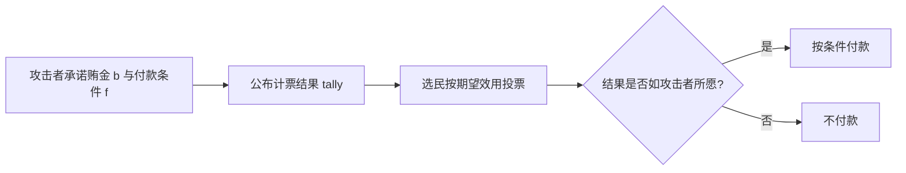

## TL;DR

DAO 治理正在走向秘密投票，但这篇论文捅破了一个尴尬的真相：把选票藏起来还不够，只要公布精确的加权计票结果，攻击者就能把不少人的投票选择反推出来。作者在 31 个 DAO 的 3,844 个真实提案上实测：统一攻击算法在 81.0% 的提案上至少确定了一人的投票，在 29.2% 的提案上把全部选票都恢复了出来。论文的回答是给隐私换一个度量——B-Privacy，即攻击者要以 90% 的把握买通一次投票至少要花多少钱；并给出修正方案：给计票结果加拉普拉斯噪声，同时强制公布的胜者与真实胜者一致。在没有极端巨鲸的提案上（翻盘至少需要 5 人结盟），10% 的噪声就能把买票成本抬高 4.1 倍。但只要巨鲸手握过半权重，任何只动计票结果的技巧都救不了隐私。

## 论文信息卡

- **标题**：B-Privacy: Defining and Enforcing Privacy in Weighted Voting
- **作者**：Samuel Breckenridge、Dani Vilardell、Andrés Fábrega、Amy Zhao、Patrick McCorry、Rafael Solari、Ari Juels（Cornell Tech / IC3、Ava Labs、Arbitrum Foundation、Tally）
- **会议**：USENIX Security 2026
- **原文链接**：https://arxiv.org/abs/2509.17871
- **说明**：USENIX 官网摘要与 arXiv 预印本在样本口径上略有出入（官网摘要为 2,503 个提案、27 个 DAO、3.5 倍；预印本全文为 3,582 个提案、30 个 DAO、4.1 倍），本文实验数字以预印本全文为准。

## 背景

一人一票的世界里，隐私约等于选票保密：公布总票数，不公布谁投了谁，个人选择就藏在人群里。这个直觉在加权投票里失效了。DAO 治理、股东投票、PoS 委托投票的权重都与持币量或股份成正比——权重各不相同，且本身就是公开的。于是精确的计票结果变成了一道算术题：已知每个人的权重和总票数，反推每个人投了哪边。

论文举了一个极简的例子：Alice 权重 1.2，其他人权重都是 1。如果计票结果是“赞成 1507，反对 2510.2”，反对一栏里那个 .2 只能来自 Alice——她的选择不言自明。真实权重有 18 位小数，碰撞概率极低，这道题反而更好解。

这不是纸上谈兵。买票在 DAO 世界里已经是一门生意：论文引用数据称，Curve 协议上的买票市场规模超过 2.5 亿美元，Arbitrum 上的 LobbyFi 买票协议在重大提案中能控制 8%–14% 的选票。Snapshot 的“屏蔽投票”只是临时加密，提案结束后照样解密公开；更有专门为买票而生的“黑暗 DAO”。已有的秘密投票方案（Cicada、Kite 等）几乎都只保护选票本身，没人认真算过“计票结果本身泄漏了多少”。这篇论文补的就是这一环。

## 方法拆解

论文的方法分三步：先攻击，再定义，最后加噪。

### 第一步：两招组合拳，从计票结果里把选票抠出来

攻击设定是一个反事实场景：假设 DAO 已实现选票保密、只公布精确计票结果，攻击者知道所有参与者的权重（链上公开信息），不知道各自的选择，能恢复多少？数据源是 Snapshot 平台 2020 年 9 月至 2025 年 2 月的投票记录，筛选出提案数超过 5 个的 DAO，共 3,844 个提案、31 个 DAO，用真实投票记录验证效果。

**巨鲸攻击（whale attack）**：如果某个人的权重比某一选项的总票数还大，那他一定没投那个选项。确定一个巨鲸的选择后，把他的权重从对应选项里扣掉，重新算总票数，继续找下一个巨鲸——扣掉的权重可能让胜负翻转，进而暴露更多人。复杂度只有 $O(n \cdot |C|)$，大选区也跑得动。

**子集和攻击（subset-sum attack）**：对每个选民逐一检验：去掉他之后，剩下人的权重能不能恰好拼出某个选项的总票数？如果只有一个选项能拼出来，那他必定投了这一项。这本质上是把选民按权重划分为与各选项总票数相等的子集，是 NP-hard 的子集和问题，但论文用 Horowitz–Sahni 的折半枚举法把复杂度压到 $O^*(2^{n/2})$，在普通机器上能处理 $n \lesssim 45$ 人的提案。18 位小数的权重精度让“恰好拼出来纯属巧合”的概率微乎其微，拼出来基本就是真相。

**统一算法**：先用巨鲸攻击预处理压规模；剩余人数 ≤45 时再上子集和攻击。实测中有 346 个起初超过 45 人的提案就是这样被“缩”进攻击范围的。

### 第二步：B-Privacy——用买票成本给隐私定价

光说“泄露了多少选票”还不够，治理真正怕的是泄露被用来买票。论文于是把隐私翻译成经济学语言：**B-Privacy 就是攻击者为了以概率 $p$ 买到自己想要的结果，至少要付出的总贿金**，记作 $B_{\text{tally}}(p)$。计票越透明，攻击者越能精准定位贿赂对象，B-Privacy 越低；只公布胜者时 B-Privacy 最高，但透明度最低。相对 B-Privacy 是某算法与“完全公开选票”基线之比，比值越大，防买票能力越强。

这个定义建立在一个贝叶斯贿赂博弈上：攻击者事先承诺贿金数额，付款条件可以依赖公布的计票结果（例如“赞成胜出幅度超过 10% 才付款”）；每个选民在不知道别人真实偏好的情况下，按期望效用最大化投票。两个关键量决定了选民会不会被收买：**关键性（pivotality）**——他的一票改变结果的概率，越关键越难收买；**贿金边际（bribe margin）**——他投赞成比投反对多拿到贿金的概率差，计票结果越能验证他的选择，这个边际越大，贿赂就越划算。均衡条件是：选民投赞成当且仅当 $U_i^{\text{no}} \leq \alpha_i b_i / \Delta_i$，其中 $U_i^{\text{no}}$ 是他对“反对”的相对偏好，$b_i$ 是贿金，$\alpha_i$ 是贿金边际，$\Delta_i$ 是关键性。直觉很清楚：一个人越不关键、贿赂越容易被验证，就越便宜。

*图：贿赂博弈流程示意（据论文第 5 节整理，非论文原图）*

### 第三步：加噪的计票算法——噪声要加，胜者不能错

差分隐私的老办法是给计票结果加噪声，但直接照搬可能翻转结果：49.9% 对 50.1% 的提案，加 0.2% 的噪声就能把公布的胜者改成错的。论文的方案是“加噪 + 纠错”：先加拉普拉斯噪声，再强制公布的胜者与真实胜者一致。

噪声强度用“计票扰动” $d$ 标定：95% 的情况下，噪声绝对值不超过总权重 $W$ 的 $d$。实验主推 $d=10\%$，即 95% 的概率下公布票数与真实票数之差不超过 10%，拉普拉斯参数为 $b = dW / \ln 20$。例如权重 $(1, 1.1, 1.3)$、真实计票“反对 1.1、赞成 2.3”时，加噪后可能变成“反对 1.2、赞成 2.2”：胜者不变，但“谁投了反对”已看不出来。

难点在于：纠错破坏了经典差分隐私的证明——公布的胜者本身就是真实信息。论文为此引入了新的证明技术（定理 10），给出纠错后加噪计票的 B-Privacy 下界；也就是说，报告的隐私提升是保守估计，真实提升只会更高。

## 实验与数据

### 攻击实测：秘密投票的假象

在 3,844 个提案中，统一攻击算法在 3,118 个（81.0%）上至少确定了一名选民的选择——“合理否认”被打破；在 1,122 个（29.2%）上把全部选票都恢复了出来。在被攻破的提案里，平均泄露 41.6% 的选票、85.1% 的投票权重：选票不到一半，权重却占大头，因为被优先锁定的是巨鲸。

*图：统一攻击算法在各 DAO 上的平均效果，每个点代表一个 DAO，横轴为平均泄露选票比例，纵轴为平均泄露投票权重比例（来源：论文原文）*

规模效应非常陡峭。选民 ≤45 人的提案中，791/878（90.1%）被完全恢复，剩下 87 个的唯一原因是存在权重完全相同的选民投了不同选项——这种天然歧义是攻击唯一解不开的情形。到了大选区，决定脆弱性的不再是人数，而是权重集中度：Arbitrum 的平均选民数约是 Aavegotchi 的 10 倍，攻击成功率反而更高；在胜出幅度超过 90% 的提案里，巨鲸攻击在 Arbitrum 泄露 88.0% 的权重，在 Aavegotchi 只泄露 38.1%。

加 10% 噪声后，同一批攻击的效果大幅滑落：子集和攻击基本失效——带噪票数几乎不可能被任何权重子集精确拼出；巨鲸攻击也必须放宽门槛（权重超过某选项票数再加 0.1W，才能以 95% 的置信度排除），能锁定的巨鲸大幅减少。每个提案重复 10 次加噪试验取平均，同样的 DAO 在图上整体向左下方移动，即泄露的选票与权重比例双双下降。

*图：10% 计票扰动下，原始计票与加噪计票的攻击效果对比，各 DAO 的位置整体向左下方移动，即泄露的选票与权重比例双双下降（来源：论文原文）*

### B-Privacy 仿真：噪声值多少钱

B-Privacy 依赖无法观测的选民效用，只能做仿真：过滤掉弃权票、只保留二选一提案、排除选民超过 30,000 人的提案，得到 3,582 个提案、30 个 DAO。选民效用按历史投票取正态分布，约 84% 的选民会坚持历史选择，攻击者的目标成功概率设为 $p=0.9$。

这里要引入核心解释变量：**最小决定性联盟（MDC）**，即最少需要多少选民改变投票才能翻转结果。MDC 越小，说明结果越被少数人捏在手里——多数情况下是因为存在巨鲸。总体上，10% 加噪计票的相对 B-Privacy 几何均值为 1.5 倍，只公布胜者为 2.9 倍，看起来平平无奇。但按 MDC 切开后图景完全不同：在 649 个 MDC ≥ 5 的提案上，加噪计票的提升跃升至 4.1 倍，只公布胜者高达 14.2 倍。分界线也很清晰：平均 MDC ≥ 13 的只有 4 个 DAO（Proof of Humanity、Shell Protocol、Beanstalk DAO、Aavegotchi），其余 DAO 的平均 MDC 都小于 6；Balancer 几乎所有二选一提案都存在手握过半权重的巨鲸，MDC=1，任何只动计票结果的方案在它身上都近乎无效。

*图：各 DAO 上不同计票算法的相对 B-Privacy，几何均值，横轴为对数尺度，虚线为完全公开选票的基线（来源：论文原文）*

噪声的边际收益递减得很快。以 Aavegotchi 的 250 个提案为例，相对 B-Privacy 随扰动 $d$ 单调上升，但小剂量噪声的提升最陡，超过约 10% 后曲线很快走平；同一扰动下，MDC 越大的提案组提升越高。10% 是个性价比拐点：再往上加，透明度越丢越多，防买票能力却没涨多少。

个案也很说明问题：在 ApeCoin 一个 452 名选民、MDC=6 的提案上，即使完全公开选票，攻击者也只贿赂 29 人——只有大户值得贿赂；计票信息越少，值得贿赂的人就越少。噪声保护的主要是小户，巨鲸在任何算法下都是最显眼的目标。

## 相关工作对比

从三条线看这篇论文的位置。第一条是传统投票隐私：选票保密、收据无关性、抗胁迫性，强度依次递增，都是为一人一票设计的。加权投票的秘密投票方案（如 Cicada、Kite、Snapshot 屏蔽投票）继承了这条线，但都没处理计票结果泄漏——等于锁了前门、忘了后门。

第二条是概率化计票：DPWeVote、随机抽样投票、风险限制计票都用过类似思路，但要么不保证胜者正确，要么只在非加权场景下讨论隐私度量。B-Privacy 把“胜者必须正确”写进机制并重做了证明，同时直接报“买票要多花多少钱”，治理社区一听就懂。

第三条是 DAO 实证研究：此前已有工作指出公开投票会造成从众、损害去中心化，也有 Voting-Bloc Entropy 这样的去中心化度量，但都没有可操作的指标把“投票结构”翻译成“买票脆弱性”。MDC 加 B-Privacy 填上了这个缺口：前者一眼看出结果被几个人捏着，后者算出捏着结果要花多少钱。

## 局限与开放问题

- **只覆盖二选一投票**：多选项提案、弃权作为显式选项的情形都不在模型内，作者推测结论方向上成立，但未证明。
- **效用模型是假设的**：仿真用正态分布拟合选民偏好，真实偏好分布、贿金敏感度可能不同；相对 B-Privacy 对参数不敏感，但绝对金额仍需谨慎解读。
- **巨鲸问题无解**：MDC=1 的提案上，任何计票算法都救不了隐私。计票隐私的前提是权重分散，单靠密码学或噪声修不好治理集中化。
- **噪声与实现仍可探索**：实验主推拉普拉斯噪声与 10% 扰动，其他分布、动态调参的效果有待验证；谁来生成噪声、如何证明噪声确实加了且胜者没错、参数由谁定，论文也未深入。

## 一点思考

这篇论文最值得治理者带走的不是噪声公式，而是优先级：先算自己 DAO 的 MDC，再谈隐私方案。如果多数提案的 MDC 只有 1 或 2，砸钱上秘密投票、零知识证明都是给巨鲸的独角戏做布景——买票者看一眼计票结果就知道该找谁。反过来，只要权重分散到 MDC ≥ 5，一个 10% 的加噪计票就能把买票成本抬高 4 倍，代价只是公布票数 95% 的情况下偏差不超过 10%。我的判断是：加噪计票应该成为 DAO 治理的默认配置之一，但必须和反巨鲸的机制改革（委托上限、二次方投票、权重衰减）打包推进，否则就是给集中化的治理贴了一层隐私的膜。

## 原文链接

- arXiv：https://arxiv.org/abs/2509.17871
- USENIX Security 2026 演讲页：https://www.usenix.org/conference/usenixsecurity26/presentation/breckenridge
