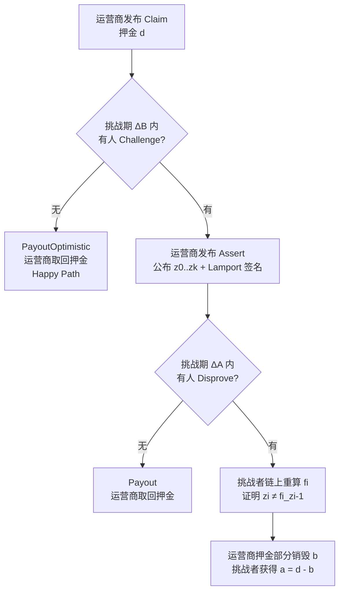

## TL;DR

比特币最大的尴尬不是慢，而是"出不去"：想把 BTC 拿到二层用，桥的安全基本都押在"一群签名人别串通"上——串通了，钱就没了。USENIX Security 2026 的这篇论文给出了迄今最激进的答案：**BitVM2-BRIDGE，第一座基于比特币链上轻客户端的桥，把信任假设从"诚实多数（t-of-n）"一路压到"存在性诚实（1-of-n）"**——签名人、运营商、挑战者三个角色，每个都只需要一个人诚实。核心技术 BitVM2-CORE 让比特币这个"图灵不完备"的链也能验证任意计算：链下算、链上吵，SNARK 验证器被切成小块塞进比特币交易，撒谎者会被任何人用一笔 Disprove 交易当场抓包。最硬的证据是 2025 年 6 月 3 日的主网实测：**最坏情况（完整争议流程 Claim→Challenge→Assert→Disprove）在 42 个区块（7 小时 36 分钟）内走完，总成本 1490 万聪（约 1.6 万美元）**；而正常路径的三笔交易不到 16.75 vKB，约 50k 聪（53 美元），论文还给出了压到 1.66 美元的优化路线。结论很直白：**比特币桥的安全税，第一次从"信任一个委员会"降到了"信任一个人"，而这个人可以是任何路人。**

## 论文信息卡

- **标题**：Bridging Bitcoin to Second Layers via BitVM2
- **作者**：Robin Linus Woll（Stanford / ZeroSync，BitVM 提出者）、Lukas Aumayr、Zeta Avarikioti、Matteo Maffei、Andrea Pelosi、Orfeas Stefanos Thyfronitis Litos、Christos Stefo、David Tse（Stanford）、Alexei Zamyatin（BOB）
- **会议**：USENIX Security 2026（第 35 届，Baltimore）
- **原文链接**：https://www.usenix.org/conference/usenixsecurity26/presentation/woll
- **论文全文 PDF**：https://repositum.tuwien.at/bitstream/20.500.12708/231404/3/Woll-2026-Bridging%20Bitcoin%20to%20Second%20Layers%20via%20BitVM2-vor.pdf
- **开源实现**：https://doi.org/10.5281/zenodo.17949747（生产级参考实现，主网实验交易 ID 均已公开）

## 背景

要理解这篇论文的分量，先看比特币桥为什么叫"圣杯"。比特币每秒 5–7 笔交易、脚本语言刻意不完备——没有循环、没有递归，4MB 区块上限、1000 个堆栈元素限制，这些"缺陷"是安全设计，但也让比特币天生玩不了 DeFi 这类复杂应用。扩容靠二层（L2）：支付通道解决了"转账"这一个应用，但要让 BTC 在通用二层上流通，必须有一座桥，能把 BTC 锁在主链、在二层铸出等值的 wBTC，再原路赎回。

跨链桥在别的链上通常用"轻客户端"解决：目标链上跑一个源链的轻客户端，验证"某笔交易确实发生在源链"再放行资产。但比特币没有智能合约，轻客户端装不上去。于是现实中的比特币桥几乎全是**多签/联邦制**：找 n 个人管钱，t 个人签名就能动。WBTC、tBTC 等莫不如是。问题在于这是"诚实多数"假设——**只要委员会里凑够 t 个坏人串通，用户的存款就没了**，而且这是结构性风险，不是"选好人"能解决的。历史上桥被盗事件（Ronin、Wormhole 等）反复证明：桥是整个加密世界最贵的单点故障。

BitVM（2023 年 Robin Linus 提出）第一次让人看到"不用改比特币共识也能跑任意计算"的可能：链下计算、链上争议，作恶者会被挑战者用欺诈证明抓包。但第一代 BitVM 是**双人对赌**模式：证明者和验证者事先固定，验证者必须全程在线盯着，否则作恶者得逞——这对桥这种"要服务无数陌生人"的场景是致命的。BitVM2（2024 年白皮书）把挑战权开放给**任何人**，而这篇 USENIX '26 论文是它的集大成者：把 BitVM2 做成通用计算验证原语（BitVM2-CORE）、造出比特币史上第一个链上轻客户端、再用它拼出一座完整的双向桥（BitVM2-BRIDGE），并且**在主网上真的跑通了**。

## 方法拆解

论文的叙事是一条漂亮的"稻草人阶梯"（S1→S5），每一步解决上一步的硬伤，读懂这条阶梯就读懂了全文。

### S1：直接上链验证——想法很美，装不下

运营商 O 想向比特币证明"程序 g 在输入 x 下输出 y"。最直接的想法：Assert 交易里直接塞进整个程序 g 的脚本，Payout 时把 x、y 当 witness 交上去，链上当场验算。但 g 可能是"验证整条 PoW 链是否合法"这种巨型程序，x 可能是整条链的数据——**脚本和输入都远超 4MB 区块上限**，Assert 和 Payout 根本发不出去。此路不通。

### S2：套一层 SNARK——输入变小了，验证器还是太大

把 g 编译成 SNARK：witness 变成几百字节的简洁证明，Payout 问题解决。但 Assert 里要编码的是 **SNARK 验证器本身**——论文脚注提到一个 Groth16 验证器约 900MB，依然塞不进 4MB 的区块。还是装不下。

### S3：把验证器切碎——只需要链上验"一小块"

既然整个验证器装不下，那就切成 $k$ 个小子程序 $f_1, \dots, f_k$，每个都能在单个比特币交易里执行。运营商在 Assert 里公布全部中间状态 $z_0, z_1, \dots, z_k$（其中 $z_i = f_i(z_{i-1})$），挑战者只需挑出撒谎的那一块 $f_i$，在链上重算一次，证明 $z_i \neq f_i(z_{i-1})$ 即可。这就是**欺诈证明的精髓：链上永远只需要验证一小片计算**。但新问题出现了：Assert 必须在运行后才能发布（中间状态那时才知道），运营商在 setup 阶段就不被任何程序绑定——他完全可以临场换一个对自己有利的"程序"来领钱。

### S4：签名人委员会模拟"契约"

比特币没有原生 covenant（限制 UTXO 后代花费方式的脚本），论文用**预签交易树**来模拟：n 个签名人在 setup 阶段为每个运营商预签 Assert 和 Payout 交易，然后**删掉自己的私钥**。只要 n 个人里有**一个人**诚实删钥，运营商就永远无法偏离预设流程——这就是"存在性诚实（1-of-n）"的由来，也是全文最关键的一次信任假设降级：从"委员会多数诚实"降到"只需要一个人删钥"。

### S5：Lamport 签名防"恶意挑战者"

S4 还有个漏洞：挑战者可以在 Disprove 里伪造中间状态，诬陷诚实运营商。解法是让运营商在 Assert 里同时公布每个 $z_i$ 的 **Lamport 一次性签名**（比特币脚本没有原生验签任意消息的能力，但 Lamport 签名只用哈希，原生 opcode 就能手搓验证）。Disprove 必须携带运营商亲签的 $(z_{i-1}, z_i)$，伪造者当场现形。

S1→S5 走完，**BitVM2-CORE** 成型：运营商押一笔保证金 $d$ 发 Claim，说"我知道某计算的正确结果"；没人挑战就走乐观路径拿钱；有人挑战就进入 Assert→Disprove 的争议流程。为了防止运营商"免费撒谎"（被挑战就自己推翻自己的假 claim、全身而退），协议规定 Disprove 成功后保证金部分销毁（burn 掉 $b$，挑战者拿走 $a = d - b$），撒谎第一次就疼。

### 链上轻客户端：比特币第一次"照镜子"

BitVM2-CORE 是通用原语，论文用它造了**比特币历史上第一个链上轻客户端**：把"你给我证明区块 B 在最长 PoW 链上"这件事，编码成 SNARK 电路（验证每块的哈希指针和难度目标、创世块一路连到 B），再用 BitVM2-CORE 的争议机制保证正确性。客户端接受的块是"离 tip 有 $m-k$ 个块"的位置——既够新（活性）又够深（不会被重组替换）。一个小而妙的设计：Assert 里加了个 Lamport 签名的区块高度 $h$ 和绝对时间锁，运营商拿过期旧块来糊弄会被挑战者直接证伪。

### 拼成桥：BitVM2-BRIDGE

桥上有三类角色：**n 个签名人**（只在 setup 出场，预签交易树然后删钥）、**m 个运营商**（干活的人）、**任意数量的挑战者**（完全无需许可，路人皆可）。Peg-in：Alice 锁 v BTC 到 PegIn 交易，运营商们完成轻客户端 setup，二层给她铸 v wBTC。Peg-out 是全场最精彩的一幕：

1. Bob 在二层**销毁** wBTC，并在销毁交易里用 OP_RETURN 嵌入一笔预签好的 PegOut（SIGHASH_SINGLE|ANYONECANPAY 签名，把这次销毁和"比特币上的哪笔支付"死死绑定，防止一次销毁领多次钱）；
2. 某个运营商看到销毁，用**自己的钱**先行垫付 v-fO 个 BTC 给 Bob（用户视角是即时到账，不用等争议期）；
3. 运营商发布 Claim，启动轻客户端流程，证明"销毁确实发生了、垫付确实发生了"，从而拿回 PegIn 锁着的 v BTC，净赚手续费 fO；
4. 若 Claim 造假，任何挑战者发起争议，成功后 PegIn 的钱原地不动，诚实运营商稍后仍可正常认领——**用户的钱在争议中是安全的**。

论文用一张表（图 1）把安全假设的降级量化得明明白白：和传统多签桥相比，peg-in 活性从"多数运营商诚实"降到"1-of-m"，peg-in/out 安全从"多数签名人诚实"降到"1-of-n 签名人"+"只需 1 个挑战者"，运营商资金安全只需要"1 个诚实挑战者存在"（多签桥里这一项根本不存在——运营商就是签名人自己）。

## 实验与数据

这是论文最让我信服的部分：**它不只在纸上证明，还在主网上真刀真枪跑了一遍最坏情况**。

2025 年 6 月 3 日，团队在比特币主网执行了完整 unhappy path：Claim → Challenge → Assert → Disprove 四笔交易全部上链，**42 个区块（7 小时 36 分钟）内确认**。这意味着即使在主网拥堵时，一个挑战期的长度也是现实可行的。总成本 1490 万聪（按当时币价约 1.6 万美元），其中 Assert 占 389 万聪、Disprove 占 1099 万聪——这笔钱就是每个 peg-in 实例需要准备的**挑战抵押品**量级。论文还根据历史费率数据测算：约 50 sat/vB 的费率有 95% 概率在两周内确认，那么一笔 ~4MB 的 Disprove 对应每个运营商约 2 BTC 的抵押需求。

脚本规模的数据也很实在：379 个 Disprove 脚本，长度分布在 500KB 到 3.99MB 之间，**90% 低于 3MB**，密集峰值在 3MB 附近（预计算/哈希阶段），只有零星几个超过 3.5MB。这说明 SNARK 验证器切块的策略是有效的——最坏情况的交易尺寸可控，没有出现"某一块爆炸"的长尾灾难。

而正常走的 happy path 便宜得多：PegOut + Claim + PayoutOptimistic 三笔交易**不到 16.75 vKB，约 50k 聪（53 美元）**；论文第 8 节还给出优化路线——把 AssertScript 从 Claim 里挪到中间交易，happy path 可压到 **534 vbytes、约 1.6k 聪（1.66 美元）**。换句话说，**诚实行为的成本是几十美元量级，作恶被抓的代价是上万美元量级**，这个不对称就是整个博弈成立的经济基础。形式化部分则给出了 8 个定理：BitVM2-CORE 的可靠性/完备性、轻客户端的安全性、双向桥的安全/活性、以及运营商资金安全——每个都有"存在性诚实"假设下的严格证明（完整证明在配套长版本 [22]）。

## 相关工作对比

论文把自己放在一条清晰的技术谱系里，创新点也因此非常清楚：

- **zkBridge**：用 zkSNARK 给一条链证明另一条链的状态，思路相近，但**比特币上根本验证不了 SNARK**，所以和比特币无缘。
- **BitVM（一代，2023）**：开山之作，但挑战者是事先固定的双人对赌，且争议要用**二分博弈走 79 笔链上交易**（约 0.007 BTC），验证者还必须全程在线——桥这种开放场景用不了。
- **BitVMX / TOOP / ColliderVM**：都在"比特币上跑计算"这个方向上各进一步，但要么挑战者仍是许可制的，要么需要指数级链下通信，要么靠算哈希碰撞（能耗巨大）——**只有 BitVM2 做到了挑战权完全无需许可**。
- **传统多签桥（WBTC/tBTC 等）**：信任假设停留在"委员会诚实多数"，BitVM2-BRIDGE 把它降到"每类角色只需一人诚实"，且挑战者可以是任何人，这是**质变**不是量变。

一句话定位：如果说一代 BitVM 证明了"比特币能吵架"，BitVM2 证明的是"**任何人都能跟比特币吵架，而且吵得起**"。

## 局限与开放问题

论文第 8 节出乎意料地坦诚，局限列得比很多论文的贡献还实在：

- **契约是"模拟"的**：签名人委员会本质是 n-of-n 预签 + 删钥，不是一劳永逸的密码学保证。论文自己承认：任何一种 covenant 操作码提案（如 TXHASH、OP_INSPECTINPUTOUTPOINT）都能让签名人彻底下岗。
- **存款面额固定**：当前实例只支持固定金额的 peg-in/out，散户体验差；缓解方案是多面额并行部署 + 做市商聚合，但那是运营问题不是协议问题。
- **大交易是非标准的**：Assert/Disprove 超过 400KB 标准 relay 上限，走不了默认 P2P 网络，得靠矿池的直投通道（如 MARA Slipstream）——**桥的活性间接依赖矿池的配合**。
- **运营商要垫资**：peg-out 是运营商先拿自己的 BTC 垫付，用户才即时到账，这意味着运营商有实打实的资金成本，手续费 fO 必须覆盖它。
- **恶意挑战者可以"搞心态"**：任何人都能逼运营商走一遍昂贵的 Assert 流程。论文的解法是挑战者必须先押抵押金 $c$ 覆盖运营商成本，且抵押金可众筹（SIGHASH_SINGLE|ANYONECANPAY）——但这又抬高了"做好人"的门槛。
- **运营商集合是静态的**：setup 时定死，轮换机制在现有设计下很难做，只能靠"旧桥 peg-out 即新桥 peg-in"的笨办法。
- **轻客户端只支持静态难度**：比特币难度调整周期内的假设，长期看需要扩展。

## 一点思考

这篇论文真正的分量不在"桥"本身，而在 BitVM2-CORE 这个原语：**它第一次让比特币拥有了"验证任意计算"的通用能力，而不需要任何共识改动**。我的判断是：未来比特币 L2 之争，技术路线的胜负手不在"谁的桥 TPS 高"，而在"谁能把 unhappy path 的成本和复杂度压到运营商可接受"——这篇论文已经把标杆立在"7.5 小时、1.6 万美元抵押、53 美元 happy path"的位置。实操上，普通用户短期内不会直接碰这些预签交易，真正的机会在**运营商/做市商**角色：垫资赚 fO，本质上是一门"卖比特币安全冗余"的生意。另外提醒一句：签名人"删钥"这个动作是整个 1-of-n 假设里最脆弱的人性环节，选桥的时候，问一句"你们的签名人 ceremony 怎么做"比看 TPS 数字管用得多。

## 原文链接

- USENIX 官方页面：https://www.usenix.org/conference/usenixsecurity26/presentation/woll
- 全文 PDF（TU Wien 机构库）：https://repositum.tuwien.at/bitstream/20.500.12708/231404/3/Woll-2026-Bridging%20Bitcoin%20to%20Second%20Layers%20via%20BitVM2-vor.pdf
- 开源实现与主网实验数据：https://doi.org/10.5281/zenodo.17949747
