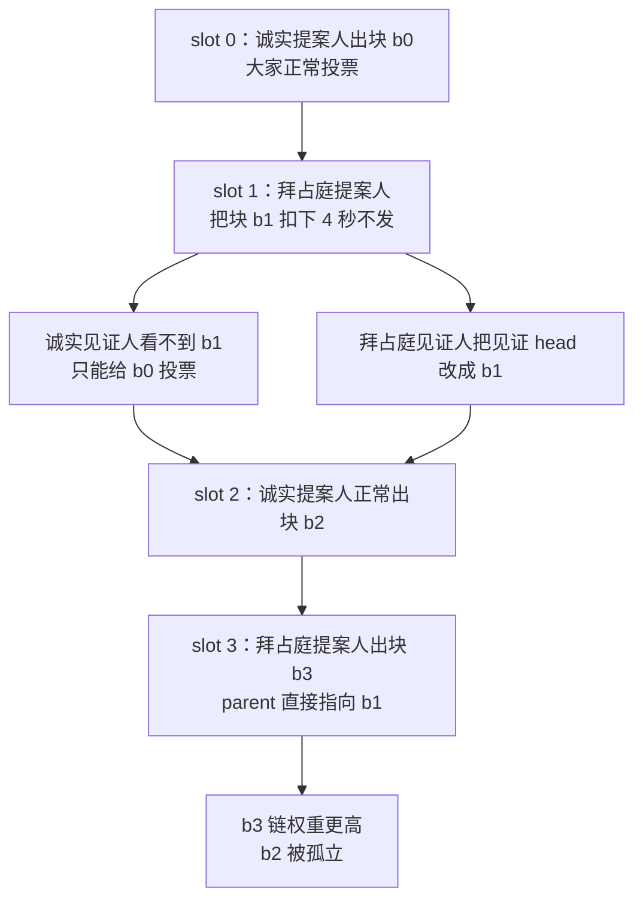

## TL;DR

以太坊 PoS 的激励机制有个默认假设：老实投票就有钱拿，作恶会被罚。但这个假设的边界，从来没人系统地"扫"过——找激励漏洞全靠专家手工，而攻击策略空间大到没法枚举。NDSS 2026 的 BunnyFinder 把软件测试里的"故障注入"思想搬到了共识协议层：在 Prysm 和 Teku 的本地测试网上半自动注入 9,354 个攻击实例，累计跑了一百多个小时。结果：5 种已知的重组与激励攻击全部复现，还挖出 3 种新攻击——以太坊 PoS 上的**首个自私挖矿攻击**（只需 13.4% 质押就盈利）、Staircase 攻击变体 Staircase-II（33.3% 质押让所有诚实验证者挨罚）、"皮洛士胜利"攻击（攻击者自己挨罚也要把诚实者拖下水）；顺手还揪出 Prysm 同步模块死锁和日志模块"幻影重组"两个实现缺陷。这篇的真正价值不在三个攻击本身，而在于把"激励审计"从手工活变成了可复用的流水线：激励缺陷是设计缺陷，靠代码审计和 fuzz 扫不出来，得靠专门的攻击生成器去试。

## 论文信息卡

- **标题**：BunnyFinder: Finding Incentive Flaws for Ethereum Consensus
- **作者**：Rujia Li（清华大学）、Mingfei Zhang（山东大学）、Xueqian Lu、Wenbo Xu（蚂蚁集团区块链平台部）、Ying Yan（蚂蚁集团）、Sisi Duan（清华大学，通讯作者）
- **会议**：NDSS Symposium 2026（2026 年 2 月 23–27 日，美国圣迭戈）
- **原文**：https://dx.doi.org/10.14722/ndss.2026.230281
- **开源代码**：https://doi.org/10.5281/zenodo.17042549

## 背景

2022 年 9 月以太坊转向 PoS 后，网络稳定性就系在激励机制这一根绳上：诚实验证者按时投票拿见证奖励、提案拿区块奖励；双签被 slash，缺席投票被扣见证奖励。现实数据也撑腰：超过 99% 的验证者都在正常运行。

但这套机制并不完美。过去几年，研究者手工挖出了好几个"激励攻击"：ex-ante 重组攻击让诚实提案人的块被孤立；staircase 攻击里，攻击者控制 29.6% 以上的质押，就能让所有诚实验证者拿不到见证奖励，自己却照拿不误。更要命的是，这些攻击的发现全靠专家直觉：激励机制没有形式化的安全定义，没法像代码漏洞那样"证明不存在"；而拜占庭验证者可以任意延迟、篡改自己发出的每条消息，攻击策略空间大到枚举不完。于是就有了这篇论文要回答的问题：**能不能少依赖点人工，系统地把激励缺陷扫出来？**

## 方法拆解

BunnyFinder 的灵感来自软件测试：渗透测试、混沌工程、fuzz 本质上都是"往系统里注入故障，看哪里会坏"。BunnyFinder 把这套思想从"找代码 bug"平移到"找设计缺陷（激励缺陷）"，搭了一条四组件流水线，分两个阶段跑：

```mermaid
flowchart LR
    subgraph 阶段一：攻击发现（全自动）
        SG[策略生成器 SG<br/>JSON 描述攻击实例] --> SE[策略执行器 SE<br/>本地测试网真实注入]
        SE --> SA[状态分析器 SA<br/>SQL 查日志判激励缺陷]
    end
    subgraph 阶段二：攻击优化（人工+RL）
        SA --> H[人工分类：<br/>已知攻击 / 新攻击类型]
        H --> SO[策略优化器 SO<br/>强化学习微调参数]
        SO --> SE
    end
```

**策略生成器（SG）**解决"空间太大"的问题。攻击手段归纳为两类：顺序操纵（延迟自己消息的发送时机）和内容操纵（篡改消息字段）。SG 用三条启发式原则把"无穷多种"攻击压成可枚举集合：第一，不提前释放消息（以太坊实现不会处理超前 slot 的消息）；第二，延迟时间离散化，以 4 秒（1/3 slot）为单位；第三，只篡改"有效"字段——区块的 parent 哈希和见证集合、见证的 head/source/target 字段。三板斧下来，理论空间压到 12,896 个候选，实际生成 **9,354 个攻击实例**，每个实例是一份 JSON（论文叫 SSF），精确写明"哪个 slot、延迟几单位、改哪个字段"。

**策略执行器（SE）**是把 JSON 变成真实攻击的"打手"，由攻击调度器和拜占庭模拟器组成。调度器把 JSON 翻译成客户端代码里的可执行指令，通过分发器下发；拜占庭模拟器则在 Prysm/Teku 客户端里预埋了注入点（比如 `BlockBeforeBroadcast` 控制区块延迟发送、`AttestBeforeSign` 控制见证 head 字段篡改），运行时按指令执行。整个实验在一张本地以太坊 2.0 测试网上跑，网络假设是同步的——作者的逻辑是：同步网络下都能打成的攻击，异步网络只会更容易。

**状态分析器（SA）**负责"定罪"。论文先给激励缺陷下了可操作的定义，两个触发条件：① 诚实验证者拿到的奖励低于"公平份额"（无攻击时应得的奖励）；② 有人挨罚。然后按拜占庭方净收益 $R_B$ 和诚实方净收益 $R_h$ 的正负组合分成四档：Metric-I（都赚钱，但诚实方低于公平份额）、Metric-II（都挨罚）、Metric-III（拜占庭赚钱、诚实挨罚，最危险）、Metric-IV（拜占庭挨罚、诚实赚钱但低于公平份额），并定义"拜占庭优势" $BA = R_B - R_h$ 量化攻击效果。SA 从各验证者日志抽奖励数据，用 SQL 查询逐实例判定。

**策略优化器（SO）**是第二阶段的精髓。SA 筛出的新攻击类型先由人工归纳出通用策略，再用强化学习微调参数（比如每条消息到底延迟多久）。难点在于奖励是延迟的——验证者的奖励要等区块最终确定才能结算，每步的即时反馈会误导训练。论文用了一个带 LSTM 记忆的 recurrent actor-critic + PPO 模型：agent 就是控制所有拜占庭验证者的攻击者，环境是精简版以太坊 2.0（实现 HLMD-GHOST 分叉选择和 Casper FFG），状态包括提案人职责向量、justification 进展和链权重。RL 在这里不是噱头：它学出来的不是固定延迟，而是一套**状态相关的自适应策略**。

## 实验与数据

实验在 AWS 上最多 3 台 c5.4xlarge（16 vCPU、32GB 内存）铺开，9,354 个攻击实例在本地测试网逐个执行，累计跑了一百多个小时。SA 判定其中 **3,121 个构成激励缺陷，约占三分之一**——Metric-I（自私挖矿类）2,586 个占大头，Metric-II 466 个，Metric-III 2 个，Metric-IV 67 个。团队人工核查了最赚钱的前 300 个实例，最终确认 3 种新攻击。先说复现能力：5 种已知攻击（ex-ante 重组、sandwich 重组、unrealized justification、justification withholding、staircase）在旧版本客户端上全部复现——其中几种在 Deneb 升级后的新版客户端里已经被修复，侧面说明框架没在"打稻草人"。

**新攻击一：以太坊 PoS 上的自私挖矿（Metric-I）**。这是 PoS 版以太坊已知的首个自私挖矿攻击，流程很直观：



效果和比特币的自私挖矿如出一辙：双方都赚钱，但诚实验证者的奖励被系统性压低。论文解权重不等式得出，攻击者只需控制超过 $\beta > 2/15 \approx 13.4\%$ 的质押，攻击就开始盈利——远低于 33.3% 的安全阈值。这个攻击在 Prysm v4.0.6 引入 `REORG_PARENT_WEIGHT_THRESHOLD` 参数后已被修复，但意义在于：它是被机器"算"出来的，不是人想出来的。RL 优化后更进一步：agent 学会看"未来几个 slot 的提案人是不是自己人"来动态决定扣块多久，成功率接近 100%，所需质押门槛再降 20% 以上。

**新攻击二：Staircase-II（Metric-III）**。原版 staircase 攻击要 29.6% 质押才能让诚实验证者颗粒无收；变体换了个打法：攻击者只需拿下**连续两个 epoch 首 slot 的提案人**（发动概率 1/9），把首块延迟 4 秒、并把自己的见证永远扣下。诚实验证者因为 target 不一致，凑不够 2/3 无法 justify 区块；攻击者则在 epoch 末释放扣下的块，用自己的见证完成 justification。结果：诚实验证者挨罚，攻击者照拿奖励——Metric-III 里最危险的那档。当攻击者质押达到 33.3% 并持续发动，所有诚实验证者都会被罚。RL 优化把这个攻击变成了"精确制导"：默认策略是无脑扣下所有见证（自己也要挨罚），优化后的 agent 只在"控制了 epoch 首 slot"时才扣见证，平时乖乖走协议。数据对比很直接：拜占庭优势 BA 从 13.4 翻到 27.2（约 2 倍），攻击成功率从 35.0% 飙到 97.0%，攻击者自身成本从 46.1% 降到 40.1%，诚实验证者的奖励最多比默认策略下再低 30%。

**新攻击三：皮洛士胜利攻击（Metric-II/IV）**。"皮洛士的胜利"指杀敌一千自损八百的惨胜——攻击者自己也挨罚，但诚实者罚得更重。基础版很简单：拜占庭验证者永远不发见证，参与率被拉低，诚实者奖励掉到公平份额的 67% 左右，但攻击者自己的损失率高达 180%，属于"自杀式"，论文不认为有效。优化版则精细得多：扣下 slot 1–31 的见证、延迟释放 b31/b32，让诚实验证者在 slot 32 的见证 source/target 全部填错。最优实例里，攻击者只损失 5.1% 的激励，就让诚实验证者损失 19.9%。追加生成的 2,010 个优化实例把"有效攻击"比例从 60.78% 提高到 70.78%。

**副产品：两个 Prysm 实现缺陷**。框架本意是找设计缺陷，却意外揪出两个代码 bug：同步模块死锁——staircase-II 攻击下所有验证者都以为自己落后、没人能完成同步；日志模块"幻影重组"——reorg 日志器因调用过期函数，在根本没发生重组时也打重组日志。两个问题都已披露给以太坊基金会并得到确认，Teku 没有这两个问题。三种新攻击在 Prysm 和 Teku 上均可复现。

## 相关工作对比

把 BunnyFinder 放到"找漏洞工具"的坐标系里看，差异很清晰。传统 fuzz（如 Tyr、LOKI、MPFUZZ、CONFUZZIUS）注入的是随机或无意义的错误，目标是**实现漏洞**（崩溃、DoS）；混沌工程 CHAOSETH 测的是"故障下系统还能不能正常工作"；拜占庭模拟器 Twin 测的是 BFT 协议的安全性和活性；SquirRL 用 RL 分析比特币自私挖矿，目标是找纳什均衡而非发现新攻击。BunnyFinder 的靶子是另一层：**设计缺陷**——代码实现再正确，激励设计本身可能就是歪的。渗透测试倒是也关注设计缺陷，但它是黑盒、靠人工；BunnyFinder 把"攻击者行为"参数化成 JSON 策略空间，让机器去穷举加优化，这是之前没有的。代价也有：SG 的剪枝是启发式的，可能过滤掉真正新颖的攻击；SO 阶段仍需人工归纳攻击类型，所以标题诚实地写了 semi-automated（半自动）。

## 局限与开放问题

- **剪枝可能漏报**：SG 的启发式原则（离散延迟、限定字段）把空间压下来了，但也可能把"不按套路出牌"的新攻击过滤掉，作者明确承认这是启发式方法的固有代价。
- **激励覆盖不全**：目前只建模了见证奖励和区块奖励，RANDAO 随机数操纵、MEV 等激励面都没纳入——作者把 RANDAO 列为未来工作。
- **同步网络假设**：实验假设消息准时到达，作者认为异步网络下攻击只会更容易，但没有实证数据支撑这个外推。
- **半自动名副其实**：从 3,121 个候选到 3 种新攻击，中间靠人工核查了 300 个实例并归纳攻击类型，离"一键出报告"还有距离。
- **主网可行性未经验证**：13.4% 的质押对应巨额资金，staircase-II 还要连续两个 epoch 抢到首 slot 提案人（概率 1/9），出于伦理只在本地测试网验证——但这不影响它作为"设计审计工具"的价值。

## 一点思考

这篇论文最值得带走的不是三个攻击本身——自私挖矿在 Prysm v4.0.6 已被修复，staircase-II 的发动条件也足够苛刻——而是它证明了一件事：**激励缺陷是设计缺陷，靠代码审计和 fuzz 是扫不出来的，必须有一个专门的"攻击生成器"去试**。我的判断是：对于 PoS 新链、再质押协议这类"激励即安全"的系统，上线前跑一轮 BunnyFinder 这类半自动激励审计，应该和代码审计并列成为标配，成本远低于一次激励事故。对验证者运营者也有直接启示：staircase-II 这类攻击意味着"老实投票也可能被罚"，监控不能只看在线率，还得盯"实际奖励偏离公平份额"的程度——那才是激励攻击的指纹。

## 原文链接

- 论文（NDSS 2026）：https://dx.doi.org/10.14722/ndss.2026.230281
- 开源代码：https://doi.org/10.5281/zenodo.17042549
