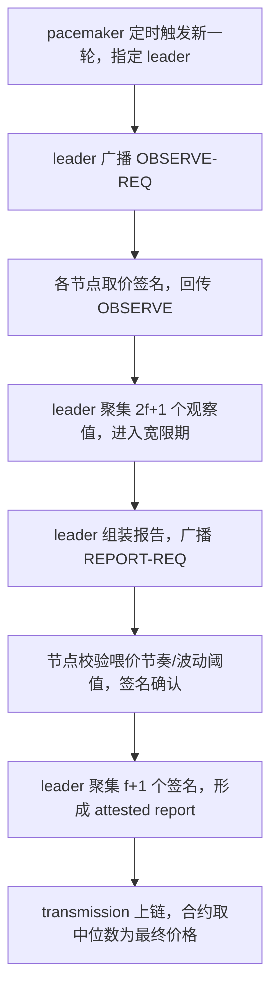
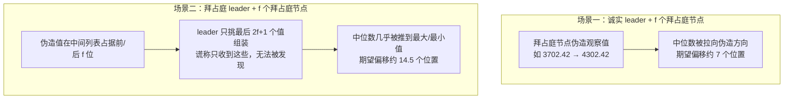

## TL;DR

Chainlink 预言机喂价的安全防线，长期以来建立在一个优雅的数学承诺上：**validity 属性**——最终上链的价格一定落在诚实节点的观察值区间内。这篇 NDSS 2026 论文用 4 年链上实测数据证明了这个承诺的真实分量：区间本身宽得吓人（ETH/USD 诚实区间宽度最大达价格的 13.13%），而拜占庭节点通过两种低成本手法，可以把确定价格**推到区间的任一端**——最大扭曲 8.47%。下游 Aave 清算和 ENS 域名收入的案例显示，单次事件的资金影响可达 10^5 美元量级。论文的终极判断是：**validity 只防"离谱的价格"，不防"巧妙的操纵"**，预言机安全不能只靠一个不等式。

> 📄 论文：*Validity Is Not Enough: Uncovering the Security Pitfall in Chainlink's Off-Chain Reporting Protocol*
> 👥 作者：Di Zhai、Jianbo Gao、Tianhao Liu、Tao Zhang、Jian Wang、Jiqiang Liu（北京交通大学）、Jiashuo Zhang（北京大学）
> 🏛 会议：Network and Distributed System Security Symposium（NDSS 2026，2 月 23–27 日，圣地亚哥）
> 🔗 [NDSS 页面](https://www.ndss-symposium.org/ndss-paper/validity-is-not-enough-uncovering-the-security-pitfall-in-chainlinks-off-chain-reporting-protocol/) · [论文 PDF](https://www.ndss-symposium.org/wp-content/uploads/2026-f458-paper.pdf) · [开源代码](https://github.com/Zhai-Di/ocr-security)

## 背景：预言机是 DeFi 的"眼睛"，Chainlink 是那副眼镜

DeFi 协议活在链上，但价格活在链下——借贷的清算线、永续合约的结算价，都要靠预言机把交易所价格搬进智能合约。**预言机是整个 DeFi 的事实来源**，它错了，下游一切风控都是沙上建塔。

Chainlink 是这个领域的绝对霸主：截至 2025 年 5 月，它的去中心化预言机网络（DON）承载了**全生态 68% 的预言机 TVL，以太坊主网上高达 78%**。它的核心协议叫 OCR（Off-Chain Reporting）：一组固定的预言机节点（ETH/USD 喂价是 31 个节点）在链下各自观察价格，跑一轮共识协议，确定一个唯一价格，再由链上聚合合约接受。设计上满足 $n \geq 3f+1$ 的拜占庭容错关系，当前取最优弹性 $n = 3f+1$（ETH/USD 就是 $n=31, f=10$）。

OCR 的安全招牌是一个叫 **validity** 的属性：最终确定的价格 $m$ 必定落在诚实节点观察值的区间内，即 $\min(V_h) \leq m \leq \max(V_h)$。直觉很美好：哪怕有拜占庭节点捣乱，最终价格也不会"离谱"。论文要问的正是：**这个区间在现实中到底有多宽？拜占庭节点在这个区间里又有多大的腾挪空间？**

## 方法拆解：OCR 到底怎么跑，攻击者又是怎么钻空子的

### 先看 OCR 一轮喂价的完整流程

OCR 每轮（epoch）产生一个价格报告，由三个子协议协作：

几个关键设计细节：

1. **代表值取中位数**。链上聚合合约对 attested report 里的 $2f+1$ 个观察值排序取中位数 $m$——这是 validity 能成立的数学基础。
2. **观察值本身不设阈值**。节点只校验"喂价节奏"（ETH/USD 每小时更新一次，或波动超 0.5%），但**对单个观察值的数值不做合理性检查**——价格本就在波动，没法区分"3702 的真实报价"和"4302 的伪造报价"。
3. **leader 是单点**。每轮一个 leader 收集、组装、广播；节点由 Chainlink 指定，外部无法加入。

validity 的证明很干净：$2f+1$ 个观察值里至少 $f+1$ 个来自诚实节点，中位数不可能跑出诚实值的最小–最大区间。**但它只保证"价格在区间内"，不保证"在区间内的哪个位置"。** 攻击者的全部艺术，就是把中位数推到对自己有利的那一端。

### 两种拜占庭手法：伪造 + 挑拣

论文的威胁模型很务实：$n$ 个节点中有 $f$ 个拜占庭节点互相串通，目标是**最大化或最小化确定价格**以套利（比如配合清算、抢跑）。

**手法一：伪造观察值**。拜占庭节点收到 OBSERVE-REQ 后，照常取价再把数值改大/改小，签名发回。由于协议对观察值本身不设阈值，这类显著偏离的值**会被正常接受**（表 I）。

**手法二：leader 挑拣子集**。拜占庭 leader 只挑选 $2f+1$ 个最大（或最小）的值组装报告，对外谎称"只收到了这些值"——**这个谎言无法被验证**，因为掉线/延迟本来就是常态（实测 13.46% 的列表不完整）。最终列表变成 **$f$ 个伪造值 + $f+1$ 个极端诚实值**，中位数被推到几乎最大/最小。

论文定义了三个度量：$\Delta P$（价格偏差）、$\Delta I$（中位数索引偏移）、$U_{max}$（抬高/压低两个方向下确定价格的最大不确定性）。理论结果：场景一中位数期望偏移约 7 个位置；场景二期望偏移 14.55 个位置——**几乎是把中位数从区间中间直接推到端点**。

## 实验与数据：4 年链上实测，数字比直觉更残酷

### 数据规模

论文团队跑了一个以太坊全节点，抓取**区块 12016450（2021 年 3 月，Chainlink 采用 OCR 之始）到 22648562（2025 年 6 月）**的全部 `NewTransmission` 事件，解析出观察值列表。聚焦 ETH/USD（占 Chainlink 调用的 60.61%），共 **84,097 个观察值列表**。

### 诚实区间到底有多宽？

这是全文最有冲击力的一张图：每个列表的诚实观察值区间宽度（以中位数归一化），**最大值达 13.13%**。具体实例：某轮区间为 $[3076.76, 3510.31]$ 美元，宽度 433.55 美元；该轮无拜占庭时的确定价是 3302.30 美元——**拜占庭节点可以把它推到任一端**，而 validity 对此一言不发。

数据里还抓到了野生的异常值：同一列表里正常值在 3284–3290 美元区间，却混入 1654.79，甚至 27047822019 这样的乱码值。论文将其归因于拜占庭节点的恶意提交——**这种攻击不是纸上谈兵，野外已经有人在这么干**。

### 价格偏差 $\Delta P$：最大 8.47%

对 72,711 个过滤后的完整列表做仿真（附录 B 的敏感性分析确认结论稳健）：

| 场景 | 方向 | 最大偏差 | 占价格比 |
|---|---|---|---|
| 场景一（诚实 leader） | 抬高 | $120.86 | 3.57% |
| 场景一（诚实 leader） | 压低 | $105.77 | 3.07% |
| 场景二（拜占庭 leader） | 抬高 | **$209.24** | **8.47%** |
| 场景二（拜占庭 leader） | 压低 | $230.04 | 6.79% |

分位数显示这不是小概率尾部事件：场景二抬高方向，1% 分位仍有 $37.60（1.58%）。

### 不确定性 $U_{max}$：价格可以"任人打扮"

$U_{max}$ 衡量的是同一轮里，拜占庭节点在抬高和压低两个方向之间能制造的最大价差。场景一中，37.92% 的实例 $U_{max}$ 超过诚实区间宽度的一半；场景二中，15.52% 的实例超过三分之二，**且 $U_{max}$ 可以达到诚实区间的全宽**。换句话说：在拜占庭 leader 当道的轮次里，最终上链的价格几乎可以在诚实区间内任意落点。

### 案例研究：下游真金白银的损失

论文做了两个下游影响案例，把"价格偏差"翻译成"美元损失"：

**案例一：Aave 清算**。区块 13179376–13179389 内的 13 笔 WETH 抵押清算（清算奖励 5%）。拜占庭节点抬高 ETH 美元价 → 清算人偿还同样债务能换到的 WETH 变少 → **清算人受损**；压低则获利。场景二下单轮**平均损失 −136.51 WETH、最大 −141.49 WETH**——单轮影响就是 **$10^5$ 美元量级**。

**案例二：ENS 域名收入**。ENS 域名租金以美元计价，经 Chainlink ETH/USD 换算成 ETH 收取。2022 年 4 月到 2025 年 6 月的 446 万笔相关调用：场景一下累计损失约 −$386,838；场景二下累计损失 **约 −$1,941,340**、获利约 +$3,290,631。**累计影响达数百万美元量级**。

### 对策：换掉中位数？

论文给了三条对策，按激进程度排列：

1. **让 leader 看不到观察值明文**（密码学方案，leader 只验签名）——能根治手法二，但工程复杂，留作未来工作。
2. **降低 $f/n$ 比**。$n=5f+1$ 时最大偏差降到 2.83%/2.36%，$n=6f+1$ 时降到 1.96%/2.34%（当前 7.85%/5.87%）。代价是节点数大幅增加。
3. **用 Dolev 近似函数替代中位数**：先去掉 $f$ 个最大和 $f$ 个最小值，再从最小值起每隔 $f$ 取一个、取均值。当 $n = \alpha f + 1$ 且 $\alpha \geq 4$ 时，$U_{max}$ 被严格限定在诚实区间宽度的 $1/(\alpha-2)$ 以内——**这是中位数法给不出的保证**。Sepolia 实测 gas：44,961 vs 47,338，额外成本可接受。

## 相关工作对比：为什么这篇是第一篇

预言机安全不是新话题，但之前的研究都打在"外围"。Deng 等人做了价格偏差下 DeFi 合约行为的自动分析框架，Mo 等人检测偏离价格的不安全交易——都是**事后检测**，没碰协议本身。Gansäuer 等人研究了 Chainlink 价格在大波动下的偏差，但只关注了喂价间隔/波动阈值这些**配置参数**。

分布式预言机协议也有不少工作：Jin（隐私保护传感器融合）、Chakka（可扩展性）、Bandarupalli（低通信复杂度）——但后两者以**放宽 validity 为代价**换性能；Pyth、Chronicle 等竞品各有聚合机制，但没人系统回答过"validity 到底防住了什么"。

这篇的差异化在于：**第一次把 validity 保证形式化地拆开，证明它只是一个区间约束；第一次用 Chainlink 真实历史数据量化拜占庭行为在这个区间里的操作空间；第一次把偏差换算成下游美元损失**——指出了**协议理论设计与实际部署之间的结构性差距**：数学上没错的保证，在现实参数下保护力度远不如想象。

## 局限与开放问题

- **威胁模型排除了窃听类攻击**：假设拜占庭节点在收到 leader 的观察值列表前看不到诚实节点的观察值。现实中如果拜占庭节点能窃听网络流量，操纵空间可能更大。
- **数据截止 2025 年 6 月**：之后 Chainlink 的节点集合、参数变化未覆盖；分析聚焦 ETH/USD，其他喂价特性不同。
- **异常值归因有不确定性**：野外抓到的乱码观察值归因于拜占庭恶意提交，但良性故障无法完全排除。
- **对策多为"论文级"**：Dolev 函数替换中位数需要 Chainlink 实际采纳；密码学隐藏观察值的方案还停留在"未来工作"。
- 开放问题：① leader"只收到了这些值"的谎言在协议层能否被**可验证地**戳穿？② $f/n$ 降低的节点成本谁来买单？③ Pyth 的置信区间聚合、Chronicle 的多签中位数是否存在同构的"区间内操纵"问题？

## 一点思考

读完这篇最大的触动是：**安全领域最危险的不是"没有保证"，而是"有一个看起来很强的保证"**。validity 的数学证明没错，错的是人们对它的解读——"价格落在诚实区间内"被默认理解成了"价格是诚实的"，但区间宽达 13% 时，这个保证约等于没说。

给 DeFi 开发者的实操建议就一条：**别把预言机价格当成点估计来用**。凡是"价格 × 系数 = 生死线"的逻辑（清算线、保证金率），都要假设喂价可能被推到对你最不利的一端，留出安全边际。

最后，这篇论文的真正价值在于方法论：它示范了怎么把一个"协议属性"翻译成"美元损失"。以后再看到"某协议具有 XX 安全属性"，多问一句——**这个属性在真实参数下，到底值多少钱？**

---

*本文为论文研读笔记，观点为个人解读。引用数据均来自论文原文，感兴趣请直接阅读 [论文 PDF](https://www.ndss-symposium.org/wp-content/uploads/2026-f458-paper.pdf)。*
