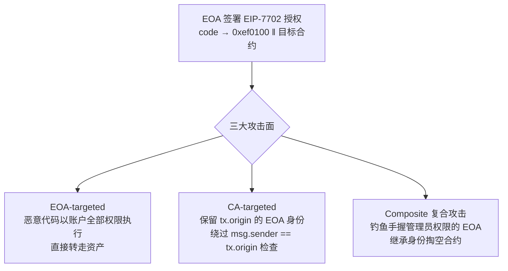

## TL;DR

EIP-7702 让普通钱包一键升级成智能账户，但这项发表在 USENIX Security 2026 上的大规模实证研究发现——**超过 63% 的授权交易指向了恶意合约**。更关键的是方法论上的警示：链上只验证签名的密码学正确性，不验证你授权的那个地址是否可信；钱包 UI 只显示"升级账户"四个字，不显示合约地址和代码。安全边界从代码转移到了用户那一次签名上，而签名恰恰是最软的一环。

> 📄 论文：*Revealing the Dark Side of Smart Accounts: An Empirical Study of EIP-7702 Incurred Risks in Blockchain Ecosystem*
> 👥 作者：Mingyuan Huang（HKUST）、Han Liu（南开大学，通讯作者）、Shuo Yang（中山大学）、Daoyuan Wu（岭南大学）、Shuai Wang（HKUST）
> 🏛 会议：35th USENIX Security Symposium（USENIX Security 2026），pp. 1887–1905
> 🔗 [USENIX 页面](https://www.usenix.org/conference/usenixsecurity26/presentation/huang-mingyuan) · [论文 PDF](https://www.usenix.org/system/files/conference/usenixsecurity26/sec26_prepub_huang-mingyuan.pdf)

## 背景：账户抽象这条路是怎么走偏的

以太坊的账户模型从一开始就是分裂的：**EOA**（普通钱包）由私钥控制，只能做简单的原子操作，不支持批量、多签、gas 代付；**CA**（合约账户）功能强大，但你要先把资产搬到一个新地址，gas 逻辑和资产归属是割裂的。这种"资产所有权"和"执行逻辑"分离的设计，让钱包管理和 gas 供给都变得别扭。

社区试过两条路。ERC-4337 走了"另起炉灶"路线：搞一套独立的 mempool 和 Bundler，不动协议层，代价是生态割裂、 adoption 缓慢。EIP-7702 走了"原地升级"路线：2025 年 Pectra 升级引入，新增交易类型 `SET_CODE_TX_TYPE (0x04)`，用户签一个授权元组 `(chain_id, address, nonce, y_parity, r, s)`，自己的 EOA 的 code 就被置为 `0xef0100 || address`——一个系统级委托代理。此后所有打到这个账户的调用都被委托给目标合约，**地址、余额、交易历史全保留**，随时可以把 address 置零打回原形。

听起来很美：不用换地址就有智能账户的全部能力。但论文指出了一个被严重低估的设计细节：**链上验证只检查签名的密码学正确性（r, s, y_parity），对 address 字段没有任何约束**。你授权给谁，全靠你自己肉眼验证。而钱包 UI 里，这笔交易通常只显示为一句"upgrade account"或"authorize smart account logic"，**看不到合约地址，看不到代码**。合法升级和恶意升级在用户面前长得一模一样。

## 方法拆解：三类攻击 + 三件套检测工具

论文先搭了一个威胁模型，定义得很实在：攻击者可以创建任意数量的 EOA/智能账户/合约，可以发起任何类型的交易（包括用闪电贷临时撑大资金体量）；但**不能直接偷你的私钥**——他们赌的是"总有一部分用户会被钓鱼签下恶意授权"（钓鱼网站、误导性 UI、社交工程）。

然后按受害者类型，把攻击分成三类：

**EOA-targeted（针对用户）**：诱导用户把 EOA 绑定到恶意合约。此后恶意代码以该账户的**全部权限**执行——转走资产、任意调用。论文强调了一个范式转移：传统恶意合约是"外部敌人"，代码跑在自己的合约上下文里，靠重入、预言机操纵等手法从外部偷；而 EIP-7702 的攻击是 **"inside-the-account"**——恶意逻辑直接继承受害账户的存储、余额和签名权，在账户内部作案，调用链更短、更难被察觉。

**CA-targeted（针对合约）**：升级后的智能账户保留了 EOA 的身份（`tx.origin`）。很多老合约用 `msg.sender == tx.origin` 来判断"调用者是人类而非合约"——Pectra 之前这个假设成立，之后彻底失效。攻击者顶着 EOA 的身份绕过这类访问控制，做以前只有 EOA 能做的事。

**Composite（复合攻击）**：组合拳。专挑手握智能合约管理员权限的 EOA 下手，先拿下这个 EOA（第一类手法），再继承它的管理员身份，间接掏空合约。一次钓鱼，双重收获。

为了实证，团队造了一套三件套检测工具：**Transaction analyzer**（从 2284 万笔历史交易里筛可疑交易）→ **Decompiler**（从字节码反编译还原语义事实）→ **Contract analyzer**（跨合约静态分析找恶意模式），三类攻击各配一套检测器。

## 实验与数据：366 万笔授权交易里挖出的东西

数据集：7 条支持 EIP-7702 的链（Ethereum、BNB Chain、Polygon、Optimism、Arbitrum、Base、Gnosis），2284 万笔历史交易中的 **3,664,166 笔授权交易**（截至 2025 年 7 月中），当时全网智能账户总数已超过 300 万。

结果很扎眼：

- **924 个恶意合约被实锤**：793 个 EOA-targeted、124 个 CA-targeted、7 个复合攻击；其中 **10 个是首次披露的零日攻击地址**，还经过了其他安全公司的交叉复核。论文同时发布了**首个公开的 EIP-7702 攻击跨链数据集**。
- **真实损失 2,362,848 美元**，另有约 **1014 万美元**资产因老合约安全假设被打破而暴露在风险中。现实中已有 DeFi 项目因此损失约 100 万美元。
- **超过 63% 的授权交易**与恶意 EOA-targeted 攻击相关；授权榜 Top 30 的热门合约里**将近一半由攻击者控制**——"热门升级目标"一半是坑。
- **真实攻击长什么样**：论文解剖了一个恶意钱包合约，它几乎复刻了良性钱包的 `executeBatch()` 函数，暗地里加了 `set_destination()`（可任意设置收款地址）并重写了 `receive()`——**任何打进这个账户的 ETH 会被自动转发给攻击者**。这类授权大多发生在用户访问钓鱼网站、或从不可信渠道复制"空投/ bonus"交易数据之后。更狡猾的是，有些恶意合约刻意**模仿流行钱包的实现**混入正常升级流量，还有的不开源代码，让用户无从查证。
- **攻击者大多"不装了"，但也有狡猾的**：多数根本不做代码混淆，函数名里直接写着恶意关键词——这片攻击面新到连"反检测军备竞赛"都还没开始。但一部分攻击者得手后会把智能账户**重新绑定回良性合约"洗白"**，只看当前链上状态会漏网，必须回溯**完整的授权历史**才能抓到。

## 相关工作对比：为什么这篇是第一篇

在它之前，对 EIP-7702 安全风险的讨论停留在两个层面：一是 EIP 文档自身的警告（规范里就写了恶意 attached logic 的风险，但没人系统验证）；二是零散的真实事件报告（几个 DeFi 项目被钓鱼，损失约百万美元量级）。没有人回答过三个基本问题：攻击面到底有几类？野外到底有多少恶意合约？损失和风险敞口到底多大？

这篇的贡献在于把"感觉有风险"变成了"有数字的风险"：第一个系统性分类、第一个跨链大规模测量（366 万笔授权）、第一个公开数据集。它不是发现了某个 0day，而是**给整个生态画出了第一张威胁地图**。

## 局限与开放问题

- **数据截止 2025 年 7 月中**：之后的 EIP-7918（保留价）、Fusaka 等变化未覆盖，攻击手法也在进化，数字是下限不是上限。
- **检测依赖已知模式**：工具链针对三类已定义攻击设计，新型手法（比如更隐蔽的社会工程 + 合约组合）可能漏网，攻防是军备竞赛。
- **只覆盖 7 条 EVM 链**：其他支持 7702 的链不在视野内。
- 开放问题有三个，个个都值得做：① **钱包 UI 该怎么展示授权风险？**（现在只显示"升级账户"四个字是灾难性的）；② **协议层能否给 authorization 加护栏？**（比如模拟执行、allowlist、延迟生效）；③ **存量老合约的 `tx.origin` 假设怎么系统性修复？**（1014 万美元敞口不会自己消失）。

## 一点思考

读完这篇，最大的感受是：**基础设施的"易用性升级"，永远先被黑产吃透**。EIP-7702 是以太坊账户抽象路上必然的一步，但 63% 这个数字应该让每个钱包开发者后背发凉。

给普通用户的三条实操建议：

1. **7702 授权 = 交出账户 root 权限**，不是"签个名"那么轻。只给完全信任的 dApp 授权，警惕"签个名领空投"。
2. 授权目标合约地址先查一查（链上浏览器、社区黑名单），别跟着"热门榜"无脑点——榜上一半可能是攻击者的。
3. 定期检查自己账户的 code 字段，长期不用的授权及时撤销（置零恢复）。

给开发者的提醒更直接：**立刻审计代码里所有 `tx.origin` 的使用**。"EOA = 人类"这个假设已经死了，Pectra 之后，任何 EOA 背后都可能是一段合约代码。

最后说一句：这篇论文真正有价值的不是 924 这个数字，而是它证明了一件事——**当"升级"变成一键操作，信任假设就从"代码是否正确"转移到了"用户是否看懂了自己在签什么"**。而在当前钱包 UI 下，用户根本看不懂。这才是最危险的地方。

---

*本文为论文研读笔记，观点为个人解读。引用数据均来自论文原文，感兴趣请直接阅读 [论文 PDF](https://www.usenix.org/system/files/conference/usenixsecurity26/sec26_prepub_huang-mingyuan.pdf)。*
