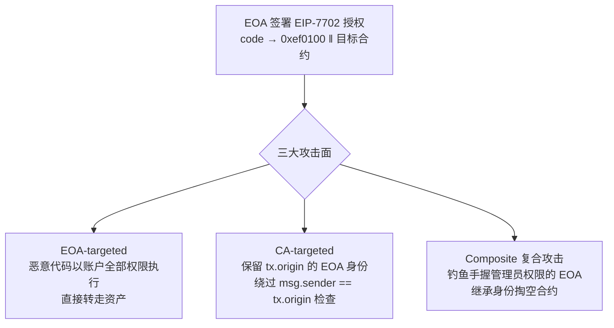

## TL;DR

一句话：EIP-7702 让普通钱包一键升级成智能账户，但这项发表在 USENIX Security 2026 上的大规模实证研究发现——**超过 63% 的授权交易指向了恶意合约**。"升级"按钮按下去的那一刻，你的账户可能就不再属于你了。

> 📄 论文：*Revealing the Dark Side of Smart Accounts: An Empirical Study of EIP-7702 Incurred Risks in Blockchain Ecosystem*
> 👥 作者：Mingyuan Huang（HKUST）、Han Liu（南开大学，通讯作者）、Shuo Yang（中山大学）、Daoyuan Wu（岭南大学）、Shuai Wang（HKUST）
> 🏛 会议：35th USENIX Security Symposium（USENIX Security 2026），pp. 1887–1905
> 🔗 [USENIX 页面](https://www.usenix.org/conference/usenixsecurity26/presentation/huang-mingyuan) · [论文 PDF](https://www.usenix.org/system/files/conference/usenixsecurity26/sec26_prepub_huang-mingyuan.pdf)

## 先说清楚：EIP-7702 是什么

EIP-7702 是 2025 年以太坊 Pectra 升级引入的账户抽象方案，核心思想一句话：**让普通钱包（EOA）不用换地址，就能拥有智能合约账户的能力**。

机制上，它新增了一种交易类型 `SET_CODE_TX_TYPE (0x04)`，里面带一个 `authorization_list`。用户签一个授权元组 `(chain_id, address, nonce, y_parity, r, s)`，自己的 EOA 的 code 就会被置为 `0xef0100 || address`——一个系统级委托代理。此后打到这个账户的所有调用，都会被委托给目标合约执行，**地址、余额、交易历史全部保留**，随时可以把 address 置零打回原形。

打个比方：相当于给你的钱包装了个"外挂大脑"。方便是真方便，批量交易、gas 代付、会话密钥全都有了。但问题也出在这里——**这个"大脑"可以是别人写的**。

## 这篇论文做了什么

这是第一篇系统性实证研究 EIP-7702 安全风险的论文。研究团队做了三件事：

1. **按受害者类型，把智能账户攻击分成三类**：EOA-targeted（针对用户）、CA-targeted（针对合约）、Composite（复合攻击）；
2. **自研检测工具链**：交易分析器（从海量链上数据里筛可疑交易）+ 反编译器（从字节码还原语义）+ 合约分析器（跨合约静态分析）；
3. **大规模实测**：覆盖 7 条支持 EIP-7702 的链（Ethereum、BNB Chain、Polygon、Optimism、Arbitrum、Base、Gnosis），分析了 2284 万笔历史交易中的 **3,664,166 笔授权交易**（截至 2025 年 7 月中），当时全网智能账户总数已超过 300 万。

## 三类攻击是怎么打的

**第一类：EOA-targeted（针对用户），最猖獗。** 攻击者诱导用户签一个授权，把 EOA 绑定到恶意合约上。此后恶意代码以该账户的**全部权限**执行——转走资产、任意调用，无所不能。论文发现**超过 63% 的授权交易**与这类恶意攻击相关，而授权榜 Top 30 的热门合约里**将近一半由攻击者控制**。也就是说，你在链上看到的"热门升级目标"，一半可能是坑。

**第二类：CA-targeted（针对合约），最阴险。** 升级后的智能账户保留了 EOA 的身份（`tx.origin`）。很多老合约用 `msg.sender == tx.origin` 来判断"调用者是人类而非合约"，Pectra 之前这个假设成立，之后彻底失效。攻击者顶着 EOA 的身份，可以绕过这类访问控制，做以前只有 EOA 能做的事。论文估计，**约 1014 万美元**的资产正因为这类被打破的安全假设而暴露在风险中。

**第三类：Composite（复合攻击），最致命。** 攻击者专门挑那些手握智能合约管理员权限的 EOA 下手，先拿下这个 EOA（第一类手法），再继承它的管理员身份，间接掏空合约。一次钓鱼，双重收获。

## 数字背后：几个扎眼的发现

- **924 个恶意合约被实锤**：793 个 EOA-targeted、124 个 CA-targeted、7 个复合攻击；其中 10 个是首次披露的零日攻击地址，还经过了其他安全公司的交叉复核。
- **真实损失 2,362,848 美元**，另有约 1014 万美元资产处于风险敞口中。现实中已有 DeFi 项目因此损失约 100 万美元。
- **攻击者大多"不装了"**：多数根本不做代码混淆，函数名里直接写着恶意关键词——说明这片攻击面新到连"反检测军备竞赛"都还没开始。
- **但也有狡猾的**：一部分攻击者得手后，会把智能账户重新绑定回良性合约来"洗白"。只看当前链上状态会漏网，必须回溯**完整的授权历史**才能抓到。
- 论文还发布了**首个公开的 EIP-7702 攻击跨链数据集**，给后续研究铺了路。

## 一点思考

读完这篇论文，最大的感受是：**基础设施的"易用性升级"，永远先被黑产吃透**。EIP-7702 是以太坊账户抽象路上必然的一步，但 63% 这个数字应该让每个钱包开发者后背发凉。

给普通用户的三条实操建议：

1. **7702 授权 = 交出账户 root 权限**，不是"签个名"那么轻。只给完全信任的 dApp 授权，警惕"签个名领空投"。
2. 授权目标合约地址先查一查（链上浏览器、社区黑名单），别跟着"热门榜"无脑点。
3. 定期检查自己账户的 code 字段，长期不用的授权及时撤销（置零恢复）。

给开发者的提醒更直接：**立刻审计代码里所有 `tx.origin` 的使用**。"EOA = 人类"这个假设已经死了，Pectra 之后，任何 EOA 背后都可能是一段合约代码。

最后说一句：这篇论文的价值不在于发现了某个具体漏洞，而在于用 366 万笔交易的硬数据证明了一件事——**当"升级"变成一键操作，安全边界就从代码转移到了用户的那一次签名上**。而签名，恰恰是整个系统里最软的一环。

---

*本文为论文研读笔记，观点为博主个人解读。引用数据均来自论文原文，感兴趣请直接阅读 [论文 PDF](https://www.usenix.org/system/files/conference/usenixsecurity26/sec26_prepub_huang-mingyuan.pdf)。*
