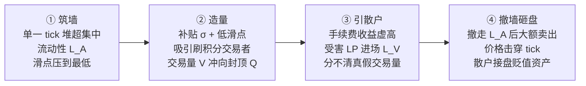

## TL;DR

给 DEX 做市池发积分、补交易量，本意是引来真实交易、养深流动性；但这篇 USENIX Security '26 论文证明，补贴一旦超过某个临界阈值，就会变成攻击者的免费诱饵。攻击者先在单一 tick 上堆出超集中流动性"筑墙"，把低滑点和补贴双重红利摆在台面上，刷积分的交易量随之而来，虚高的手续费收益再把散户 LP 引进来接盘；等猎物足够多，攻击者撤墙、砸盘、抽身，留下散户抱着贬值的代币。作者在 BNB Chain 上十个月的实测里抓到 29 起攻击、涉及 18 个池子，99 个受害者地址净亏 287 万美元，而攻击者在 23 个事件里总共赚走 2388 万美元。最扎心的结论是：这不是偶发事故，而是激励设计的内生产物——补贴越猛，攻击面越大。

## 论文信息卡

- **标题**：Liquidity Mining as an Attack Surface: Incentive-Induced Liquidity Attacks in Concentrated Liquidity Market Makers
- **作者**：Nora Sinong Lu*、Chon Kit Lao*（澳门大学）、Yunlong Mao（南京大学）、Xiaobo Zhou（澳门大学）、Ruizhe Jia（斯坦福大学）、Kanye Ye Wang（澳门大学）（*为共同一作）
- **会议**：35th USENIX Security Symposium（2026 年 8 月 12–14 日，美国巴尔的摩）
- **原文链接**：https://www.usenix.org/conference/usenixsecurity26/presentation/lu-sinong
- **全文 PDF**：https://ylmao.github.io/papers/security26-lu-sinong.pdf

## 背景

集中流动性做市商（CLMM，以 Uniswap v3 为代表）允许 LP 把资金集中在某个价格区间而非整条价格曲线，资本效率大幅提升，但代价是流动性分布本身变成了影响价格稳定和成交质量的关键变量。与此同时，DEX 冷启动最常用的手段是"按交易量发积分"：Blast、Aerodrome、PancakeSwap 都在用，Binance Alpha Points 更是典型——用户在指定"Alpha 代币"池子里刷交易量攒积分，积分未来可兑换空投或代币分配。这类补贴是池子之外的外部注入，刷量者只关心"补贴减去滑点和手续费是否为正"，根本不在乎代币本身值多少钱。

问题在于，此前的安全研究几乎都在盯代码层：重入、逻辑漏洞、预言机操纵，或者 MEV 那种交易排序层面的提取。而"激励机制 × 集中流动性"这个交叉点的对抗视角，几乎是空白。补贴参数（补多少、封顶多少）一直被当成增长运营问题，从没被当成安全参数。本文第一次把"发积分"这件事放进攻击模型：补贴制造的可预测交易量，恰好是攻击者最想要的免费诱饵。

## 方法拆解：四步"养套杀"，外加一套博弈论

整套攻击是一个精心编排的四阶段序列，每一步都在为下一步创造条件：

**三类参与者**各司其职：攻击者手里有一批 Alpha 代币库存（token0），目标是换成主流币（token1）；受害 LP 看到高收益进场，他们致命的盲点是**无法区分真实交易需求和补贴刷出来的量**；刷量交易者则对币价完全无感，只要补贴覆盖成本就拼命刷。

作者把这套机制形式化成了一个序贯博弈，几个关键结论值得细品。**定理 1** 说补贴制造交易量有三段式结构：补贴强度 $\sigma$ 低于参与门槛时没人刷；超过门槛后交易量随补贴单调增长；补贴足够大时交易量被项目方设定的封顶 $Q$ 钉死。**引理 2** 进一步给出闭式解 $V^*(\sigma)=\min\{Q,\tilde{V}(\sigma)\}$——这意味着**攻击者能精确预测补贴会造出多少量**，因为 $(\sigma, Q)$ 都是公开参数。

最精彩的是**定理 3 和引理 4**导出的"理性受害者悖论"。受害 LP 的最优进场流动性是 $L^*_V(Q) = \max(0, \sqrt{fQL_A/c_V} - L_A)$，其中 $f$ 是手续费率、$c_V$ 是 LP 感知到的综合成本（含被收割风险）。注意这个式子：即使 LP 完全理性、已经把"可能被砸盘"的风险定价进 $c_V$，只要封顶 $Q$ 足够大，进场依然是笔划算买卖。理性挡不住诱惑，这就是悖论所在——而现实中散户往往还低估风险，实际进场只会更多。

攻击者的利润则由三部分组成：$\Pi_A = fV\frac{L_A}{L_A+L_V} + U_{dump} - c_A X_{sold} - \kappa$，即筑墙期间分到的手续费、砸盘时从残余流动性里抽走的价值，减去库存成本和摩擦。**定理 6** 给出攻击可行性阈值：存在一个临界封顶 $Q^*$，攻击有利可图当且仅当 $Q \ge Q^*$。**推论 7** 把话挑明——平台面临"交易量-安全"根本权衡：想要交易量就得把补贴加到 $Q^*$ 之上，而一旦越过这条线，LP 的亏损就是激励设计的可预期后果，不是意外。

检测方法同样扎实，分四步：先以 229 个 Binance Alpha 代币划定池子宇宙（2025 年 1 月 1 日至 10 月 1 日 BSC 全量 Uniswap v3 风格池的 Mint/Burn/Swap 日志，来自 Allium）；再用 3σ 异常规则抓"单 tick 筑墙（Mint 主导）+ 撤墙（Burn 主导）"配对；然后两阶段验证——撤墙后两小时内价格暴跌 ≥10%，且必须由**同一池子内**的 Swap 实现（排除跨池噪音）；最后做 tick 级重放，按行为给地址贴角色标签：撤墙时仍有流动性的是受害者，又筑墙又砸盘的是攻击者。

## 实验与数据：在 BSC 上抓现行

检测流水线最终锁定 **29 起攻击事件、18 个池子**，其中 13 个事件造成实质亏损。受害者侧：99 个正亏损地址，净损失 **287.4 万美元**（未收回的主流币价值 1046.9 万，减去手里 Alpha 代币残值 759.4 万）。损失以 USDT 为主（280.5 万），USDC 5.6 万，WBNB 约 1.4 万。作者还做了稳健性检查：换一种破位时刻定义（池内首次出 tick vs 小时级 10% 跌幅），受害者只差 9 个地址，总损失只差 2.25%——结论不依赖拍脑袋的参数。

**集中度极其夸张**：最大单个受害者占总损失的 57.1%，前五名占 84.6%；最大单个事件占 86.8%，前五事件占 97.4%。这说明被收割的主要是几个"大户 LP"，散户是陪跑，但机制对所有人都一样危险。

攻击者侧更触目惊心：23 个事件里识别出 149 个攻击者地址，**总利润 2388.4 万美元**，是受害者净损失的 8 倍多。注意论文明确提醒：两者不是零和关系——攻击者利润还包括砸盘时穿过受害者集合之外流动性抽走的价值。最大单个事件利润 1093.8 万（占 45.8%），事件利润中位数 9.95 万；131 个地址盈利，地址利润中位数 2.13 万。换句话说，这套打法高度可复制，大鱼小鱼都能吃。

时间结构完美复刻"慢筑快收"：12/29 的事件筑墙超过 3 天（让散户充分看到"高收益"），18/29 从开始撤墙到价格破位不到 24 小时（散户来不及跑），19/29 在流动性见顶后 1 小时内就开始拆墙。量价数据也对得上模型：准备期 20/29 事件交易量高于基线（多为温和的 1–1.5 倍，墙在悄悄吸量）；攻击期 17/29 高于基线、4 起超过 5 倍（砸盘放量）；破位后 23/29 跌回基线以下——**量是借来的，墙一撤就还**。价格方面，筑墙期 16/29 事件价格波动在 0–10%（墙把价格钉住，岁月静好）；撤墙后 20/29 跌超 10%，其中一半跌幅在 20%–50%，只有 1 起上涨。波动率中位数从准备期的 0.0119（全阶段最安静）飙到破位后的 0.8843。机械层面，18/29 事件在破位时单 tick 流动性被抽到**归零**，另有 7 起抽掉 80%–99%——先撤墙再砸盘，实锤。

作者还堵住了几个质疑口：2650 万笔刷量交易中只有 504 对"原子对冲"（0.0038%），说明量不是左右手互倒刷出来的，是真被墙的低滑点吸引来的；5 个**无激励**的高交易量 PancakeSwap v3 池用同样方法检测，0 起命中，最大撤资后跌幅仅 2%；人工核验确认没有"把墙拆到相邻 tick 打掩护"的案例，攻击者地址与代币部署者地址零重叠——排除项目方自导自演。

## 相关工作对比

和智能合约漏洞研究（重入、逻辑错误、预言机操纵）相比，本文的攻击**不依赖任何代码 bug**，合约审计查不出问题，形式化验证也验不出——漏洞在经济学里，不在代码里。和 MEV 相比，MEV 玩的是区块内的交易排序，时间尺度以秒计、受害者是被动被夹；而这是天级别的"养套杀"，受害者是**自愿**进场的 LP，被收割的是他们自己的贪婪。和传统金融的 pump-and-dump、对敲相比，链上版本多了两个作弊器：可编程的集中流动性墙让"控盘"成本极低，公开的补贴参数让攻击者能精确算出 $Q^*$ 再动手。和此前的空投/积分策略行为研究相比，前人只研究"刷量者怎么玩"，本文第一次把"补贴→造量→引流动性→收割"做成完整博弈模型，并用十个月链上数据大规模验证——从机制解释升级到了可证伪的科学。

## 局限与开放问题

- 只抓"单 tick"的干净形态：墙分散到多个相邻 tick 的变体可能漏网，实际攻击只多不少。
- 检测阈值（3σ 异常、10% 跌幅）是操作性选择，边界案例换参数可能增减。
- 无激励池对照组只能算"情境证据"而非因果推断，隔离不了激励之外的市场差异。
- 角色标签靠链上行为推断，私下串谋、链下关联地址网抓不到。
- 损失是部分估计：Alpha 代币持有者的账面损失、攻击范围外的流动性都没计入。
- 四个缓解方案（补贴封顶与费率校准、奖励延迟结算、风险信息披露、异常触发的动态封顶）都是设计建议，没经过实战检验。
- 开放问题：多 tick 变体检测、补贴参数的最优动态控制、把"墙检测"做进钱包和聚合器的风险提示——LP 进场前就该看到"该 tick 流动性 90% 来自单一地址"的警告。

## 一点思考

对 LP 来说，判断标准可以很粗暴：一个池子"年化高得离谱、价格却纹丝不动、流动性还挤在单一 tick 里"，第一反应应该是"这是墙，不是机会"，而不是"发现宝藏"。对平台方，结论更刺耳：补贴参数 $(\sigma, Q)$ 从今天起是安全参数，不是增长参数——$Q$ 设多高，等于给攻击者写好了盈利保证书。我的判断是：积分激励这类外部性补贴，迟早要像合约审计一样成为 DEX 上线的标配安全评审项；否则下一轮牛市的积分大战，就是下一批散户的万人坑——而这篇论文，已经把坑的图纸公开了。

## 原文链接

- USENIX Security '26 展示页：https://www.usenix.org/conference/usenixsecurity26/presentation/lu-sinong
- 全文 PDF：https://ylmao.github.io/papers/security26-lu-sinong.pdf
