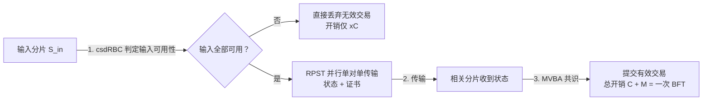

## TL;DR

分片链扩容的瓶颈早就不在单片能跑多快，而在跨片交易怎么协调：分片越多，跨片交易占比越高，协调成本越能把系统拖垮。USENIX Security 2026 的 Logos 换掉了协调范式：**不再用两阶段提交（2PC）加回滚，而是「广播-传输-共识」三段式**。输入分片先用轻量广播原语 csdRBC 判定输入是否可用，无效交易直接丢弃，不进昂贵的共识回滚；有效交易再经并行单对单传输（RPST）送到相关分片，最后由 MVBA 共识提交。结果是：有效跨片交易的片内开销降到 $kB$（$k$ 为相关分片数，$B$ 为一次 BFT 成本），跨片通信开销降到 $O(b\lambda)$，1000 个 AWS 节点、4 个区域的广域网实测峰值吞吐 **132.8 ktx/s**，跨片网络用量只有 Kronos 的 **1/210**，无效交易泛洪下吞吐仍是 Kronos 的 **2.86 倍**。

## 论文信息卡

- **标题**：Logos: Robust Sharding Blockchain With Fast Processing and Optimal Cross-Shard Overhead
- **作者**：Yizhong Liu、Boyu Zhao、Yuxuan Hu、Haojun Tan、Feiang Ran、Andi Liu、Zhuocheng Pan、Yuan Lu、Song Bian、Jianwei Liu、Zhenyu Guan
- **单位**：北京航空航天大学网络空间安全学院、北京先进创新中心未来区块链与隐私计算、中国科学院软件研究所
- **会议**：USENIX Security 2026（第 35 届，Baltimore，论文页码 1047–1066）
- **原文链接**：https://www.usenix.org/conference/usenixsecurity26/presentation/liu-yizhong
- **论文全文 PDF**：https://www.usenix.org/system/files/conference/usenixsecurity26/sec26_prepub_liu-yizhong.pdf

## 背景

分片的想法很直观：把全网节点分成若干分片，每个分片只存一部分状态、只处理一部分交易，分片数一多，总吞吐就能跟着涨，Harmony、Nightshade、Polkadot 都走了这条路。但裂缝也很明显：**一笔交易的输入和输出往往不在同一个分片**。论文引用已有数据指出，16 分片系统里跨片交易（CSTX）占比可超过 99%——分片切得越细，系统的主要工作就越是「跨片协调」，而非单片记账。

跨片协调的核心目标叫原子性：要么所有相关分片都提交有效交易，要么都拒绝无效交易，不能出现「A 分片扣了钱、B 分片没到账」的中间态。经典两阶段提交要每个输入分片先用 BFT 锁定输入、再用一次 BFT 执行，片内开销高达 $2kB$。Kronos（NDSS'25）是此前最强的异步分片方案，它走「先执行、后回滚」的捷径：有效交易只需 $kB$，但无效交易要再花一次 BFT 回滚，开销变成 $2xB$（$x$ 为受影响分片数）。攻击者只要不断提交无效跨片交易，就能逼各分片反复回滚、拖垮有效吞吐——论文把「泛洪下能否保持有效交易处理能力」单独定义为鲁棒性。

另一个成本在分片之间：异步网络没有送达时限保证，单点协调员可能直接不转发消息；而为可靠送达搞分片间广播，又会让跨片通信开销膨胀到 $O(n^2b\lambda)$，跨地域部署时长链路带宽本就稀缺。Logos 要同时解决的，正是这两个问题：**片内别为无效交易付 BFT 的价，分片间别为可靠送达付广播的价**。

## 方法拆解

Logos 的整体流程可以用一张图概括：

### 第一步：csdRBC，先判定、再决定要不要花大钱

传统 2PC 的问题在于，它用一整轮 BFT 去回答一个本来更简单的问题：「这笔交易的输入在我这个分片里到底存不存在、够不够花？」Logos 为此设计了新原语 csdRBC（cross-state determine reliable broadcast，跨状态判定可靠广播），只做「判定」，不做「执行」。

它的关键设计有两处。第一是**对齐状态高度**：提案里附带提案者本地的区块高度，每个节点只有在本地状态推进到该高度后才开始投票。这解决了异步网络里最常见的冲突来源——两个节点对「当前余额是多少」看法不一致，并不是谁在作恶，只是看到的链高度不同。第二是**一票制**：在同一个高度上，每个诚实节点对一组冲突交易（花同一笔钱的两笔交易）只投一票。所有诚实节点最终能收集到冲突交易集合，并按哈希顺序等公共规则解决冲突，从而拼出一份一致的可用性证书：至少 $2f+1$ 个签名，其中至少 $f+1$ 个来自诚实节点。

这个设计的经济学意义很直接。有效交易的片内成本是 csdRBC 成本 $C$ 加上最后共识成本 $M$，而在异步 BFT 里 $B = C + M$，所以总成本恰好等于一次 BFT，是理论下限，不可能再低——因为任何安全更新都至少要经过一次共识。无效交易更便宜：各输入分片判定完不可用就直接丢弃，总成本只有 $xC$，而 $C < B$，彻底绕开了 Kronos 那条「执行后再回滚」的昂贵路径。攻击者再想用无效交易泛洪，系统付出的只是轻量广播的价，而不是 BFT 回滚的价。

### 第二步：RPST，把广播换成「每人只发一片」

判定完成后，输入分片要把可用性状态和证书送到所有相关分片。Kronos 的做法是分片间广播：发送分片的每个节点都向接收分片广播，消息量和长链路数都随节点数平方增长。Logos 的 RPST（reliable parallel single-to-single transmission，可靠并行单对单传输）把这件事拆成了三步。

首先是**纠删编码**：发送分片用 Reed-Solomon 编码把消息切成 $n$ 个片段，任意 $r$ 个正确片段就能还原原文；同时对所有片段建一棵 Merkle 树，用门限签名给树根背书，片段加 Merkle 证明就是可验证的「身份证」。然后是**单对单发送**：每个发送节点只把自己那一片发给唯一一个接收节点，而不是广播给所有人，长链路数从 $O(n^2)$ 降到 $O(n)$。最后是**片内重建**：接收分片里只要拿到 $f+1$ 个正确片段（每分片满足 $n \ge 3f+1$，恶意节点最多搞砸 $f$ 份，诚实片段一定够），就能在片内广播这 $f+1$ 份、还原完整消息，而且这一步可以嵌进正常的异步 BFT 执行，不额外增加通信轮次。

合起来看，跨片通信总量从 $O(n^2b\lambda)$ 压到 $O(b\lambda)$：总传输比特数与消息本身的信息量同阶，论文证明这是信息论意义上的最优。片段和证书还是在 csdRBC 执行中自然生成的，不必为传输再单独跑一轮认证。

### 第三步：共识提交，只对有效交易动用 MVBA

收到全部输入状态后，相关分片对有效交易跑 MVBA（多值验证拜占庭共识）达成提交；对无效交易，各分片直接丢弃。论文还给出了部分同步网络下的变体：输入分片的共识阶段可简化为 FINALIZATION 消息广播，收到 $2f+1$ 条确认即可提交，逻辑与异步版一致。整个模式因此是可组合的：csdRBC、RPST、MVBA、BFT 都是可替换的模块，未来出现更快的异步 BFT 或广播原语，可以直接换进去。

## 实验与数据

实验在真实广域网上部署，而非单机模拟：Go 实现，片内共识用 Speeding Dumbo 与 Speeding MVBA，SHA-256、BLS 签名、Reed-Solomon 纠删编码；AWS EC2 c5.xlarge 横跨弗吉尼亚、香港、东京、伦敦 4 区，最多 1000 节点，每节点 1 vCPU（3GHz）与 2GB 内存；交易 128 字节，近似以太坊转账大小；每分片 50 节点，批量 $b$ 从 2k 到 200k。

**整体性能：吞吐随规模上涨，而不是随规模崩掉。** 在 1000 节点、批量 200k 时，Logos 达到峰值 **132.8 ktx/s**；在批量不超过 10k、规模不超过 1000 节点时，延迟始终低于 **3.43 秒**。1000 节点下吞吐-延迟权衡点为 117.70 ktx/s，说明它没有用「无限放大批量」来换吞吐数字。

**跨片比例：即使几乎全是跨片交易，系统也不趴下。** 随着跨片占比上升，吞吐下降、延迟上升是必然的，但即使在 90% 跨片占比下，Logos 仍保持 **43.5 ktps**——分片越多、跨片占比越高的场景，恰恰是它优势最大的场景。

**与 Kronos 的正面对比：全面占优，且优势随规模放大。** 在每分片 50 节点、分片数 10 到 20 的对比中，Logos 的吞吐超过 Kronos 的 **1.87 倍**，延迟只有 Kronos 的 **50%**。跨片网络用量差距更夸张：处理 60 万笔跨片交易时，Logos 只用约 230 MB，Kronos 要约 48300 MB，**比值 1/210**，且 Logos 的用量随分片规模几乎不变，而 Kronos 的用量随分片规模急剧上升。这正是 $O(n^2)$ 与 $O(n)$ 在真实流量账单上的体现。

**鲁棒性：泛洪攻击下的分水岭。** 当无效跨片交易占比达到 40% 时，Kronos 的有效交易吞吐与总吞吐都明显下滑——每个无效交易都要触发回滚；而 Logos 的有效交易处理比例仍保持 **78%**，吞吐达到 Kronos 的 **2.86 倍**。总吞吐在泛洪下还略有上升：处理无效交易更便宜，省下的资源留给了有效交易——这正是「无效交易只付广播价」在实验中的兑现。

## 相关工作对比

分片跨片处理的发展史，基本就是一部「怎么降低协调成本」的历史。Omniledger 和 RapidChain 沿用 2PC 思路，片内开销分别是 $2kB$ 和 $kB$（有效）/$2kB$（无效），且部分方案依赖网络时序假设；Chainspace、ByShard 同样是 $2kB$ 的量级，且不完全支持异步网络；AHL 把开销推高到 $(2k+3)B$。Kronos 是此前最强的异步方案：有效交易 $kB$，但无效交易要 $2xB$，且不具备抗泛洪的鲁棒性。Logos 在这个谱系里的位置是：有效交易保持 $kB$ 的最优值，无效交易降到 $xC$（$C < B$），跨片可靠传输从 $O(n^2b\lambda)$ 降到 $O(b\lambda)$，同时是表中唯一同时满足异步适用性、强原子性与抗泛洪鲁棒性的方案。

但也要注意：Kronos 的「执行-回滚」在无效交易很少时并不吃亏，Logos 的优势在高跨片比例、高无效交易比例时才充分显现——它解决的是分片扩容到大规模、跨片成为主流之后的瓶颈，而不是小规模分片的日常开销。

## 局限与开放问题

- **安全分片仍是外部假设**：每分片 $n \ge 3f+1$ 的诚实多数是安全性前提，论文讨论了 PoW 参考委员会或许可环境 CA 的配置与轮换方案，但轮换成本与对在线交易的影响未在主实验中验证。
- **实验负载仍是转账型交易**：128 字节交易、EC2 受控网络下的结果很干净，但真实智能合约的状态争用、热点账户、跨片合约调用下的表现，论文未披露同等规模实测。
- **协议组合的工程成本**：csdRBC、RPST、MVBA、BFT 四层组合比 2PC 复杂得多，实现与审计工作量不可小觑，生产级实现仍需实战检验。
- **UTXO 适配只有构造、没有同等实测**：论文给出了 UTXO 模型下的适配思路，但没有给出与账户模型同等规模的性能数据。
- **延迟仍在秒级**：批量 10k 以内延迟可压在 3.43 秒以下，但对亚秒级确认有硬要求的场景，仍需更快的确认层或乐观路径配合。

## 一点思考

分片扩容的真正教训是：协调成本的分布比平均成本更重要，Logos 的价值不在于把有效交易再快一点，而在于把无效交易挡在最便宜的环节，让攻击者无法用垃圾交易绑架整个系统。对做分片链与 Layer 2 的团队来说，这是一个可以直接借鉴的设计原则：先问「拒绝一笔坏交易要花多少钱」，再问「提交一笔好交易有多快」。同时要清醒，Logos 的数字来自受控的 EC2 实验与转账型负载，离生产复杂负载还有距离；但方向是对的——当跨片交易成为主流，跨片协调必须按信息论下限来设计，而不是按「能跑就行」凑合。

## 原文链接

- 论文主页：https://www.usenix.org/conference/usenixsecurity26/presentation/liu-yizhong
- 论文全文 PDF：https://www.usenix.org/system/files/conference/usenixsecurity26/sec26_prepub_liu-yizhong.pdf
