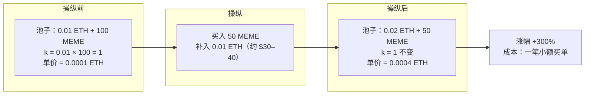
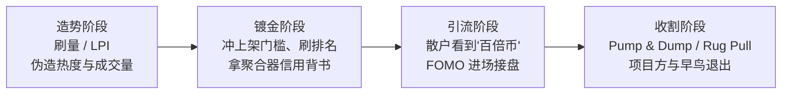

## TL;DR

Meme 币的"百倍神话"，很可能是一场编排好的演出。USENIX Security 2026 的这项研究建了迄今最大的 Meme 币数据集——横跨以太坊、BSC、Solana、Base 四条链的 34,988 个代币，纵向追踪三个月价格。结论扎心：涨幅超过 100% 的 707 个"高收益币"里，**82.8% 有人工造势的痕迹**。手段分两类：老套路是刷量（wash trading）——同一拨人左手倒右手，刷出成交量暴增 1,772%（中位数）、价格却纹丝不动；新套路是论文首次命名并形式化的 **LPI（Liquidity Pool-Based Price Inflation，流动性池价格膨胀）**——利用 AMM 恒定乘积公式，在低流动性池子里花 54 美元（中位数投入）就能把价格抬高 500% 以上，堪称成本最低的"画图"工具。更关键的是"流水线"：造势不是目的，62.9% 被 pump-and-dump 或 rug pull 收割的币，之前都经历过刷量或 LPI；下架币里这个比例高达 86.67%。账本很残酷：超过 17,000 个地址实现亏损累计超 930 万美元，而收割方拿走 778 万美元。结论很直接：Meme 币的高收益，大多不是市场自然选择的结果，而是"先造势、再收割"的两段式剧本。

## 论文信息卡

- **标题**：A Midsummer Meme's Dream: Investigating Market Manipulations in the Meme Coin Ecosystem
- **作者**：Alberto Maria Mongardini（罗马第一大学 / 丹麦技术大学）、Alessandro Mei（罗马第一大学）
- **会议**：USENIX Security 2026
- **原文**：https://arxiv.org/abs/2507.01963（arXiv:2507.01963v2，2026-01-02 修订）
- **开源数据集**：https://doi.org/10.5281/zenodo.17830943

## 背景

Meme 币从 2013 年狗狗币的一个玩笑起步，到 2024 年膨胀成超 1,170 亿美元的市场。Pepe 的 400,000%、柴犬币的 80,000,000% 涨幅，配上 pump.fun 这种"零技术门槛发币"平台，造就了一台永不停歇的造富机器，连美国 SEC 都专门给 Meme 币下了定义：靠网络迷因、热点人物吸引社区购买和交易的加密资产。

但 Meme 币和比特币有个本质区别：它没有任何效用支撑，价格完全系于" perceived interest"（被感知到的关注度）。注意力是可以伪造的——而伪造注意力的成本，远低于创造真实需求。这就是 Meme 币操纵激励极强的结构性原因。

前人的研究都是单点作战：有人测刷量（Victor 等人发现某些交易所 ERC-20 成交量 35% 是刷出来的），有人做 pump-and-dump 检测（Xu 等人），有人分析 rug pull（Zhou 等人分析了 201 个案例；Cernera 等人发现的"1-day rug pull"在 BSC 上卷走 2.4 亿美元），但最多只覆盖两条链。没人系统回答过三个问题：高收益 Meme 币里到底多少是"演"出来的？刷量、拉盘、跑路这些手段是各自为战，还是一套组合拳？有没有前人没见过的新手法？这篇论文就是冲着这三个问题去的：建最大数据集、跨四条链、纵向追踪三个月，把"造势→收割"当成一条完整的流水线来解剖。

## 方法拆解

### 第一步：攒出 34,988 个币的数据集

论文的数据集搭建分三步，思路是"先收已知、再捞新币、最后过滤"：

1. **收已知币**：从 CoinMarketCap（2,930 个）、CoinGecko（2,107 个）、GeckoTerminal（4,735 个）三个聚合器的 meme 分类里抓，去重后得到 8,852 个"认证" Meme 币。
2. **捞新币**：对 DexScreener（30,771 个）和 CoinSniper（44,611 个）两个 DEX 聚合器写爬虫，抓新上线的代币，去重得 65,021 个候选。但这些平台什么币都收，得用 SEC 定义（"受网络迷因/热点启发"）做筛选。作者的办法很巧：对已知 Meme 币的名字做 TF-IDF，找高频特征词，用肘部法则定下 150 个关键词，人工剔除通用词后剩 126 个 meme 专属词（dog 占 7.24%、cat 6.92%、inu 4.82%、AI 4.96%……动物园开会了属于是）。名字命中任一关键词的算 Meme 币，捞出 26,557 个；再加上 pump.fun 平台的币（地址带 .pump 后缀，抽查 100 个 100% 命中 meme 定义），4,140 个。
3. **过滤**：三轮保守过滤——CoinMarketCap 标定的稳定币（4 个）、CoinGecko 非 meme 标签（46 个）、名字含 usd/wrapped/staked 的（182 个），最终 **34,988 个**。地址校验又剔掉 1,065 个无效/未部署地址，剩 31,811 个。

作者明确采取"宁可错杀"的保守策略：精度优先于召回，后面的数字都是下限估计。

### 第二步：纵向追踪 + 多层检测

2024 年 10 月中做经济快照（拿到价格/市值的 20,688 个币），2025 年 1 月中复测（20,327 个，98.25% 存活可查），日线 OHLCV 全程记录；2025 年 1–3 月再加小时线，专门抓收割动作。

检测方法分四套，每套都是"宽进严出"：

- **刷量初筛**：成交量单日暴增 >500% 但价格波动 <5%（正常市场大成交量必然带价格波动），筛出 3,266 个可疑实例、379 个币。
- **刷量实锤**（Dune 交易明细三招）：① 零风险仓位——同一 maker 同日买卖量差 ≤2%（989 例/276 币）；② 循环交易量——单日 ≥99% 成交量来自"既买又卖"的同一批地址（223 例/131 币）；③ 协同操纵网络——同一批 maker 出现在该币的每一轮可疑交易日（42 例/17 币）。合并去重后 **1,043 例、287 个币**实锤。
- **LPI 两阶段**：初筛（24h 涨 >100% 且成交量增幅 ≤20% 或绝对成交量 <$1,000——涨幅与成交量脱钩是 LPI 的指纹，871 例/149 币）→ 交易明细验证（买入量 ≥90% 日成交量、独立交易者 ≤10 个，72 例/40 币）。
- **收割检测**：rug pull（单日跌 >99% 且随后成交量萎缩 >99%）；pump-and-dump（RSI>80 定峰，pump 要求 24h 内涨 >50% 且量增 >500%，dump 要求峰后跌 >30% 且量萎缩到 pump 期一半以下）。阈值比前人研究（10%/400%）保守得多，因为 Meme 币天然波动大，宽松阈值会误伤。

## 实验与数据

### Meme 币的"众生相"：便宜、微型、爱扎堆

先看 tokenomics 画像。价格中位数只有 $4\times10^{-6}$，约 85% 的币单价低于 $0.00001$——"花几块钱买几十亿个"的心理暗示拉满，专治"万一它成了下一个 SHIB"的幻想。市值中位数仅 $4,100，高度投机。链分布：BSC 46.88%（16,405 个）、Solana 33.80%、以太坊 10.90%、Base 2.36%，四链合计占 93.96%。造币高峰在 2024 年 6–7 月，pump.fun 把 Solana 推上 Meme 币发射台。

"市值"这个数字在 Meme 币世界基本是废纸。`catgirl a` 自称市值 1,510 亿美元，流动性几乎为零；47 个号称市值超 10 亿美元的币里，一半以上流动性不到 1,000 美元，88.1% 的流动性不到其市值的 0.1%。市值 = 单价 × 总量，而单价可以被一笔小额交易任意拨动——这正是 LPI 的立足点。

### 三个月后：三分之一涨、三分之一跌、三分之一"已死"

20,327 个币三个月后的成绩单：6,938 个下跌（34.13%，平均跌 38.42%）、6,462 个价格纹丝不动（31.79%——零成交，不是横盘，是"已死"）、6,927 个上涨（34.07%）。其中涨超 100% 的 707 个，涨超 1,000% 的 171 个。光看这个分布，你会觉得"三分之一的币在涨， meme 币也不是不行"。但论文接下来给这 707 个"优等生"做了全面体检。

### 体检报告：82.8% 的"优等生"在作弊

707 个高收益币里，**586 个（82.8%）至少有一项造假或高危痕迹**。细拆：

- **持仓集中**：359 个币（50.78%）的 top10 持有者控制超 30% 供应量（GoPlus/CertiK 的警戒线）；
- **藏持仓**：133 个用 bundle buy（JITO 打包：先加池子紧接着换币，把筹码分散到多个钱包）伪装分散持仓；8 个项目超 30% 筹码躺在"新地址"里；24 个靠"战略空投"把 63.43% 的币发到自己控制的钱包；
- **honeypot**：28 个（只能买不能卖）；
- **刷量实锤**：287 个；**LPI 实锤**：40 个。

### 刷量画像：不是一次性，是"养号式"造势

287 个被实锤刷量的币，平均每个经历 3.63 轮操纵（中位 3 轮，最多 23 轮）——不是打一枪就跑，而是长期"养护"热度。操纵日成交量中位暴增 1,772%，但绝对金额中位数只有 $859（BSC 甚至只有 $394——gas 便宜，刷量成本更低）。首次被操纵的中位时间是发币后 85 天，Solana 最快（61 天）；操纵 campaign 平均持续 86 天。平均每轮只有 3.92 个操纵者，49.28% 的轮次是**单人操作**——一个人、一台电脑，就能给一个币"刷出"繁荣。

刷量的目的很务实：一是冲聚合器的上架门槛（CoinMarketCap/CoinGecko 要求最低交易量），二是刷 DexScreener 按成交量排序的排名。都是为了一个字：**曝光**。

### LPI：花 54 美元"画"出 500% 涨幅的新手法

这是论文最有增量的发现。LPI 利用 AMM 的恒定乘积公式 $x \times y = k$：在低流动性池里，一笔小额买单就能剧烈改变两种代币的比例，从而指数级抬高价格。

论文的例子：池子里只有 0.01 ETH 和 100 个 MEME，操纵者花 0.01 ETH（当时约 30–40 美元）买走 50 个 MEME，单价从 0.0001 ETH 涨到 0.0004 ETH，**一笔交易、+300%**。

实测数据更夸张：72 起实锤 LPI，**投入中位数仅 54 美元**，43% 的事件成本不到 100 美元（以太坊贵一点，中位 560 美元，gas 贵没办法）；但一半事件的涨幅超 500%，36% 超 1,000%，最极端的涨幅超 10,000%——恰恰发生在投入最小的事件里。平均 1.96 个参与者，三分之二是单人作案。和刷量不同，LPI 专挑"老死币"：被操纵的中位币龄 209 天，发币 90 天内中招的只有 9 个——有年头、没人气、池子浅的币最理想，"老"反而显得可信。40 个 LPI 币里 32 个同时持仓高度集中，27 个的 top10 平均控制 80.62% 的供应。

### 收割：造势是手段，跑路是目的

2025 年 1–3 月的小时线抓到 91 次 pump-and-dump（60 个币，54 个在 Solana）：pump 中位涨幅 +143.95%，dump 中位跌幅 -55.82%；63.74% 的 pump 涨超 100%，7 次超 1,000%。**61.67% 的被收割币之前经历过刷量或 LPI**；加上 2 个 rug pull（都在 Solana/以太坊，且都先造势），比例升到 62.9%。

下架币的案例研究把"剧本"钉死了：124 个曾上架 CoinMarketCap/CoinGecko 后被下架的币，67.74% 在上架前有造势痕迹（70 个刷量、27 个 LPI），24.19% 在上架后搞收割（23 个 pump-and-dump、7 个 rug pull）；而被收割的币里，**86.67% 之前都造过势**。标准剧本：先刷量冲上架门槛 → 拿到大平台背书 → 借曝光收割 → 下架消失。

### 账本：930 万美元的"财富转移"

论文算了完整的资金账本。收割方：创建者拿走 206 万美元（分散在 10,614 个地址里——藏持仓实锤了）、"早鸟"获利者 393 万美元、"晚鸟"获利者 179 万美元，合计 **778 万美元**。受害方：pump-and-dump 实现亏损 327 万美元（5,783 个地址，人均亏 617 美元）；rug pull 604 万美元（11,368 个地址，单场平均 67 万美元，最惨一场超 289 万美元、一场波及 4,380 个钱包）。合计**超 930 万美元、17,000+ 个地址**——注意这只是"实现亏损"下限，被套牢没卖的不算。利润集中在操纵者手里，亏损广泛分摊给散户：教科书式的财富转移。

## 相关工作对比

把这篇放到坐标系里看，增量很清楚。前人（Victor、Le Pennec、Xu、Cernera、Zhou 等）都是"单手法、单链/双链"的孤立研究：刷量归刷量，pump-and-dump 归 pump-and-dump。这篇做了三件前人没做的事：① 第一个横跨四条链的 Meme 币全景普查（34,988 个，迄今最大）；② 把"组合拳"本身当研究对象，量化了"造势→收割"的时序链条（62.9%、下架币 86.67%）；③ 命名并形式化了 LPI，补上了"低成本画图"这块检测空白。代价是方法论上处处保守——阈值宁紧勿松，所以所有数字都是下限，真实的水只会更深。

## 局限与开放问题

- **数字是下限**：保守阈值优先精度，漏掉的操纵只会更多，作者自己也承认这是低估。
- **只看链上**：KOL 喊单、Telegram/Discord 群里的宣发节奏，和链上操纵的时间配合没有研究——作者列为未来工作，而这恰恰可能是"引流阶段"的关键一环。
- **分类有盲区**：名字关键词法会漏掉不按套路命名的币（靠 pump.fun 后缀补了一部分，但非 pump.fun 的漏网之鱼仍在）。
- **DEX-only 币没有 CEX 数据**：作者假设"能上 CEX 的币聚合器都会收录"，逻辑上说得通，但严格说是个未经验证的假设。
- **rug pull 全貌未知**：检测范围限定在"涨超 100% 的币"里只抓到 2 个，整片森林的跑路全貌不在本文射程内。
- **双刃剑**：把 LPI 的机制讲得这么透，等于给新手操纵者发了教程。论文在伦理部分正面回应了这一点：手法已在广泛使用、1.7 万个地址已经受害，公开是为了武装防守方，利大于弊。

## 一点思考

这篇最大的实用价值，是把"LPI"这个检测特征交给了行业：看币不能只看涨幅和成交量，得看"涨幅/成交量是否脱钩、池子深度、持仓集中度"三件套，DEX 聚合器应该把这类风险做成显眼的徽章，而不是藏在页面底部的安全评分里——这是论文明确喊话的方向。我的判断是：对普通投资者最有用的只有一句话——**涨得越快、成交量越小的币，越可能是画出来的；"老币突然暴涨"（LPI 专挑老死币）比"新币暴涨"更值得警惕**，因为前者连"早期红利"的叙事都是伪造的。对监管者（比如正在落地的 MiCA 反操纵条款），这篇提供了现成的链上检测模式：LPI 的"涨幅脱钩 + 买量集中 + 参与者极少"三联征，完全可以做成实时预警——而论文数据显示，62.9% 的收割在动手前都经历过造势，这个预警窗口是真实存在的。

## 原文链接

- 论文（USENIX Security 2026）：https://arxiv.org/abs/2507.01963
- 开源数据集（含检测代码与 notebooks）：https://doi.org/10.5281/zenodo.17830943
