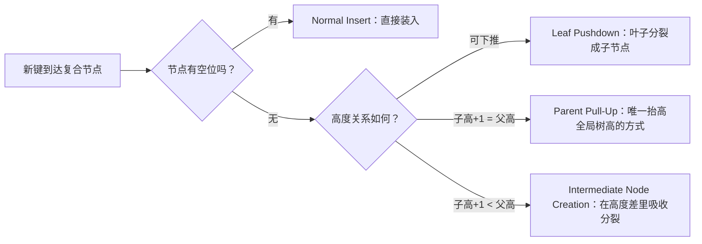

## TL;DR

以太坊出块最贵的一步不是执行交易，而是算状态根：论文测得它占块处理时间的约 78%。Mhot 的做法不是换一套更重的密码学，而是换一棵树——它只在真正能区分键的位置上分叉，让树高由键的实际分布决定，而不是被固定的前缀宽度锁死。结果是：在以太坊主网负载上，写入吞吐比 Merkle Patricia Trie（MPT）高 5–9 倍，证明缩小约一半；面对能把 MPT 路径成功加深 99.97% 的 Nurgle 攻击，Mhot 的成功率是 0%。启示是：状态承诺的瓶颈首先是数据结构问题，其次才是密码学问题。

## 论文信息卡

- **标题**：Mhot: Height-Optimized Authenticated Data Structure for Blockchain State Commitment
- **作者**：Sipeng Xie、Qianhong Wu、Minghang Li、Qiyuan Gao、Bo Qin、Qin Wang（署名单位包括北京航空航天大学、人民大学等）
- **会议**：USENIX Security 2026（论文注明已被该会接收）
- **原文链接**：https://arxiv.org/abs/2606.11736

## 背景

要理解 Mhot，先要理解状态根的用途。共识只对区块头达成一致，区块头里那个短短的状态根就是全网状态的密码学承诺；轻客户端不下载全部状态，凭状态根加一小段证明就能验证某个账户或存储槽的值。这套机制叫认证数据结构（ADS），核心是提交（Commit）摘要、生成证明（Prove）、验证（Verify），且须满足绑定性与简洁性。

以太坊用的 MPT 是按十六进制位逐级分叉的 Patricia Trie，每个更新都要沿根到叶重算哈希。论文指出，其平均路径深度已从 8 层涨到 11 层，单个区块可触发 8,700 次以上磁盘 I/O。更糟的是深度可被人为制造：Nurgle 攻击（S&P 2024）搜索与已有键共享长前缀的键，把压缩路径撑开，每次插入让目标路径加深 1–2 层；以太坊按操作码而非遍历节点数收 gas，攻击者几乎不花钱，验证者却长期买单。剪历史数据、重定 gas 价都只治症状，树结构不变，攻击面就还在。

于是问题变成一个两难：想把树压矮，就要加大每层一次吃掉的位数（span）；但前缀树里 span 和扇出（fanout）是指数耦合的——吃 $s$ 位就要留 $2^s$ 个子槽。要把 256 位键的最坏深度压到 10 层以内，需要 $s\geq 26$，即每个节点约 6,700 万个子槽，根本不可行。反过来，Verkle 树和 LVMT 用向量承诺在密码学上解耦了证明大小与扇出，却要付出可信设置仪式和配对运算的代价，还不原生支持范围证明。Mhot 的切入点是：这个两难是前缀索引本身造成的，换掉索引规则，就不必在“矮树”和“小证明”之间二选一。

## 方法拆解

### 第一步：只在能区分键的位置上分叉

Mhot 的地基是高度最优 Trie（HOT）。对一棵子树里的键集 $K$，一个位位置 $i$ 只有在至少两个键在该位上不同时，才叫判别位。MPT 是不管这些位有没有区分力，都按固定位置成块地吃掉；HOT 只吃判别位。一个扇出为 $k$ 的复合节点最多吃 $k-1$ 个判别位——span 与 fanout 是线性关系，而不是指数关系。取 $k=32$ 时，一个节点最多吃 31 个判别位，256 位键的理论最小深度是 $\lceil 256/31\rceil=9$ 层，而同样扇出的前缀树每层只解决 $\log_2 32=5$ 位，需要 52 层。密集的键区节点少吃位、多装条目，稀疏的键区多吃位、少装条目，树高跟着键的实际分布走，而不是跟着固定的前缀宽度走。论文还证明，对任意键集和扇出，HOT 在 radix trie 中达到可证明的最小高度。

高度最优靠四种插入模式维持：有空位直接插入；碰撞时叶子下推成子节点；只有子高加一恰好等于父高时，溢出才向上传播并抬高全局树高；子高与父高存在差值时，则在差值里建中间节点吸收分裂。正是“高度差当缓冲层”，让 Nurgle 攻击难以把深度传导到已有键。

### 第二步：让 HOT 能当区块链的状态承诺用

HOT 原本是内存索引结构，没有持久化、没有认证。Mhot 补上这一层，关键是内容可寻址索引：节点的数据库键就是它序列化内容本身的哈希。之所以行得通，是因为 HOT 有结构确定性——同一个键集无论按什么顺序插入，得到的树结构都相同，于是所有验证者对同一状态算出相同的节点哈希和状态根，不需要可信设置。这也继承了 MPT 的写时复制语义：改一个节点就失效它到根的整条祖先引用链。代价是子引用从原来 4–8 字节的指针膨胀到 40 字节的标识符，满节点在 $k=32$ 时最多多出约 1KB，论文认为这是为统一序列化格式付出的可接受成本。

但高扇出带来第二个麻烦：朴素证明每层要带全部 $k-1$ 个兄弟哈希，复杂度 $O(h\cdot k)$，$k=32$、$h=5$ 时约 5KB。Mhot 的解法是分层证明：每个复合节点内部再建一棵二叉 Merkle 树，算出子节点 Merkle 根（CMR），节点内容哈希绑定 CMR 而非全部子哈希，证明时每层只需 $O(\log k)$ 个兄弟节点，单点证明降到 1.1–1.4KB，每节点哈希开销约降 6 倍。HOT 的查找本身是“乐观查找”，总能走到某个叶子，最后比对叶子键与查询键即可，于是成员与非成员证明共用同一套流程；多点与范围证明也复用这套两层结构。

### 第三步：批量提交时别重复算哈希

一批插入共享祖先时，朴素做法会把同一批脏节点反复重算。Mhot 的批量提交管线分三招：延迟哈希——脏节点先拿临时 ID 进待提交表，父节点引用临时 ID，算哈希推迟到区块提交，且每节点每区块最多写时复制一次；按高度分层提交——子节点高度严格小于父节点，按高度从低到高扫一遍即满足“先子后父”；同层并行——同高度节点无数据依赖，可并发算哈希，每层只需一次同步屏障。存储层也配合：只序列化已填充字段、掩码只存置位位置；数据库键为 64 位前缀加 256 位哈希共 40 字节，前缀含 1 位类型、55 位版本、8 位高度，让同区块、同高度节点聚在一起，喂给 LSM 树顺序写入；写入还可异步化合并刷盘，均摊 fsync 开销，崩溃后靠预写日志恢复。

## 实验与数据

实验用 Rust 实现，底层 RocksDB（2GB LRU 缓存），取 5 次运行中位数，硬件为 8 vCPU AWS EC2（Xeon Sapphire Rapids 3.2GHz、64GB、EBS 基线 12,000 IOPS）。对照组是 MPT、基于 KZG 的 LVMT（每层 16 位、扇出 $2^{16}$）、上层 6 级放内存的 RainBlock 式配置。负载分合成（100k–1M 条目，100 轮×10 万次随机更新）与真实（重放主网第 13,500,000–13,510,000 号区块，200 轮×50 块）两档。

写入吞吐是最直观的一组数字。10 万键时，异步刷盘版 Mhot 达到 260k ops/s，是 MPT（29k ops/s）的 9 倍，同步版也有 200k ops/s（7 倍），而 LVMT 和 RainBlock 分别只有 120k 和 108k ops/s。规模拉大后差距收窄但仍在：100 万键时 Mhot 异步版 104k ops/s，对 MPT（17k）是 6 倍、对 LVMT（80k）是 1.3 倍、对 RainBlock（38k）是 2.7 倍；真实主网负载上 Mhot 为 130k ops/s，对 MPT（20k）是 6.5 倍、对 LVMT（72k）是 1.8 倍、对 RainBlock（55k）是 2.4 倍。Blake3 变体比 Keccak 快 3–5%，但为保持以太坊兼容，默认仍用 Keccak。

写放大（WA）是另一笔账：10 万键时 Mhot 为 0.9、MPT 为 2.7；100 万键时 MPT 从 2.7 涨到 4.8，Mhot 保持 0.9–1.6，削减 3–3.7 倍；真实负载上 Mhot 异步版 1.1 对 MPT 3.2（2.9 倍）。论文也注明 LVMT 的 WA 更低（0.8–1.0），且 Mhot 刷盘轮次会冲到 4–8，长期总量划算、单轮波动要留意。

树高与证明互相印证。合成负载上 Mhot 树高 5–6 层，比 MPT 和 RainBlock 的 8–9 层浅 35–40%；真实负载上 Mhot 稳定在 6 层，而 LVMT 平均高度虽只有 2，个别分支却深达 9 层，几乎追平 MPT 的最坏 10 层——合约工厂批量建号、顺序建号会让真实地址在某些前缀扎堆，固定 16 位切分会被聚类打穿。单点证明上，Mhot-Blake3 在 100k 键时 1,139 字节、真实负载 1,423 字节，MPT 是 2,304–2,867 字节（约 2 倍），LVMT 最深采样在真实负载上冲到 4,411–19,123 字节（约 Mhot 的 13 倍）。验证延迟反差更大：Mhot-Blake3 真实负载 5.3 微秒、MPT 12.3 微秒，LVMT 的 KZG 配对验证要 38–147 毫秒，差 3–4 个数量级。多点与范围证明随批量线性增长：1,000 个键时分别为 92.6KB 和 95.7KB，证明 2.3–2.8 毫秒、验证 4.9–5.1 毫秒。

Nurgle 实验是全文最硬的一组对照。威胁模型是攻击者控制 52 位前缀、握有一整个区块的 gas 预算（300M gas，约 15,000 次插入），目标是 10,000 个随机采样键。MPT 上 99.97% 的目标键都被成功加深，平均深度从 6.88 涨到 8.91（+2.03 层），最大深度从 9 到 12 层；Mhot 上 10,000 个目标零成功、深度变化为 0——前缀碰撞被复合节点的内部重组（叶子下推、父节点上提）就地吸收，没有传导到已有键。LVMT 则呈现另一种脆弱：已有键的深度确实固定、推不深，但攻击键会污染目标前缀区，攻击前 82.3% 的键在第 0 层、17.4% 在第 1 层，攻击后 99.9% 的攻击键落在第 3 层，之后所有撞上这些前缀的新键都会被迫更深——等于把伤害转嫁给了未来的用户。

## 相关工作对比

要定位 Mhot，可看两条路线。Verkle 树（EIP-6800）用向量承诺把每层证明压到常数大小，代价是可信设置与配对验证；统一二叉树（EIP-7864）面向 SNARK 生成、部分动机是后量子，但生成开销大，且两者都要硬分叉。存储优化路线（RainBlock、LMPTs、ChainKV、LETUS）平均性能很好，但只要底层仍是固定前缀树，Nurgle 的深度机制就还在，只是攻击面被收窄。Mhot 的创新不在单项指标，而在于证明：不引入新密码学假设，只靠“判别位 + 分层证明 + 按高度批量提交”，就能同时拿到矮树、小证明和抗前缀攻击；代价是节点变大、证明生成多一层内部 Merkle 计算、刷盘轮次写放大波动，这些被批量管线部分抵消但没有消失。

## 局限与开放问题

- 评估只做到 ADS 层，没有接进完整执行管线做端到端验证：状态根算快了，整块处理到底快多少，论文未披露，需要后续实测。
- Mhot 干掉了 Nurgle 的前缀碰撞攻击，但可能打开新的攻击面：攻击者可以刻意让判别位冲突集中在某些子树，逼出反复的叶子下推、父节点上提与中间节点创建；这种新攻击的成本与每插入带来的路径增长，论文留给了未来工作，没有给出紧界。
- 并发写入仍是开放问题：不可变节点天然支持无锁并发读，但多写者的协调机制论文未解决。
- 写时复制会持续产生新版本节点，生产部署需要一套可配置的剪枝策略，在历史状态可用性与存储增长之间取舍。
- 论文提到的后续方向包括把扇出做到 $k=64$ 以吃满 AVX-512、把同层并行搬上 GPU、以及引入 HOT 的叶子优化布局进一步压小节点。

## 一点思考

Mhot 最值得带走的不是“9 倍”这个数字，而是设计判断：状态承诺这层，结构优化的性价比高于密码学升级。Verkle 迁移要动共识、可信设置和轻客户端验证栈，周期以年计；而 Mhot 这类哈希原生改动，理论上可先以客户端内部承诺引擎渐进落地，历史证明仍对旧 MPT 根可验。我的判断：它短期内不会替代 MPT，但它是 Erigon、Reth 这类把承诺引擎独立出来的客户端最值得跟进的一条线；真正要盯的，不是下一组基准数字，而是有没有客户端敢把它接进真实执行管线、以及判别位冲突的新攻击面会不会被实测堵上。

## 原文链接

- 论文全文：https://arxiv.org/abs/2606.11736
- 会议信息：USENIX Security 2026（论文注明已被接收）
