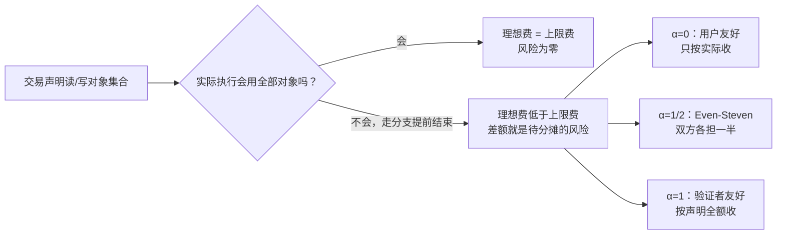

## TL;DR

并行执行把链跑快了，却把手续费算难了。USENIX Security 2026 的这篇论文指出，问题不在算力，而在不确定性：一笔交易事先声明要访问哪些对象，实际执行时却可能因为前面的交易改了状态而走另一条分支，少用甚至不用某些对象。于是收费只有两条路：按声明收，用户就为没用过的对象多付钱；按实际收，验证者就为预留了却没用上的执行容量少收钱。论文证明，除非提前执行交易或改成所有交易同价，否则这两类风险不可能同时清零。更麻烦的是，并行 gas 计价本身还能被“托儿交易”操纵：用户塞一笔假交易可以压低自己的 gas，验证者塞一笔假交易可以抬高别人的 gas。论文给出的出路是对象加权手续费（OW-TFM）：按对象过去的拥挤程度定价、按声明与实际的差额分摊风险，并在参数满足条件时防住验证者的托儿攻击。

## 论文信息卡

- **标题**：Perils of Parallelism: Transaction Fee Mechanisms under Execution Uncertainty
- **作者**：Sarisht Wadhwa（杜克大学）、Aviv Yaish（耶鲁大学、IC3、维也纳复杂性科学中心）、Fan Zhang（耶鲁大学、IC3）、Kartik Nayak（杜克大学）
- **会议**：USENIX Security 2026（第 35 届 USENIX 安全研讨会）
- **原文链接**：https://www.usenix.org/conference/usenixsecurity26/presentation/wadhwa
- **论文全文**：https://arxiv.org/abs/2604.04193

## 背景

共识提速之后，执行成了瓶颈。Sui 用基于对象的依赖关系做并行执行，Monad 用乐观执行、冲突了再重跑，都是为了让互不冲突的交易同时跑。但图灵完备的智能合约有个天然麻烦：不预先执行，就不知道两笔交易到底会不会冲突。两笔相互依赖的交易被排到并行执行时，一笔要么失败后重跑，要么锁住对象等另一笔先走完；前者伤用户体验，后者把并行又逼回串行，还白白占用容量。

串行链的手续费模型在这里直接失效。比特币的一价拍卖、以太坊 EIP-1559 的基础费，都是把执行资源当成一维、可加的东西：一笔交易跑多久，就收多少。但在并行世界里，同样跑 3 个单位时间的两笔交易，对系统的“拖慢”可能完全不同：一笔只碰冷门对象，可以和别人并行；另一笔碰热门对象，会把一串交易都堵在后面。只按时间收费，等于对“堵路”不收费。多维手续费市场和并行 gas 计算机制（GCM）试图补上这一课：按对象、按关键路径给交易定价。但这篇论文先问了一个更基础的问题：在执行结果不确定、参与者又都是理性经济人的前提下，这些定价规则本身站得住吗？

## 方法拆解

论文先搭了一个极简模型，再依次抛出三组结果：或有交易的风险权衡、托儿攻击、对象加权手续费。

### 第一步：把交易写成“声明的对象集合”

每笔交易被抽象为计算量 $t$、出价 $g$，以及读集 $R$ 与写集 $W$。两个交易只要共享一个对象且至少一方是写，就冲突，不能并行。关键在于，声明的集合是“保守声明”：交易可能声明了某些对象，但实际执行时因为条件分支没走到，根本不用它们。论文把这类对象叫或有对象，把这类交易叫或有交易。

标准例子是带价格条件的 AMM 交易：先读某个池子的价格对象 $o_1$，只有价格高于阈值才动自己的余额 $o_2$ 和合约余额 $o_3$。如果价格没过阈值，$o_3$ 就根本不会被碰。于是调度者在排区块时面临信息差：它看到的是声明集合，却不知道这次执行到底会用其中哪几样。而论文随后证明，这个信息差不是“调度算法不够聪明”，而是原则上无法绕开的。

### 第二步：或有交易的风险是一枚硬币的两面

论文定义了四种费用：上限费 $f_{\mathrm{att}}$（按全部声明对象收费）、下限费 $f_{\mathrm{base}}$（只按一定会用的对象收费）、理想费 $f_{\mathrm{ui}}$（按实际用掉的对象收费）、实收费 $f_{\mathrm{act}}$（真正收到的钱）。由此定义两类风险：用户风险 $\mathrm{UR} = f_{\mathrm{act}} - f_{\mathrm{ui}}$，即为没用过的对象多付的部分；调度者风险 $\mathrm{SR} = f_{\mathrm{att}} - f_{\mathrm{act}}$，即预留了容量却没收到钱的部分。

引理 1 给出一个恒等式：$\mathrm{UR} + \mathrm{SR} = f_{\mathrm{att}} - f_{\mathrm{ui}}$，与收费规则无关。总的不确定性蛋糕是固定的，收费规则只能决定切给谁。定理 1 把话说得更死：在调度者不能提前执行交易、且区块计算预算不超过 $G$ 的前提下，不可能让所有或有交易同时满足 $\mathrm{UR}=0$ 且 $\mathrm{SR}=0$，除非退化成所有交易同价的常量收费。论文还用复杂性理论堵住了“找捷径”的念头：判断一笔交易到底会不会用某个对象是 P-完全问题，一般情况下不存在比一步步模拟更快的办法，而模拟本身恰恰就是调度者想省掉的那份计算。

既然不可能双清零，论文就把设计空间参数化成一条直线：$f_{\mathrm{act}} = \alpha f_{\mathrm{att}} + (1-\alpha) f_{\mathrm{ui}}$，$\alpha \in [0,1]$ 是风险分给用户的比例。三个特殊点对应三种机制：$\alpha=0$ 的用户友好型，只按实际收，用户零风险、验证者全担；$\alpha=1$ 的验证者友好型，按声明全额收，验证者零风险、用户全担，论文指出这类设计与 Monad 一类的做法相近；$\alpha=1/2$ 的 Even-Steven 型，双方各担一半。调度者对未来的预期又分三种：乐观型假设全部交易都完整执行，悲观型按最坏情况（只收到底线费）做计划，中位型假设一半或有交易会执行不足。三乘三的组合构成一张收益表：乐观时三种机制收益都是 $f_{\mathrm{att}}$；悲观时用户友好型只拿到 $f_{\mathrm{base}}$，验证者友好型仍拿到 $f_{\mathrm{att}}$，Even-Steven 型拿到两者均值。选机制，实际上是在同时选“风险给谁”和“按什么预期排区块”。

### 第三步：托儿交易，操纵并行 gas 计价

第二组结果针对前人提出的并行 gas 计算机制（GCM）。GCM 的任务是把一个区块的总执行时间（makespan）分摊到各笔交易头上，代表性方案是 Shapley 分摊（按边际贡献在所有子集上平均）和时间比例 makespan（TPM，按执行时间占比分摊）。论文指出，前人列出的公平性、效率等性质漏掉了一条最基本的：防托儿（shill-proofness）。所谓托儿，就是往区块里塞没有实际效用的假交易，纯粹为了改变别人的计价。

用户托儿的例子用 Shapley 机制算得很具体。用户的真实交易执行时间为 3、只碰对象 $o_1$，不加托儿时它的 Shapley gas 是 $8/3$。用户再塞一笔执行时间为 1、只碰 $o_2$ 的假交易，真实交易的 gas 变成 $137/60$，假交易自身是 $11/30$，两笔合计 $53/20$，小于原来的 $8/3$。省得不多，但性质上成立：多交一笔交易反而总共少付费，机制就被套利了。验证者托儿的例子更直接：两笔各跑 6 个单位、互不冲突的交易，TPM 下各付 3；验证者塞一笔跑 6 个单位、同时碰两个对象的假交易，三笔各付 4，验证者扣掉自己那笔的 4 之后净收 8，高于原来的 6。假交易在这里不是成本，而是抬价的杠杆。

论文还证明了一个更一般的冲突：调度者防托儿与“总 gas 等于 makespan”的效率要求不可兼得。直觉是，$n$ 个核跑 $n+1$ 笔完全并行的交易，makespan 会从 $t$ 跳到 $2t$；防托儿要求第 $n+1$ 笔至少收 $t$ 的 gas，而对称性又要求每笔都至少收 $t$，总和就超过 makespan。唯一的松动口是论文自己承认的：如果交易可以被切分到多个核上并行（而非原子执行），这个证明就不成立。

### 第四步：或有交易让托儿更便宜，费用版的防托儿条件更严

把前两步合起来，危险会放大。或有交易执行不足时可能只付很少的费，甚至接近零，于是攻击者可以塞一笔“注定执行不足”的假交易，用很低的成本改变调度与拥堵，再让自己的主交易少付费。论文因此把防托儿从 gas 层面升级到费用层面：用户版要求，加了假交易后主交易与假交易的费用之和不得低于原来；验证者版要求，验证者从诚实交易上多收的部分，不得超过它为假交易付出的净成本。在用户友好机制（$\alpha=0$）下，这两个条件合起来只有一个解：交易的费用必须与其他交易无关，也就是费用不能依赖并行调度。这是一个很强的否定性结论：如果你坚持“用户只为实际付费”，那就别指望费用还能反映并行拥堵；想反映拥堵，就必须让用户承担一部分不确定性。

### 第五步：对象加权手续费 OW-TFM

论文最后给出的建设性方案是对象加权手续费。它的思路是切断“费用依赖本区块调度”这条循环：费用不由本区块的排法决定，而是由对象在过去区块里的拥挤程度决定。每个对象 $o$ 有一个价格 $p_o$，交易每用一个对象就付 $\pi \cdot p_o \cdot t$，其中 $\pi$ 是用户自定的优先费倍数；声明了但没用的对象，按 $\alpha \cdot p_o$ 收费，$\alpha$ 仍是前面的风险分摊参数。价格按 EIP-1559 式的规则逐块更新：

$$p_{o,b+1} = p_{o,b} \cdot \exp\left(\eta \cdot \frac{\mathcal{U}_{o,b} - \mathcal{U}_o^{\star}}{\mathcal{U}_o^{\star}}\right)$$

其中 $\mathcal{U}_{o,b}$ 是对象 $o$ 在区块 $b$ 的实际占用，$\mathcal{U}_o^{\star}$ 是目标占用，$\eta$ 是响应速度。用得多于目标，下一块涨价；用得少，降价。因为价格来自历史，单区块内的托儿塞不进定价公式；托儿要起作用，必须跨区块抬高对象的历史占用，而这要真金白银地付费。论文给出验证者防托儿的参数条件：$\alpha \geq \pi_o \eta \frac{\gamma}{1-\gamma}$，其中 $\pi_o$ 是用该对象的交易的平均优先倍数，$\gamma$ 是验证者留存费用的比例（其余部分被销毁）。直觉是：$\alpha$ 越大，假交易自身为“声明未用”部分付的钱越多，抬价的净收益就越难为正；$\eta$ 越大、优先倍数越高，抬价的杠杆越大，$\alpha$ 的门槛也就越高。论文用 Dune 查询估算，以太坊的平均优先费约为基础费的 5 倍，并明确说明这只是基准参考，不代表并行链上的真实优先倍数。

## 实验与数据

需要先说明论文的性质：这是一篇理论与形式分析论文，作者在伦理附录里明确表示，研究是理论和分析性的，没有在真实系统上做实验。因此本节没有原型跑分、没有吞吐量曲线，呈现的是论文给出的形式结果与数值算例，数字全部来自原文，应按“反例与边界”而非“性能基准”来理解。

第一组数字是两类托儿算例。Shapley 机制下，用户托儿把总 gas 从 $8/3 \approx 2.67$ 压到 $53/20 = 2.65$，降幅很小，但证明了“多交交易反而少付费”的可能性真实存在；TPM 机制下，验证者托儿把净收入从 6 抬到 8，增幅达三分之一，且假交易本身就是抬价工具。第二组是调度者的收益表：乐观时三种机制收益都是 $f_{\mathrm{att}}$；悲观时用户友好型只拿到 $f_{\mathrm{base}}$，验证者友好型仍拿到 $f_{\mathrm{att}}$，Even-Steven 型拿到两者均值；中位型下 Even-Steven 型为 $(3f_{\mathrm{att}} + f_{\mathrm{base}})/4$。没有一种机制在所有预期下都占优，悲观时的下限由分摊方式决定。第三组是 OW-TFM 的参数条件与基准估计：防托儿要求 $\alpha$ 不低于 $\pi_o \eta \gamma/(1-\gamma)$，而以太坊优先费约为基础费 5 倍的估算，给了 $\pi_o$ 一个数量级上的参照。论文未披露 OW-TFM 在真实并行链上的部署数据，这一点在局限里还会提到。

## 相关工作对比

与 EIP-1559 这类串行手续费机制相比，本文的模型多了一个维度：费用不仅取决于“跑多久”，还取决于“堵了谁”。EIP-1559 按区块整体拥挤调基础费，无法区分热门对象与冷门对象；多维手续费市场按资源种类分别定价，算是一步，但仍未把“执行结果不确定”与“参与者会塞假交易”放进对抗模型。与 Acilan 等人的并行 GCM 工作相比，本文不是另提一套分摊公式，而是指出前人性质清单的缺口：Shapley 与 TPM 即使满足公平性与效率，也照样能被托儿套利。与 Sui、Monad 这类系统设计相比，本文不评价它们的执行引擎本身，而是给它们的收费规则划线：Sui 的对象依赖模型正好是本文模型里“声明对象集合”的现实版，Monad 的乐观重跑则对应“或有执行会失败或重跑”的场景，而 Monad 一类的“按声明收费”倾向，在本文的谱系里就是 $\alpha$ 接近 1 的验证者友好端。

## 局限与开放问题

- **没有真实系统验证**：全部结论来自形式模型与构造性反例，OW-TFM 的价格更新、$\alpha$ 门槛在真实并行链负载下的表现，论文未披露实测数据。
- **AMM 路由这类交易被排除在模型外**：路由交易声明多个池子、但语义上保证只用其中一个，此时上限费对应的是任何执行路径都达不到的收费，论文承认这是有意的抽象，并列为未来工作。
- **理性人假设偏强**：模型假设用户与调度者都是理性经济人，未建模纯恶意行为、拒绝服务攻击与链下合谋，部署在这些假设之外可能出现未预见的后果。
- **概率化执行模型未做**：论文按最坏情况处理或有执行，未引入基于历史行为的概率预期；用期望风险代替最坏风险可能更贴近实际，但会引入新的假设与攻击面。
- **调度与费用的循环依赖只解了一半**：OW-TFM 用历史价格切断了单区块内的循环，但跨区块的价格操纵、对象价格的收敛速度与稳定性，仍需进一步分析。
- **原子性假设的松动口**：调度者防托儿与效率不可兼得的证明依赖交易原子执行；若交易可切分到多核，结论需要重新审视，论文在讨论节也留了这个口子。

## 一点思考

这篇论文最值得带走的不是某个公式，而是一个设计纪律：并行链的手续费不能只谈“公平”，必须先谈“风险给谁、托儿怎么防”。对协议设计者来说，$\alpha$ 不是一个可以随手定的参数，它同时决定了用户体验的下限、验证者收入的下限和托儿攻击的成本，调 $\alpha$ 就是在三者之间选边。对用户和开发者来说，一个可操作的判断标准是：如果一条并行链宣称“只按实际执行收费”又宣称“费用反映并行拥堵”，那它至少在一处说了不精确的话——按本文的定理，两者不可兼得，剩下的只是它把代价藏在了哪里。对 Monad、Sui 这类链的观察者来说，下次看到手续费规则更新，不妨先问三个问题：声明未用的部分收多少、对象价格来自当期还是历史、验证者塞假交易抬价的成本是否高于收益。答不上这三个问题，所谓的“并行友好收费”就还只是一句口号。

## 原文链接

- 论文主页：https://www.usenix.org/conference/usenixsecurity26/presentation/wadhwa
- 论文全文：https://arxiv.org/abs/2604.04193
