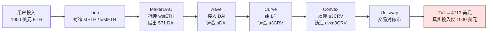

## TL;DR

DeFi 世界最常用的指标 TVL（总锁仓价值），可能有一半是"空气"。Financial Cryptography 2026 的这项研究分析了 3,570 个协议、横跨五年的链上数据，发现同一笔钱在 Lido、MakerDAO、Aave、Curve、Convex、Uniswap 之间转一圈，能把 1,000 美元计成 4,713 美元的 TVL——全程没有任何新增资金流入。2021 年 12 月 DeFi 巅峰时期，TVL 与真实价值之间的缺口高达 1,398.7 亿美元，比值约 2:1。作者提出新指标 **TVR（Total Value Redeemable，总可赎回价值）**：只统计协议合约里真正"能赎回"的本币（原生币、治理币、非加密抵押稳定币），把凭空铸造的衍生凭证代币全部剔除。敏感性测试显示，ETH 下跌 25% 时，TVL 会比 TVR 多跌约 10 亿美元——衍生代币是金融传染的放大器。这篇论文的判断很直接：TVL 适合看热闹，TVR 才适合看门道。

## 论文信息卡

- **标题**：Piercing the Veil of TVL: DeFi Reappraised
- **作者**：Yichen Luo（UCL 区块链技术中心）、Yebo Feng（南洋理工大学，通讯作者）、Jiahua Xu（UCL）、Paolo Tasca（DLT Science Foundation）
- **会议**：Financial Cryptography and Data Security（FC 2026），DeFi 专题，Springer 出版
- **原文链接**：https://arxiv.org/abs/2404.11745（arXiv:2404.11745v5）
- **备注**：部分工作受 Ripple 大学区块链研究计划（UBRI）资助

## 背景

TVL 是 DeFi 的"GDP"。无论是媒体、投资人还是研究者，谈论 DeFi 规模时几乎都会引用这个数字——截至 2025 年 5 月，DeFiLlama 口径的全网 TVL 约为 2,500 亿美元。它在传统金融里有个近亲：资管规模（AUM）。但 AUM 背后是一套成熟的会计准则，而 TVL 的计算口径至今没有统一标准：DeFiLlama、DappRadar、DeFiPulse 等数据站各算各的，方法论大多不透明。

问题的根子是 DeFi 的可组合性。用户把 ETH 存进 Lido 得到 stETH，把 stETH 再抵押进 MakerDAO 借出 DAI，把 DAI 存进 Aave 得到 aDAI……每一步都会铸造一种新的凭证代币，而每一种凭证代币都会被计入某个协议的 TVL。同一笔钱被数了四五遍，TVL 就这样被"包装"（wrapping）和"加杠杆"（leveraging）吹大了。DeFiLlama 也意识到了这个问题，提供了一个"剔除双重计数"的开关，但它的办法非常粗糙：直接把"会向别的协议存款"的整个协议从统计里删掉——比如 MakerDAO 的 TVL 会被整体抹除，连它金库里真实的 ETH 都不算了。

此前的研究大多默认 TVL 是干净信号：有人用它做协议估值和泡沫监测，有人研究 TVL 与协议收入的因果关系。也有人注意到了重复计数——比如追踪 DAI 在协议间流动的研究、测量 DeFi 协议组合结构的研究——但都停在"描述现象"的层面，没有给出一个系统性、可落地的修正指标。这篇论文要做的，就是把这层窗户纸彻底捅破，并给出替代方案。

## 方法拆解

论文的方法分四步，层层递进，核心思想借自传统会计的"合并资产负债表"。

**第一步：把代币一分为二。** 所有代币被划分为两类："本币"（plain token）是没有底层资产的代币——ETH 等原生币、各类治理代币、USDC 等非加密抵押稳定币；"衍生代币"（derivative token）是存入底层资产后按比例铸造的 IOU 凭证——stETH、wstETH、DAI、aDAI、a3CRV、cvxa3CRV 都属于这一类。判断标准很直白：这个代币背后有没有"妈"。

**第二步：定义 TVR。** TVR 只加总协议智能合约里持有的本币价值，衍生代币和借出的代币一律剔除。会计上的类比是合并报表：集团内"一家记资产、一家记负债"的内部往来，在合并时要先抵消掉，不能重复计算。

**第三步：用实例讲透重复计数。** 假设你有 1,000 美元的 stETH：存进 Lido 换成 1,000 美元 wstETH（第 1 步），再把 wstETH 抵押进 MakerDAO，按当时抵押率借出 571 美元 DAI（第 2 步）。传统 TVL 口径下，Lido 计 1,000、MakerDAO 计 1,000（wstETH）+ 571（DAI），合计超过 2,000；而合并报表抵消掉内部的 wstETH 往来后，真实价值始终是 1,000。更夸张的是论文的完整链条：

一分钱不新增，TVL 变成 4.713 倍。这就是 DeFi 可组合性的另一面：收益可以叠，数字也可以叠。

**第四步：形式化"为什么 TVL 在暴跌中跌得更狠"。** 衍生代币的价格内生于底层资产：质押率、清算阈值、清算罚金把它和底层价格死死绑在一起。ETH 一跌，抵押品贬值触发借贷协议清算，清算又压低衍生代币价格、甚至造成稳定币脱钩——TVL 里每一个衍生代币都是一条传染通道。作者把"借贷资金池"（PLF，含 MakerDAO 这类 CDP 和 Aave 这类借贷协议）单独建模，推导出 TVL 对底层价格冲击的敏感度天然高于 TVR。最后仿真验证了这套形式化推导。

顺带一提，论文还定义了 **DeFi 货币乘数 = TVL / TVR**，直接对标传统金融的 M2/M0，用来量化整个系统的"水分倍数"。

## 实验与数据

数据规模是这篇论文的底气：DeFiLlama 上 3,570 个协议、2021 年 1 月至 2024 年 3 月的逐日 TVL 拆分数据，代币分类来自 CoinMarketCap；敏感性测试则直接抓取以太坊归档节点的链上状态，锁定三个关键时点——2021 年 12 月 2 日（TVL 历史峰值）、2022 年 5 月 9 日（Luna 崩盘末）、2022 年 11 月 8 日（FTX 崩盘末）。

**核心发现一：峰值时一半是水分。** TVL、DeFiLlama 调整后 TVL、TVR 三条曲线同涨同跌，但 TVL 与 TVR 的缺口在 2021 年 12 月 2 日达到 **1,398.7 亿美元**，TVL/TVR 比值约 2。换句话说，DeFi 最辉煌的那天，账面上有将近一半是重复计数。

**核心发现二：牛市注水、熊市挤水。** 把 TVL 拆开看，重复计数占比在 TVL 峰值时为 65.3%，Luna 崩盘后降到 58.8%，FTX 崩盘后进一步降到 49.6%。牛市里大家疯狂包装加杠杆，水分自然多；暴跌清算潮相当于被动"挤水分"。协议构成也印证了集中度：峰值时 MakerDAO 占 8.1%、Curve 7.5%、Convex 6.2%、Aave V2 5.9%。Luna 崩盘后，原生币在 TVR 中的占比下降、非加密抵押稳定币占比上升（避险情绪）；FTX 崩盘后这个趋势反转。

**核心发现三：DeFiLlama 的"一键去重"不靠谱。** 2022 年 6 月之前，TVR 高于 DeFiLlama 调整后 TVL——说明它去重去少了；2022 年 6 月之后，TVR 反而低于调整后 TVL——说明它去重去多了。整协议剔除法既粗糙又不稳定，token 级的 TVR 才是细粒度答案。

**核心发现四：TVL 在下跌中确实更脆弱。** 在 Lido、MakerDAO、Aave V2、Uniswap V2、Curve、Convex 六个头部协议（占当时全网 TVL 约 68%）上做敏感性测试：ETH 下跌 25%，**TVL 比 TVR 多跌约 10 亿美元**，而且无论参数怎么调，TVL 曲线都比 TVR 更陡。机制也被拆开了：清算因子（close factor）越高跌得越狠，且 MakerDAO 的清算因子影响大于 Aave（因为它对 ETH 敞口更大）；gas 费的影响可以忽略；极端下跌下还会触发 DAI 脱钩，让 TVL 再下一层。

**核心发现五：DeFi 乘数是情绪的温度计。** DeFi 货币乘数与 ETH 价格、标普加密货币大盘指数的 Spearman 相关系数均为 0.91（1% 水平显著），与传统金融货币乘数为 −0.76（1% 显著），与 CPI、VIX 则无显著相关。解读很直观：牛市加杠杆、熊市去杠杆；DeFi 和传统金融之间还存在"替代效应"——一边的水多了，另一边就少了。

## 相关工作对比

TVL 一直被当作干净信号用：有研究分析 TVL 与协议估值、协议收入的因果关系，有人用 TVL/市值给 DeFi 估值，还有人用 TVL 监测数字泡沫。这篇论文相当于指出：你们地基下面有裂缝，楼盖得再漂亮也得先修地基。

可组合性方向的前人工作更接近真相：追踪 DAI 跨协议流动的研究解释了包装如何让 TVL 重复计入，测量 DeFi 协议组合结构的研究画出了协议之间的嵌套关系，用生产网络模型算各部门增加值的研究试图做价值核算。但它们要么只盯着单个代币或单个环节，要么停在部门层面，都没有给出一个能实际计算、能替代 TVL 的指标。TVR 是第一个做到 token 粒度的系统性修正，这是它真正的创新点。

清算方向也有经典前作，比如 FC 2021 的 "Liquidations: DeFi on a Knife-Edge" 和多项 DeFi 清算实证研究。本论文把清算机制内嵌进了 TVL 不稳定性的形式化分析，回答了"为什么 TVL 在暴跌中跌得更狠"——衍生代币既是 TVL 的注水泵，也是金融传染的放大器。方法上的三位一体（token 二分 + 合并报表思想 + 货币乘数类比）让这篇论文既有理论框架，又有五年大数据验证。

## 局限与开放问题

- **依赖第三方分类**：TVR 的准确性系于 CoinMarketCap 的代币分类和 DeFiLlama 的 TVL 拆分数据，分类错了 TVR 就跟着错。论文在附录里探讨了自动化摆脱第三方数据的路径，但尚未完全落地。
- **测试范围有限**：敏感性测试只覆盖以太坊上六个头部协议（约 68% TVL），长尾协议和小链只在附录里简单分析，结论外推要谨慎。
- **分类仍有灰色地带**：治理代币被算作本币、算法稳定币的归类等问题，划分标准仍有讨论空间。
- **相关性不等于因果**：货币乘数与宏观指标的相关性是描述性的，DeFi 与传统金融的"替代效应"还需要更强的识别策略来验证因果。
- **"可赎回"不等于"无价值"**：TVR 剔除了传染风险，但也剔除了衍生代币的真实经济功能（比如 stETH 提供的流动性）。TVR 回答的是"系统里到底有多少钱"，而不是"这些衍生品有没有用"。

## 一点思考

看 DeFi 数据的人，应该把 TVL 当"热度指标"、TVR 当"体量指标"：前者告诉你市场有多嗨，后者告诉你系统里到底沉淀了多少钱。我的判断是，TVR 这类"去水分"指标迟早会被 DeFiLlama 之类的数据站吸收——毕竟这篇论文已经用数据证明，它们的"一键去重"开关既去不干净、又经常去过了头。对普通用户更实用的启示是：熊市里别被 TVL 的断崖式下跌吓到，那里面一半以上是杠杆和包装蒸发掉的"空气"，未必是真实资金出逃；反过来，牛市里 TVL 翻倍也别急着喊 Mass Adoption，先问一句：乘数是多少？

## 原文链接

- 论文全文（arXiv）：https://arxiv.org/abs/2404.11745
- 会议版本：Financial Cryptography and Data Security（FC 2026），DeFi 专题，Springer 出版
