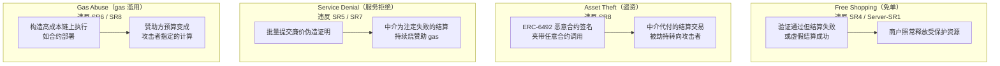
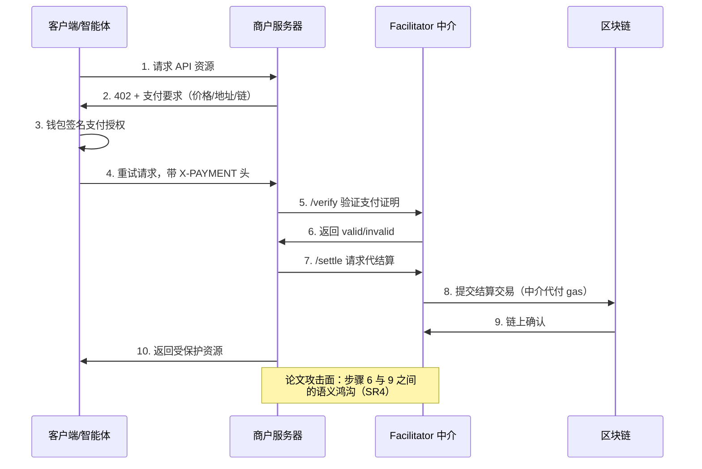

## TL;DR

HTTP 402（Payment Required）这个在 HTTP 规范里沉睡了 26 年的状态码，被 x402 协议"复活"了——它要让 AI 智能体像加载网页一样自然地完成链上支付。USENIX Security 2026 的这篇论文做了首次系统审计，结论相当扎眼：**15 个主流 x402 支付中介（facilitator），没有一个完全合规**。研究者先提炼出 8 条中介安全规则，再造出半自动黑盒测试工具 x402SCOPE，检出 49 条规则违反，端到端验证出 **31 个真实可利用漏洞**，覆盖全部 15 个部署。攻击手法是全新的四类：Free Shopping（免单）、Asset Theft（盗资）、Service Denial（服务拒绝）、Gas Abuse（gas 滥用）。链上侧的测量同样触目惊心：1.19 亿笔 Base 和 Solana 交易里，Coinbase 一家中介吞下 7,717 万笔交易、2,685 万美元支付额；93% 的商户只绑定了唯一一家中介；结算失败已经烧掉赞助方超过 20.2 万美元的 gas。核心结论一句话：**"已验证通过"和"钱真的到账"之间存在语义鸿沟，而这条鸿沟目前没有任何统一的安全基线来填**。

## 论文信息卡

- **标题**：When HTTP 402 Meets the Blockchain: Risks on Emerging x402 Payments
- **作者**：Qinying Wang（EPFL）、Yong Yang（浙江大学）、Yuan Chen（独立研究者）、Shouling Ji（浙江大学）、Mathias Payer（EPFL）（前两位共同一作）
- **会议**：USENIX Security 2026（第 35 届，2026 年 8 月，Baltimore）
- **原文**：https://www.usenix.org/system/files/usenixsecurity26-wang-qinying.pdf（开放获取，共 21 页）
- **项目页**：https://www.usenix.org/conference/usenixsecurity26/presentation/wang-qinying

## 背景

先讲清楚 x402 是个什么东西。HTTP 402 从 1999 年就写进了规范，设想是"协议原生的微支付"，但因为没有配套的支付基础设施，26 年来一直是个摆设。2025 年 5 月 Coinbase 的三位工程师发布 x402 白皮书，把它复活了：**客户端请求 API → 服务器回 402 并附上价格/收款地址/支持的链 → 客户端钱包签名一笔 USDC 转账授权 → 第三方 facilitator 在链上代为提交结算 → 服务器确认后返回数据**。整个过程不需要注册账号、没有 API key、没有信用卡，机器对机器的支付第一次被做进了 HTTP 协议层。

这个设计撞上了 AI 智能体的爆发。LLM 智能体要自主买数据、调服务、做交易，每笔都走人工绑卡是不可想象的——x402 就是冲着"机器原生支付轨道"去的。Cloudflare、AWS、Circle、Google 纷纷入场，x402scan 统计链上已超 1.5 亿笔交易、累计 4,000 万美元、40 万买家、8 万卖家。这不是实验性玩具了，是正在跑真实资金的支付基础设施。

但安全分析完全没跟上。x402 的核心信任被集中到了 facilitator 这一个组件上：商户把"验证支付证明"和"链上结算"全权委托给它。论文指出了一个此前没人形式化过的关键问题——**x402 的工作流本质是"洋葱式"的 check-then-execute**：先验证（/verify），再结算（/settle），而验证和链上执行之间隔着网络延迟、签名模型、链差异等多重不确定性。"验证通过"（paid？）和"链上真的结算成功"（safe to settle？）是两套语义，**谁来保证它们一致？答案是：目前没有任何统一规则**。前人工作要么只盯着智能合约层面的签名漏洞，要么研究支付通道，x402 这种"HTTP 协商 + 链下验证 + 第三方代结算"的混合架构，是全新的攻击面。

## 方法拆解

论文的方法论分三层，层层递进：先定规则（什么叫安全），再定攻击（违反规则会怎样），最后造工具（自动化验证）。

### 第一步：8 条中介安全规则 + 2 条服务端规则

作者把 facilitator 的职责拆成"授权正确性"（这笔支付是真的吗）和"执行安全性"（结算会按预期发生吗），提炼出 8 条可检查的规则：

- **SR1 要求匹配**：验证时若支付证明和服务器声明的支付要求对不上，必须判无效。
- **SR2 授权真实**：付款人签名必须在预期的签名模型下真实有效。
- **SR3 未过期**：过期的付款授权必须判无效。
- **SR4 结算为准**：只有支付证明真正在链上结算成功，才能返回"有效"——这是堵住"验证通过≠到账"的核心规则。
- **SR5 快速失败**：对经济上无意义（零金额、低于费用阈值）或注定无法结算（余额不足）的证明要直接拒绝，并强制幂等性和合理的时效边界。
- **SR6 赞助上限**：facilitator 代付的 gas/费用必须有可配置的上限。
- **SR7 结算前复验**：提交结算前要重新验证一次，避免把注定失败的交易送上链烧钱。
- **SR8 语义明确**：只结算链上执行语义明确、无歧义的证明，拒绝意外指令、额外签名人、替代 token 程序。

外加两条给商户服务端的：**Server-SR1**（只有结算成功后才能返回受保护资源）、**Server-SR2**（验证通过但结算失败时，必须回滚验证后触发的业务副作用，视为未支付）。这 10 条规则是全文的"宪法"，后面所有测试和攻击都挂在上面。

### 第二步：四种新攻击向量

基于规则违反，论文推导出四类攻击，每一类都对应真实的资金或服务损失：

**Free Shopping** 是最直观的：攻击者让验证通过、结算失败，商户却照常发货。根因有二：中介侧虚报结算成功（违反 SR4），或商户集成缺陷——验证通过后就执行业务逻辑、结算失败也不回滚（违反 Server-SR2）。

**Asset Theft** 是技术含量最高的：利用 ERC-6492（给未部署钱包做合约签名的包装标准）。中介在验证时不校验 ERC-6492 包装和内部签名，结算时却盲信攻击者提供的部署元数据（factoryAddress、factoryCalldata），直接把 `(to=攻击者地址, data=攻击者数据)` 送上链——一次"代付结算"就变成了攻击者任意调用，比如转走中介 EOA 里持有的资产或创建可后续提走的 token 授权。

**Service Denial** 打的是可用性：反复提交"生成便宜、中介处理昂贵"的证明，利用 SR5/SR7 的缺失，让中介为注定失败的结算持续烧赞助 gas，顺带把结算失败率推高。

**Gas Abuse** 是经济动机型：违反 SR6/SR8，把赞助方的预算转化为攻击者选定的链上执行（比如 ERC-6492 风格的合约部署），本质上是"让别人替我付 gas 跑我的合约"。

### 第三步：x402SCOPE 半自动黑盒测试框架

规则和攻击都有了，怎么规模化验证？作者造了 x402SCOPE，一个模块化、规则驱动的黑盒测试工具，三阶段流水线：

1. **Preparation（准备）**：每条链建两个钱包——客户端钱包（持少量支付资产，如 1 USDC，用来生成支付证明）、商户钱包（作为收款方）；记录中介 URL，必要时从官网拿 API key。
2. **Security Rule Checker（规则检查）**：六步——能力发现（先探测中介支持哪些网络/证明类型，只跑适用的测试，省钱）→ 模板实例化（按 x402 规范生成 ERC-3009 转账授权、ERC-1271 智能钱包签名、ERC-6492 包装三种证明模板）→ 规则引导变异（按被测规则篡改证明字段）→ 执行（打 /verify 和 /settle 端点）→ 证据收集（HTTP 响应 + 链上回执）→ 安全判定。测试覆盖 Base 和 Solana 的测试网与主网，优先测试网（两者配置一致），自动化套件每个目标不到 10 分钟。
3. **Attack Validation（攻击验证）**：对四类攻击做端到端可利用性确认。伦理红线划得很清楚：**不对第三方商户做真实的免单/拒绝服务攻击**；free shopping 的验证只在自己搭建的商户服务上做，或结合服务端 SDK 代码分析。

## 实验与数据

### 实测 15 个中介：49 处违规，31 个真实漏洞，无一幸免

评估对象从 x402scan 公开注册的中介端点池里按交易量和结算额排序取头部，剔除 2 个低活跃（买家不足 10 个）和 2 个不可达的，最终 15 个——**它们占观测窗口内 99% 的交易量和 98% 的总金额**，样本代表性足够。

结果：**15 个中介检出 49 条规则违反，端到端验证确认 31 个可利用攻击实例，影响全部 15 个部署**。分布上：

- 每个被测中介至少违反 1 条规则，同时每条规则都至少被 1 个平台违反——违规是系统性的，不是某家掉链子。
- SR5（快速失败）和 SR7（结算前复验）各有 14 个部署违反，SR8（语义明确）9 个违反——**防线最薄弱的恰恰是"别烧冤枉钱"和"别执行歧义指令"这两道**。
- 至少 1 个部署连 SR1–SR4 的基线要求都不满足。

分攻击看：**Service Denial 风险覆盖全部 15 家**（14/15 违反 SR5，允许恶意服务端触发无经济意义的结算；9 家支持 ERC-1271 却违反 SR8，复杂签名验证逻辑可被用来放大成本；3 家支持 ERC-6492 且违反 SR8；Solana 上 3 家违反 SR6，接受多签名人证明却不约束计算单元）。**Free Shopping 有 10 例高风险、2 例完整可利用**——两例都违反 SR4：一例是中介不做客户端余额检查，验证和结算都返回 valid；另一例是支付证明可重放（同时违反 SR4+SR7）。**Gas Abuse 3 例、Asset Theft 1 例**，都和 ERC-6492 相关，其中盗资案例发生在一家头部交易量的中介。

最讽刺的是案例研究里的**服务端 SDK**：Coinbase 官方 7 个参考服务端 SDK 全部缺少"验证后副作用回滚"，Flask SDK（v0.2.1）甚至在验证通过后、**无论结算成败都释放受保护资源**——等于把 Server-SR2 的要求反着实现了一遍。另一例是某中介 /verify 无状态、不预留支付 nonce，/settle 又不和某次验证结果原子绑定，攻击者用同一份有效支付证明并发请求，多次验证全部通过，商户多次发货，而买家只授权了一次付款。

披露做得规范：2026 年 1 月私下报告给 14 家（第 15 家 xEcho 没有安全联系渠道），截至 2 月 6 日 Coinbase、PayAI、Mogami 三家已确认 6 个不同漏洞，部分已修复。论文也明确不公开未修复问题的可利用细节。

### 生态测量：1.19 亿笔交易里的中心化与烧钱

链上测量覆盖 2025 年 10 月 1 日至 12 月 26 日：Base 91,507,800 笔、Solana 28,171,386 笔（按 2026 年 1 月 1 日价格 ETH≈$3,000、SOL≈$125 归一化计价）。几个关键发现：

- **增长**：x402 2025 年 5 月首次上链，10 月初出现拐点后持续活跃，峰值约日 350 万笔、超 270 万美元日 USDC 量。Base 先行，Solana 11 月下旬起交易数反超，但 Base 的支付金额依然可观——两条链用法不同。
- **中心化**：Coinbase 一家占 77.17M 笔交易、$26.85M 支付额，PayAI/Dexter/Daydreams 是遥远的第二梯队。53,576 个唯一商户里只有 3,629 个（6.77%）接入超过 1 个中介，平均每商户 1.089 个——**超 93% 的商户被锁死在单一中介上**。这正是论文开头担忧的"单点故障影响整片商户"的实证：信任集中不是理论风险，是现状。
- **烧钱**：结算失败累计烧掉约 **$202K** 的 gas 和费用（Base $145.4K 占 71.9%，Solana $57.0K 占 28.2%），其中回退交易单独贡献 $5.8K。回退率 Base 1.99%（1,857,949 笔）、Solana 0.018%（5,148 笔）。Base 回退主因：授权已被使用/取消占 56.2%——其中 1,047,753 笔回退只来自 57 个发送方，top5 占 57.07%、top10 占 76.41%，高度偏斜，符合小团伙自动化重放的特征；ERC20 超余额 38.5%、授权过期 4.8%。Solana 则 93.1% 是 owner mismatch，画像完全不同。
- **Solana 的 ATA 补贴滥用**：37,959 次关联 token 账户（ATA）创建，累计锁定约 $9,489.75 的 rent（单次 0.00203928 SOL，早期 x402 流程把这笔钱从用户转嫁给了中介）。Daydreams/PayAI/Dexter 三家占 80% 以上；60.59% 的 ATA 在不足 3 次转账后就被关闭，Gini 系数 0.664，5 个实体各自创建超 1,000 个 ATA——典型的"创建-废弃"薅补贴流水线，中介在不知不觉中为攻击者的开户成本买单。

## 相关工作对比

把这篇放进坐标系，增量很清楚。此前的支付安全研究大多盯着**链上合约本身**（签名校验、重入、闪电贷），或**支付通道网络**（闪电网络的路由与隐私）；x402 这类"HTTP 协商 + 链下验证 + 第三方代付结算"的混合架构，此前没有系统性的安全模型。论文的贡献在于第一次把 facilitator 当成"关键支付基础设施"来审计：8 条规则是可复用的检查清单，x402SCOPE 是可复用的测试工具，15 家全军覆没的实测是给行业的警钟。与同类"测一堆部署找共性漏洞"的实证安全论文（如 EIP-7702 那篇）相比，这篇的差异化在于**生态测量和受控测试互相印证**：链上 1.19 亿笔交易量化的中心化与烧钱，为"中介值得被当成关键基础设施审计"这个判断提供了经济学注脚。

## 局限与开放问题

- **黑盒测试的覆盖天花板**：作者承认，没有 ground truth 的违规语料库，precision/recall 无从谈起；"通过检查"只代表通过了已实现的检查项，不代表真的安全。Starknet 等链的证明格式、商户侧定制集成都不在覆盖内。
- **伦理约束导致部分结论停留在"高风险"**：free shopping 和 service denial 没有对真实第三方商户做完整利用验证，靠的是中介侧违规 + 自建商户/SDK 实验 + 攻击路径分析。严谨，但留了确认缺口。
- **生态测量的归因边界**：作者明确说，历史攻击没有 ground truth，链上测量是"风险证据"而非"攻击归因"——比如那 57 个发送方的重放偏斜，"不能排除重试或批量处理等良性运维原因"。
- **规则完备性**：8 条规则源于作者对当前部署的观察，x402 还在快速演进（订阅、计量计费等新 scheme 在路上），规则集需要跟着长大。
- **披露仍在进行**：截至论文成稿（2026 年 2 月），只有 3 家确认修复，其余 12 家的状态论文未披露——现在（2026 年 10 月）是否修完，是个开放问题。

## 一点思考

这篇最有价值的输出不是 31 个漏洞本身，而是那 8 条规则：它把"facilitator 安全"从玄学变成了检查清单，任何做 x402 集成的团队今天就能拿去自查。我的判断是：**x402 的推广速度已经超过了它的安全成熟度**——Coinbase 一家扛七成交易量、93% 商户单点绑定，这种中心化程度配上"验证≠到账"的语义鸿沟，意味着下一个大事件可能不是某家商户被黑，而是某家中介的一个 SR4 级失误让成千上万商户同时"被免单"。对开发者的实操建议就三条：商户侧永远不要在结算确认前释放资源（Server-SR1 是底线中的底线）；选 facilitator 时把"是否做结算前复验、是否有赞助上限"写进采购 checklist；Solana 生态的中介要立刻审计 ATA 创建的补贴逻辑。对协议层，x402 基金会该把这 8 条规则收编为合规基线——HTTP 当年靠 TLS 才变成支付可用的网络，x402 也需要自己的"TLS 时刻"。

## 原文链接

- 论文（USENIX Security 2026，开放获取 PDF）：https://www.usenix.org/system/files/usenixsecurity26-wang-qinying.pdf
- 会议页面（含 BibTeX）：https://www.usenix.org/conference/usenixsecurity26/presentation/wang-qinying
