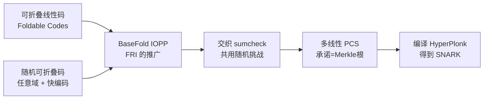

## TL;DR

做 SNARK 的人长期被困在一个"不可能三角"里：想要证明者快，就得接受大证明和慢验证（Brakedown）；想要证明小、验证快，证明者就慢得多（FRI），而且还挑域——非得是 FFT 友好的有限域。Crypto 2024 的论文 **BaseFold**（Hadas Zeilberger、Binyi Chen、Ben Fisch，耶鲁大学 / Espresso Systems）捅破了这层窗户纸：它把 FRI 背后的折叠思想抽象成一大类"可折叠线性码"，FRI 只是其中一个特例。基于此构造的多线性多项式承诺方案在**任意足够大的有限域**上都跑得飞快，证明者接近 Brakedown 的速度，证明却小 5–11 倍、验证快一个数量级。最有杀伤力的演示是：直接在 secp256k1 的原生域上证明 ECDSA 验证电路，比 FRI 路线快 200 多倍。

## 论文信息卡

- **标题**：BaseFold: Efficient Field-Agnostic Polynomial Commitment Schemes from Foldable Codes
- **作者**：Hadas Zeilberger（耶鲁大学）、Binyi Chen（Espresso Systems）、Ben Fisch（耶鲁大学）
- **会议**：CRYPTO 2024（Advances in Cryptology – CRYPTO 2024, Part X, pp. 138–169）
- **原文链接**：https://eprint.iacr.org/2023/1705

## 背景

多项式承诺（PCS）是 SNARK 的发动机：证明者先把多项式"承诺"成一个短字符串，之后能向验证者证明"承诺的多项式在某点取值确实是 y"。几乎所有实用的透明（无可信设置）、抗量子的 SNARK，都是拿交互式预言证明（IOP）编译出来的，而 IOP 里最核心的部件就是**接近性证明（IOPP）**——证明一个向量接近某纠错码的码字。

这个领域长期是两大家族对峙。**FRI 家族**（STARK、Plonky2 都在用）：基于 Reed-Solomon 码，证明小、验证快，但证明者要做 $O(n \log n)$ 的编码，必须在 FFT 友好的域上才跑得动，换个域就抓瞎。**Tensor-code 家族**（Ligero → Brakedown → Orion）：证明者是线性的、飞快，且不挑域，但证明体积大、验证慢——Brakedown 的验证和证明都是 $O(\lambda\sqrt{n})$ 量级的。论文里给了一组很直观的数字：20 个变量的多项式，Brakedown 证明者只要 53 毫秒，FRI-PCS 却要 5.1 秒；反过来证明体积是 7285KB 对 935KB。Orion 试图用"证明递归"把 Brakedown 的证明压小，但递归本身的证明者开销很大（本博客之前研读过 Orion 的故事）。

KZG 是另一条路：证明只有十几 KB，但需要可信设置和椭圆曲线配对，不抗量子。所以问题很清楚：**能不能有一个方案，证明者接近 Brakedown 一样快，证明和验证接近 FRI 一样好，还不挑域？** BaseFold 的回答是：能，关键是把 FRI 推广。

## 方法拆解

### 第一步：什么是"可折叠"的码

FRI 为什么能工作？直觉上，Reed-Solomon 码有个漂亮的性质：把码字按偶/奇位置劈成两半，用验证者的随机挑战 $\alpha$ 做线性组合 $f_{even} + \alpha \cdot f_{odd}$，得到的新向量仍然是"同一类码"的码字，只是规模减半。重复折叠 $d$ 轮，问题就从 $n$ 缩到常数——这就是 FRI 的折叠。

BaseFold 把这个性质抽象成**可折叠线性码（foldable linear codes）**的定义：生成矩阵满足

$$G_i = \begin{bmatrix} G_{i-1} & G_{i-1} \\ G_{i-1}\cdot T_{i-1} & G_{i-1}\cdot T'_{i-1} \end{bmatrix}$$

其中 $T_{i-1}, T'_{i-1}$ 是对角矩阵，且对角元两两不同。Reed-Solomon 码在 FFT 友好域上恰好满足这个形式（偶/奇分解对应特定的对角矩阵）——**FRI 只是 BaseFold 在 RS 码上的特例**。这个抽象的价值在于：找一个又快、距离又好的可折叠码，就得到一个好的 IOPP。

### 第二步：随机可折叠码——又快又不挑域

论文构造了一族**随机可折叠码（Random Foldable Codes）**：每一轮独立地从域的非零元里均匀随机采样对角矩阵的对角元，取 $T'_i = -T_i$。编码算法是递归的：把消息劈成左右两半递归编码，再用 $(l + t \circ r,\ l - t \circ r)$ 合并（$\circ$ 是逐点乘）。算下来编码只要约 $n \log n$ 次域加法和 $0.5n \log n$ 次域乘法——**全是域运算，没有 FFT，没有单位根，什么域都能跑**。

随机性能保证距离吗？论文花了整整一节（第 3 节）证明紧的最小距离界，核心技巧是用秩-零化度定理控制"编码在某位置集合上全零"的消息有多少，从而让 union bound 能收敛。结论是压倒性的：比如域大小 $2^{61}$、码率参数 $c=16$、$d=15$ 时相对距离 0.572；$2^{256}$ 域、$c=8$ 时达到 0.76。直觉上，随机对角元让"坏消息"（编码零太多）在每一轮都以压倒性概率被消灭。

### 第三步：BaseFold IOPP——FRI 的通用版

协议分 commit 和 query 两阶段，和 FRI 神似：commit 阶段，每轮验证者发随机挑战 $\alpha_i$，证明者对每个位置 $j$ 把上一轮 oracle 的两个点 $(\text{diag}(T_i)[j], \pi_{i+1}[j])$ 和 $(\text{diag}(T'_i)[j], \pi_{i+1}[j+n_i])$ 插值成一条直线 $f_j(X)$，在 $\alpha_i$ 处取值得到下一轮 oracle $\pi_i$——码字规模逐轮减半。query 阶段验证者随机抽一个位置 $\mu$，检查每轮的 $p(\alpha_i) = \pi_i[\mu]$ 是否成立。安全性证明沿用了 FRI 的改进分析（Ben-Sasson–Kopparty–Saraf 的框架）。

### 第四步：和 sumcheck 交织，拼出多项式承诺

这是全篇最巧妙的一步。承诺就是编码的 Merkle 树根。求值证明要证 $f(z) = y$，而多线性多项式有恒等式 $f(z) = \sum_{b \in \{0,1\}^d} f(b)\cdot \tilde{eq}_b(z)$——右边正好是一个 sumcheck 命题。于是协议让 **IOPP 的折叠和 sumcheck 并行推进，共用同一套随机挑战** $r = (r_1, \dots, r_d)$：IOPP 最后一轮的消息恰好是 $f$ 在随机点 $r$ 处的编码，sumcheck 最后也归约到 $f(r)$ 的一致性检查，两边一对上，证明就闭环了。

对比 FRI-PCS 的开销很有意思：FRI-PCS 为了求值要额外承诺 $f(x)$ 和 $(f(x)-f(v))/(x-v)$ 两个多项式，推导后者要 $4ck_d$ 次域乘法（$c=8$ 时是 $32k_d$）；BaseFold 交织 sumcheck 的额外开销只有 $5k_d$ 次域乘法。这就是它证明者能打赢 FRI-PCS 的结构性原因。

## 实验与数据

测试环境是 AWS r6i.8xlarge（16 核、256GB 内存），哈希统一用 Blake2s-256，安全参数按 100 比特配。对比对象：Brakedown、多线性 KZG，以及工业级实现的单变量 FRI-PCS（Plonky2 的后端）。

**PCS 本体对比（64-bit 域）**：25 个变量时，FRI-PCS 证明者要 182 秒，BaseFold 只要 28.26 秒（**快 6.5 倍**）；代价是证明体积 5.52MB 对 1.39MB（FRI 小）。和 Brakedown 比：12 变量时 BaseFold 证明者快 2 倍、证明小 4 倍；25 变量时证明小 2.5 倍、验证快 7.5 倍。单次求值在大实例上 Brakedown 的证明者仍快 1–11 倍，但**批量求值时两者证明者速度基本持平**（附录 D 解释了原因：BaseFold 吃到了 HyperPlonk 批量打开的红利）。

**255-bit 域、26 变量**是最能体现"三角重构"的一组：BaseFold 证明 5.98MB，Brakedown 69.26MB（**小 11 倍多**）；验证 16 毫秒对 1.35 秒（**快 84 倍**）。和多线性 KZG 比（20 变量）：BaseFold 证明者 1.3 秒对 37.36 秒、验证 9 毫秒对 101 毫秒，代价是证明 3.47MB 对 13.76KB——KZG 的证明体积仍然是碾压级的，但它要可信设置。

**编译成 SNARK（HyperPlonk 后端）**：$2^{20}$ 门电路，HyperPlonk[BaseFold] 证明 18 秒、验证 37 毫秒、证明 8.77MB；HyperPlonk[Brakedown] 证明 13.67 秒、验证 1.55 秒、证明 110MB——证明者打平，验证和体积完胜。

**杀手级应用：ECDSA 电路**。因为不挑域，BaseFold 可以直接在 secp256k1 的原生域上编码电路（只需 $2^{14}$ 个约束）；FRI/KZG 不挑不行，只能用非原生域编码再模拟域运算，电路膨胀到 $2^{20}$ 门，外加每个非原生乘法 26 倍开销。结果：

| 方案 | 证明者 | 证明体积 | 验证者 |
|---|---|---|---|
| HyperPlonk[BaseFold] | 273 ms | 5506 KB | 21 ms |
| HyperPlonk[Brakedown] | 278 ms | 32271 KB | 302 ms |
| Plonky2（FRI 后端） | 58436 ms | 1355 KB | 23 ms |
| HyperPlonk[MKZG] | 71027 ms | 7.74 KB | 107 ms |

证明者 **200 多倍**的差距，主要就是"挑域税"。论文还提到，把 STARK 的 FRI 换成 BaseFold，预期能快半个数量级（留作未来工作）。

## 相关工作对比

- **FRI / STARK / Plonky2**：BaseFold 在 RS 码上退化为 FRI，是"超集"关系。FRI 的证明更小，但证明者慢且挑域；BaseFold 用稍大的证明换来了快得多的证明者和域自由。
- **Brakedown / Orion**：Brakedown 证明者仍是单次求值的王者，但验证和证明体积随规模膨胀得厉害（$O(\lambda\sqrt{n})$）；Orion 用递归把 Brakedown 的证明压到 polylog，但递归的证明者开销巨大。BaseFold 走的是另一条路：不递归，直接把三角形的三个角都做到"良好"。
- **KZG**：证明体积无敌（KB 级），但可信设置 + 配对 + 不抗量子，应用场景不同。
- **STIR（Crypto 2024）、WHIR（Eurocrypt 2025）**：这两位是 FRI 的改良版，WHIR 更是明确把自己定位成"FRI、STIR、BaseFold 的直接替代品"，并且借用了 BaseFold 把 sumcheck 融入折叠的思路。可以说 BaseFold 开了个头，后续工作在它的肩膀上继续卷验证速度。

## 局限与开放问题

- 证明体积仍然明显大于 FRI-PCS 和 KZG（25 变量时 5.52MB vs 1.39MB），对证明上链的场景不友好。
- 单次求值、大实例下证明者还是打不过 Brakedown（慢 1–11 倍）；优势主要体现在批量求值和 SNARK 编译场景。
- 距离证明要求域足够大（$|F| \geq 2^{10}$），小域要搬到扩域上做，论文用"soundness bootstrapping"处理，但多了一层复杂度。
- STARK-over-BaseFold 只有预期、没有实测数据；ePrint 初版和 Crypto 终版的实验部分有过一次大更新，引用数字时以终版为准。
- 随机可折叠码的"随机"是 setup 时一次性的公开随机，不算可信设置，但理论上是个新码族，距离界之外的密码学性质（如是否还有隐藏结构）值得更长时间的检验。

## 一点思考

BaseFold 最值钱的不是某组 benchmark 数字，而是 field-agnostic 这件事：它让 SNARK 第一次可以"在哪条链的域上，就在哪条链的域里证明"，ECDSA 快 200 倍只是第一个战利品，任何非 FFT 友好域上的电路都会吃到红利。它的证明者没有赢过 Brakedown，但它证明了三角形的三个角可以同时做到良好——而把 FRI 降格为特例的"可折叠码"抽象，可能是比 BaseFold 本体更长寿的贡献，WHIR 已经替它验证了这一点。明确判断：**在验证时间和证明体积优先的场景（尤其是链上验证），BaseFold 是比 Brakedown 更务实的选择；但在证明必须上链且体积敏感的场景，KZG 们暂时还动不了。**

## 原文链接

- ePrint 全文：https://eprint.iacr.org/2023/1705
- Crypto 2024 论文集：https://doi.org/10.1007/978-3-031-68403-6_5
