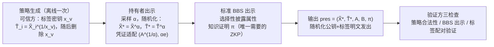

## TL;DR

匿名凭证让你证明"我成年了"而不必交出身份证，但标准方案有个泄密口：每次出示都会暴露凭证是谁签发的——用国民身份证做年龄证明，等于顺手告诉对方你的国籍。Asiacrypt 2026 接收的这篇论文（Hasso Plattner Institute 的 Flamini、Friedrichs、Lehmann）提出了 IHBBSτ：第一个基于**标准 BBS 签名**、出示大小恒定、且验证不需要验证方密钥的发行方隐藏（IHAC）方案。核心技巧有两招：一是 BBS 公钥的**乘法随机化**（$\tilde{X}^\star = \tilde{X}^\alpha$，凭证同步适配为 $(A^{1/\alpha}, \alpha e)$）；二是用一种"可控可塑"的**标签**代替 Bobolz 等人框架里笨重的第二套签名方案来认证策略里的发行方公钥，出示时把随机化后的公钥和标签明文发出、连零知识证明都省了。实测（BLS12-381，arkworks）：出示的额外开销恒定为 192 字节 + 2.2 毫秒，而发行方数量从几十涨到几千（比如欧盟上千所大学）开销纹丝不动；相比基于 Groth 签名的中间方案计算省约 75%、体积减半以上。

## 论文信息卡

- **标题**：Constant-Size Issuer Hiding for BBS Credentials via Randomizable Keys
- **作者**：Andrea Flamini、Karla Friedrichs、Anja Lehmann（Hasso Plattner Institute, University of Potsdam, Germany）
- **会议**：ASIACRYPT 2026（已接收）；preprint 存档于 ePrint 2026/369（2026-02-23 收录，2026-09-13 修订，CC BY 许可）
- **原文链接**：https://eprint.iacr.org/2026/369

## 背景

先说匿名凭证是什么。经典场景：可信发行方（政府、大学、银行）给你的属性（年龄、国籍、学位）签个名，这就是你的"凭证"；之后你向验证方出示时，可以只披露部分属性（"我已成年"），其余保密，而且多次出示之间不可链接。BBS 签名是做这件事最热门的工具：签名本身常数大小、天然支持选择性披露，正在 IETF（draft-irtf-cfrg-bbs-signatures）和 W3C 走标准化，欧盟数字身份钱包（EUDI Wallet，eIDAS 2.0 要求"不可链接的最小化披露"）也把它列为 ZKP 路线的最有力候选。

但标准匿名凭证漏了一块：每次出示都会通过发行方公钥暴露"这是谁签发的"。想证明"拥有某国大学学位"而不说哪所大学？公钥直接把学校卖了。用国民身份证做年龄证明？验证方顺手知道了你的国籍。论文指出，在 EUDI Wallet 的需求文档里，发行方隐藏已经被列为显式要求（ZKP01(v)）。实际部署还可能把发证压力分散到联邦州/市一级的小发行方——发行方一暴露，匿名集就缩水。

发行方隐藏匿名凭证（IHAC）要解决的就是：在验证方给定的"策略"（policy，一组可信发行方公钥的集合，比如"欧盟所有成员国"）之内，证明"我持有其中某一家签发的凭证"，但不说是哪一家。

## 方法拆解

### 三条路线：Type-0 / 1 / 2，先看清地形

论文的第一个贡献其实是"先立规矩"：把现有方案按**策略密钥的信任假设**分成三类：

- **Type-0**：无策略密钥，只有发行方名单。做法是对策略做 OR 证明（"我的凭证是这 n 家中某一家签的"），出示大小随发行方数量线性（或用 Stacking Sigmas / Groth–Kohlweiss 压到对数）增长。
- **Type-1**：通用策略密钥。可信第三方给策略里每个发行方公钥签个"认证"，持有者证明"我有一个被认证过的密钥签发的凭证"。出示常数大小，验证公开可验证——这是 Bobolz 等人（CANS 2021）提出的框架。
- **Type-2**：验证方专属策略密钥。策略密钥带密钥成分，验证出示**需要验证方用自己的密钥**才能验（Sanders–Traoré，PoPETs 2024；Katz–Sefranek 的 BBS 版）。

论文花了一整节论证：Type-2 的"常数大小"是拿工程代价换来的——每个验证方都要生成保管密钥对，密钥一泄露可任意伪造；恶意验证方还可以用特制的策略密钥给回头客打标记；密钥分发仓库还会知道"你去向哪个验证方出示"。结论是 Type-0/1 严格更适合真实部署，而此前**没有**同时满足"标准 BBS + 常数大小 + 公开验证"的 Type-1 方案——这就是 IHBBSτ 要填的坑。

### 核心观察：认证发行方公钥不需要一整套签名方案

Bobolz 框架的结构性包袱有两处：第一，要用第二套能签群元素的签名方案（Groth 签名）给发行方公钥做认证，又重又慢（验证要进 $G_T$ 做配对）；第二，每次出示要做**两个**知识的零知识证明——一个证"我有凭证"（躲不掉），一个证"我的发行方公钥被认证过"（这就是为隐藏发行方交的税）。

论文的关键洞察：认证发行方公钥这件事，根本不需要一整套签名方案——因为对属性的信任本来就由 BBS 签名的不可伪造性保证了。于是他们用一个极简的原语**标签（tag）**替代策略签名。标签被设计成"可控可塑"（controllably malleable）：给定消息 $m$ 上的标签 $\tau$，任何人都能推导出随机化消息 $m^\alpha$ 上的合法标签 $\tau'$，但**伪造**无关消息的标签仍然不可能。

### 发动机：BBS 公钥的乘法随机化

标签能 work，全靠一个新技巧——BBS 公钥的乘法随机化，论文认为这本身就是独立贡献：

BBS 公钥形如 $\tilde{X} = \tilde{G}_2^x$。随机采样 $\alpha \in \mathbb{Z}_p^*$，令
$$\tilde{X}^\star = \tilde{X}^\alpha, \qquad (A^\star, e^\star) = (A^{1/\alpha}, \alpha e).$$
直接验算配对等式可知 $(A^\star, e^\star)$ 恰好是在新公钥 $\tilde{X}^\star$ 下对同一属性向量的合法 BBS 签名。注意这不是对签名的完全随机化——但够用了，因为匿名凭证里签名本来就从不明文出现，只做知识证明。

为什么非得是乘法、加法不行？论文给了个漂亮的反例。标签的构造是 $\tilde{T}_i = \tilde{X}_i^{1/x_v}$（$x_v$ 是可信第三方只在生成策略时用一次的密钥）。如果改用加法随机化（$\tilde{X} \cdot \tilde{G}_2^r$），标签就得长成 $\tilde{T}_i = \tilde{X}_i \cdot \tilde{G}_2^{1/x_v}$——那任何人拿到一对 $(\tilde{X}_i, \tilde{T}_i)$ 相除就得到 $\tilde{G}_2^{1/x_v}$，可以给**任意**公钥伪造标签。而乘法形式下，随机数 $\alpha$ 被"吸收"进指数里，无法剥离，标签的可塑性被精确地限制在"合法随机化"之内。小代价：要排除 $x = 0$ 的平凡密钥，$\alpha$ 从 $\mathbb{Z}_p^*$ 而非 $\mathbb{Z}_p$ 采样。

### 出示协议：四步，零知识证明只剩一个

Setup 与发证完全沿用标准 BBS。策略生成（`SetPolicy`，离线一次）：可信方生成标签密钥 $x_v$ 与公钥 $(G_v, T_v)$，给策略里每个 $\tilde{X}_i$ 计算标签 $\tilde{T}_i = \tilde{X}_i^{1/x_v}$；**生成完 $x_v$ 就可以删除**——攻击窗口只存在于策略生成的那一刻，这是 Type-1 相对 Type-2（验证方要长期保管密钥）的核心优势。

持有者出示（`Present`）走四步：

1. 采样 $\alpha \leftarrow_\$ \mathbb{Z}_p^*$，随机化公钥 $\tilde{X}^\star = \tilde{X}^\alpha$，同步适配凭证 $(A^{1/\alpha}, \alpha e)$，随机化标签 $\tilde{T}^\star = \tilde{T}^\alpha$；
2. 对随机化后的公钥做一次**标准** BBS 出示（选择性披露属性的知识证明 $\pi$，这是躲不掉的那个）；
3. 把 $(\tilde{X}^\star, \tilde{T}^\star)$ **明文**发出，不再为发行方隐藏做任何零知识证明；
4. 输出 $pres = (\tilde{X}^\star, \tilde{T}^\star, A, B, \pi)$。

验证方（`VfPres`）检查三件事：策略公钥本身合法（`VfPolicy`）；BBS 出示在 $\tilde{X}^\star$ 下通过；标签在 $(G_v, T_v)$ 下验证通过（一个配对等式，无需 $G_T$ 中的复杂运算）。

（文字摘要：可信方离线生成策略时给每个发行方公钥打标签并删除密钥；持有者出示时随机化公钥、凭证与标签，做一次标准 BBS 出示后把随机化公钥和标签明文发出；验证方检查策略、BBS 出示与标签三项，无需验证方密钥。）

### 安全性：AGM + ROM，归约到 BBS 的不可伪造

不可链接性好证：$\tilde{X}^\star$ 在 $G_2$ 上均匀随机——策略里任何一家都可能是真正的发行方（信息论意义的隐藏，即论文所称的 everlasting privacy），再叠加上 BBS 出示本身的零知识性。

不可伪造性是硬骨头：标签的安全性无法独立成章，它和 BBS 的不可伪造性绞在一起。论文用**代数群模型（AGM，仅对 $G_2$）+ 随机预言机**做了组合证明，归约到 BBS 签名的强不可伪造（SUF-CMA）。证明分两个互补的归约 $B_1/B_2$：根据敌手伪造的凭证是否落在"已见签名的等价类"里，恰好有一个归约能借敌手之手伪造 BBS 签名——AGM 的用处在于从敌手手里抠出伪造公钥关于已知 $G_2$ 元素的代数表示，进而解出离散对数方程。论文也很坦诚：只对 $G_2$ 用 AGM 是有意的——它标出了通往标准模型证明的缺口，指给未来工作。

## 实验与数据

论文第 6 节做了四组对照，口径统一在"**比一次普通 BBS 出示多付多少**"上。微基准环境：BLS12-381 曲线、arkworks v0.4.2、AWS EC2 m5.2xlarge；标量 32 字节、$G_1$ 元素 48 字节、$G_2$ 元素 96 字节。

**第一组：打 Type-0 的 OR 路线**（同组作者另一篇 FFK+26 的 Stacking Sigmas / Groth–Kohlweiss 优化版）。SΣ 与 GK 的出示开销分别是 $96 + 64\log n$ 与 $32 + 288\log n$ 字节——策略里有 2500 个发行方（比如欧盟全部大学）时，开销不到 1KB / 不到 4KB，其实也堪用；但证明者的**计算**开销随策略膨胀，发行方上千时接近**一整秒**。IHBBSτ 的出示开销恒定 **192 字节 + 2.2 毫秒**，与 $n$ 无关——这就是"常数大小"四个字的含金量。

**第二组：打 Bobolz 框架的直接实例化** IHBBSGro（Groth 签名认证发行方公钥，安全在 GGM 下）：

| 方案 | 计算开销 | 实测 | 通信开销 | 实测 | 策略公钥大小 |
|---|---|---|---|---|---|
| IHBBSGro | $2p + 4e_{G_2} + 5e_{G_1}$ | 8.7 ms | $3G_2 + G_1 + 3\mathbb{Z}_p$ | 432 B | $240n$ B |
| **IHBBSτ（本文）** | $2e_{G_2} + e_{G_1}$ | **2.2 ms** | $2G_2$ | **192 B** | $96(n+1)$ B |

计算省约 75%，体积减半还多（432 → 192 字节），策略公钥也只有一半（每发行方 96 字节 vs 240 字节），外加安全模型从 GGM 收紧到 AGM。

**第三组：打同期独立工作** Kaaniche 等人（ePrint 2026/555，同样 Type-1 BBS 路线）：他们仍沿用 Bobolz 框架、需要为发行方公钥的策略签名做知识证明。论文按标准实例化替他们补算了数字：计算 $e_{G_2} + 12e_{G_1}$（3.6 ms）、通信 448 B；更关键的是他们的策略里必须附带每个公钥的 $G_1$ 版本外加离散对数相等证明，**策略体积膨胀到 $208n$ 字节**，是 IHBBSτ（$96n$）的两倍多——而用户每次都要先拉取策略+策略公钥才能出示，通信总账反而更贵。

**第四组（附录）：把 IHBBSτ 改成 Type-2**，与 Katz–Sefranek（KS25）的 BBS Type-2 方案比：证明者计算基本持平，通信省一个 $G_2$ 元素加一个标量——顺手证明 Type-1 的设计在 Type-2 赛道也不输。

## 相关工作对比

- **Bobolz 等（CANS 2021）**：Type-1 的开山框架，通用但笨重——第二套签名（Groth）+ 两次知识证明 + GGM 证明。IHBBSτ 可视为它的"轻量化嫡系"：保留框架思想，把认证机制换成标签，砍掉一个 ZKP，模型收紧到 AGM。
- **Sanders–Traoré（PoPETs 2024）**：Type-2，基于 PS 签名的代数技巧，连发行方隐藏的 ZKP 都不要，极紧凑——但验证需要验证方密钥。Katz–Sefranek（2025）把它搬到 BBS 上，问题照单全收。
- **Flamini 等 FFK+26（ePrint 2026/870）**：同组作者的 Type-0 路线，把 OR 证明只做在发行方公钥（而非完整凭证验证方程）上，再用 Stacking Sigmas 压到对数级；策略 ≤64 时表现很好，但天然不适合上千发行方的场景——正是逼出本文的另一半动机（该文最初与本文是同一篇，后拆分）。
- **Kaaniche 等 KKLT26（ePrint 2026/555）**：同期独立的 Type-1 BBS 工作，还指控本文方案有个"致命漏洞"（恶意发行方随机化自己的公钥伪造标签）。本文正面回应：那要求**策略内的发行方作恶**，而这在双方的安全模型里都被明确排除在外——况且恶意发行方本来就能彻底破坏任何发行方隐藏方案的不可伪造性。这是一般的局限，不是本文独有的 bug；能否容忍"轻度发行方腐化"是开放问题。

## 局限与开放问题

- **仍需一次可信设置**：策略生成要可信第三方算标签（$x_v$ 用后即焚）。比 Type-2 的长期密钥保管轻得多，但"可信第三方"四个字还在。
- **配对方案，非后量子**：BBS 依赖 q-SDH；用在身份证件这种十年有效期的场景，抗量子路线得另起炉灶。
- **安全模型排除策略内恶意发行方**：见上文与 Kaaniche 等人的交锋；"轻度腐化容忍"是明确的开放问题。
- **证明在 AGM（仅 $G_2$）+ ROM 下**：标准模型归约仍开放，论文自己把缺口指了出来。
- **策略公钥 $O(n)$**：每发行方 96 字节，2500 家就是 240KB——好在只需从公共仓库拉一次、可缓存复用，出示本身不受影响。
- **只有构造层微基准**：论文没给端到端实现（比如钱包集成实测），真实部署的体感仍需验证。

## 一点思考

发行方隐藏是匿名凭证从论文走向 EUDI 钱包落地的"最后一公里"隐私，这篇的价值不止于又一个构造——它把 Type-0/1/2 各自的信任代价摆到台面上称了一遍，结论很干脆：Type-2 的"常数大小"是用每个验证方保管密钥换来的，工程上近乎伪命题。我的判断是：如果 EUDI 钱包未来两三年真用 BBS 做 ZKP 路线，策略大概率长成 Type-1 的样子，而这篇的标签机制是目前最轻的实现路径，值得做钱包的团队跟进。但另一面也要清醒：配对方案在十年有效期的身份证件场景下保质期存疑，后量子匿名凭证的发行方隐藏，才是更长线的战场。

## 原文链接

- 论文：https://eprint.iacr.org/2026/369
- 同组 Type-0 路线（FFK+26）：https://eprint.iacr.org/2026/870
- 同期独立工作（KKLT26）：https://eprint.iacr.org/2026/555
