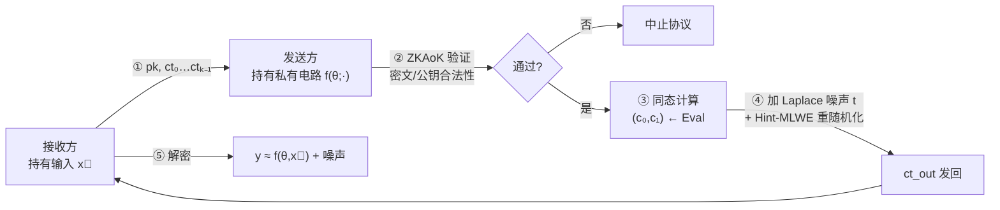

## TL;DR

CKKS 是隐私 AI 落地最核心的同态加密方案，但它"近似计算"的特性让传统安全定义直接失效：明文和噪声在密文里融为一体，想藏住计算方的私有模型，传统 noise flooding 手法一加大噪声就把明文也毁了。这篇 Asiacrypt '25 论文干了三件事：第一，提出 DPHE（差分隐私同态评估）安全定义，把计算方隐私从"不可区分性"放宽到"计算差分隐私"，并证明只要理想功能满足差分隐私、协议满足 DPHE，真实执行的输出依然是差分隐私的；第二，给出通用编译器，用 Laplace 机制代替指数级 noise flooding，再配上基于 Hint-MLWE 的密文重随机化，把普通 CKKS 协议编译成 DPHE 协议；第三，做出第一个针对 CKKS 的零知识论证（ZKAoK），用"稀疏密钥的 $L_2$ 范数证明 + coeff-to-slot 证明明文合法性"两招攻克 CKKS 特有难题，Rust 实现显示 41.1MB 的密文加公钥只需 17.9MB 的证明，证明者 324 秒、验证者 51 秒。

## 论文信息卡

- **标题**：On the Security and Privacy of CKKS-based Homomorphic Evaluation Protocols
- **作者**：Intak Hwang、Seonhong Min、Jinyeong Seo、Yongsoo Song（均为首尔国立大学 SNU）
- **会议**：Asiacrypt 2025（2025 年 12 月，墨尔本）
- **原文链接**：https://eprint.iacr.org/2025/382（CC BY-NC）
- **开源代码**：https://github.com/SNUCP/ckkspiop

## 背景

同态加密里，CKKS（Cheon-Kim-Kim-Song，Asiacrypt 2017）是个异类：它不支持精确整数运算，只支持复数域上的近似算术。听起来像缺点，实则是它成为隐私机器学习（PPML）主力方案的原因——神经网络推理、联邦聚合本来就是近似计算，CKKS 的近似误差完全可以接受，Microsoft SEAL、OpenFHE、Lattigo 等主流库都把它作为默认方案。

这篇论文讨论的是经典的 sender-receiver 模型：发送方手里有一个私有电路 $f(\theta; \cdot)$（比如训练好的模型参数 $\theta$），接收方手里有输入 $\vec{x}$（比如待推理的数据）。协议只有两轮：接收方加密输入发过去，发送方在密文上同态计算后把结果密文发回来，接收方解密得到 $y \approx f(\theta, \vec{x})$。接收方的隐私好办，CKKS 的 IND-CPA 语义安全直接保证；真正的难题是发送方的隐私——输出密文的噪声里残留着电路计算的痕迹，恶意接收方可能从中反推出模型参数。

对 BGV、BFV、TFHE 这类精确方案，标准解法是 noise flooding：发送方在输出密文上叠加指数级大的噪声，把电路痕迹彻底淹没。因为精确方案里明文和噪声严格分离，加再大的噪声也不影响解密正确性。但 CKKS 里明文和噪声是融合在一起的，连密钥持有者都分不清哪部分是明文、哪部分是噪声——noise flooding 一加上去，明文直接被毁，协议就废了。在此之前，CKKS 没有通用的密文随机化方法，这是一个公开的空白。

雪上加霜的是恶意接收方：它可以发送畸形构造的密文或公钥（比如不满足稀疏性假设的密钥），让发送方的随机化保护失效，进而套取电路信息。防御手段是让接收方先用零知识论证（ZKAoK）证明自己发的密文和公钥是"合法构造"的。但 BGV/BFV 的 ZKAoK 搬不到 CKKS 上来，原因有两个：CKKS 明文合法性是复数域 $\mathbb{C}^{N/2}$ 上的关系，而 PIOP 类证明系统只擅长证素域上的关系；CKKS 的密钥必须是稀疏三元多项式，证明稀疏性此前没有高效做法。

## 方法拆解

### 第一步：DPHE——把安全定义从"不可区分"换成"差分隐私"

论文的核心洞察很务实：CKKS 的应用（安全推理、安全训练、安全聚合）最终关心的本来就是评估结果的差分隐私，而不是"计算过程可模拟"这种强到不切实际的要求。于是他们定义了 DPHE（Differentially Private Homomorphic Evaluation）协议：

理想功能 $\mathcal{F}_{\mathrm{DPHE},\theta}$ 很简单——接收方发来 $\vec{x}$，得到 $y \leftarrow M(\theta, \vec{x})$，其中 $M$ 是一个随机化算法。接收方隐私沿用标准定义（对半诚实发送方的计算不可区分性）；发送方隐私则放宽为：在 UC 框架下，存在一个高效模拟器，它与真实协议执行的**最大散度（max divergence）**被 $\varepsilon$ 界住——这正是计算差分隐私（CDP）的定义形式。注意这里把传统"正确性"也放宽成了"usefulness"（输出偏离目标值有多远），因为随机化算法本来就没有精确正确性可言。

这个定义的含金量在组合定理（Theorem 5）：如果理想功能 $M$ 是一个 $\varepsilon_2$-CDP 预测机制，而协议 $\Pi$ 是一个 $\varepsilon_1$-DPHE 协议，那么真实执行的输出就是一个 $(2\varepsilon_1 + \varepsilon_2)$-CDP 预测机制。换句话说，**已有的差分隐私机制（如 DP-SGD 那套分析）可以直接搬到 DPHE 协议上用**，隐私预算只是线性叠加。论文还验证了 UC 框架里常用的证明技巧（dummy adversary 完备性、子协议组合定理）在这个差分隐私版本下依然成立，所以定义是自洽可用的。

### 第二步：DPHE 编译器——Laplace 噪声 + Hint-MLWE 重随机化

有了定义，论文给出通用编译器，把普通 CKKS 协议编译成 DPHE 协议（思路致敬 Asharov 等人给 BGV 做的编译器 [3]，但把 noise flooding 换掉了）。流程如下：

关键在第 ④ 步，发送方构造输出密文：

$$ct_{out} = r_0 \cdot ek + (r_1 + r_2, r_3) + q_1 \cdot (c_0 + \lfloor t \rceil, c_1) \pmod{Q_1}$$

其中 $t \leftarrow \mathrm{Lap}(N\tau/\varepsilon)^N$ 是 Laplace 机制采样的噪声，$\tau$ 是发送方预先估计的同态计算最大误差（对一切可能的 $\theta$ 取上确界）。这一步替代了 noise flooding：**Laplace 噪声是"适度"的**——它的量级只和误差界 $\tau$、隐私预算 $\varepsilon$ 有关，不是指数级的，所以不会毁掉明文的可用性。

而 $r_0 \cdot ek$ 这一项是密文重随机化，基于 Hint-MLWE 假设（Crypto'23 引入，带提示的 MLWE）。它的作用是抹掉输出密文中发送方特有的信息（比如重线性化过程留下的痕迹），此前这类"擦除"只能靠 noise flooding 实现，代价是巨大的参数膨胀；Hint-MLWE 版本避开了这个开销。定理 8 给出编译器的安全条件：RLWE 困难，且高斯参数 $\sigma \ge \sqrt{2}\cdot\eta_{1/2^\lambda}(\mathbb{Z}^N)$（光滑参数下界）。

### 第三步：第一个 CKKS 的 ZKAoK——两个 CKKS 特有难题的解法

编译器的第 ② 步依赖一个理想功能 $\mathcal{F}_{\mathrm{ZKAoK}}$：验证接收方发的公钥（加密公钥、重线性化密钥、旋转密钥、共轭密钥）和密文满足关系 $R_{\mathrm{CKKS}}$——密钥稀疏（$\|s\|_\infty \le 1$ 且 $\|s\|_1 \le h$）、各误差有界、明文合法、且满足 $ct_{i,0} + s\cdot ct_{i,1} = x_i + e_i$ 这类线性关系。论文用 PIOP（多项式交互式预言证明，之后可经多项式承诺 + Fiat-Shamir 编译成 SNARK）实例化了它，记作 $\Pi_{\mathrm{CT\&PK}}$，设计蓝本是 Bois 等人给 BFV 做的 PIOP [52]。

两个 CKKS 特有的坎是这样迈过去的：

**稀疏密钥证明。** CKKS 要求密钥是稀疏三元多项式（汉明重量 $\le h$），稀疏性既关乎同态运算精度，也关乎 bootstrapping 效率。论文设计了一个新的 PIOP $\Pi_{L_2}$ 来证明 $L_2$ 范数界。妙处在于：在 $\|s\|_\infty \le 1$ 的条件下，$\|s\|_2^2 = \|s\|_1$ 恒成立——于是 $\Pi_{L_\infty}$（证每个系数 $\le 1$）加上 $\Pi_{L_2}$（证平方和 $\le h$），就等价于证明了汉明重量 $\le h$。把组合数学问题转化成了范数问题，这是全篇最漂亮的一个技巧。

**明文合法性证明。** PIOP 只能处理素域上的关系，但"明文是合法复向量"是 $\mathbb{C}^{N/2}$ 上的命题。论文的解法是**修改密文生成流程**：不直接生成槽位明文的密文，而是先生成"中间形态"密文，令其系数满足 $\mathrm{Coeff}(m_i) = \lfloor \Delta \cdot (\vec{m}_{2i} \| \vec{m}_{2i+1}) \rceil$，在系数域用 $\Pi_{L_\infty}$ 证明 $\|m_i\|_\infty \le \Delta$（这是素域上可证的）；验证通过后，验证方再执行一次 coeff-to-slot 操作（CtoS，正是 CKKS bootstrapping 的核心构件），把系数搬运到槽位上，自然得到明文合法的 CKKS 密文。定理 11 严格证明了这个转换的可靠性。说白了：证不了复数域，就把问题搬到能证的系数域，证完再用同态操作搬回去。

最后把整套 PIOP 用 HSS 多项式承诺方案（Crypto'24，格基、透明 setup、抗量子）编译成非交互论证。代码已开源。

## 实验与数据

实现用 Rust 编写，基于作者团队已有的 HSS 实现（SNUCP/celpc），跑在单线程 Intel Xeon Platinum 8268 @ 2.90GHz 上。CKKS 参数选得相当实在：$N = 2^{14}$，$\log Q_L = 404$（9 个素数：8 个 43-bit 加 1 个 60-bit），密钥用汉明重量 256 的稀疏三元分布，误差用均匀三元分布，经 lattice estimator 验证达到 128-bit 安全——不是玩具参数，是真能用的配置。

核心 benchmark（$\Pi_{\mathrm{CT\&PK}}$，证明 $k$ 个密文加公钥的合法性）：

| 密文数 $k$ | $\log \Delta$ | 公钥大小 | 密文大小 | 证明大小 | 证明者时间 | 验证者时间 |
|---|---|---|---|---|---|---|
| 2 | 16 | 39.5 MB | 1.57 MB | 17.9 MB | 324.35 s | 50.88 s |
| 4 | 16 | 39.5 MB | 3.14 MB | 18.9 MB | 365.46 s | 56.08 s |
| 8 | 16 | 39.5 MB | 6.28 MB | 21.0 MB | 442.86 s | 67.13 s |
| 2 | 32 | 39.5 MB | 1.57 MB | 18.7 MB | 356.90 s | 54.65 s |
| 4 | 32 | 39.5 MB | 3.14 MB | 20.4 MB | 425.26 s | 64.33 s |
| 8 | 32 | 39.5 MB | 6.28 MB | 24.0 MB | 561.28 s | 83.63 s |

几个值得细读的数字：第一，证明大小（17.9MB）约为输入总大小（41.1MB）的一半不到，这正是 HSS 方案次线性复杂度（证明大小正比于 witness 规模的平方根）的体现；第二，证明时间的大头花在公钥上——39.5MB 的重线性化/旋转密钥远大于密文本身，所以 $k$ 从 2 翻到 8，证明时间只从 324 秒涨到 443 秒，增长温和；第三，这个速度与已有的 BGV/BFV 的 ZKAoK 处在同一量级，说明"第一个 CKKS 的 ZKAoK"没有付出离谱的代价。论文也诚实地指出：如果换用 KZG 承诺，证明能压到 KB 级，但代价是可信 setup 和更慢的证明生成——他们优先保证了证明速度，因为在同态评估协议里，证明是由算力较弱的接收方（客户端）生成的。

## 相关工作对比

- **Asharov 等人 [3]（Eurocrypt 2012）**：给 BGV 做的"半诚实→恶意"通用编译器，靠 noise flooding + ZKAoK。本工作是它的精神续作，但面对 CKKS 把两大支柱都换了：noise flooding 换成 Laplace 机制，安全定义从不可区分性换成差分隐私。
- **DP-MPC [7]**：同样用"模拟器最大散度有界"来定义安全，但只处理半诚实的安全 MPC 协议；DPHE 把它推广到了恶意接收方、UC 框架，以及"根本不是 MPC"的同态评估协议。
- **BGV/BFV 的 ZKAoK 一系列工作**（Boschini 等 [13]、ACORN [8]、Chatel 等 [22]、Bois 等 [52]）：本工作的 PIOP 直接站在 [52] 的肩膀上，但稀疏密钥证明和明文合法性证明是全新的——此前 CKKS 的 ZKAoK 是空白，这篇是第一个。
- **Approximate MPC [42]**：看似相关实则不然——它假设诚实执行能得到精确结果，只是"算近似更划算"；而 CKKS 里诚实接收方也永远拿不到精确结果，定义根本套不上。

## 局限与开放问题

- 只覆盖两方 sender-receiver 模型；多方/门限 CKKS 场景（多个数据持有方）是明确的未来工作，论文结论里点了名。
- 证明者 5 分钟以上、证明 18MB：作为"存在性证明"很漂亮，离生产部署还有距离；KZG 路线能把证明压到 KB 级，但要引入可信 setup。
- DPHE 本质上是**放宽**的安全定义：计算差分隐私不等于不可区分性。这不是论文的缺陷，而是它诚实面对的 trade-off——但读者要清楚自己拿到的是哪种保证。
- Laplace 噪声会吃掉精度（usefulness 界要求误差容限 $\eta > \tau + 1/2$），隐私预算 $\varepsilon$ 越小精度损失越大，实际部署需要仔细调参。
- 编译器定理依赖 RLWE 困难假设和高斯参数下界，参数选择空间比精确方案更受约束。

## 一点思考

这篇论文真正的贡献不是那个 324 秒的证明，而是第一次把"近似计算的安全"形式化成了一个可用的定义——以后做隐私推理、联邦学习的团队可以直接套 DPHE 框架做安全分析，而不用再削足适履地去凑不可区分性。但也要清醒：ZKAoK 部分 5 分钟的证明时间决定了它短期内只是"存在性证明"，工程上更现实的路径是拿 DPHE 定义去指导协议设计，而不是直接部署这个证明系统。长远看，CKKS 这类近似方案的安全注定只能是"带参数的、差分隐私式的"保证，这篇论文把这句话第一次说清楚了——对于还在用"语义安全"话术包装近似方案的项目，这是一次必要的祛魅。

## 原文链接

- 论文全文：https://eprint.iacr.org/2025/382
- 开源实现：https://github.com/SNUCP/ckkspiop
- 会议版本：Asiacrypt 2025 论文集（Springer）
