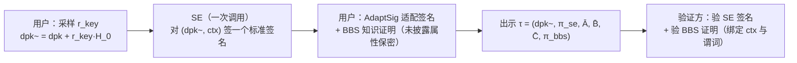

## TL;DR

匿名凭证解决了“证明我成年了而不交身份证”，却留下一个老问题：凭证到手后能不能转借给别人用？Eurocrypt 2026 的这篇论文给出了系统回答——把凭证绑定到设备安全元件（SE）里的一把密钥，每次出示都必须由 SE 新鲜参与，借出去的凭证在别人手里就是废纸。更关键的是，它不要求你无条件信任这块硬件：三个构造排成一条隐私阶梯，Schnorr 版只要求 SE 诚实，BLS 版能扛住被替换算法的 SE，盲 BLS 版即使 SE 完全被敌手控制、放在云端，也依然保得住不可链接性。代价极小：SE 每次出示只需算一次标准签名，无状态、无凭证专属状态，交互轮数最优。

## 论文信息卡

- **标题**：Device-Bound Anonymous Credentials With(out) Trusted Hardware
- **作者**：Karla Friedrichs、Franklin Harding、Anja Lehmann、Anna Lysyanskaya（Hasso Plattner Institute 与 Brown University）
- **会议**：EUROCRYPT 2026；preprint 存档于 ePrint 2025/1995（2025-10-24 收录，2026-07-01 修订）
- **原文链接**：https://eprint.iacr.org/2025/1995

## 背景

先区分两个容易混淆的隐私问题。昨天那篇讲“发行方隐藏”：出示时不暴露凭证是谁签发的；今天这篇讲“设备绑定”：出示时证明凭证确实属于当前这台设备、而不是从别人那里复制来的。前者防验证方顺藤摸瓜，后者防凭证被转借、被盗用。

为什么设备绑定非做不可？论文给了两个动机：防盗用——凭证文件即使泄露，没有设备里那把密钥，攻击者也冒充不了她；防转借——恶意用户不能把凭证复制给朋友冒充自己。实现方式很直接：签发时把设备公钥和用户属性一起签进凭证；每次出示时，用户还要新鲜证明自己掌握对应的设备私钥，重放旧证明过不了关。

难就难在“这块硬件到底值不值得信”。安全元件（SE）按设计就是黑盒：手机安全芯片、SIM 安全域或云端 HSM，你都没法打开检查它内部跑了什么代码。以往方案几乎都默认 SE 诚实，这在隐私上是个致命假设——制造商或国家级对手可以在不破坏不可伪造性的前提下动手脚，比如在签名随机数里藏隐蔽信道、事后由合谋验证方解码，或者对“不喜欢”的凭证拒绝服务。部署现实更棘手：欧盟数字身份钱包（EUDI Wallet）要求最高保证等级的 SE，但只有部分旗舰手机才有；法规因此允许用远程 HSM 代替本地 SE，而远程 SE 天生就知道每次出示的上下文——验证者是谁、会话 nonce 是什么——这会直接把不可链接性清零。所以真正的问题是：在硬件不可全信、甚至可能在云端的前提下，设备绑定还能不能保隐私？

## 方法拆解

### 先立规矩：出示只有三步，SE 只有一次调用

论文的第一大贡献是先把“设备绑定匿名凭证”形式化。它把出示限定为轮最优的三步：用户算出 `umsg`，SE 回 `smsg`，用户再合成最终出示 $\tau$。这既是效率要求，也是一种纪律：SE 的交互必须是孤立、单体的——一次调用、算完就忘，不准跨调用保持状态，更不准要求 SE 记住“这是哪张凭证”。

论文区分两个变体：context-aware 的 DBAC 里 SE 知道出示上下文 `ctx`（验证者身份、会话信息），适合本地硬件；context-blind 的 BDBAC 里 SE 不接收 `ctx`，专为云端 SE 准备——云端 SE 本来就不该知道你去向谁出示。

安全目标拆成两条线。不可伪造性覆盖属性不可伪造、出示新鲜性与不可转移性，分腐化用户/诚实用户 × 腐化 SE/诚实 SE 的组合讨论。隐私则是一条阶梯：UNLINK-0 是 SE 完全诚实且隔离；UNLINK-1 是 SE 诚实、但接口可能被短暂拿到；UNLINK-2 是 SE 算法被替换为任意无状态代码（算法替换攻击 kleptography）；UNLINK-3 是 SE 完全被敌手控制，即云端 HSM 的情形。另有独立定义的 SE-Obliviousness（SE-Obliv）：SE 对自己“在帮哪次出示”一无所知——缺了它，云端 SE 光凭“你让我签了什么”就能给用户画像，UNLINK-3 也形同虚设。

### 通用骨架：把设备公钥“藏”进凭证，再用密钥同态把它“洗”掉

三个构造共享同一套骨架，核心技巧来自 Orange Innovation 的 BBS# 提案里的 “secure splitting”。先看签发。设备密钥对是 $(dsk, dpk)$，其中 $dpk = dsk \cdot H_0$，$H_0$ 是 BBS 凭证里专用的一个生成元。签发者签的不是“属性 + 设备私钥”，而是“属性 + 设备公钥”：取随机数 $e$，算

$$C = G_1 + dpk + \sum_{i=1}^{\ell} a_i \cdot H_i, \qquad A = \frac{1}{isk+e} \cdot C$$

得到的 $(A, e)$ 就是一张标准 BBS 凭证，只不过属性向量里多了一项隐式属性 $dpk$。用户拿到凭证，却不掌握 $dsk$——私钥永远不出 SE，这是整个设计的前提。

出示时的问题是：如果直接让 SE 对 $(dpk, ctx)$ 签名，$dpk$ 一明文出现，多次出示立刻可链接——$dpk$ 是不变的。解法是密钥同态签名：用户采样随机数 $r_{key}$，把设备公钥“洗”成 $dpk^\sim = dpk + r_{key} \cdot H_0$；SE 对 $(dpk^\sim, ctx)$ 签名；用户用 AdaptSig 把签名适配到 $dpk^\sim$ 之下；最后做一个 BBS 知识证明，证明自己知道一张凭证、知道 $r_{key}$ 与未披露属性，使得调整后的承诺恰好对应 $dpk^\sim$ 与披露的属性，并把适配后的 SE 签名明文附上。最终出示为 $\tau = (dpk^\sim, \pi_{se}, \bar{A}, \bar{B}, \bar{C}, \pi_{bbs})$，验证方检查 SE 签名与绑定了 $ctx$、谓词 $\varphi$、$\pi_{se}$ 的零知识证明。

（文字摘要：用户先随机化设备公钥，SE 只做一次标准签名，用户把签名适配到随机化公钥上并附上 BBS 知识证明，验证方检查签名与证明两项；随机化保证多次出示之间无法通过设备公钥链接。）

骨架成立的关键，是“适配后的签名仍可作为私钥知识的证明”。BBS# 原提案只是假设了这一点、没有形式论证；本文补上了证明——对 weak Fiat-Shamir Schnorr 与 BLS 都成立，BLS 的情形是非平凡的，需在代数群模型里引入一个新引理。因此论文不宣称“任意密钥同态签名都行”：提取性在组合后未必保持，必须逐个验证。

### 构造一 BBS-Schnorr：最轻，但只保 UNLINK-1

第一个构造就是 BBS# 提案的形式化版本：SE 算一个定义在 $G_1$ 上的 weak Fiat-Shamir Schnorr 签名 $(c, s)$，其中 $c = H(r, m)$、$s = \omega + c \cdot dsk$；适配极其简单：输出 $(c, s + c \cdot r_{key})$。论文称它是第一个可证明安全、轮最优且无状态的 BBS 设备绑定协议——但隐私只证明到 UNLINK-1。

弱点恰恰出在 Schnorr 的随机数上。SE 自己选 $\omega$，被替换算法的 SE 可以把追踪信息编码进 $\omega$（进而进 $c$、$s$），合谋验证方解码后就能识别用户；该构造也不满足 SE-Obliv，因为 SE 看得到明文的 $dpk^\sim$。所以 Schnorr 版只解决“凭证不能借”，不解决“硬件可能使坏”。

### 构造二 BBS-BLS：确定性签名堵住隐蔽信道，保到 UNLINK-2

第二个构造把 Schnorr 换成确定性签名 BLS：$sig = sk \cdot H(m)$，适配是 $sig + r_{key} \cdot H(m)$。确定性是关键——给定消息，签名输出唯一，SE 再没有随机数可供藏私货，subversion 的经典信道被堵死了。于是隐私等级升到 UNLINK-2：即使 SE 的算法被替换成任意无状态代码，出示依然不可链接。

BLS 版还有两个附带好处：签名天然可门限化、可聚合，验证方看不出背后是单设备还是多设备分片，为“本地 + 远程密钥组合”等扩展留了口子；而且它的签发与验证和第三个构造完全相同，两方案可并行跑在同一套凭证体系上。

但 BLS 版仍有一个硬伤：SE 看得到自己在签什么——明文消息 $(dpk^\sim, ctx)$。恶意 SE 记下 $dpk^\sim$，等出示出现时一比对便知“这就是我刚才签的那次”。所以它到不了 UNLINK-3，也满足不了 SE-Obliv，云端场景下仍然不够。

### 构造三 BBS-BlindBLS：盲化之后，云端 SE 也“瞎”了

第三个构造是全文的高潮：把 BLS 换成盲 BLS（Boldyreva 的盲签名版本），并切换到 context-blind 变体。用户先对要签的消息做统计盲化，$\bar{m} = bst \cdot H(m)$；SE 只对盲化后的 $\bar{m}$ 做一次确定性签名，$\bar{sig} = dsk \cdot \bar{m}$；用户解盲得 $sig = bst^{-1} \cdot \bar{sig}$，再适配到 $dpk^\sim$ 之下，最后附上 BBS 证明。

这时 SE 既不知道 $ctx$，也不知道自己签的消息对应哪次出示、哪个验证者，而且输出唯一确定、没法再塞私货。论文证明它同时满足 SE-Obliv 与 UNLINK-3——三个构造里唯一达到“恶意 SE”等级的方案，也是首个可安全用于 EUDI 所设想的远程 HSM 设定的设备绑定构造。它与 BLS 版签发、验证相同，部署可以渐进：本地 SE 不足的地区先走远程 HSM，等硬件跟上再切换，凭证体系不用推倒重来。

## 实验与数据

先说清楚一个容易误读的点：这篇论文没有实现基准测试，没有给出字节级证明大小、毫秒级运行时间。下面的“数据”全部是论文正文给出的定性比较与构造层面的开销账，凡是论文未披露的数字，本文一律不补。

论文第 4 页的 Table 1 是全文唯一的横向对比表：

| 方案 | 用户–SE 交互 | SE 无状态 | 隐私等级 | 兼容 BBS | 盲化 |
|---|:-:|:-:|---|:-:|:-:|
| DAA | ✗ | ✗ | 诚实 SE | ✓ | ✗ |
| DAA+（subverted TPM） | ✓ | ✗ | 被替换 SE | ✓ | ✗ |
| Hanzlik–Slamanig | ✓ | ✓ | 诚实 SE | ✗ | ✗ |
| Hesse 等 | ✓ | ✗ | 诚实 SE | ✓ | ✗ |
| BBS#（Orange 提案） | ✓ | ✓ | 诚实 SE | ✓ | ✗ |
| **BBS-Schnorr（本文）** | ✓ | ✓ | 诚实 SE（定理：UNLINK-1） | ✓ | ✗ |
| **BBS-BLS（本文）** | ✓ | ✓ | 被替换 SE（定理：UNLINK-2） | ✓ | ✗ |
| **BBS-BlindBLS（本文）** | ✓ | ✓ | 恶意 SE（定理：UNLINK-3 + SE-Obliv） | ✓ | ✓ |

注：表里的“1-Round”指的是用户与 SE 之间为一次出示所需的交互，不是整个出示的轮数；按论文 §3.1 的语法，完整出示是三步（用户 → SE → 用户）。另注意，本文 Schnorr 版在表里被标为“被替换 SE”一档，但正文定理只证明到 UNLINK-1——应以定理为准，表是一张宽泛的比较标签，不能读成“Schnorr 版已证明抗替换”。

三个构造的开销账一句话总结：每次出示，SE 只做一次调用、只算一个标准签名（盲变体是一次盲 BLS 签名），不保存任何凭证专属状态，出示结构统一为 $\tau = (dpk^\sim, \pi_{se}, \bar{A}, \bar{B}, \bar{C}, \pi_{bbs})$。与旧方案比，DAA 原始方案每个凭证要两次 TPM 调用且调用间要保持状态，Hesse 等虽然做到一次调用、却要求 SE 与宿主共享凭证专属状态——本文三个构造把这两项都清零了。论文结论里还给了一个定性性能预期（非实测）：Schnorr 版 SE 计算只在 $G_1$ 里，两个 BLS 版在 $G_2$ 里，因此 Schnorr 版在受限硬件上可能稍快一点。仅此而已，论文未披露任何实测数据。

安全定理的账同样值得单列，因为三个构造的“保单”等级不同：

| 构造 | 不可伪造性 | 隐私 |
|---|---|---|
| BBS-Schnorr | UNF（DL 在 $G_1$ 上困难 + BBS/Schnorr EUF-CMA，ROM+AGM） | UNLINK-1 |
| BBS-BLS | UNF（DL 在 $G_1$、$G_2$ 上困难 + BBS/BLS EUF-CMA，ROM+AGM） | UNLINK-2 |
| BBS-BlindBLS | BDBAC UNF（另需盲 BLS 的 weak one-more 不可伪造性，ROM+AGM） | UNLINK-3 + SE-Obliv |

其中“隐私无条件”需精确理解：$dpk^\sim$ 的盲化与盲 BLS 的盲化是信息论/统计意义上的；但形式化的 UNLINK 定理本身仍依赖随机预言机与 BBS 的零知识性，不能把“统计盲化”读成“整个隐私证明不依赖任何假设”。

## 相关工作对比

这条线的起点是 Camenisch 与 Lysyanskaya 2001 年的不可转让匿名凭证，以及后来直接匿名认证（DAA）把 TPM 绑进凭证的做法。DAA 的问题是模型太重（UC 框架、针对整个应用）且接口太专：每个凭证两次 TPM 调用、调用间要保持状态，而手机 SE 根本没有那套接口。Hesse 等 2023 年把调用压到一次、面向离线出示，但代价是 SE 要与宿主共享凭证专属状态——一个 SE 服务多张凭证时这不现实，而且隐私仍只到“诚实 SE”。

与本文关系最近的是 Orange Innovation 的 BBS# 提案：它率先提出“SE 只算标准 Schnorr/ECDSA 签名”的 secure splitting 思路，但没有形式模型，安全证明也被本文指出存在缺口。本文 Schnorr 构造可看作 BBS# 的“补证明版”，BLS 与盲 BLS 则是它在隐私阶梯上的延伸：前者用确定性堵住随机数信道，后者用盲化让 SE 连“自己在签什么”都不知道。另一条平行线是 Hanzlik–Slamanig 的 core-helper 结构与一批把 ECDSA 凭证“转匿名”的通用零知识方案：它们要么需要新的结构保持原语、与 BBS 不兼容，要么根本没考虑不可信 SE 的隐私风险。本文三个构造全部兼容正在标准化的 BBS，这在真实部署里比“更一般的模型”更重要。

## 局限与开放问题

- **签发阶段不匿名**：签发按定义揭示 $dpk$；腐化设备若能影响密钥选择，还能把密钥本身当作一次性隐蔽信道。论文认为影响可忽略（签发很少发生、不揭示动态行为、容量有限），但仍是明说的缺口。
- **密钥生成假设**：模型假定 SE（半）诚实地生成密钥；允许敌手注入恶意 $dpk$ 的更一般版本需要给公钥附加适当的零知识证明，论文为简洁起见没有采用。
- **谓词范围有限**：三个构造只针对选择性披露谓词族定义，不是任意谓词的通用构造。
- **“诚实用户 + 腐化 SE”不在不可伪造性定义内**：远程 HSM 下这其实更现实，论文用独立的 SE-Obliv 性质处理它。
- **元数据与时间侧信道无法消除**：即使满足 UNLINK-3 与 SE-Obliv，远程 SE 仍能看到出示的数量与时间；每次出示都须绑定新鲜会话 nonce 时，时间侧信道在原理上消不掉。
- **没有实现与实测**：全文没有基准测试，$G_1$/$G_2$ 的性能比较只是定性预期；真实钱包里的端到端表现仍待验证。
- **BBS 本身的边界**：BBS 依赖配对假设、不是后量子方案；用在十年有效期的身份证件场景，抗量子路线仍需另起炉灶。

## 一点思考

这篇论文最值得带走的不是某个构造，而是一张“信任账单”：它把“信任硬件”这句话拆成了诚实、被替换、完全恶意三档，并证明每一档分别要付多少代价。我的判断是，如果 EUDI 钱包真的要在远程 HSM 这条路上走下去，盲 BLS 版是目前唯一在模型上站得住的候选，本地 SE 能力不足的地区可以先用它顶上去、以后再平滑切换。但也要清醒：签发阶段的 $dpk$ 泄露与时间侧信道这两个缺口，恰恰是真实部署里最容易被“模型已证明安全”这句话掩盖的地方；做钱包的团队如果只盯着出示协议的证明，而忽略签发与元数据，等于只锁了前门。

## 原文链接

- 论文：https://eprint.iacr.org/2025/1995
- Eurocrypt 2026 会议论文集信息见 ePrint 页面的 publication info（“A major revision of an IACR publication in EUROCRYPT 2026”）
