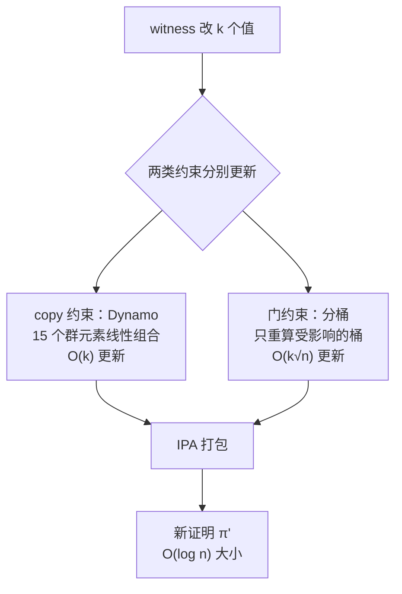

## TL;DR

零知识证明有个反直觉的短板：数据改一个比特，证明就得从头重算一遍，代价和电路规模成正比。这篇 Eurocrypt 2026 的论文第一次形式化定义了 **dynamic zk-SNARK**——给证明系统加一个 `Update` 算法，小改动只花亚线性时间打补丁。核心构造 Dynaverse 只用 KZG 承诺（不依赖递归），更新时间 $O(\sqrt{n}\log n)$、证明恒定大小，实测比 PLONK 重算快约 500 倍。顺带还拿下了两个副产品：第一个证明复杂度只和非零元个数相关的稀疏 SNARK（Aero），以及第一个不需要递归、无需线性状态的增量可验证计算。

> 📄 论文：*Dynamic zk-SNARKs (with applications to sparse zk-SNARKs and IVC)*
> 👥 作者：Weijie Wang（耶鲁）、Charalampos Papamanthou（耶鲁 / Lagrange Labs）、Shravan Srinivasan（Lagrange Labs）、Dimitrios Papadopoulos（港科大 / Lagrange Labs）
> 🏛 会议：Eurocrypt 2026（第 45 届欧密会，罗马，2026 年 5 月），LNCS 16547, pp. 329–358
> 🔗 [ePrint 全文](https://eprint.iacr.org/2024/1566)（2024/1566，CC BY，最后修订 2025-10-13）

## 背景：改一个数，重算整个证明

先一句话复习 zk-SNARK：证明者有一个电路和一组满足电路的秘密输入（witness），生成一个很短的证明；验证者不看秘密输入，只验算证明就相信"计算是对的"。Groth16、PLONK 都是这个路数，区块链里到处在用（zk-Rollup、隐私转账）。

但所有主流 SNARK 都有一个隐形假设：**数据是静态的**。一旦 witness 里改了一个值——比如 Merkle 树里换了一个叶子、数据库更新了一行——旧证明直接作废，必须从头跑一遍证明算法，时间至少和电路规模 $n$ 成正比。直觉上这很浪费：改 1 个比特和改 100 万个比特，花的钱一样多。

为什么做不到增量更新？论文点名了两个技术根因。第一，**Fiat-Shamir**：把交互式证明压成非交互时，挑战值是哈希了全部电路连线算出来的，动一根线，挑战全变，证明里依赖挑战的部分全部失效。第二，**多项式除法**：PLONK 证明门约束要算商多项式 $A(X) = \tau(X)/\prod(X-i)$，被除数 $\tau$ 编码了全部连线赋值，改一个值，商多项式面目全非——除法对输入变化是全局敏感的。

之前也不是没人想过"动态证明"，但都卡在两个极端：要么靠**递归 SNARK**（IVC、Nova 那套），渐进复杂度漂亮（$O(\log n)$ 更新），但实用的递归系统（比如 Plonky2）要把随机预言机编码进电路，安全证明只是启发式的；要么是**专用结构**（可更新向量承诺、认证数据结构、Reckle Trees），只能回答成员证明、范围查询这种简单问题，表达不了通用计算。这篇要回答的是：**通用计算的证明，能不能既可更新、又有可证明的安全性？**

## 方法拆解：先解决置换，再解决乘法

论文的形式化定义很干净：dynamic zk-SNARK 是四元组 $(G, P, U, V)$，比标准 SNARK 多一个更新算法 $U$。$U$ 吃进去旧的 statement-witness、旧证明 $\pi$、辅助数据结构 aux 和新的 statement-witness，吐出新证明 $\pi'$，要求当新旧 witness 的汉明距离为 $k$（只改了 $k$ 个位置）时，运行时间为 $O(k \cdot f(n))$ 且 $f(n) = o(n)$——亚线性。注意"小汉明距离"是必要条件：如果改了一半的数据还想亚线性更新，那必然漏掉了某些改动，不可能正确。零知识性也要相应加强：模拟器要能模拟**一整串**由更新算法生成的证明，而不只是一个。

核心构造 Dynaverse 分两步走，对应 PLONKish 电路的两类约束：

**第一步：Dynamo，动态置换论证。** PLONK 里"连线接得对不对"（copy constraint）是个置换关系：witness 向量 $z$ 满足 $z[i] = z[\sigma[i]]$。论文构造了第一个**可更新的置换 SNARK**：证明者用 KZG 承诺 $z$ 的多项式，验证者持有置换 $\sigma$ 的承诺，证明某个精心构造的多项式恒为零当且仅当 copy 约束成立。关键性质是证明只有 **15 个群元素**，且每个都是 $z$ 的线性组合——线性组合的好处是，$z$ 改一个值，证明只用做一次群运算就能跟着改，**更新时间 $O(1)$**。这是整个构造的基石。

**第二步：门约束的"分桶"技巧。** 加法约束好办（线性，天然可更新），难的是乘法约束的商多项式。论文的办法是把 witness 向量切成 $\sqrt{n}$ 个桶、每个桶 $\sqrt{n}$ 大小，每个桶单独算自己的小商多项式承诺。改一根线，只重算它所在的那个桶——更新时间从 $O(n)$ 降到 $O(\sqrt{n})$。代价是证明变大了（$O(\sqrt{n})$ 个桶承诺），再用 Bünz 等人的内积论证（IPA）把验证方程打包，证明大小和验证时间压到 $O(\log n)$。

集齐两步就是 **Dynaverse**：更新 $O(\sqrt{n}\log n)$、证明 $O(1)$ 大小（IPA 版 $O(\log n)$），安全只依赖 KZG——即 **q-DLOG 假设 + 代数群模型**，和 Groth16 同一款地基，没有递归、没有启发式。

论文还给了升级版 **Dynalog**：用指数级增长的多层桶结构，把更新和证明都做到多项式对数级（再套一层 SNARK 组合可把证明压到 $O(1)$）。以及两个漂亮的应用：**Aero**——第一个稀疏 SNARK，证明者复杂度只和 witness 非零元个数 $k$ 相关（$O(k\log^2 k)$），而不是电路总大小；**BIVC 编译器**——从任意 dynamic zk-SNARK 编译出有界步数、无需递归的增量可验证计算，顺带拿下第一个**亚线性状态**的 BIVC，摆脱了传统 IVC 要维护线性大小服务器的包袱。

## 实验与数据：渐进输了，实测赢了

论文在 AWS c7i.48xlarge（192 核）上用 Rust 实现了优化版 Dynaverse，对照组是第 3.1 节的递归 folklore 构造（用 Plonky2 实现）。电路规模从 $2^{18}$ 到 $2^{24}$，随机改一个 witness 位置测更新：

| 电路规模 | 基线更新 | Dynaverse 更新 | 基线验证 | Dynaverse 验证 | 基线证明 | Dynaverse 证明 |
| --- | --- | --- | --- | --- | --- | --- |
| $2^{18}$ | 3.82s | 0.15s | ≤0.006s | 0.78s | 129.8 KiB | 96 KiB |
| $2^{20}$ | 4.53s | 0.18s | ≤0.006s | 1.03s | 129.8 KiB | 192 KiB |
| $2^{22}$ | 4.63s | 0.24s | ≤0.006s | 1.58s | 129.8 KiB | 384 KiB |
| $2^{24}$ | 5.09s | 0.38s | ≤0.006s | 2.40s | 129.8 KiB | 768 KiB |

三点值得细看。第一，**更新快 10–20 倍**：基线渐进复杂度 $O(\log n)$ 明明更优，但递归的常数太大，被 $O(\sqrt{n})$ 的 Dynaverse 按在地上摩擦——渐进分析输了，工程赢了。第二，**验证和证明是代价**：Dynaverse 验证要 0.78–2.4 秒（基线 6 毫秒），证明 96–768 KiB 随电路增长（基线恒定 129.8 KiB）。更新快、验证慢，这是 dynamic SNARK 的天然 trade-off：更新是高频操作，验证是低频操作，这个取舍是合理的。第三，论文很诚实地注明了**对 Dynaverse 不利的实验设定**：Dynaverse 用的 BLS12-381 配对曲线比基线的 Goldilocks 域运算慢得多，等于让了一只手。

另外摘要里还有个更抓眼球的数字：Dynaverse 更新比 **PLONK 从头重算快约 500 倍**——这才是"打补丁 vs 重装系统"的真实差距。

## 相关工作对比

**和 IVC/Nova 比**：IVC 是"计算过程"的增量证明（一步接一步），dynamic zk-SNARK 是"数据变化"的增量证明（同一电路、witness 小改），问题设定就不同。而且 Nova 这类 folding 方案和 Plonky2 一样，实用版本的安全性都是启发式的；Dynaverse 的证明在 AGM+q-DLOG 下是严格的。

**和 Reckle Trees（CCS '24，同个团队）比**：Reckle Trees 是 Merkle 树的批量动态证明，只能做成员证明；Dynaverse 是通用电路，表达能力不在一个量级。

**和可更新向量承诺（Hyperproofs 等）比**：那些只能支持线性函数或简单查询，Dynaverse 支持任意电路的 gate 约束+copy 约束。

一句话定位：它是第一座同时满足"通用计算 + 可更新 + 可证明安全"的桥，之前的工作每次最多占两条。

## 局限与开放问题

- **可信设置**：KZG 需要 trusted setup，q-DLOG+AGM 虽然和 Groth16 同款，但毕竟不是透明 setup（STARK 那种）。
- **证明者和验证者的不对称**：更新快了 10–20 倍，验证却慢了两个数量级、证明也更大——适合"频繁更新、偶尔验证"的场景，反过来就不划算。
- **更新幅度受限**：只有小汉明距离才亚线性；数据大改还是得重算。这不是缺陷，是定义决定的上限。
- **辅助数据**：更新算法依赖 prover 维护的 aux 数据结构，有状态，不像标准 SNARK 那样无状态。
- **实现是初步的**：作者自己说是 unoptimized，IPA 压缩版因为"具体效率不行"根本没实现——$O(\log n)$ 证明目前还停留在纸面。
- 开放问题：能不能做到透明 setup 的 dynamic SNARK？更新和验证能不能同时快？Aero 的稀疏性能在真实稀疏电路（比如大规模 Merkle 树）上表现如何？

## 一点思考

这篇最打动我的不是 500 倍这个数字，而是它把"证明"从**一次性快照**变成了**可维护的数据结构**——思路上和 Merkle 树当年干的事一模一样。区块链的现实世界恰恰是动态的：Rollup 的状态根每 12 秒变一次、预言机喂价一直在变、AI 模型持续训练，今天的 SNARK 每次都要为全量数据重新买单，长期看这是不可持续的。Lagrange Labs（作者团队的公司，做 ZK 协处理器的）押注这个方向，说明工业界已经闻到味道了。对做 zkVM/zkRollup 的团队来说，值得认真评估：你的证明负载里，有多少是"小改动"？如果答案是"大部分"，dynamic SNARK 可能就是下一代架构的入场券。

---

*本文为论文研读笔记，观点为个人解读。引用数据均来自论文原文，感兴趣请直接阅读 [ePrint 全文](https://eprint.iacr.org/2024/1566)。*
