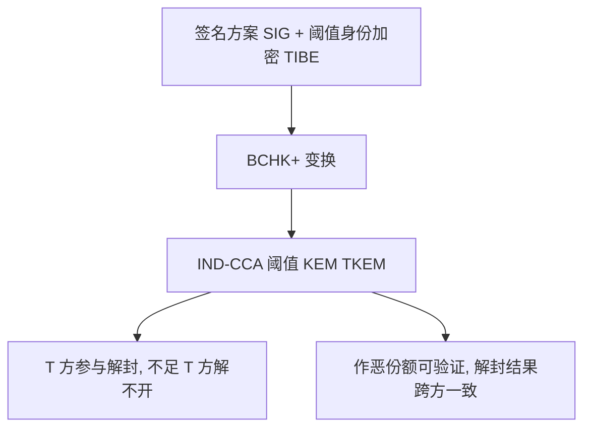

## TL;DR

阈值密钥封装（TKEM）想解决的问题很实际：解封密钥不能只捏在一个人手里，要分给 $N$ 方，凑够 $T$ 方才能解开，单点被攻破或宕机都不至于全盘皆输。但在格上做到 IND-CCA 安全，长期以来只有一条不依赖重型机械的路——Lapiha 和 Prest 在 Asiacrypt 2025 的 BCHK+ 构造，而它的密文高达约 540 KiB，没法上链、没法进投票系统、没法塞进任何对带宽敏感的协议。PKC 2026 的这篇论文没有换赛道，而是把这条路的底层构件彻底重做：换一个更简单的阈值身份加密（TIBE），把密文从 10 个环元素砍到 4 个，模数也随之缩小，再辅以比特丢弃等优化，最终在 $T=32$、$\kappa=128$ 比特安全下把密文压到 30 KiB 以下，相对旧构造缩小约 18 倍，封装密钥也从原来的量级降到约 6.6 KiB。更重要的是，它顺手解决了旧构造一个结构性短板：用 Vandermonde 秘密分享代替 Shamir 分享，让每一份作恶的密钥提取份额都能被单独验证、单独揪出，而不是像以前那样，一方发垃圾就能让整轮重构系统性失败，还查不出是谁干的。

## 论文信息卡

- **标题**：IND-CCA Lattice Threshold KEM under 30 KiB
- **作者**：Katharina Boudgoust（CNRS，蒙彼利埃大学 LIRMM）、Rafaël del Pino（PQShield）、Oleksandra Lapiha（伦敦大学皇家霍洛威学院）、Thomas Prest（PQShield）
- **会议**：PKC 2026
- **原文链接**：https://eprint.iacr.org/2026/021

## 背景

先理清层次。KEM 是后量子时代的基础构件：发送方用公钥封装出随机会话密钥和密文，接收方用私钥解封。NIST 在 2022 年选定的 ML-KEM（Kyber）就是格上的 KEM。IND-CPA（选择明文攻击下不可区分）只是底线，实际部署要求更强的 IND-CCA：敌手拿任意密文问解封预言机，也猜不出挑战密文里封的是哪个密钥。很多格加密构造只能做到 IND-CPA，要升到 IND-CCA 需要通用编译器，最常用的是 Fujisaki-Okamoto（FO）变换，ML-KEM 和 HQC 都在用它。

阈值化把事情变难了一个数量级。阈值 KEM 里解封密钥被分给 $N$ 方，至少 $T$ 方参与才能解封，应用包括电子投票、区块链内存池隐私，NIST 也已发布阈值方案征集。但把 FO 变换阈值化需要昂贵的通用多方计算；绕开 FO 的其他 IND-CCA 格阈值构造，则往往依赖非交互零知识证明、阈值全同态加密或多方计算这类重型机械，效率说不清楚。Boneh-Canetti-Halevi-Katz（BCHK）变换是另一条路：它用一个签名方案加一个阈值身份加密（TIBE）拼出 IND-CCA 阈值加密，Lapiha-Prest 的 BCHK+ 变体又补上了格场景下很难得到的“解封一致性”。问题只剩一个：它的 TIBE 密文太大，540 KiB 的量级让整个构造停留在论文里。这篇论文的任务，就是把这个唯一可行的轻量路线真正做便宜。

## 方法拆解

### 第一步：换掉底层 TIBE，从 10 个环元素砍到 4 个

理解这篇论文的关键，是先看懂旧构造为什么贵。身份加密（IBE）里，主公钥是一个伪随机矩阵 $A$ 和一个均匀向量，陷门持有者可以为任意身份 $id$ 算出一个短原像 $z$，满足 $F_{id} \cdot z \approx t$，其中 $F_{id}$ 是嵌入了 $id$ 的矩阵。加密就是算一对 $(u, v)$，解密时用 $v - u \cdot z$ 恢复消息编码。Lapiha-Prest 的 $F_{id}$ 长这样：$A_0 \parallel A_1 + E(id) \cdot B \parallel A_2$，其中 $A_0$ 带 Plover 陷门，$A_2$ 是为了在安全证明里嵌入一个 module-NTRU 陷门而额外加的矩阵块。数一数，密文因此要发 $3 \times 3 + 1 = 10$ 个环元素。

新构造的起点是 Cash 等人 Eurocrypt 2010 的 ROHIBE，身份嵌入方式简单得多：

$$F_{id} = A_0 \parallel H(id)$$

其中 $H$ 被建模为随机预言机。这一步省的不止是 2 个环元素：ABB 式嵌入要求任意两个标签之差都可逆，需要挑选具有指数多个单位元的低分裂环；而 $H(id)$ 只需一个环元素，环的选择不再受分裂性质束缚。第二步更彻底：新构造直接不要 $A_2$ 这一整块矩阵，因为 $H(id)$ 可以同时扮演 $A_2$ 和 $A_1 + E(id) \cdot B$ 两个角色——每个身份都有自己独立的矩阵扩展和自己嵌入在 $H(id)$ 里的 NTRU 陷门，这个陷门既能用于 Hint-LWE 归约，也能用于 IBE 本身的安全性。这一块又省 3 个环元素。第三步是小修补：旧构造里 $A_0$ 的第一个系数 $d_0$ 只是为了随机化首项，新构造直接设 $d_0 = 1$ 并在生成密文时丢掉 $A_0$ 的第一个系数，再省 1 个。合计 $2 + 3 + 1 = 6$ 个，10 个环元素就此变成 4 个。

### 第二步：模数变小，尺寸收益层层放大

环元素砍半还不是全部收益。更简单的构造允许取更小的模数 $q$，其随环维度 $d$、阈值 $T$ 和查询数 $Q$ 的增长速度明显慢于旧构造；模数小了，每个环元素占的比特数就少，反过来又允许把 $d$ 取得更小，收益复利式放大。再加两招精细优化：一是比特丢弃，$v$ 本来就可以重度丢弃，论文发现 $u$ 的两个系数也可以丢——解密时算 $u \cdot z$，$z$ 的系数极不均衡，前两个很大、第三个很小、最后一个居中，丢弃策略必须按此量身定做；二是系数丢弃，只封装 $\kappa$ 比特密钥，$v$ 只发 $\kappa$ 个系数。这几招叠加，才从“环元素少了”走到“密文只有原来十八分之一”。

### 第三步：Vandermonde 分享，让作恶可被揪出

旧构造的另一个痛点在密钥提取环节。提取一份身份密钥需要多方交互：第一轮各方发承诺 $cmt_i = H_{cmt}(w_i)$，第二轮揭示 $w_i$，最后一轮各方发响应 $z_i$，响应里包含用拉格朗日系数缩放过的 Shamir 密钥份额。直接发缩放份额会被密钥恢复攻击利用，Threshold Raccoon 的做法是给每个响应加一个一次性掩码 $m_i$，所有掩码加起来为零，重构时刚好抵消。这招从证明角度很简单，但有两个代价：各方需要事先共享互享秘密种子；更致命的是，某一方在最后一轮发垃圾，重构会系统性失败，却没人知道是谁干的——掩码把作恶藏起来了。

新构造把 Shamir 分享换成 Vandermonde 秘密分享（Borin 等人 2025 年的格友好版本，源头是 Desmedt 等人的方案）。它的好处是分享本身就短：短的值分出短的份额，重构系数也短，于是各方响应 $z_i$ 也能保持短，而短响应是可以验证的——检查一个线性恒等式，再检查一个范数界，就能判断某份响应是否合格。这就是论文提出的“提取份额鲁棒性”：即使敌手恶意生成提取份额，也无法让诚实生成的密文重构失败；实际证明的版本更强，对有偏随机数生成的密文同样成立。代价是证明必须处理 Vandermonde 分享带来的泄露，论文把 Coset-Hint-RLWE 到 Hint-RLWE 的归约直接揉进主证明，假设面落在 Hint-RLWE 和 NTRU 上。

鲁棒性还顺带升级了 TKEM 的解封一致性：旧构造只把“两方恢复出两个不同但都有效的密钥”算作不一致，新构造把“一方的恢复结果是 $\bot$（无效）”也算作不一致。直觉是，有效密钥一方可借 BCHK+ 变换反推出底层消息与加密随机数，从而把另一方份额拼成对 TIBE 鲁棒性游戏的一次伪造。

## 实验与数据

这篇论文没有基准测试式的“实验”，它的“实验与数据”就是参数表本身——对以尺寸为命脉的构造而言，参数表就是全部说服力。所有参数组统一取 $T = 32$、$q \approx 2^{50}$、$d = 2048$，下表给出的是 TIBE 自身的封装密钥与密文尺寸（单位：字节），TKEM 的完整密文还要在此基础上另加验证密钥与签名，论文给出的参考值是：ML-DSA 在 NIST 安全 2 级和 5 级下验证密钥加签名合计分别为 3,732 和 7,219 字节，Falcon 在 1 级和 5 级下合计分别为 1,563 和 3,073 字节。

| 安全参数 $\kappa$ | 提取份额鲁棒 | 封装密钥 | TIBE 密文 |
| --- | --- | --- | --- |
| 128 | 否 | 6,688 | 28,544 |
| 128 | 是 | 7,456 | 29,056 |
| 256 | 否 | 12,352 | 56,512 |
| 256 | 是 | 14,400 | 58,560 |

读这张表抓住三个要点。第一，headline 数字的来源：$\kappa = 128$、非鲁棒档的 TIBE 密文 28,544 字节约合 27.9 KiB，封装密钥 6,688 字节约合 6.5 KiB，论文引言“约 6.6 KiB / 约 30 KiB、相对旧构造 7 倍 / 18 倍”即源于此；配 Falcon 一级签名时 TKEM 总量约 30,107 字节，仍在 30 KiB 以下，配 ML-DSA 则要自行加总，不能笼统宣称所有选型都低于 30 KiB。第二，鲁棒性几乎免费：同档下鲁棒版密文只大 512 字节（128 档）或 2,048 字节（256 档），旧构造里鲁棒性要靠零知识证明或重型分享换来，这里只换了一次分享方案。第三，鲁棒版的代价不在尺寸，而在查询预算：解封查询数 $Q$ 从约 $2^{45}$ 降到 $2^{25}$，部署时必须按实际查询量选档，不能只看尺寸。

还有一个正确性细节：论文把解密失败概率 $\delta$ 只要求做到约 $2^{-30}$ 的量级，而非可忽略量，因为 BCHK+ 变换本身保证即使存在解密失败，CCA 安全性仍然成立，不必为压失败概率而无限放大参数。

## 相关工作对比

横向看，这篇工作没有发明新的阈值范式，而是把 BCHK 这条唯一轻量路线从“理论上可行”推到“尺寸上可用”。与阈值化 FO 变换相比，它避开了通用多方计算；与依赖零知识证明、阈值全同态加密的构造相比，它不引入重型机械，代价都体现在一张可逐项核对的参数表里。与 Lapiha-Prest 相比，密文 18 倍、封装密钥 7 倍、分享方案换成可验证的 Vandermonde 分享、解封一致性也升级到更强版本。唯一的反向 trade-off 是鲁棒版查询预算 $Q$ 大幅收紧，以及构造仍站在随机预言机模型和较新的 Hint-RLWE 假设上。

## 局限与开放问题

- 鲁棒版以查询预算换问责：$Q$ 从约 $2^{45}$ 降到 $2^{25}$，高频解封场景选档时必须先算查询量，不能默认鲁棒版处处可替代非鲁棒版。
- 尺寸仍未追平单用户 KEM：即使 128 档约 30 KiB 的总量，相对单用户格 KEM 仍大一个数量级以上，阈值化的代价只是从“不可用”降到了“可接受”，远未到“便宜”。
- 假设面较新：安全性依赖 Hint-RLWE（及揉进证明的 Coset-Hint-RLWE 归约）和 NTRU 陷门，论文论证了其参数区不受 overstretched NTRU 攻击影响，但 Hint-RLWE 的 cryptanalysis 积累远不如标准 RLWE 深厚。
- 随机预言机模型：身份嵌入 $H(id)$ 与承诺哈希都建模为随机预言机，标准模型下的对应构造论文未给出，部署时的哈希实例化仍需谨慎。
- 论文未披露端到端运行时间与实现基准：全文以构造、证明与参数表为主，没有可比的封装/解封耗时、轮数之外的通信开销实测，工程选型前需要自行实现并测一轮。

## 一点思考

这篇论文最值得工程团队注意的不是 18 倍本身，而是它改变了阈值 KEM 的选型默认答案：以前“格上 IND-CCA 阈值 KEM”约等于“只能写在标书里”，现在至少在 $T=32$、128 比特安全档位上，它第一次有了可以写进带宽预算的尺寸。我的判断是，电子投票、内存池隐私、NIST 阈值征集这类本来就在用格假设的场景，这篇构造是目前最现实的候选起点；但别急着当成生产默认——先按查询量在鲁棒版与非鲁棒版之间选档，再把签名选型对总尺寸的影响算进去，最后补上自行实现的速度实测。短期更务实的用法，是把它当作“尺寸锚点”：任何新方案在这个档位上比它大一个数量级，就得先回答“多出来的尺寸换来了什么”。

## 原文链接

- 论文：https://eprint.iacr.org/2026/021
- 前任构造（Lapiha-Prest，Asiacrypt 2025）：论文参考文献 [LP25]，见原文第 1 节与参考文献表
