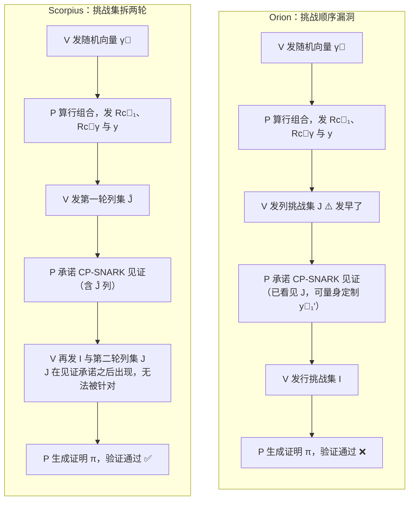

## TL;DR

后量子 zk-SNARK 明星 Orion（Crypto 2022，线性时间证明者）在经历两次修订之后，最新版本依然不安全。ASIACRYPT 2025 的这篇论文证明：攻击者不需要重新构造承诺，**任意一个已经存在的承诺都可以被打开成任意求值结果**，并且给出了可实际运行的攻击代码。漏洞根源是一个挑战—响应顺序问题：列挑战集 $J$ 在证明者承诺 CP-SNARK 见证之前就已泄露，证明者可以针对 $J$ 量身定制见证。作者随后在不引入新假设、保持线性证明者的前提下修复了协议，新的多项式承诺方案命名为 **Scorpius**：把列挑战拆成先后两轮，并用多项式掩码代替向量掩码构造零知识码。修复后的方案证明尺寸更小、验证器更快，还首次给出了严格的安全证明。顺带的一个"彩蛋"：按论文重算，Orion 原版选取的参数 $t=1568$ 实际只提供约 14 bit 安全，要达到 128 bit 需要 $t=9635$。

## 论文信息卡

- **标题**：A Crack in the Firmament: Restoring Soundness of the Orion Proof System and More
- **作者**：Thomas den Hollander、Daniel Slamanig（德国联邦国防军大学 Research Institute CODE）
- **会议**：ASIACRYPT 2025（第 31 届，2025 年 12 月，墨尔本）
- **原文链接**：https://eprint.iacr.org/2024/1164（ePrint 2024/1164，CC BY 许可）
- **攻击实现**：https://github.com/ThomasdenH/orionattack

## 背景

零知识证明在区块链落地之后，"后量子 + 无需可信设置（transparent）"成了 SNARK 选型的硬需求。基于哈希和纠错码的路线（Brakedown、Orion）是这个方向的主力：它们不依赖椭圆曲线配对，天然抗量子计算，且证明者可以做到线性时间。

Orion（Xie、Zhang、Song，Crypto 2022）是这条路线上的明星。它在 Brakedown 之上做了两处关键改进：一是用最小距离更好的线性时间可编码码，二是用"码切换（codeswitching）"证明组合技术，把证明尺寸和验证时间从 $O(\sqrt{N})$ 一路压到 polylog，还顺手加上了零知识性质。当时它是后量子 SNARK 里证明者最快的方案，证明尺寸比 Brakedown 小一个数量级，外层用 Virgo 提供零知识。

但 Orion 的发表史就是一部"补丁史"。发表后先修了一次零知识处理：掩码多项式与编码冗余混在一起，导致模拟器无法模拟；接着 HyperPlonk 的作者发现了可靠性漏洞——行索引集 $I$ 在证明流程中给得太早，证明者可以作弊，原作者于是用 commit-and-prove SNARK（CP-SNARK）做外层打补丁：逼证明者先把见证承诺了，验证者才发 $I$。

这篇 ASIACRYPT 2025 论文要讲的就是：**补丁没打全，Orion 还是坏的**——而且这次给了能跑的代码。

## 方法拆解

### Orion 的承诺与求值流程

先快速过一遍 Orion 的多项式承诺是怎么工作的，这是理解漏洞的前提。设多项式 $\phi$ 的系数排成 $k \times k$ 矩阵 $W$：

1. **Commit**：对 $W$ 的每一行用线性码 $\mathrm{EC}$ 编码，并叠加一个随机行向量 $\vec r_i$ 做掩码（零知识用），得到矩阵 $C$；再对 $C$ 的每一列用 $\mathrm{EC}$ 编码，得到 $D$；对 $D$ 的每一列做 Merkle 承诺，最后把 $2n$ 个列承诺再做一次 Merkle，得到总承诺 $R$。
2. **Eval**（证明 $\phi(\vec x)=y$，其中 $\vec x = \vec x_0 \otimes \vec x_1$）：验证者发随机向量 $\vec\gamma$；证明者计算行的线性组合 $\vec y_\gamma = \sum_i \vec\gamma_i W_i$、$\vec y_1 = \sum_i \vec x_{0,i} W_i$ 及其编码，并对编码做 Merkle 承诺；验证者随机抽查列集 $J$，检查"线性组合确实是这么算的"；行集 $I$ 的抽查则验证列编码与承诺 $R$ 一致。直觉是：线性码保证，任何不一致都会以压倒性概率在随机抽查中暴露。零知识相关的检查被塞进外层的 CP-SNARK 里完成。

### 漏洞：列挑战集 $J$ 泄露得太早

上次修订只修了行集 $I$（把它挪到见证承诺之后），却漏掉了列集 $J$。看 Eval 的顺序：第 4 步验证者发出 $J$，第 5 步证明者才承诺 CP-SNARK 见证（包含 $\vec y_1, \vec y_\gamma, \vec r_1, \vec r_\gamma$ 和 $J$ 对应的列），第 6 步验证者才发出 $I$。

于是证明者**在知道 $J$ 的情况下**选择见证。关键在于：$\vec y_1$ 这类向量唯一被验证的地方就是外层 SNARK，而编码承诺 $R_{\vec c_1}$ 只约束了它们在 $J$ 上的投影——$J$ 之外的值，验证者根本看不见。

### 攻击如何构造：任意承诺，任意求值

攻击流程出奇地直接。证明者手里有一个已存在的承诺 $R$（不需要是它自己伪造的），想把它在点 $\vec x$ 处"打开"成任意想要的 $y$：

1. 前 4 步完全按协议诚实执行，只是在第 3 步把**想要的假 $y$**发出去（代替真实求值）。
2. 在第 5 步，构造一个伪造的 $\vec y_1'$，满足三个条件：(1) 它在 $J$ 上的编码与已承诺的 $c_{\vec 1}$ 一致（$\forall j \in J: \vec c_1'[j] = \sum_i \vec x_{0,i} C_{ij}$）；(2) 它"解释"了假的求值（$y = \sum_j \vec x_{1,j} \vec y_1'[j]$）；(3) Merkle 承诺 $R_{\vec c_1}$ 能在 $j$ 处打开到对应值。

论文证明这总是可解的：先任选一个满足条件 (2) 的 $\vec y_1'$，再调整掩码 $\vec r_1'$ 使条件 (1) 成立（零知识的挑战空间限制让前后两半索引集不相交，互不干扰）。对于非零知识版本，问题化为线性系统 $BG^T \vec m = \vec c_1(J)$：引理 1 说明解空间维数至少 $k - t$（$t$ 个抽查点定不住 $k$ 维消息）；引理 2 说明当求值点随机且 $k > t$ 时，除可忽略概率外解一定存在。论文的实验结论更干脆：**$k > t$ 时恒有解**。在非交互（Fiat-Shamir）设置下，证明者甚至可以对多个候选 $J$ 依次尝试，成功概率只会更高。

### 攻击实现：不显式构造生成矩阵

Orion 用的是广义 Spielman 码，编码过程是递归的 expander 图操作，直接构造生成矩阵 $G$ 又慢又占内存。攻击实现玩了一个巧妙的逆向：从右向左把 $t \times n$ 的选择矩阵 $B$ 反向穿过编码器，最终得到 $t \times k$ 的矩阵 $BA$，全程内存只有 $O(|B|)$；再对 $Q = [BA; \vec x_1]$ 求伪逆 $Q^\dagger$，直接解出伪造的 $\vec y_1'$。代码已开源，实现者称攻击是 practical 级别的。

### 修复：Scorpius 把挑战集拆成两轮

修复的核心思想很优雅：**把列挑战集拆到两轮去**。验证者先发第一轮列集 $\hat J$（第 4 步），证明者用 $\hat J$ 承诺列 $C_{\cdot j}$（第 5 步见证承诺）；验证者再发第二轮的 $I$ 和全新的 $J$（第 6 步）。此时 $J$ 在见证承诺之后才出现，证明者选见证时看不见它，针对 $J$ 定制见证的路就被堵死了。

但直接拆轮会破坏零知识：$J$ 不能与 $\hat J$ 完全独立采样，否则部分见证会泄露。于是作者换了零知识机制：用一个 $q-1$ 次**随机多项式**代替随机向量做掩码，得到"零知识线性码" $\mathrm{EC}_{\mathrm{ZK},q}$（引理 3）。这个变换本身可能独立成趣：它是 $q$-query uniform 的（任意 $q$ 个位置的查询值均匀随机），相对最小距离保持 $2d$——而 Orion 原来的向量掩码会把距离减半——同时仍保持线性时间可编码。有了它，$\hat J$ 和 $J$ 可以独立均匀采样，协议反而变简洁了。

效果是全方位的：码距翻倍意味着达到同样安全级别所需的抽查数 $t$ **减半以上**，证明中的元素大幅减少；验证时间约为"验证 $\pi$"加上 $O(t)$，显著下降；证明者只多了 $O(\sqrt{N})$ 的电路乘法和 $N$ 次常数多项式求值，基本持平。修复后的多项式承诺方案被命名为 **Scorpius**。

### 安全证明的思路

论文给了 Orion 系**第一份严格的安全证明**，extractor 分四步走：(1) 由 $R_{\vec c_\gamma}$ 的绑定性，$\vec y_\gamma, \vec r_\gamma$ 被唯一确定；(2) 由 Merkle 绑定性，$R$ 唯一确定 $C$ 的列；(3) 用引理 6（随机线性组合保持与码字的距离）加上"$\hat J$ 在承诺之后采样"，推出 $C$ 每行都接近某个码字，从而解出 $W$；(4) 由 CP-SNARK 可靠性得到 $y = \phi(\vec x)$。Extractor 把协议 rewind $k$ 次，拿 $k$ 个线性无关的 $\vec\gamma$ 解线性系统还原 $W$。零知识方面，新模拟器用零多项式做承诺，且**不再要求承诺时已知求值点**——论文指出 Orion 原版的模拟器违反了自己的定义。非交互化（Fiat-Shamir）也给了显式处理。

## 实验与数据

- **攻击实测**：论文报告，只要 $k > t$，求解线性系统"恒有解"（always yielded a solution）；攻击的 Rust 实现已开源，可复现。这是密码学论文里少见的"真动手"环节——漏洞不是纸面上的，是能跑的。
- **参数安全级别重算**：脚注里藏着一个更扎心的数字。Orion 原版取 $t = 1568$，但按其线性组合检查的实际成功概率 $1 - d/(3\cdot 2n)$ 折算，**真实安全级别只有约 $\lambda \approx 14$**；要达到 128 bit 安全，需要 $t = 9635$。也就是说，即便没有这次的协议漏洞，原版参数也远未达到宣称的安全强度。
- **修复后效率**：$t$ 减半以上，证明尺寸与验证时间显著下降，证明者时间基本持平（"comparable"），符合上文的渐近分析。
- **小多项式支持**：原版要求 $k > t/(4(1-2\delta)) \approx 1347$（$\delta = 0.055$）；新版直接支持小一半的多项式。对更小的 $k$ 还可以把行编码换成 Reed-Solomon 码：$k = 2000$ 时取 $RS[7486, 2000+2t, 4847]$ 只需 $t = 365$；$k = 1000$ 时取 $RS[9896, 1000+2t, 8585]$ 只需 $t = 156$。
- **多点打开**：用随机线性组合把多个求值点压成一次 Eval，得到多点打开协议（引理 5），零知识不受影响。
- 另外，ePrint 摘要提到修订版还借用了 Diamond–Posen（CiC'24）的技巧，把验证者的挑战压缩到对数级。

## 相关工作对比

同源的 Brakedown（Golovnev 等，Crypto 2023）证明尺寸是 $O(\sqrt{N})$，Orion 用 codeswitching 把它压到 polylog，这是 Orion 当年最大的卖点。外层的 Virgo（Zhang 等，IEEE S&P 2020）提供零知识；论文致谢里透露，Orion 原作者曾建议换用支持 batching 的 FRI-based 外层 SNARK 来降低多轮承诺的开销，可见这条优化线还在继续。

HyperPlonk 的 Orion+ 走了另一条路：基于配对，把证明压到 10KB 以内（近千倍压缩），但代价是放弃后量子安全性。颇具戏剧性的是，正是 HyperPlonk 的作者发现了 Orion 的第二次可靠性漏洞——"最了解你的人，伤你最深"。

与 BCL22（Eurocrypt 2022）的零知识线性码相比：那里的向量掩码会把相对最小距离减半，本文的多项式掩码保持距离不变，是一个通用的、可独立使用的变换。综合来看，本文是第一份给 Orion 补上严格安全证明和严格零知识分析的工作，而不只是一次"打补丁"。

## 局限与开放问题

- **强模拟可提取性（strong SE）不可能**：对 BCG20 系（Orion、Brakedown、Ligero）都一样——攻击者只改一个索引就有可观概率通过全部检查，相当于可重随机化证明。weak SE 看似成立，但论文没有证明，留作未来工作。
- **Fiat-Shamir 的完整分析缺失**：论文只对多项式承诺部分给了非交互化的显式处理，把 Fiat-Shamir 套用到完整 zk-SNARK 上的安全损失没有详细分析。
- **外层依赖仍在**：修复保留了 CP-SNARK（Virgo）作为外层；朴素的多轮承诺方案开销大，FRI batching 目前只是讨论，没有完全落地。
- **开放优化问题**：能否把随机性藏进秘密的生成矩阵里，进一步压缩证明尺寸——前提是能高效验证码的最小距离，论文认为现有随机采样的线性时间可编码码可能已经满足要求。

## 一点思考

这篇论文最值得记住的不是"Orion 又双叒被攻破了"，而是"靠直觉打补丁修不好协议级 bug"——两次修订都没逃过第三次实锤，唯一的出路是重做形式化证明，而这正是 Scorpius 顺手补上的。对工程选型的判断是：在后量子 zk-SNARK 落地之前，优先选择带严格证明的构造，论文宣称的参数必须按证明重算——$t=1568$ 实际只有 14 bit 安全就是一记警钟。实操上，别再把 Orion 旧版当黑盒集成，要么跟进 Scorpius，要么等它的开源实现成熟。对中文读者而言，这类"攻破—修复—反超"的故事恰恰是理解 SNARK 安全模型最好的教材：可靠性不是功能特性，而是证明。

## 原文链接

- 论文全文：https://eprint.iacr.org/2024/1164
- 攻击实现：https://github.com/ThomasdenH/orionattack
- ASIACRYPT 2025 录用消息（作者单位页面）：https://www.unibw.de/crypto-en/qusac-news/3-papers-accepted-as-asiacrypt-2025
