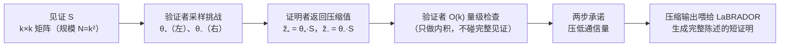

## TL;DR

格基证明系统这几年进步飞快：证明大小做到了线性甚至更小，证明者时间也追上了其他抗量子方案，唯独验证者还是慢的那个——验证一份聚合证明的工作量跟见证规模成正比，批量一上来就撑不住。CRYPTO 2026 的 Orthus（IBM Research 苏黎世团队，Lyubashevsky、Seiler 等人）第一次把格证明的验证做到了次线性：验证时间随见证规模的平方根增长。最直观的数字是聚合 Falcon 签名：2^17（131072）个签名一起验，老路线 LaZer 需要 63 秒，Orthus+LaBRADOR 组合只要 7 秒，快了 9 倍，证明大小维持在约 100KB。核心技巧叫 Left-Right 协议：把见证排成 k×k 矩阵，验证者采样两个挑战，证明者只返回压缩后的向量，验证者做 O(k) 量级的检查就够了；压缩后的输出再喂给 LaBRADOR，生成关于完整陈述的短证明。安全只依赖标准格假设 M-SIS，没有引入新假设。

## 论文信息卡

- **标题**：Orthus: Practical Sublinear Batch-Verification of Lattice Relations from Standard Assumptions
- **作者**：Madalina Bolboceanu、Jonathan Bootle、Vadim Lyubashevsky、Antonio Merino-Gallardo、Gregor Seiler（均为 IBM Research Zurich；Bolboceanu 与 Merino-Gallardo 另属 University of Potsdam）
- **会议**：CRYPTO 2026；preprint 存档于 ePrint 2026/398（2026-02-26 收录，2026-06-30 修订，CC BY 许可）
- **原文链接**：https://eprint.iacr.org/2026/398

## 背景

先说大背景：后量子迁移正在从标准制定走向工程落地。Falcon 作为 NIST 签名标准之一，体积小、速度快，是区块链抗量子路线里呼声很高的签名方案——Algorand 2025 年就专门写博客讨论过用 Falcon 做抗量子交易。但 Falcon 签名有个结构性毛病：单个签名不算大，可 PoS 链每个 epoch 要处理成千上万个签名，逐个验证、逐个传输的账根本算不过来。自然的想法是聚合：把 N 个签名压成一份聚合证明，一次验证全部。

格基证明系统过去几年正好补上了这块拼图。LaBRADOR（Crypto 2023）把格证明的证明大小做到了线性，LaZer 库（CCS 2024）把它工程化，Aardvark 等人 2024 年就用 LaBRADOR 做了 Falcon 聚合。2025 年以太坊基金会还做过一次横评：hash-based 的 Plonky3 聚合方案 vs Falcon+LaBRADOR 的格路线。结论是格路线在证明大小和证明者时间上占优——但验证时间慢了一个数量级。

这就是 Orthus 要打的点。论文开篇就把话挑明：在格证明的各项指标里，验证慢是 adoption 的最大障碍。LaBRADOR 这类系统的验证者工作量随见证线性增长，批量验证 N 个关系就得做 O(N) 的活。Orthus 的目标是把验证做到次线性：渐近意义下，验证时间只随见证规模的平方根增长。

## 方法拆解

### 瓶颈在哪：LaBRADOR 的验证者是线性的

先理解 LaBRADOR 的验证瓶颈。格证明里最常见的陈述是"短向量满足线性方程"：证明者手里有个大见证向量 w（比如 N 个 Falcon 签名的全部数据），要向验证者证明 Aw = u 且 w 的范数足够小。LaBRADOR 的做法是让证明者发承诺，验证者采样随机挑战做线性组合来检查范数界——但无论怎么组合，验证者最终都要"摸"一遍整个见证，工作量是 O(N)。批量越大，验证者越累，这就是 63 秒 vs 7 秒差距的来源。

### 关键视角：把见证排成 k×k 矩阵

Orthus 的第一步是换个视角：别把见证看成一根长向量，把它排成 k×k 矩阵 S（见证规模 N = k²）。这一步本身不产生任何魔法，但它让后面的"压缩"有了抓手——矩阵的行和列给了验证者两个独立的采样维度。

### 核心技巧：Left-Right 协议（挑战压缩）

这是论文第 3 节的 Left-Right 协议，也是全文的发动机。流程走三步：

1. **验证者采样挑战**：验证者随机采样两个挑战向量 θ₊、θ₋（"左"和"右"各一个，这就是协议名字的由来）；
2. **证明者返回压缩值**：证明者计算 z̃₊ = θ₊·S 和 z̃₋ = θ₋·S——也就是用挑战向量对矩阵做左右乘法，把 k×k 的矩阵压缩成两个长度 k 的向量，发给验证者；
3. **验证者做 O(k) 检查**：验证者只对这两个压缩向量做内积量级的检查，确认它们确实对应某个满足约束的矩阵，而不需要展开完整的 k² 个见证元素。

直觉上可以这么想：原来验证者要逐个检查 N 个元素，现在他随机"投影"两次，只检查投影结果。只要挑战是随机的，作弊的证明者几乎不可能在两次投影下都蒙混过关——投影把 O(N) 的检查量压到了 O(k) = O(√N)。这就是次线性的来源。

### 从 Left-Right 到 Orthus：批量陈述的块结构

Left-Right 协议处理的是单个矩阵关系，而真实场景（比如聚合 N 个 Falcon 签名）是"同一个约束重复 N 次"的批量陈述。论文第 4 节把协议推广成 Orthus：把批量见证按行块组织，对每个行块证明同一组约束。渐近复杂度是 Õ(K²√N)——验证时间里真正随见证规模增长的部分只有 √N。论文把它定位成 LaBRADOR（含 Dachshund 前端）的推广：证明同样的方程组，LaBRADOR 的验证者是（拟）线性的，Orthus 是次线性的。

### 收尾两步：两步承诺 + LaBRADOR 接力

压缩归压缩，Left-Right 协议本身还不是一个完整可用的证明系统，论文第 5 节做了两处工程化收尾：

- **Two-step commitment（两步承诺）**：进一步压低通信量。代价是承诺的绑定性需要一个额外的 M-SIS 假设实例——论文里写得很坦诚，多出来的假设摆在台面上；
- **把 Orthus 的输出喂给 LaBRADOR**：压缩后的输出被编码成一组 LaBRADOR 能高效处理的二次约束，由 LaBRADOR 生成关于完整陈述的短知识证明。这里有个范数松弛（norm slack）因子 9.75/0.74·√m（定理 6），组合后的知识可靠性用标准的组合引理保证。

（文字摘要：见证被排成 k×k 矩阵；验证者采样左右两个挑战，证明者返回压缩后的向量；验证者只做 O(k) 量级的内积检查，实现 √N 级验证；两步承诺压缩通信后，输出交给 LaBRADOR 生成最终的短证明。）

### 安全性：只用标准假设

安全定理全部建立在标准格假设 Module-SIS（M-SIS）之上，没有引入新假设。定理 1 证明 Left-Right 协议对相应关系是知识可靠的（knowledge-sound），知识误差 κ_LR = 2n−1/q^{d/2} + κ_{1in}；定理 4 把结论推广到 Orthus 本体，知识误差 κ_block = 1/q^{d/2} + κ_{row-block-many}，提取器的期望运行时间是 32Tm。两步承诺多要的那份 M-SIS 硬度是唯一的"附加条款"，论文没有藏着掖着。

## 实验与数据

论文给了完整实现（开源在 github.com/lazer-crypto/labrador）加实测，不是纸上谈兵。测试机是单核 Intel i7-11850H，场景是 Falcon 签名聚合，对手是 LaZer（LaBRADOR 的工程实现）：

| 批量 | LaZer 证明者 (s) | Orthus 证明者 (s) | LaZer 验证者 (s) | Orthus 验证者 (s) |
|---|---|---|---|---|
| 2^13 | 5.56 | 5（压缩部分 2.4） | 3.2 | 1.4（压缩部分 0.2） |
| 2^14 | 9.8 | 9.2（压缩部分 5.2） | 5.6 | 2.3（压缩部分 0.3） |
| 2^15 | 21.7 | 16.8（压缩部分 10.8） | 12.8 | 2.9（压缩部分 0.3） |
| 2^16 | 46.7 | 32.4（压缩部分 23） | 27.1 | 4.6（压缩部分 0.6） |
| 2^17 | 108.5 | 62.6（压缩部分 45.6） | 63 | 7（压缩部分 0.7） |

**怎么读这个表**：第一，验证加速随批量增大而放大——2^13 时约 2.3 倍，2^17 时到 9 倍，这正是次线性 vs 线性的渐近差异在兑现，批量越大优势越明显；第二，验证时间里 Orthus 压缩部分只占零头（2^17 时 7 秒里只有 0.7 秒），大头是最后的 LaBRADOR 接力，说明 Left-Right 压缩本身极其便宜；第三，证明者时间也有改善（2^17 时 108.5 秒 → 62.6 秒，约 1.7 倍），虽然不如验证端惊艳。

**证明大小**：Orthus 约 100KB，LaZer 约 75KB。论文主动解释了这 25KB 的差距来源：他们的 LaBRADOR 实现跑在 256 次环上（原版 64 次），是为了和 Orthus 的列 NTT 对齐，属于实现选择而非协议固有开销。

**实现细节**（第 7 节，工程味很浓）：模数限定在 38 位；列 NTT 一次并行算 32 个交错 NTT，在 Willow Cove 微架构（2021 年移动版 Tigerlake）单核上，256 个长度-512 的 NTT 约 122000 周期——每个不到 500 周期。看得出作者是真想把这东西推向实用，不是发完论文就完事。

**一个时效性注脚**：2026 年 10 月 16 日，也就是这篇解读发布前一周，LayerZero / a16z / CMU / Imperial 联合发布的 Aerie 论文直接把 Orthus 当 baseline 打——同机复测 32K 批量下证明快 1.5 倍、验证快 38 倍、证明小 1.7 倍。当然口径不完全一致（Aerie 证明的是完整验证关系），但"刚发表就被后浪追着打"本身说明了一件事：格证明的验证效率这个方向，正在快速迭代，Orthus 开了个头。

## 相关工作对比

离得最近的当然是 **LaBRADOR**（Beullens–Seiler，Crypto 2023）：Orthus 在论文里明确把自己定位成它的推广——证明同样的方程组，LaBRADOR 验证者是（拟）线性的，Orthus 是次线性的。不是另起炉灶，而是把前辈的验证瓶颈精准地换掉了。

**Greyhound**（Crypto 2024）和 **Nguyen–Seiler 的 R1CS 次线性证明**（Crypto 2022）也在"验证更快"这条赛道上，但 Orthus 的差异化在于它是为格构造中自然出现的关系（短向量 + 线性方程）专门设计的，Falcon 聚合这种真实 workload 能直接吃上红利，而不是通用 R1CS 的又一个变体。

**LatticeFold / LatticeFold+**（Asiacrypt 2025 / Crypto 2025）和 **"Rok and roll"**（Asiacrypt 2025，同样做 verifier-efficient 的随机投影）是同代竞争者，走的是 folding/accumulation 路线。Orthus 的路线更"轻"：一次挑战压缩 + LaBRADOR 接力，没有 folding 那套递归开销。

应用侧的前辈是 **Aardal 等人 2024 年用 LaBRADOR 聚合 Falcon**（ePrint 2024/311）：Orthus 的评测直接以它（LaZer 实现）为 baseline，63 秒 → 7 秒的对比就是这么来的——打的不是纸面假设，是已经工程化的前代实现。

## 局限与开放问题

- **验证还没到 polylog**：Õ(K²√N) 是次线性，不是多对数级。√N 在 N=2^17 时很香，但 N 再大两个数量级，验证者还是会累——真正的 succinct verification 还有路要走；
- **证明大小略有代价**：100KB vs LaZer 的 75KB，虽然作者解释是环次数选择的实现因素，但"验证快了、证明大了点"这个 trade-off 是真实存在的；
- **证明者改善有限**：证明端只快了约 1.7 倍，Left-Right 压缩把活从验证者那里挪走了一部分，但证明者本身的计算量没有质变；
- **只服务格原生关系**：Orthus 是为"格构造中自然出现的关系"定制的，不是通用证明系统。你的陈述如果不是短向量+线性方程这套形状，吃不上这波红利；
- **假设清单多了一行**：主体安全只用标准 M-SIS，但两步承诺的绑定性额外要了一份 M-SIS 硬度——论文写明了，不算暗坑，但数假设时要算上；
- **工程门槛**：实现要 AVX-512、38 位模数这些具体选择，真要集成进生产系统还有适配工作要做。

## 一点思考

一句话判断：格证明这几年的叙事是"证明越来越小、证明越来越快"，Orthus 第一次把聚光灯打到了一直被忽视的第三极——验证者；它证明了一件事：验证慢不是格证明的原罪，而是 LaBRADOR 那一代构造的选择，换个"矩阵+挑战压缩"的视角，验证完全可以做到次线性。给工程侧的实操建议：评估聚合签名方案时，别只看证明大小和证明者时间，把"验证时间随批量怎么增长"单独列一行——线性增长的方案在 2^17 批量下就是 63 秒和 7 秒的区别，这是架构选型级的差异。而 Aerie 一周后就追着打上来的现实也说明：这个方向的红利期很短，Orthus 的价值更多是开路——它证明了次线性验证这条路走得通，后面只会更快。

## 原文链接

- 论文全文（ePrint 2026/398，CC BY）：https://eprint.iacr.org/2026/398
- PDF 直链：https://eprint.iacr.org/2026/398.pdf
- 开源实现：https://github.com/lazer-crypto/labrador
