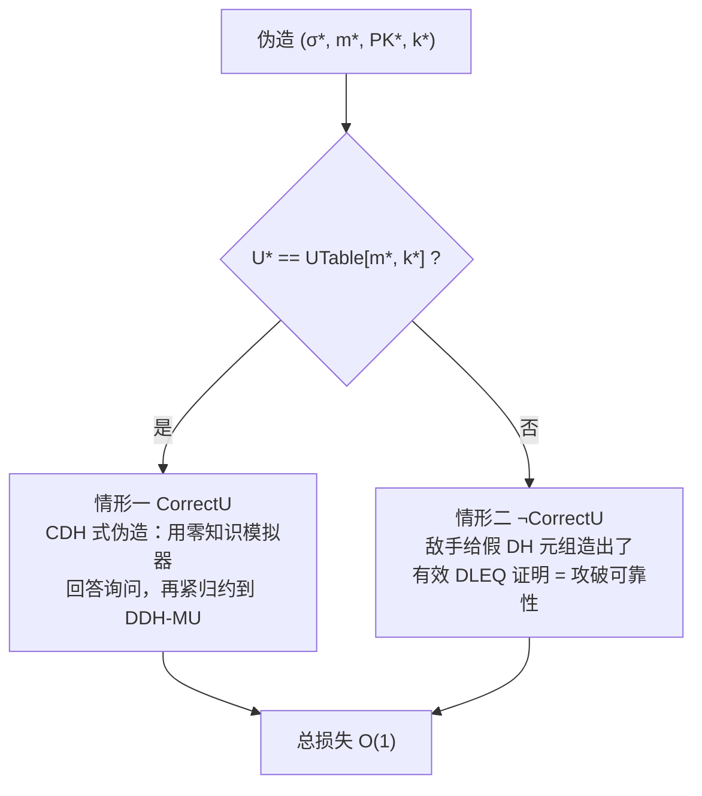
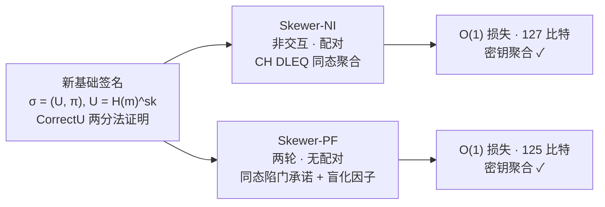

## TL;DR

多签名是给一群人用的——比特币 Taproot 的 MuSig2、以太坊验证者的 BLS 聚合签名都是实例。但 Eurocrypt 2026 的这篇论文指出：**所有现有多签名的不可伪造定义，都只考虑"一个诚实签名者 + 其余全坏人"的单用户模型**。单用户安全搬到 $n$ 个用户，损失是 $O(n)$ 的：按 $n=2^{30}$、$2^{20}$ 次签名询问、$2^{30}$ 次随机预言机询问换算，MuSig2 的可证明安全只剩约 **1 比特**，mBCJ 剩 2 比特，HBMS 剩 0 比特。这不是说它们能被攻破，而是说**没有紧证明，你没法诚实地回答"用户规模上去后密钥到底要多长"**。

作者形式化了带密钥聚合的多用户不可伪造定义，证明现有"紧单用户"路线（Pan-Wagner 的 Chopstick/Toothpick、Bacho-Wagner 的 T-Spoon 等）的证明技巧全都锁死在单用户设定里；然后从零设计新基础签名，拿掉 Katz-Wang 签名对 simulation soundness 的依赖，分叉出两个构造：**Skewer-NI**（非交互、配对、127 比特、签名 240 字节）和 **Skewer-PF**（两轮、无配对、125 比特、签名 129 字节），DDH 假设下安全损失均为 $O(1)$，且**同时支持密钥聚合**——此前"紧安全"和"密钥聚合"从未兼得。

## 论文信息卡

- **标题**：Putting Multi into Multi-Signatures: Tight Security for Multiple Signers
- **作者**：Anja Lehmann、Cavit Özbay（Hasso Plattner Institute, University of Potsdam）
- **会议**：Eurocrypt 2026（2026 年 5 月，罗马；官网录用名单第 36 项）
- **原文链接**：https://eprint.iacr.org/2025/2198

## 背景

多签名要解决的问题很直观：$n$ 个人对同一消息 $m$ 联署，最后产出**一个**短签名 $\sigma$，验证者用**一个**聚合公钥就能验，尺寸和计算量都不随 $n$ 增长。Maxwell 等人 2019 年提出**密钥聚合**之后，验证者连 $n$ 个公钥都不用存了。落地场景都是分布式账本：比特币 Taproot 多签用 MuSig2，以太坊验证者用 BLS 聚合签名。

密码学有个"渐进 vs 具体"的老矛盾：渐进安全只说"损失是关于 $n$ 的多项式"，部署选曲线、定密钥长度要的是**具体比特数**。单用户安全有个通用结论：1 用户安全的方案搬到 $n$ 用户，损失乘以 $n$（论文附录 C 给了通用归约）。$n=2^{30}$ 时这 30 比特直接从安全预算里扣掉——128 比特的曲线，证明只给你保 98 比特，剩下全靠"敌手没那么强"的信仰。

诡异的是，多签名的安全模型从 2006 年起就一直是单用户的：游戏只给敌手**一个**诚实公钥，伪造目标是"栽赃这一个诚实者"。数字签名、公钥加密、KEM 的多用户安全早就有人系统研究过，唯独多签名——这个**为多用户而生**的原语——从来没人把"多"字写进安全定义。论文的第一个问题就问得很直接：现有轮优化的多签名，能不能证出紧的多用户安全？如果不能，能不能造出来？

## 方法拆解

### 第一步：旧方案为什么救不回来

论文第 4 节把现有"紧单用户"方案按两条路线逐个解剖，结论是：它们的证明技巧和单用户设定是焊死的。

**两轮无配对路线**（Chopstick/Toothpick [PW23, PW24]、[TSS+23]）都站在 Katz-Wang（KW）签名肩膀上。KW 签名的证明要靠 Fiat-Shamir 编译的 DLEQ 证明的 **simulation soundness**：归约先把公钥换成随机值逼敌手去证一个假命题，再靠 simulation soundness 说"假命题证不出来"。但多签名要聚合，聚合要**同态结构**，而 MacKenzie-Yang 早在 2004 年就证明了：满足那种绑定性的承诺不可能是同态的。Pan-Wagner 的绕法是用**双模陷门承诺**：承诺密钥设为 $ck := H(m)$，归约猜出伪造消息 $m^*$，把 $H(m^*)$ 编程成绑定模式、其余全编成陷门模式。单用户下这招成立，因为那个唯一的诚实签名者**永远不会被询问 $m^*$ 上的签名**；多用户下，另一个诚实签名者完全可能签过 $m^*$——两种模式的要求直接打架。

PW 后来做的紧单用户版本用的是 Goh 等人的**伪随机比特技巧**：把消息空间按伪随机比特 $b_m$ 一分为二，一半好模拟、一半难伪造，敌手以 1/2 概率撞进难的那一半，损失降为常数。但这招要求归约**不能同时模拟 $b=0$ 和 $b=1$ 下的同一消息签名**；多用户时两个诚实签名者的伪随机比特以不可忽略的概率不同，整个划分就崩了。

**非交互配对路线**（BLS 系、BB 系）更直接：证明靠随机预言机编程——猜目标消息 $m^*$、把 CDH 挑战嵌进签名者公钥和 $H(m^*)$，在基础签名层面就已经是松的、单用户的；QLH12、BW24 两个紧单用户例外，靠的又是伪随机比特，同样锁死单用户。聚合签名那条路（BNN07）理论上有紧多用户安全，靠的是 **key prefixing**（每人签名时把自己的公钥当前缀做域分离），但这和"所有人签**同一**消息"的需求根本冲突，还丢了密钥聚合、验证开销随人数线性涨。

### 第二步：换个 DLEQ 的用法——新的基础签名

既然 KW 这条路被 simulation soundness 卡死，作者干脆换了基础签名。构造极简：

- 密钥：$(sk, pk := g^{sk})$
- 签名：$\sigma := (U, \pi)$，其中 $U := H_m(m)^{sk}$，$\pi$ 是 $(g, H_m(m), pk, U)$ 的 DLEQ 证明——"消息相关值和公钥共享同一个秘密指数"

证明策略是全文最漂亮的部分。归约在内部维护一张账本 $UTable[m,k] := H_m(m)^{sk_k}$，把敌手的伪造分成两种情形：

KW 的证明是"逼敌手必须去攻破 simulation soundness"；这里反过来：**soundness 只是两条路之一**，另一条路（CorrectU）走零知识模拟 + DDH 紧归约。simulation soundness 从必需品降格为可选项，同态结构和紧证明的冲突就此解开。顺带补上一个引理：**DDH-MU（多用户 DDH）可由 DDH 紧推出**（Bellare 等人 2024 年定义了它但没证明，作者用 DDH 重随机化补上了）。

### 第三步：Skewer-NI——非交互，靠配对

非交互版本用 **Couteau-Hartmann（CH）变换**把 Chaum-Pedersen 协议编译成 NIZK：把 CRS 里随机元 $C \in \mathbb{G}_2$ 的离散对数当作挑战，响应藏在群元 $Z_k$ 的指数里。CH 证明是同态的——各签名者的部分签名 $(R_k, \tilde{R}_k, Z_k, U_k)$ 直接连乘，就得到聚合证明 $(R, \tilde{R}, Z, U)$，验证是两个配对等式：

$$e(g_1, Z) = e(R, g_2)\cdot e(apk, C), \quad e(H_m(m), Z) = e(\tilde{R}, g_2)\cdot e(U, C)$$

多用户证明里有个关键坎：CorrectU 事件在聚合场景下**不可高效判定**——归约不知道恶意公钥的离散对数，算不出 $H_m(m^*)^{ask^*}$。解法藏在 **proof of possession** 里：每个签名者注册时额外给出 $U_\rho := g_\rho^{sk}$（$g_\rho$ 是公共随机生成元）外加一个 Fiat-Shamir DLEQ 证明。归约把 $g_\rho$ 和 $H_m(m)$ 都设成某个 $Y$ 的重随机化幂，于是 $U_\rho$ 成了一个"翻译器"：不用知道恶意私钥，也能把恶意部分对 $U^*$ 的贡献消掉，让 CorrectU 重新可判定。定理 2 给出紧界：$Adv \le Adv^{DDH} + Adv^{DP} + (9q^2+4q+2q_{H_\rho})/2p$，其中 DP（double pairing）假设是给 CH 证明可靠性用的。

### 第四步：Skewer-PF——两轮，不用配对

无配对版本走两轮：第一轮各签名者对自己的 DLEQ 公告做**同态陷门承诺**（用 [TSS+23] 的紧凑构造），承诺密钥取为 $H_{ck}(apk, m)$；第二轮把承诺乘起来、算 Fiat-Shamir 挑战、各自回响应。两个精巧设计：

1. **防碰撞的密钥聚合**：$apk := g^{H_a(PK)}\cdot \prod mpk_i$。多出来的 $g^{H_a(PK)}$ 项保证不同的签名者集合不会撞出同一个聚合公钥——这是"把承诺密钥设成陷门模式"的前提，否则归约不知道 $apk$ 背后对应的是哪个 $PK$。
2. **盲化因子**：第一轮每个签名者给共同签名者 **KEM 封装成对新鲜密钥**，并用一个普通数字签名把会话信息认证了；第二轮双方导出盲化因子，只有**所有人走完第二轮**时这些因子才恰好抵消，否则 $(z_k, o_k)$ 看起来完全随机。这让归约可以随机模拟除最后一个诚实者之外的所有部分签名，最后一个再用组合陷门开口"圆"回来。代价是签名轮内 $O(\ell^2)$ 通信（$\ell$ 为组大小），好处是私钥尺寸保持常数——此前门限签名里类似的成对盲化都假设可信 setup 预分发密钥，多签名里没有可信方，作者用 KEM+签名现场建对密钥绕开了。

实例化全是 DDH：KEM 用 ElGamal 经 GHS25 变换，签名用 KW 或 GJKW，损失都是常数。定理 3（informal）：ROM 下紧多用户安全。

## 实验与数据

先说清楚：这是纯理论论文，**没有实现、没有 benchmark**。"数据"是附录 A 在统一参数下换算的**具体安全比特数**：$n=2^{30}$ 用户、$q_S=2^{20}$ 签名询问、$q_H=2^{30}$ 随机预言机询问、组上限 128 人、假设按 128 比特计；无配对方案按 secp256k1、配对方案按 BLS12-381 算字节数。表里的"个位数比特"不是说方案能被攻破，而是极端参数下**可证明的保证**还剩多少。

**两轮无配对组**（贴近比特币/钱包场景）：MuSig2 安全损失 $O(n\cdot q_S^3\cdot q_H/\epsilon^3)$，具体安全约 **1 比特**；mBCJ 约 2 比特；HBMS 约 0 比特；SpeedyMuSig 33 比特；Chopstick-KAg（带聚合）76 比特；T-Spoon（Crypto 2025 最新，带聚合）96 比特、签名 354 字节。而 **Skewer-PF：$O(1)$ 损失，125 比特，签名 129 字节，公钥 33(+97) 字节**（括号里是 proof of possession）。MuSig2 的签名只有 65 字节——Skewer-PF 用约两倍的签名尺寸，换来了从 1 比特到 125 比特的证明质量。

**非交互配对组**（贴近以太坊验证者场景）：BLS 多签名约 1 比特（48 字节签名虽小，证明是松的）；BLS-PoP 76 比特；[BW24] 96 比特但无密钥聚合。而 **Skewer-NI：$O(1)$ 损失，127 比特，签名 240 字节，公钥 48(+112) 字节**，是这张表里**唯一同时做到"紧多用户安全 + 非交互 + 密钥聚合"**的方案。[BNN07] 也有 $O(1)$/127 比特，但它靠 key prefixing，验证开销随人数线性增长、无密钥聚合，作者明确说那只是"乐观估计"、不满足效率目标。

横向看还有一个规律：凡是之前做到"紧"的（Chopstick-Tight 96 比特、Toothpick-Tight 95 比特），密钥聚合列全是 ✗——紧安全和密钥聚合的兼得，确实是第一次。

## 相关工作对比

- **MuSig2（比特币 Taproot 在用）**：实用标杆，65 字节 Schnorr 风格签名、两轮；代价是非标准假设（AOMDL）+ 松证明。本文可以看作"如果愿意多付一倍签名尺寸，能买到 125 比特可证明安全"的参照系。
- **BLS 多签名（以太坊/Dfinity 验证者）**：48 字节签名天然聚合，配对+CDH；rogue-key 攻击之后工业界普遍加 PoP（Bellare-Neven 的经典三分法 KOSK/PoP/PPK 就从这里来）。本文的 PoP 用法更进一层：不只是防 rogue-key，还成了多用户证明里"消掉恶意贡献"的工具。
- **Chopstick/Toothpick（Pan-Wagner）、T-Spoon（Bacho-Wagner, Crypto 2025）**：紧单用户安全的前沿，被本文第 4 节逐个证明"救不进多用户"——陷门承诺的双模编程和伪随机比特划分都焊死在单用户设定上。

## 局限与开放问题

- **随机预言机模型**：两个构造的安全证明都在 ROM 下，不是标准模型。
- **无自适应腐化**：多用户模型里诚实签名者不能中途变坏，作者明确列为未来工作。
- **Skewer-PF 的 $O(\ell^2)$ 轮内通信**：成对 KEM 封装的代价，组规模 $\ell$ 大时会贵；更适合验证者委员会这类中小固定成员，不适合开放动态的大规模集合。
- **无实现、无实测**：论文未披露任何运行计时，配对方案验证侧的实际开销只能从"两个配对等式"去估。
- **三轮 KW 型方案**（[BN06, FH19, FH20]）可能天然具备紧多用户安全，但多一轮交互，不在本文"轮优化"的目标范围内。
- **PoP 模型的落地摩擦**：每个公钥要附带一个 DLEQ 证明，无许可场景用起来别扭；这是紧证明的代价。

## 一点思考

紧安全不是洁癖：当你要为 $2^{30}$ 用户规模选曲线定参数时，$O(n)$ 的损失直接吃掉 30 比特，没有紧证明的参数选择本质上是拍脑袋——MuSig2 那"1 比特"的换算就是一记警钟。明确判断：**Skewer-PF（两轮、无配对、129 字节签名）是 MuSig2 之后最值得工程跟进的多签名候选，但它的主场是成员固定的中小委员会，而非开放动态的大规模签名者集合**；PoP 模型和 $O(\ell^2)$ 轮内通信是它落地的两道坎。在这之前，它更适合先当"紧安全"的新基准线——以后任何多签名方案声称紧安全，都得先过 Skewer 这一关。

## 原文链接

- ePrint 全文：https://eprint.iacr.org/2025/2198
- Eurocrypt 2026 录用名单：https://eurocrypt.iacr.org/2026/acceptedpapers.php
- HPI 官方介绍：https://hpi.de/lehmann/news-3/six-presentations-at-eurocrypt-2026-workshops.html
