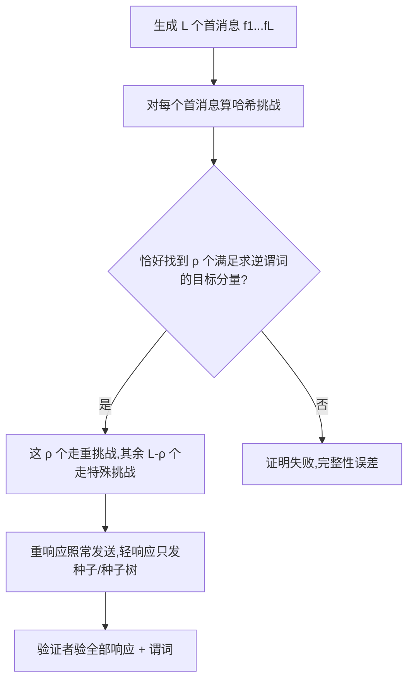

## TL;DR

零知识证明要进可组合协议、多方协议，就不能依赖“倒带证明者再问一遍”这种提取方式——倒带在并发和 UC 安全里会互相嵌套、让安全归约掉精度。Crypto 2026 的这篇论文给群作用 Sigma 协议造了一个新的通用编译器 GAO：它不靠倒带取证，而是让证明者在生成证明时就凑出“恰好 ρ 个重响应”，提取者只看随机预言机查询记录和证明本身就能把证据抠出来。配合拉伸-压缩（Stretch-and-Compress）和碰撞谓词（Coll-GAO）两步优化，最终版 SC-Coll-GAO 用在后量子签名 LESS 上，相对 Fiat-Shamir 基线计算只多 50%–60%，签名只大 10%–20%。换句话说，可组合安全这张门票，第一次有了可以接受的标价。

## 论文信息卡

- **标题**：New Straight-Line Extractable NIZKPs for Cryptographic Group Actions
- **作者**：Andrea Flamini（都灵理工大学）、Federico Pintore（特伦托大学）、Edoardo Signorini（Telsy）、Giovanni Tognolini（特伦托大学）
- **会议**：CRYPTO 2026
- **原文链接**：https://eprint.iacr.org/2025/1819

## 背景

先把问题说清楚。Sigma 协议是三轮交互证明：证明者先发一个“首消息”，验证者回一个“挑战”，证明者再发“响应”。把它变成不需要交互的 NIZKP，最常用的办法是 Fiat-Shamir 变换：用哈希代替验证者，挑战直接由首消息算出来。简单、紧凑、快，几乎所有实用签名都这么干。

但 Fiat-Shamir 有个暗病：它的安全性证明要“倒带”。提取者想从能造出有效证明的敌手手里抠出证据，必须把敌手倒回过去、换个挑战再问一遍，从两份不同挑战下的响应拼出证据。单次证明没问题，可一旦证明被嵌进更大的协议——多方计算、UC 安全框架、并发会话——倒带就开始互相嵌套，归约精度还会被分叉引理吃掉一截。实践中大家常常直接忽略这部分损失来选参数，但严格的安全证明不认这笔账。

于是就有了“直线可提取”这个更强的要求：提取者不倒带，只凭敌手发过的随机预言机查询记录和最终那份证明，就能提取证据。这类证明可以直接塞进 UC 安全的协议里当构件。已有的通用路线有两条：Pass 和 Unruh 的裁剪-选择路线，证明至少要多 $\lambda/2$ 比特；Fischlin 变换靠“工作量证明”找满足哈希谓词的挑战，证明可以很紧凑，是目前最常用的直线可提取路线。

群作用协议长什么样？给定群作用 $\star: G \times X \to X$，证明者要证明自己知道 $g \in G$，使得 $x_1 = g \star x_0$。它的挑战空间只有二元 $\{0,1\}$，必须并行重复很多次才够安全。好在它有个“种子友好”（seed-friendly）的好性质：对某个特殊挑战 $\tilde{ch}$（这里取 0），响应可以压缩成一颗短种子；只有少数“重挑战”的响应才是真正的大对象。于是 Fiat-Shamir 路线的标准优化叫“定重”（fixed-weight）：在一份证明里固定恰好 $\rho$ 个重响应、其余全用种子，再用种子树把大批种子压得更小。LESS、MEDS 这些后量子签名全靠这套手法把签名压下来。问题自然就来了：直线可提取的变换，能不能也吃上定重这碗饭？

## 方法拆解

### 第一步：先证明“老路走不通”

论文没有一上来就推销新构造，而是先花一整节回答第一个问题：把 Fischlin 变换硬套到定重框架上行不行？答案是否定的，而且否得很有说服力。

Fischlin 变换的思路是让证明者做工作量证明：生成一批首消息，对每个首消息找满足哈希求逆谓词的挑战。朴素的定重版是按挑战权重从轻到重去搜。毛病出在“各自为战”：变换对并行重复的每一份子协议独立搜，整份证明的期望总权重远超目标。换个思路也行：定一个权重上限 $\rho$，超重的证明直接丢弃、重算。但论文的测算表明，要把权重压下来，计算代价会爆炸，而且参数选择没有闭式解——每个候选参数集都要靠昂贵的蒙特卡洛模拟去估。

### 第二步：GAO，把“恰好 ρ 个”写进构造

新变换 GAO（Group Action Oriented）的核心想法是反过来的：别先搜、再看权重撞不撞运气，而是把权重目标直接当成构造约束。

具体讲，证明者先算出 $L$ 个首消息，然后在所有首消息里找恰好 $\rho$ 个满足求逆谓词的分量——比如“哈希输出的前 $b$ 比特等于目标值”。这 $\rho$ 个分量走重挑战，其余 $L-\rho$ 个一律走特殊挑战 $\tilde{ch}$，响应压成种子。于是整份证明的权重“按构造”就是 $\rho$，不需要事后筛选。安全性直觉也干净：伪造者要猜中 $\rho$ 个目标分量及其挑战，成功概率约 $2^{-b\rho}$；而提取者拿到随机预言机查询记录和证明后，能找到同一首消息在不同挑战下的两份记录，再用底层 Sigma 协议的特殊可靠性（special soundness）把证据拼出来——全程不用倒带。

更关键的是参数选择变简单了：给定目标权重 $\rho$ 和完整性误差（通常取 $2^{-40}$），最小的 $L$ 有闭式解，跟 Fiat-Shamir 路线一样可以直接算，不用像 Fischlin 定重版那样逐个参数集做模拟。GAO 在随机预言机模型下可证，不需要额外 setup，也不依赖同态承诺之类的高级原语。

### 第三步：拉伸-压缩，用便宜的哈希换昂贵的首消息

Stretch-and-Compress（SC）是个很漂亮的成本置换：首消息生成贵、哈希查询便宜，那就少算首消息、多试几次哈希。

做法分两步。拉伸（stretch）：故意把参数选得“松”一点，允许完整性误差远大于 $2^{-40}$ 的目标，这样需要的首消息数 $L$ 就能大幅缩小。压缩（compress）：给证明者 $k$ 个独立的随机预言机 $H_1,\dots,H_k$，同一批首消息依次用每个预言机各试一次，直到某一次成功为止。因为各次尝试独立，$k$ 次全失败的概率是单次失败概率的 $k$ 次方。论文给的示例很直观：单次失败概率拉伸到 $2^{-1}$，取 $k=40$，总失败概率就压回 $(2^{-1})^{40}=2^{-40}$。当然，敌手也多了 $k$ 次机会，所以目标谓词的难度 $b$ 要相应调高一点，但这点代价跟省下的首消息相比微不足道。SC 可以套在 GAO 上得到 SC-GAO。

### 第四步：碰撞谓词，让一个首消息顶多次用

最后一步 Coll-GAO 把求逆谓词换成碰撞谓词，灵感来自 Kondi 和 Shelat 对 Fischlin 变换的改进。证明者不再找 $\rho$ 个各自满足求逆谓词的分量，而是找 $\rho/2$ 对“哈希值碰撞”的有序对，且这些对必须互不交叉（non-crossing）。好处是每个首消息现在可以参与多个潜在碰撞，查询复杂度显著下降。代价是完整性误差的解析分析变得不可行——这正是 SC 派上用场的地方：先在拉伸后的误差水平上用模拟估计（论文把估计的成功样本数提高到 $N=7000$，归一化平均绝对误差控制在 1% 以内），再用多预言机压缩回 $2^{-40}$。SC 与 Coll-GAO 合体，就是最终版 SC-Coll-GAO。

## 实验与数据

评测对象是 LESS 签名——基于线性码等价问题的群作用签名，已进入 NIST 后量子签名标准化第二轮，参数取安全参数 $\lambda=128$（$q=127$、$n=252$、$k=126$）。所有性能数字都来自 LESS 参考代码，在一台第 8 代 Intel Core i7-8665U 上测得，以 Megacycles（M）为单位。成本模型拆成三项：生成一个首消息 $CC_f=0.6M$，一次哈希查询 $CCH=0.001M$，一个重响应 $CC_z=0.005M$。Fiat-Shamir 基线的成本约等于 $L\cdot CC_f + L\cdot CCH + \rho\cdot CC_z$。

先看三组 LESS 官方参数下的 Fiat-Shamir 基线：

| 参数组 | $L$ | $\rho$ | 公钥数 $\ell$ | 签名（B） | 计算（M） |
| --- | --- | --- | --- | --- | --- |
| LESS-252-192 | 192 | 36 | 1 | 2609 | 115.4 |
| LESS-252-68 | 68 | 42 | 3 | 1825 | 41.0 |
| LESS-252-45 | 45 | 34 | 7 | 1329 | 27.2 |

再看 SC-Coll-GAO 在同样权重下的表现（括号内为相对基线的倍数）：

| 参数组 | 计算（M） | 签名（B） |
| --- | --- | --- |
| $\ell=1,\rho=36$ | 177（×1.6） | 2977（×1.1） |
| $\ell=3,\rho=42$ | 62.2（×1.5） | 2241（×1.2） |
| $\ell=7,\rho=34$ | 43.6（×1.6） | 1649（×1.2） |

汇总成论文的 headline 数字：计算开销增加 50%–60%，签名增大 10%–20%。两点对比更能看清优化的贡献：不加碰撞谓词的 SC-GAO，计算是基线的 2.1–2.3 倍、签名 1.2–1.4 倍；加上碰撞谓词后，计算开销相对 SC-GAO 又降了约 25%–30%，签名也同步收窄。这说明两步优化都不是摆设，碰撞谓词是把“2 倍多”压到“1.5 倍多”的关键一跃。

读这些数字时还有个对 Fiat-Shamir 有利的提醒，论文自己也明说了：基线参数完全忽略了倒带带来的精度损失，而直线可提取变换给出的是紧致（tight）的安全证明。也就是说，50%–60% 这个标价，是在“对方少算了一笔安全账”的前提下比出来的；如果把安全强度真正对齐，差距还会更小。另外，LESS 的群元素表示已接近最优（约 $2\lambda$ 比特），对新变换最不友好；换成 MEDS（$37\lambda$ 比特）这类更臃肿的方案，定重收益更大，相对优势只会更明显。

## 相关工作对比

横向看，这篇工作的站位很清楚。Fiat-Shamir 仍然最快、最紧凑，但给不出直线可提取性，进不了 UC 安全的构件箱；Pass/Unruh 的裁剪-选择路线通用但证明臃肿，至少多 $\lambda/2$ 比特。Fischlin 变换曾是直线可提取路线里最紧凑的选择，但论文证明它与定重框架存在结构性冲突：要么权重失控，要么参数选择贵到不可行。此前也有针对特定协议的直线可提取变换（依赖同态承诺或同态加密），GAO 的优势在于通用：只要协议是种子友好的，就能直接套用，不必为每个协议定制高级原语。

## 局限与开放问题

- 安全性证明在经典随机预言机模型下给出；面向抗量子部署时，量子随机预言机（QROM）下的提取版本论文未展开，这是落地前必须补的一课。
- 实测只覆盖 LESS 一个实例，MEDS 等群元素更臃肿的方案、以及多公钥之外的参数区，论文未披露实测数字，收益外推仍需验证。
- 评测基于参考代码与单台旧款笔记本 CPU 的 Megacycles 计数，未披露真实部署中的端到端延迟、验证端成本与带宽表现。
- SC 依赖多个独立随机预言机，实现时必须做好域分离；证明里要额外携带“第几个预言机成功”的索引，工程上是个容易忽略的细节。
- 完整性误差的估计部分依赖模拟（SC-Coll-GAO 的估计样本数 $N=7000$），参数选择的统计置信度与闭式解的干净程度仍有差距。

## 一点思考

这篇论文最值得工程团队注意的不是 50% 这个数字本身，而是它改变了选型时的默认答案：以前“要 UC 安全就得接受证明臃肿几倍”的直觉被打破了，至少在群作用签名这条线上，可组合性的税率已经降到可以写进预算表的水平。我的判断是，LESS 这类 NIST 第二轮候选签名如果未来要进多方钱包、阈值签名或可组合协议，SC-Coll-GAO 是目前最现实的直线可提取路线；但别急着把它当成生产默认——先等 QROM 版本和验证端实测补齐，再谈替换 Fiat-Shamir。短期更务实的用法，是把它当作协议设计阶段的“安全备胎”：原型先用 Fiat-Shamir 跑通，安全证明需要 UC 组合时再切过去，代价可控。

## 原文链接

- 论文：https://eprint.iacr.org/2025/1819
- LESS 签名参考实现：https://github.com/lesssig/LESS
