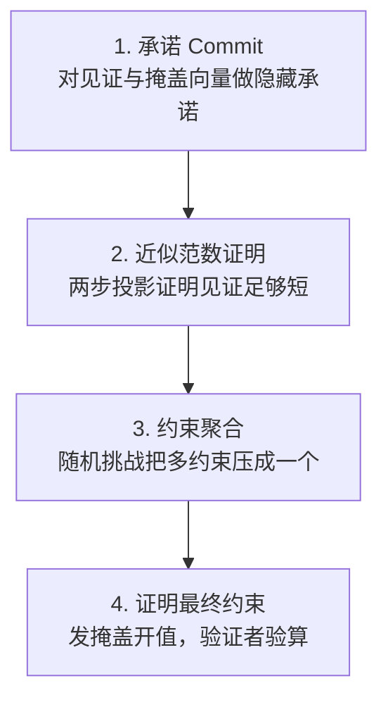

## TL;DR

格证明这几年把"小"和"快"都做到了，唯独缺"藏"。Crypto 2023 的 LaBRADOR 能把任意大陈述的证明压到 100KB 以内、证明者也很快，但证明过程会泄露见证——做匿名凭证、盲签名这种要隐私的活，它上不了台。CCS 2026 的这篇论文（IBM 苏黎世团队）第一次把这块拼图补齐：它把 LaBRADOR 的压缩变体 LaBRADOS、一个新压缩的零知识协议 LNP-Lite 和 LaBRADOR 本身像流水线一样串起来，得到首个真正可用的抗量子简洁零知识证明系统。最关键的数字是：开零知识之后，证明只从约 100KB 涨到约 115–125KB，多了大约 20KB；在大规模输入下，证明者和验证者的时间开销几乎可以忽略（把种子扩展成 2^16 个多项式时，证明时间 25.47 秒 vs 不开零知识的 25.04 秒）。论文还把整套东西开源进了 LaZer 库，附带 PRG、抗碰撞哈希、盲签名等一整套可跑的基准测试。

## 论文信息卡

- **标题**：A Toolkit for Succinct Lattice-Based Zero Knowledge Proofs
- **作者**：Beatrice Biasioli、Madalina Bolboceanu、Vadim Lyubashevsky、Antonio Merino-Gallardo、Gregor Seiler、Patrick Steuer（IBM Research Europe, Zurich；Biasioli、Bolboceanu、Merino-Gallardo 另属 University of Potsdam）、Michał Osadnik（Aalto University）
- **会议**：ACM CCS 2026；preprint 存档于 ePrint 2026/1289（2026-11-03 修订版）
- **原文链接**：https://eprint.iacr.org/2026/1289

## 背景

先说大背景：后量子迁移正在从标准制定走向工程落地，而隐私协议的迁移比签名慢了一拍。NIST 已经标准化的主签名方案 Dilithium（ML-DSA）本身就是格方案，这意味着将来有大量陈述天然就是"关于格方案的陈述"——比如证明你持有某个 Dilithium 签名而不暴露签名本身。这时如果证明系统也是格基的，双方共享同一套数学结构，很多运算可以直接写成证明系统原生的多项式关系，不用先把一切编译成电路、再过一遍可信编译工具链。这是格证明独有的协同优势，也是这篇论文的出发点。

但格证明有个结构性短板：以 LaBRADOR（Crypto 2023）为代表的这一代系统，证明小（任意大陈述压到 100KB 以内）、证明者快，却不是零知识的——证明者发出的消息会泄露见证信息。签名聚合这种场景无所谓，反正签名本来就是公开的；可匿名凭证、盲签名、Privacy Pass 这类隐私协议，零知识是核心功能，不是可选项。之前确实有人提过"把线性大小的零知识协议 LNP 和 LaBRADOR 拼起来"的想法（Albrecht 等，Eurocrypt 2024；del Pino 等，Crypto 2025），但都停留在设想层面，既没有具体实例化，也没有实现。直接拼还有两个硬伤：LNP 的内层消息虽然次线性，实际尺寸仍然很大；更糟的是，给见证加掩盖会把喂给 LaBRADOR 的见证吹大，运行时间随之恶化。

这篇论文的贡献就是把这个设想第一次落了地：给出完整的构造、证明安全性、做出实现、跑出基准。作者来自 IBM 苏黎世的格密码团队——正是 LaBRADOR、LaZer 库和本博客之前解读过的 Orthus（Crypto 2026）背后的同一批人。

## 方法拆解

### 一张图看懂流水线

整个系统的结构是一条四段流水线，先压缩、再补零知识、再压缩：

*图：组合证明系统的流水线：LaBRADOS 多轮压缩 → LNP-Lite 单轮零知识 → LaBRADOS 再压缩 → LaBRADOR 收尾（来源：论文原文 Fig. 1，重绘为矢量图）*

这张图的精髓在于**零知识协议不需要在一开始就跑**。LaBRADOR 一类协议的工作方式是递归：每一轮把见证线性组合、压缩，输出更小的见证交给下一轮。论文的安排是：先跑若干轮 LaBRADOS（LaBRADOR 的压缩变体，外层承诺做成隐藏的），把见证压到足够小；然后只跑一轮新的零知识协议 LNP-Lite，给这个小见证补上零知识；LNP-Lite 的输出本身已经可以安全公开，于是后面再接若干轮 LaBRADOS（这时外层承诺不用隐藏了）和 LaBRADOR，把它一路压回约 115KB。零知识只出现在流水线中间最窄的那一段，贵的活只干在小输入上，这是整个设计最关键的取舍。

### LNP-Lite：给 LNP 做的四处手术

LNP-Lite 是论文的核心新协议，脱胎于 Crypto 2022 的 LNP（Lyubashevsky、Nguyen、Plançon 的线性大小零知识证明）。它沿用 LNP 的四步骨架——承诺、近似范数证明、约束聚合、最终约束证明——但为拼进这条流水线做了四处关键改动：

**第一，换挑战空间。** LNP-Lite 改用和 LaBRADOS 相同的挑战空间 $\mathcal{C}$，方便两个协议拼接。但这个挑战空间在自同构 $\sigma^{-1}$ 下不稳定，而证明"某个向量是二值"恰恰需要 $\sigma^{-1}$。办法是把 $\sigma^{-1}(\mathbf{x}_{bin})$ 也塞进见证，作为辅助向量一起证明。

*图：LNP-Lite 的四个步骤（根据论文原文 Fig. 2 整理）*

**第二，加一层外层承诺。** 和 LaBRADOS 压缩 LaBRADOR 的手法一样，LNP-Lite 给除最后一轮外的所有证明者消息再包一层 Ajtai 外层承诺，只发承诺、不发明文，从而把通信量压下来。论文证明了这层扩展不破坏零知识。

**第三，两步投影——这是全文最关键的技巧。** LNP 类协议证明"见证向量足够短"用的是随机投影：验证者给一个随机矩阵 $\Pi$，证明者发回掩盖过的投影 $\Pi\mathbf{s}$，验证者检查它的范数。掩盖需要高斯噪声加拒绝采样，噪声的标准差要跟着见证的范数界走。如果直接把这套搬到 LNP-Lite，投影的松弛因子会膨胀到约 25806（原版 LNP 约 2606.8），进而要求模数 $q$ 大到约 $2^{48.31}$——LaBRADOR 的实现用的是小模数加 AVX-512 单精度算术，这么大的模数根本装不下。

论文的解法是把投影拆成两步：先对固定小维数的向量做二值证明（维数与输入无关），延迟使用昂贵的高斯掩盖；第二步再对低位做掩盖。这样高斯噪声的标准差变成固定参数，不再跟着输入的范数界走。最终松弛因子降到约 79.59，比原版 LNP 还小一个量级以上，模数 $q$ 只需约 $2^{31.6}$，正好能塞进 LaBRADOR 已有的算术实现。这一步是 LNP-Lite 能落地的真正原因。

**第四，换拒绝采样、拆分投影。** 双峰拒绝采样换成标准拒绝采样（实现更简单）；原来 LNP 对所有见证向量只做一次联合掩盖投影，LNP-Lite 改为每个见证向量单独做掩盖投影。此外还补上了证明 LaBRADOS 输出所需的二次输入约束支持——这是 LaZer 库里的 LNP 原本不支持的。

### 安全性和工程实现

安全性只依赖标准格假设：M-SIS、M-LWE、M-LWR，外加一个新问题 Two-Secrets-Extended M-LWE——它出现在 LNP-Lite 的零知识证明里，论文在附录 C 给出了无多项式结构版本到背包形式 LWE 的归约。知识可靠性方面，提取器只能保证提取出范数放大约 79.59 倍的见证，这是投影类证明固有的松弛，论文把它写进了定理。

工程上，整套系统落在 LaZer 库里，包含三个新部件：一是前端 Dachshundv2（重写 LaZer 的 Dachshund，新增近似 $\ell_2$ 范数证明和任意二次式支持）；二是 Pack 编排逻辑，自动决定每种协议跑几轮、按什么顺序跑，默认规则是"见证缩小超过 10% 才继续加轮次"，找不到安全的 LNP-Lite 参数时就多加几轮前置 LaBRADOS；三是 Python 封装，加了一个零知识开关，决定中间是否插入 LNP-Lite 这一轮。底层算术复用 LaBRADOR 的 AVX-512 实现。

## 实验与数据

基准测试跑在单核 Intel Core i7-11850H 上。用例统一用 512 次环，证明系统内部用 256 次环。先给最重要的结论：**证明大小基本恒定**——不开零知识约 95–105KB，开零知识约 115–125KB，相差约 20KB，来自 LNP-Lite 的承诺和后续多出的 LaBRADOS 轮次。大小由最后一轮 LaBRADOR 主导，所以几乎不随输入规模变化。

### 表 1：PRG 扩展（1024 位种子 → 2^6–2^16 个多项式）

| 输出维度 | 证明者 zk（秒） | 证明者 non-zk（秒） | 验证者 zk（秒） | 验证者 non-zk（秒） |
| --- | --- | --- | --- | --- |
| 2^6 | 0.86 | 0.11 | 0.44 | 0.09 |
| 2^8 | 1.22 | 0.23 | 0.54 | 0.18 |
| 2^10 | 1.67 | 0.66 | 0.76 | 0.38 |
| 2^12 | 2.97 | 1.94 | 1.30 | 0.93 |
| 2^14 | 6.71 | 5.88 | 2.72 | 2.37 |
| 2^16 | 25.47 | 25.04 | 9.14 | 8.60 |

PRG 本身由带舍入的学习问题（M-LWR）构造：种子经矩阵乘法加舍入不断扩展。它的可验证版本能做可验证对称加密——证明密文确实由明文加 PRG 密钥流得到，而不暴露明文和密钥。

### 表 2：哈希压缩（输入 2^6–2^16 个多项式）

| 输入维度 | 证明者 zk（秒） | 证明者 non-zk（秒） | 验证者 zk（秒） | 验证者 non-zk（秒） |
| --- | --- | --- | --- | --- |
| 2^6 | 1.30 | 0.12 | 0.60 | 0.09 |
| 2^8 | 1.69 | 0.37 | 0.67 | 0.24 |
| 2^10 | 1.77 | 0.73 | 0.78 | 0.41 |
| 2^12 | 3.14 | 2.12 | 1.38 | 0.98 |
| 2^14 | 9.20 | 7.40 | 3.50 | 2.93 |
| 2^16 | 29.59 | 29.60 | 9.71 | 9.36 |

哈希用的是 Merkle–Damgård 结构加 Ajtai 压缩函数，抗碰撞性归约到 M-SIS（具体安全强度超过 256 位）。它还能替代 Ajtai 承诺去承诺大输入——公钥和模数更小且固定。

### 表 3：Merkle 成员证明（树高 64，批量 1–128 条路径）

| 路径数 | 证明者 zk（秒） | 证明者 non-zk（秒） | 验证者 zk（秒） | 验证者 non-zk（秒） |
| --- | --- | --- | --- | --- |
| 1 | 1.80 | 0.71 | 0.90 | 0.40 |
| 8 | 3.74 | 2.53 | 1.57 | 1.20 |
| 32 | 10.41 | 9.44 | 4.36 | 3.91 |
| 128 | 38.97 | 36.82 | 13.30 | 12.42 |

这是最贴近区块链的场景：证明你知道某个属于公开集合（比如一组用户公钥）的私有元素，对应 Merkle 树里一条从根到叶的路径。128 条路径批量证明时，证明者 39 秒、验证者 13.3 秒。

### 表 4：盲签名承诺证明

| 消息维度 | 证明者 zk（秒） | 证明者 non-zk（秒） | 验证者 zk（秒） | 验证者 non-zk（秒） |
| --- | --- | --- | --- | --- |
| 10 | 1.22 | 0.34 | 0.62 | 0.23 |

盲签名是论文选的压轴用例：用户向发行者证明自己对消息的承诺格式正确、拿到签名，全程不暴露消息。承诺正确性的证明用上这套新系统，签名本身的线性证明仍可用原版 LNP。

四张表合起来指向同一个规律：**零知识的税随规模增大而被摊薄**。小输入上它很显眼——2^6 规模证明者 0.86 秒 vs 0.11 秒，近 8 倍，这是 LNP-Lite 一轮的固定成本；到 2^16 规模，证明者 25.47 秒 vs 25.04 秒，只差 1.7%，验证者 9.14 秒 vs 8.60 秒。原因正是流水线设计：大头工作是 LaBRADOR 的压缩，与零知识无关；零知识只作用在已被压小的见证上。

论文还试了一个更野的构造：把"压缩—混合—扩展"三段拼成一个完整的哈希函数候选，去实例化随机预言机。混合段交替用模 256 和模 257 两种舍入制造非线性，作者同时在脚注里坦白：这段没有经过密码分析，只能算未来研究方向。

## 相关工作对比

- **LaBRADOR（Crypto 2023）**：快、小，但不零知识。本文是它的"隐私补完"，不是替代——流水线里最后收尾的还是它。
- **LNP（Crypto 2022）**：零知识，但证明大小线性。本文把它压缩成 LNP-Lite，只处理小见证，并用 LaBRADOR 压掉它的输出。
- **先前的组合设想（Albrecht 等，Eurocrypt 2024；del Pino 等，Crypto 2025）**：只给了思路，没给实例化和实现；直接拼还会踩"内层消息大、掩盖吹大见证"两个坑。本文的贡献正在于把这两个坑填上并跑通。
- **RoK / Paper / SISsors（Asiacrypt 2024）与 RoK and Roll（Asiacrypt 2025）**：另一条格 SNARK 路线，主攻"突破证明大小随安全参数二次增长"的理论障碍；本文走的是"组合现有积木 + 工程化"的路线，目标不同，可以互补。
- **Orthus（Crypto 2026，同团队，本博客 10 月 23 日解读过）**：优化的是验证者，把批量验证做到次线性；本文优化的是隐私，给证明加上零知识。两者拼起来才是完整的"又快又藏"的格证明。值得一提的是，本文 11 月 3 日的修订版还合并了 Orthus（ePrint 2026/398）的最新修正，证明尺寸因此有所增加。

## 局限与开放问题

- **证明仍有约 115KB**：和配对 SNARK 两百字节的证明比，后量子税还在，链上直接验的场景依然吃力。
- **证明与验证仍是秒级**：大规模输入下证明者 25–39 秒、验证者 9–13 秒（单核 i7-11850H），实时交互场景需要并行或进一步优化。
- **"压缩—混合—扩展"哈希候选未经密码分析**：作者自己在脚注里写明这一点，不能直接拿去当随机预言机用。
- **格基 IVC 仍未实际可行**：论文只给了基于折叠的增量可验证计算的理论构造，承认目前没有格构造能真正跑起来。
- **新假设的归约不完整**：Two-Secrets-Extended M-LWE 的硬度归约只覆盖了无多项式结构版本，带环结构版本仍是假设。
- **构造仍在打磨期**：11 月 3 日的修订版修过 LNP-Lite 可模拟性证明的一处漏洞（由 Shubham Khurana 指出），还合并了 Orthus 的修正——修完后证明尺寸上升了，说明这套组合的边界条件还在被探明。
- **参数生成的脆弱性**：LNP-Lite 只跑一轮，且依赖前置 LaBRADOS 把见证压到足够小；找不到安全参数时只能多加压缩轮次，轮次结构随实例而变。

## 一点思考

判断先说在前面：这篇论文真正的价值不在某个新数学技巧，而在于把三块已有的积木第一次严肃地拼成了一个能跑、能复现的系统并开源——格证明从此有了"开零知识只多花 20KB"的基准线。给工程侧的实操建议是：评估抗量子隐私方案（匿名凭证、盲签名、Privacy Pass 迁移）时，把 LaZer 库的零知识开关当作对照组，重点看证明大小和验证时间随批量的增长曲线；别被小输入上 8 倍的零知识税误导选型，大批量场景才是它的主场。风险提示同样直接：哈希候选未经分析、证明仍在修订，别把它当成可直接上生产的随机预言机。

## 原文链接

- 论文全文（ePrint 2026/1289，ACM CCS 2026）：https://eprint.iacr.org/2026/1289
- PDF 直链：https://eprint.iacr.org/2026/1289.pdf
- 开源实现 LaZer：https://github.com/lazer-crypto/lazer
- 证明系统实现：https://github.com/lazer-crypto/labrador
