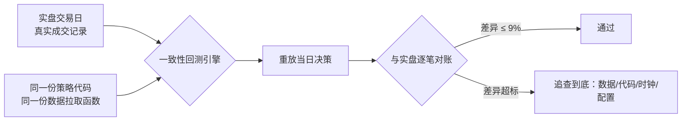

## TL;DR

回测最大的敌人不是过拟合，而是回测根本没在跑你以为的那个系统。两位独立研究者把一个美股日内策略的实盘交易日拿回测引擎逐笔复盘，挖出 6 个"汇总统计完全看不出来"的缺陷：数据 feed 错了（开盘一分钟成交量只有真实的 0.1%–2%）、历史价格被分红除权污染、仓位计算链绕过风控上限、UTC 时间戳被硬编码成纽约开盘、实盘多下载的一份数据回测没下载、配置里"开了"的开关压根没连到下单路径。最狠的结论：这些 bug 从不让结果看起来离谱，只让结果看起来合理——而这才是最危险的。

> 📄 论文：*Where Backtests and Live Trading Part Ways: Six Defects from One Intraday System*
> 👤 作者：Alex Vidovich、Zivana Zerjal（独立研究者）
> 📅 arXiv 2610.21846，2026 年 10 月 15 日（q-fin.ST，统计金融）；工作论文已备投 SSRN，CC 许可开放全文
> 🔗 [arXiv 摘要页](https://arxiv.org/abs/2610.21846) · [PDF 全文](https://arxiv.org/pdf/2610.21846)
> 📝 备注：作者在文中声明使用 Claude 作为研究助理，选题与结果核验由作者本人完成并负责

## 背景：回测失败的文献都漏掉了一层

关于"为什么回测会骗人"，学术界已经有成熟的三层解释：统计层——试多了必然过拟合（Bailey 等人的"回测过拟合"、López de Prado 的多重检验校正）；数据层——高频学术数据集的质量问题（Holden & Jacobsen）；工程层——机器学习系统的配置与管线债务（Sculley 等人）。

这篇论文卡在中间一层：**实现缺陷**——数据、代码、时钟、配置四个环节的 bug，在任何统计量跑起来之前就已经把回测带偏了。而前人文献里的防护手段（多重检验校正、研究流程规范）都默认输入是对的，所以对这些缺陷天然失明。

他们的武器是一个叫 **parity harness（一致性回测引擎）** 的方法论：回测引擎直接驱动实盘用的同一份策略代码，把实盘真实交易过的日子拿来重放，逐笔对账。还预先注册了一个"滑点容忍带"：重放与实盘同一笔交易的差异，不得超过重放结果的 9%（或一个固定的美元下限，取大者）。逻辑很朴素：回测本来就是在声称"实盘那天会这么做"，那就先证明它能复刻已经发生过的日子。

另外还有个反面教材：仓库里另一个"离线版"回测引擎，自己算每日输入而不是从券商拉，结果只有一致性引擎的一半不到，还自信地指出了"错误"的盈利日期——因为它默默丢掉了贡献最大的几笔交易。被发现纯属偶然：一位作者记得曲线的形状不对。而且它在 8 个实盘日期里有 7 天决策都对上了，也没能拦住它。**决策对得上是必要条件，不是充分条件。**

## 方法拆解：六个缺陷，四件套解剖

论文的组织方式本身就是个方法论：每个缺陷按"症状 → 量级 → 根因 → 防护测试"四件套展开，全部来自带日期的研究日志（部分数字为保护实盘系统做了模糊处理）。而"实验"就是上面说的对账流程：真实资金交易日重放——首批 5 天里，2 天因实盘独占的执行检查被预先排除在滑点检验之外，2 天通过容忍带，第 5 天分歧后追查到 Defect 5、修复后通过；之后又补了 2 天，其中 1 天早于容忍带标准，另 1 天起初"通过"、后来发现是两个错误互相抵消的假通过（修掉 Defect 5 之后它反而不过了，卡在另一个仓位上限问题上）——再加上若干 paper account（券商模拟成交）交易日。

六个缺陷逐个讲透，这也是全文的主菜。

**Defect 1：默认数据源不是合并报价带。** 症状很诡异：准备半年期 A/B 回测时，拿一笔实盘交易去对缓存的 K 线，发现缓存里开盘第一分钟的成交量只有实盘看到的零头。扫了全部 98 个交易日的缓存：每天至少有一只流动性好的股票，9:30 那根 K 线成交量低于 5 万股。

藏得深的原因有两个：全天成交量加总是对的，只有开盘那几分钟的分钟级拆分是薄的；实盘不受影响——实盘决策时的拉取恰好命中了合并报价带。

根因：拉数据的请求没带 `feed` 参数。在他们的测试里，不带参数的历史请求返回的是 IEX 单一交易所数据，而不是 SIP 合并报价带。数字触目惊心：同一分钟，合并带约 65 万股，IEX 只有约 1.1 万股；另一只股票缓存 7,900 股 vs 合并带 340 万股（0.2%）；再一只 2,600 vs 55 万（0.5%），9:32 那根 3,000 vs 21 万（1.4%）。两个月双向重放：同一个 bug 让一个月低估、另一个月高估——第二个月甚至把一笔亏损的交易翻成了盈利。缺陷存活了约 11 周，还顺带作废了一个此前跑在"薄数据"上的置换检验（p=0.217）。

防护是两层：单元测试用假 session 录下每一次请求，断言 `feed=sip` 被显式钉死；运行时在决策时刻加告警——如果全宇宙股票的开盘成交量同时相对前日坍塌，只告警不拦单（全市场同时坍塌不可能是正常行情）。

**Defect 2：分红除权污染历史价格。** Defect 1 修完重建数据集，对账时一笔模拟盘交易对不上：重建数据里有一根 K 线比实盘价格基准低 0.68%，成交量分毫不差。当天扫描发现 98 只股票里有 37 只同样偏移，全是分红股，幅度 −0.68% 到 −1.65%。

根因：三周半前的一次提交把拉取的 `adjustment` 参数从"仅复权拆股"改成了"全部"——在 Alpaca 里这包含分红除权。历史 K 线会被之后所有的分红往下重述；而实盘拉的是当日 K 线（之后的分红还没发生），下的单本来就是未复权价格。于是这个参数在实盘无害，在回测里全错。修完重拉未复权数据后，该笔交易的进出场价格与实盘精确到分。

教训被作者总结成一句话：复权价格回答的是"以今天的钱计，当时值多少"；回测需要的是"那天盘口到底报了什么价"。别让两份数据共用一个数据集。

**Defect 3：仓位计算链绕过了硬上限。** 一笔实盘亏损触发了逐行审计：策略代码里有两个仓位数字打架——每笔交易的上限，和实盘真正用的购买力上限（后者低得多，是真约束）。实盘是对的（下单时重查购买力）；回测反过来：一个后置的"加仓步骤"把已经压到上限的名义仓位又乘了上去。

量级：基准回测里 61 笔模拟成交中有 20 笔的名义仓位是实盘账户永远拿不到的；日志估计美元数字整体虚大约 18%。修完之后成交笔数还是 61 笔——变的只是名义金额，不是谁被选中。结构性修复：每个仓位配置自带上限，任何能放大的步骤之后都要重新套一次。

**Defect 4：UTC 字符串被当成了纽约时间。** 缓存的 K 线时间戳是 UTC；有个研究脚本用固定键 "13:30" 去取开盘 K 线——这只在夏令时等于美东 9:30，冬天是 8:30（盘前一小时）。研究区间里 129 个冬季交易日（占 30%）被读错或静默丢弃：在一个 13 天的冬季样本里，16% 的"股票-早晨"被按盘前 K 线打了分，84% 被完整性检查默默丢掉。11 个研究脚本受影响，全部当天打补丁重跑。诡异的是全表"结论没变"——只看结论的评审根本发现不了，但几乎每个数字都动了。

根因：拿字符串比较时钟时间。防护：一个统一的"转纽约时间"助手函数，外加铁律"裸切时间戳字符串即 bug"；作者承认单元测试还没补上（一个冬季日期加一个夏季日期，断言 9:30 ET 在两季都命中同一根 K 线）。

**Defect 5：实盘多下载的一份数据，回测没下载。** 一个真实资金交易日死活对不上账，日志里记了一笔"输入不一致"，晾了三周才追：该输入依赖实盘系统额外下载的一份数据（不是交易的股票本身），而重放只下载了交易的股票。缺失的输入在重放里静默地读成了 0——整整四个月的所有回测都带着这个缺陷跑。补上数据后，重放与实盘的输入值精确一致。20 个真实资金早晨里，修复只改变了 1 个早晨的决策——"只"改变一次，但之前一个被归因于"报价时点差异"的分歧，重新验算后"很可能"也是它（作者措辞谨慎：likely, not proven）。

这是全文最狠的一课：缺失输入不许静默回退到中性默认值，必须大声报错；每一条解释不清的对账分歧都必须追到根因。

**Defect 6：配置里"开了"不等于下单路径里"连上了"。** 这是个家族，论文展示了三名成员：一个"开着"的离场规则因为原因码不在实盘监控的"受尊敬集合"里，被实盘直接无视——更糟的是模拟在被无视的离场处就结束了，把后面所有合法离场都藏了起来；一条仓位规则只写在"回测专用字段置位才走"的分支里，实盘两笔交易完全没吃到它；审计发现生产代码读取的 53 个配置键根本没在配置文件里声明（约占四分之一），其中一个默认开启——而服务的启动文件里还躺着 5 个陈旧配置，包括"是否真的下单"的总开关只存在于那个文件里。如果把按代码默认值生成的配置文件发上线，实盘会静默进入 dry-run。

防护三层：映射测试（每个打开的离场开关必须映射到实盘尊敬集合里的原因码）、完备性测试（代码读的每个键都必须被声明）、每天两次的线上行为巡检脚本——查日志和产出文件里的行为，不查配置文件。

## 实验与数据：缺陷全景与"看起来合理"的危险

附录的总表是这篇论文的数据骨架：

| 缺陷 | 修复前 | 修复后 | 存活时长 |
|---|---|---|---|
| 1. 数据源 | 开盘分钟成交量仅为合并带的 0.1%–2% | 与实盘逐股对齐 | 约 11 周 |
| 2. 复权 | 37/98 只股票偏移，一根 K 线 −0.68% | 进出场与实盘精确到分 | 3.5 周 |
| 3. 仓位上限 | 61 笔中 20 笔超限，美元数字虚约 18% | 全部合规，61 笔不变 | 起点未知 |
| 4. 时钟 | 129 个冬季日（30%）读错或丢弃 | 全用纽约时间键，结论未翻转 | 脚本里 1 天；陷阱数月前已记过 |
| 5. 缺失数据 | 输入静默读 0，约 4 个月 | 重放用实盘的数据清单，缺失即告警 | 约 4 个月 |
| 6. 配置接线 | 离场被无视、仓位规则实盘未生效、53 个未声明键 | 类级别测试、键全声明、单一配置源 | 离场 1 天；仓位规则实盘 10 天 |

第 3 节的综合是全文的文眼，三个判断一个比一个狠：

1. **六个缺陷都坐在"两条本该一致的路径分叉"的位置上**——历史请求 vs 当日请求、回测字段 vs 实盘字段、研究脚本 vs 正确解析时间的引擎、配置 vs 下单代码。前五个里离实盘更近的那条路径是对的，第六个反过来：研究假设的行为实盘从来没有过。
2. **没有一个是被"看汇总指标"发现的。** Defect 1 双向犯错；Defect 4 动了几乎每个数字但没翻转任何结论；Defect 5 在 20 个早晨里只改了一次决策；Defect 3 让所有美元数字都错了，但没有真值可比，所以"看起来没问题"。让结果看起来离谱的 bug 会被抓住；**让结果看起来合理的 bug 才致命。**
3. **写下来的教训拦不住复发。** 时钟陷阱几个月前记在操作笔记里，照样回来；Defect 3 的测试已经就位，它的"同类"后来还是出现了——甚至出现过两个错误互相抵消、制造"假通过"的真实资金交易日。作者的结论很克制：大部分教训已经转成测试，但已有证据表明光有测试还不够。

## 相关工作对比：它填的是哪块空白

论文把自己摆在三类文献之间：统计学派的回测失败研究（Bailey 等人的过拟合、López de Prado 的多重检验校正、Arnott 等人的研究流程规范）——防的是"试多了"，默认输入正确；高频数据质量文献（Holden & Jacobsen）——讲学术数据集的脏数据，但不讲"你的拉取代码和实盘用的不是同一份数据"；机器学习工程债（Sculley 等）——讲配置与管线，但不讲交易场景。

创新点不在某个新统计量，而在**把"回测—实盘一致性"变成第一优先级测试**，并给出可复制的四件套解剖模板和十点清单。这是一种工程方法论论文：它的"实验"是真实资金交易日的对账记录，"显著性"是预注册的 9% 容忍带。跟纯讲夏普比率修正的论文比，它离交易员的键盘更近。

## 局限与开放问题

作者第 5 节的自我批判相当彻底，照单转述：

- **单一系统、单一券商、单一账户**：所有量级数字都不具迁移性；在他们 2026 年的订阅档位上观察到的 Alpaca 行为，换个档位、换个时间都可能不同。缺陷"类别"是通用的，发生率没被证明。
- **样本太薄**：一致性引擎的真实资金记录只有 7 天（1 天早于容忍带标准；2 天有实盘独占的执行检查介入；3 天通过，其中 1 天靠 Defect 5 修复；1 天是两个错误抵消的假通过）。其余对账用的是券商模拟成交的 paper 日——那测的是"引擎 vs 券商模拟器"，不是"引擎 vs 市场"。
- **Defect 5 的污染没被清除**：缺陷存活四个月期间产生的所有回测数字（包括论文里的部分数字和"研究墓地"里的已否决想法）都带着它，方向和大小未知，一个都没重跑。
- **冬天还没被检验过**：所有对账日都在美东夏令时——正是 Defect 4 的季节盲区。
- **控制不等于测试**：Defect 4 的共享助手函数和铁律还没有对应的单元测试；拆股没查（只修了分红）；开盘成交量告警的误报率未知。
- **自我报告偏差**：日志是犯错的同一批人写的（好在条目带日期、多数关联了 commit）。
- **检测偏差**：这些是"恰好被窄而具体的检查撞见"的缺陷，可能还有没撞见的；已经有一个缺陷类别在测试就位后复发了。

开放问题：parity harness 的方法能不能产品化——比如做成每个策略上线前的强制门禁？十点清单里第 10 条"每天查线上行为日志，不查配置文件"暗示了答案：一致性不是一次性的审计，是持续的对账。

## 一点思考

这篇论文最有价值的不是六个 bug 本身——任何一个有经验的量化工程师都能在其中看到自己的影子——而是它证明了"回测代码和实盘代码分叉"是一个独立的风险类别，值得像过拟合一样被严肃对待。对国内做日内/高频的团队尤其有现实意义：我们的行情源、柜台、时区（夏令时陷阱换成节假日/夜盘就是同款）只会更复杂。我的判断是：**如果你团队的回测和实盘不是同一套代码、同一份数据拉取函数，那么你看到的夏普比率里，有一块是"两条路径的分歧"在替你赚钱或亏钱，而你分不清是哪一块。** 先做第 4 条检查（拿一个真实交易日逐笔对账），再谈策略有没有 alpha。

## 原文链接

- 摘要页：https://arxiv.org/abs/2610.21846
- PDF 全文：https://arxiv.org/pdf/2610.21846
- 论文：*Where Backtests and Live Trading Part Ways: Six Defects from One Intraday System*，Alex Vidovich、Zivana Zerjal，arXiv 2610.21846（q-fin.ST），2026 年 10 月 15 日提交。
