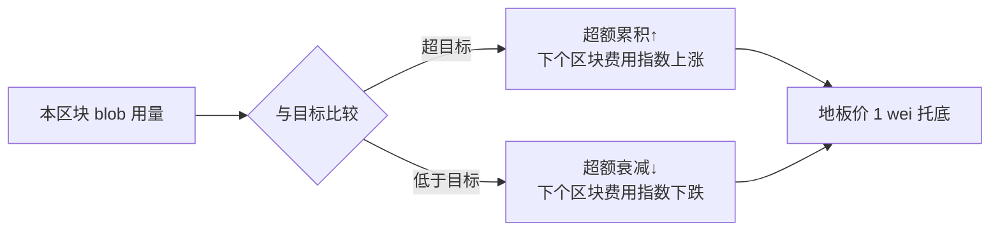

## TL;DR

以太坊卖给 Rollup 的数据可用性（blob）不靠拍卖、靠公式定价，这到底亏了多少？这篇 2026 年 10 月的实证论文用 Pectra 升级做了一次干净的自然实验——blob 价格从约 $1.40 一天内跌到接近 0，Rollup 的购买量只涨了 24%。需求弹性 **-0.19**：价格几乎不影响用量，所谓的"机械定价"主要只是换了个收钱的人。

> 📄 论文：*Demand Under a Mechanical Price: Elasticity and Welfare in Ethereum's Data-Availability Market*
> 👤 作者：Farbod Ghasemlu（独立研究者）
> 📅 arXiv 2610.16588，2026 年 10 月 12 日（q-fin.TR，交易与市场微观结构）
> 🔗 [arXiv 摘要页](https://arxiv.org/abs/2610.16588) · [HTML 全文](https://arxiv.org/html/2610.16588v1)

## 背景：以太坊的 blob 是怎么卖的

2024 年 3 月 Dencun 升级引入 EIP-4844 后，Rollup 不再用 calldata，而是买 **blob**（每个 128 KiB）往以太坊塞压缩后的交易数据，买数据的这笔钱就是 L2 成本里的大头。

定价机制很有意思：**没有拍卖，纯公式**。每个区块有个 blob 数量目标（最初 3 个），实际用量超过目标，累积的"超额"就让下个区块的价格指数上涨；低于目标就下跌，地板价 1 wei。2025 年 12 月的 EIP-7918 又加了一条：blob 费不得低于执行 base fee 的约 1/16（保留价）。

经济学里一个经典问题：价格是机械定的好，还是拍卖好？答案取决于一个数字——**需求弹性**。需求有弹性，定错价就会扭曲资源配置；需求无弹性，定错价只是换了个收钱的人。这篇论文就是来测这个弹性的，而且是用链上全量数据测的。

## 核心内容：一次天赐的自然实验

测弹性最难的是找到**干净的价格变动**。blob 费对所有买家都一样，截面没差异；时间序列里费用又是需求的结果（内生）。作者的运气（也是眼光）在于抓住了 **Pectra 升级（2025 年 5 月 7 日）**：

- 升级把 blob 目标从 3 翻倍到 6（上限 6→9），日期提前数周由客户端版本定死，**外生**；
- 当时市场正处拥堵，blob 费高达 0.82 mETH（约 $1.40）；
- 升级后一天内，费用直接砸到 1 wei 地板。

相当于价格一夜之间从 $1.40 降到 0，这 variation 要是还测不出弹性，就没什么能测出来了。

方法上值得细说，作者做得很"老实"：
- **预注册**：估计方案写好就提交了（replication 仓库 commit 811ab9b），先射箭再画靶；
- **安慰剂检验**：用 516 个假日期跑同样的估计量，构建 95% 置信区间；
- **公开决策日志 + specification curve**：所有主观选择全摊开；
- 甚至记录了一次"打脸"：原计划看"每笔 L2 交易的 blob 数"，结果发现 L2 活跃度本身对分叉有反应，这个指标不干净，果断换成未归一化的购买量，并把修改原因写进论文。

## 关键发现：几个硬数字

- **需求极度无弹性**：价格清零后，Rollup 的 blob 购买量只涨了 **24%**，95% 区间上限是 40%。隐含弹性 **-0.19**，数据允许的最弹性值是 -0.31。有意思的是，每笔 L2 交易消耗的 blob 数几乎没变（-2.8%），购买量的增长来自 L2 活跃度本身上升——**降价没让大家更"省"，只是让更多人来玩**。
- **$14.8M  mostly 是转移支付**：第一个 blob 时代，Rollup 共付了 4,704 ETH（约 $14.8M）blob 费，其中 67% 发生在 2024Q4–2025Q1——那两个季度用量达到目标的 97%，**容量本身是紧约束**，换成拍卖也会收走差不多的稀缺租金。所以这笔钱主要是从 Rollup 转到了协议（销毁），不是效率损失。
- **宽松期的损失小到可以忽略**：EIP-7918 的保留价在 296 天里最多造成 2.6 ETH（$8,039）的无谓损失。
- **地板价 ≠ 市场失灵**：直觉上，价格钉在地板上看起来像"价格没起到出清作用、该排队了"。作者匹配了 540 万笔 blob 交易的 mempool 首次出现记录：地板价时期交易平均只多等 **1.03 个区块**，被挤出的几乎为 0——容量是宽松的，没有排队问题。
- **副产品**：作者重算了全部 6,650,443 个区块的 excess blob gas，用协议规则反推验证，发现 Fusaka 升级后旧规则会误判 29.5% 的区块——顺手给客户端实现做了一次审计。

## 一点思考

**对以太坊/Rollup 生态**：关于"blob 该不该拍卖"的争论可以歇歇了。需求无弹性意味着，定价机制的选择主要影响**谁收钱**（销毁 vs 验证者），几乎不影响用量和效率。EIP-4844 这套"土味公式"在福利上没亏多少，简单反而是优点。

**对做量化的人**：这篇的方法论比结论更值得学。区块链的"计划内硬分叉 + 链上全量数据"简直是实证研究的天堂——处理时点干净外生、数据没有采样偏差、还能拿 516 个安慰剂日期做推断。传统金融里想找这么干净的外生冲击，得等十年一遇的政策变化。以后看到"以太坊又要升级"时，第一反应不该只是看币价，而该想想：**这次升级能识别出什么因果效应？**

**对独立研究者**：作者是单人独立研究者，一个人重算 665 万个区块、匹配 540 万笔 mempool 记录、预注册+决策日志全套实证规范拉满。这种体量的工作一个人做出来，执行力拉满，也说明链上数据把实证研究的门槛真的打下来了。

最后泼一小瓢冷水：弹性 -0.19 是在"价格从 $1.40 降到 0"这个特定区间测的，结论外推到"价格涨到 $100 会怎样"要小心——需求曲线在高压区间可能完全是另一个形状。作者自己也强调这是 bound（上界），不是点估计的真理。

---

*本文为论文研读笔记，观点为个人解读。引用数据均来自论文原文，感兴趣请直接阅读 [arXiv 全文](https://arxiv.org/html/2610.16588v1)。*
