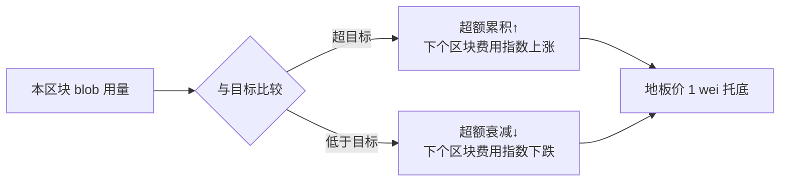

## TL;DR

以太坊卖给 Rollup 的数据可用性（blob）不靠拍卖、靠公式定价，这到底亏了多少？这篇 2026 年 10 月的实证论文用 Pectra 升级做了一次干净的自然实验——blob 价格从约 $1.40 一天内跌到接近 0，Rollup 的购买量只涨了 24%。需求弹性 **-0.19**：价格几乎不影响用量，所谓的"机械定价"主要只是换了个收钱的人。更值得看的是方法论：预注册、516 个安慰剂日期、450 个设定的 specification curve，一套实证规范拉满。

> 📄 论文：*Demand Under a Mechanical Price: Elasticity and Welfare in Ethereum's Data-Availability Market*
> 👤 作者：Farbod Ghasemlu（独立研究者）
> 📅 arXiv 2610.16588，2026 年 10 月 12 日（q-fin.TR，交易与市场微观结构）
> 🔗 [arXiv 摘要页](https://arxiv.org/abs/2610.16588) · [HTML 全文](https://arxiv.org/html/2610.16588v1)

## 背景：当价格不由市场决定

2024 年 3 月 Dencun 升级引入 EIP-4844 后，Rollup 不再用 calldata，而是买 **blob**（每个 128 KiB）往以太坊塞压缩后的交易数据。这笔 DA 费用是 L2 成本里的大头。

定价机制很有意思：**没有拍卖，纯公式**。每个区块有个 blob 数量目标（最初 3 个），实际用量超过目标，累积的"超额"就让下个区块的价格指数上涨；低于目标就下跌，地板价 1 wei。2025 年 12 月的 EIP-7918 又加了一条：blob 费不得低于执行 base fee 的约 1/16（保留价）。

这让人想起 EIP-1559 的 base fee——同样是指数控制器，同样不看竞价。经济学里有个经典框架（Weitzman 1974）：**价格工具 vs 数量工具**，选哪个取决于需求弹性和供给弹性的相对大小。套用到这里：需求有弹性，机械定价扭曲资源配置，福利损失是配置型的；需求无弹性，定错价只是换了个收钱的人，损失是转移型的。所以整个福利核算归结为一个数字：**blob 的需求弹性到底是多少？**

之前没人测过。EIP-1559 有 Reijsbergen、Liu 等人的实证，blob 市场只有早期的描述性工作（Park、Heimbach-Milionis 等人记录费用和拥堵），没有设计型（design-based）的弹性估计。这篇是第一篇。

## 方法拆解：一次天赐的自然实验，配全套实证规范

**识别策略：Pectra 供给冲击。** 测弹性最难的是找到干净的价格变动：blob 费对所有买家都一样，截面没差异；时间序列里费用又是需求的结果（内生）。作者抓住了 **Pectra 升级（2025 年 5 月 7 日）**：升级把 blob 目标从 3 翻倍到 6（上限 6→9），日期提前数周由客户端版本定死（外生），当时市场正处拥堵、费用高达 0.82 mETH（约 $1.40），升级后一天内费用砸到 1 wei 地板。价格一夜之间从 $1.40 降到 0——这种 variation 测不出弹性，就没什么能测出来了。

**估计：面板 + Poisson PML。** 观测单位是 rollup-day，用 Poisson 伪极大似然估计，带 rollup 固定效应、rollup 特定线性趋势、星期效应，窗口取分叉前后各 28 天。这里有个诚实得可爱的细节：作者**预注册**时选的是"每笔 L2 交易的 blob 数"（k=1，加 L2 交易数做 offset），理由是 Pectra 当天 ETH 涨了 22%、可能顺带推高 L2 活跃度。但数据打脸了——L2 活跃度本身对分叉有反应，分母被处理污染了。作者果断把未归一化的购买量（k=0）提为主要估计，把原方案降为描述性指标，**并把这次修改和原因写进论文**（replication 仓库 commit 可查）。这种"预注册了但数据不配合，于是公开改方案"的操作，比很多藏着掖着的论文可信得多。

**推断：单事件的正确打开方式。** 整个识别就靠 Pectra 这一个事件，常规的 cluster 标准误管的是 rollup 之间的噪音，管不了"分叉当天恰好有个全市场共同冲击"的风险。作者用了两套互补的办法：
- **516 个安慰剂日期**（Conley-Taber）：在没分叉的日子里跑同样的估计量，看 Pectra 的系数有多极端——结果是没有一个安慰剂日期的系数比它大；
- **wild score bootstrap**：因为 Base 一家就占了 78% 的方差权重，普通聚类标准误会偏，用 Rademacher 符号向量全枚举（32,768 种）做修正。
- 还跑了 **450 个设定的 specification curve**（换窗口、换趋势、换估计量……），中位弹性 -0.22，没有任何一个设定给出绝对值超过 1 的弹性。

## 实验与数据：几个硬数字

先看描述性事实（论文 Table 1）：Dencun 时代（2024.3–2025.5）费用钉在地板的区块占 24.8%，Pectra 时代占 48.9%，Fusaka 引入保留价后是 0%。费用总额更说明问题：Dencun 时代 Rollup 共付了 **4,704 ETH**，Pectra 时代只有 7.8 ETH——拥堵期的稀缺租金是大头。

核心结果（Table 2）：Pectra 后 28 天，15 个主要 Rollup 的 blob 购买量涨了 **24%**，安慰剂区间 [8%, 40%]；隐含弹性 **-0.19**，区间允许的最弹性值 -0.31。分 Rollup 看，14 个里有 11 个上涨（Base 涨得最多，0.295 log points）。而"每笔 L2 交易的 blob 数"只变了 -2.8%——**降价没让大家更"省"，增长全部来自 L2 活跃度本身上升**。

福利分解是点睛之笔：4,704 ETH 里 **67% 发生在 2024Q4–2025Q1**，那两个季度用量达到目标的 97%——容量本身是紧约束，换成拍卖也会收走差不多的稀缺租金，所以这笔钱主要是从 Rollup 转到了协议（销毁），不是效率损失。宽松期呢？EIP-7918 的保留价在 296 天里最多造成 **2.6 ETH（$8,039）**的无谓损失，小到可以忽略。

还有两个反直觉的发现：
- **地板价 ≠ 市场失灵**：价格钉在地板上看起来像"该排队了"。作者匹配了 540 万笔 blob 交易的 mempool 首次出现记录：地板价时期交易平均只多等 **1.03 个区块**，被挤出的几乎为 0——容量是宽松的，没有排队问题。
- **协议验证副产品**：作者重算了全部 6,650,443 个区块的 excess blob gas，发现 Fusaka 升级后旧规则会误判 29.5% 的区块——顺手给客户端实现做了一次审计。

## 相关工作对比：为什么这篇不一样

blob 市场的早期文献大多是描述性的：Park 等人记录市场头几个月，Heimbach-Milionis 测打包无效率，Ambrosia-Mizrach 发现 L2 费用中位数降了 95% 以上。机制设计理论那边，Crapis 等人推导过最优动态费用，Roughgarden 分析过 EIP-1559 的激励相容——但都是理论。

这篇的差异化在于三点：① **设计型识别**（自然实验 + 安慰剂推断），而不是描述统计；② **福利核算**（把弹性变成"转移 vs 无谓损失"的账本）；③ **诚实的方法论**（预注册、决策日志、specification curve、连"两条走不通的路"都报告了——BPO1/BPO2 扩容没有 first stage、拿执行 base fee 做工具变量违反排他性，作者都写出来替后人避坑）。

## 局限与开放问题

- **外推要小心**：弹性是在"$0–$1.40"区间测的，价格涨到 $100 时需求曲线可能是另一个形状。作者反复强调这是 **bound（上界）**，不是真理。
- **单事件识别**：安慰剂推断依赖"安慰剂日期与分叉日期可交换"的假设，无法被直接检验。
- **L2 传导机制**：论文 Section 11 讨论了 blob 费如何传导到 L2 用户，但那部分偏机制描述，定量证据不如主结果硬。
- 开放问题：Fusaka 保留价时代的需求反应？不同 Rollup 的异质性背后是什么（为什么 Base 反应最大）？如果以后 blob 价格长期高企，-0.19 还成立吗？

## 一点思考

**对以太坊/Rollup 生态**：关于"blob 该不该拍卖"的争论可以歇歇了。需求无弹性意味着，定价机制的选择主要影响**谁收钱**（销毁 vs 验证者），几乎不影响用量和效率。EIP-4844 这套"土味公式"在福利上没亏多少，简单反而是优点——这对所有链上资源定价（存储、计算、DA）都是个参考：先测弹性，再吵机制。

**对做量化的人**：这篇的方法论比结论更值得学。区块链的"计划内硬分叉 + 链上全量数据"简直是实证研究的天堂——处理时点干净外生、数据没有采样偏差、还能拿 516 个安慰剂日期做推断。传统金融里想找这么干净的外生冲击，得等十年一遇的政策变化。以后看到"以太坊又要升级"，第一反应不该只是看币价，而该想想：**这次升级能识别出什么因果效应？** 这种"把协议升级当自然实验"的视角，是链上数据给量化研究最独特的礼物。

**对独立研究者**：作者是单人独立研究者，一个人重算 665 万个区块、匹配 540 万笔 mempool 记录、预注册+决策日志全套实证规范拉满。这种体量的工作一个人做出来，执行力拉满，也说明链上数据把实证研究的门槛真的打下来了——不需要 Bloomberg 终端，一台机器 + 全量公开数据就能做顶刊级别的实证。

---

*本文为论文研读笔记，观点为个人解读。引用数据均来自论文原文，感兴趣请直接阅读 [arXiv 全文](https://arxiv.org/html/2610.16588v1)。*
