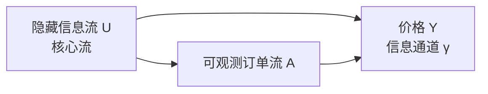
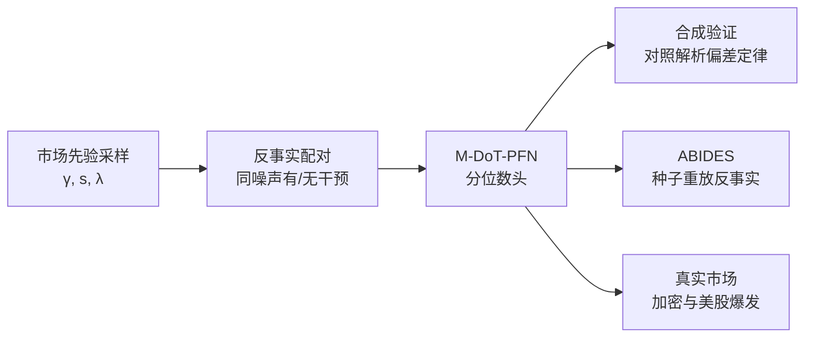

## TL;DR

执行成本最难算准的，是你自己的单子到底推动了价格多少。经典做法把价格对订单流做回归，但知情交易者本来就是因为预期价格要涨才买入：他们的订单流能“预测”价格，却不是它“造成”的价格。把预测当成因果，冲击系数就会被系统性扭曲。这篇论文换了一个问法：不再问“看到这样的订单流，价格通常怎么走”，而是问“如果我强行施加这样一笔交易，价格会怎么走”。作者用在合成市场先验上训练的因果先验数据拟合网络（PFN）直接估计这个干预量，在高混杂下把传统回归高达 68% 的高估压到接近无偏，且不经再训练就迁移到了 ABIDES 模拟市场与真实的加密货币和美股数据上。

## 论文信息卡

- **标题**：Market Impact Estimation via Causal Foundation Models（市场冲击估计的因果基础模型）
- **作者**：Dennis Thumm、Ying Chen（均来自新加坡国立大学）
- **发表渠道**：第 7 届 ACM 人工智能金融国际会议（ICAIF '26，2026 年 11 月 14–17 日，意大利米兰）
- **原文链接**：https://arxiv.org/abs/2610.12537
- **代码与结果**：https://github.com/thummd/causal-market-simulator

## 背景

市场冲击的定义本身就是一个反事实：实际价格路径减去“如果没有这笔交易”本会出现的价格路径。真实市场永远只给其中一条，另一条看不见。Almgren–Chriss 把永久冲击写成价格对订单流的线性回归系数，传播子模型把冲击写成历史订单流与衰减核的卷积，两者估计的都是 $E[Y\mid A]$——给定观测到的订单流，价格的条件期望。而交易者真正需要的是 $E[Y\mid \mathrm{do}(A)]$——强行施加一笔交易后价格的期望。只要有因素同时推动订单流和价格，两者就会分叉，而在真实市场里这样的因素永远存在：信息。

另一条路线也在逼近这个问题。TradeFM 在数十亿笔真实交易上学到了极其丰富的订单流观测分布，却没有 do 算子：能回答“接下来通常发生什么”，回答不了“如果我交易会发生什么”。而 Do-PFN 等因果 PFN 已能在表格与离散时间数据上做上下文中的贝叶斯因果推断，却缺少一个专门针对市场、且能证明其因果估计量与预测量确实不同的先验，以及超出先验的迁移证据。这篇论文补的正是这块拼图。

## 方法拆解

### 把混杂写进一个最小市场

先验只有三个变量，却恰好让因果问题无处可躲：隐藏的信息流 $U$、可观测的订单流 $A$、价格 $Y$。$U$ 是外生的“核心流”，代表尚未完全反映在价格里的交易动机；$A$ 的一部分由 $U$ 驱动（知情者因为信息而交易），另一部分是内生的“反应流”；$Y$ 则同时受到机械冲击 $\lambda A$ 和信息通道 $\gamma U$ 的影响。信息有两条进入价格的路：一条经过交易（$U\to A\to Y$），一条不经过交易（$U\to Y$）。第二条路正是混杂的来源：即使你的单子一股没动，价格也可能因为信息本身而动，而回归会把这部分也算到你的头上。

关键设计是，混杂强度在这里是一个可以精确采样的量。作者用“核心份额”$s$（$A$ 的平稳方差中有多大比例来自 $U$）参数化 $U\to A$ 的边权重，通过求解平稳 Lyapunov 方程得到唯一对应的权重；每个训练 episode 采样一组 $\gamma\in[0,2]$、$s$、$\lambda$。于是传统回归的偏差也有了闭式解：它关于 $\gamma$ 严格线性，且当信息通道关闭（$\gamma=0$）或核心份额为零（$s=0$）时恰好为零。这条解析定律后来成了整篇论文的标尺——模型好不好，不是跟某个黑箱基线比，而是跟一条解析定律比。

这里要诚实交代一个前提：在 $U$ 被隐藏、又没有工具变量的情况下，干预效应从观测数据本身不可识别。PFN 的额外信息来自先验：它在已知模型类的合成数据上做摊销贝叶斯推断，先验补上了数据给不了的东西。论文所有结论都应在这个意义上理解——先验与部署场景是否匹配，就是这个方法本身。

### 把干预做成模型的一等输入

模型名为 M-DoT-PFN，是连续时间因果 PFN 的市场特化版。每个 episode 是一组线性漂移随机微分方程，在不规则时间表上观测。干预不是事后贴上去的标签，而是模型输入的一部分：目标变量 $A$、起止窗口 $[\tau_0,\tau_1)$、种类与取值。硬干预是把变量钳制为常数；软干预则是在窗口内给目标漂移加一个常数 $\delta$——这正是母单的自然形式化：母单是“增加”流量，而不是“钉住”价格。训练用反事实配对：同一组 Wiener 噪声，分别跑一遍有干预和无干预的世界，干预下的目标取值就是精确的。架构上，干预前观测编码为带傅里叶时间特征的 token，干预后观测被掩盖，干预规格与查询进入跨变量混合器，分位数头输出干预分布。Transformer 版本共 420 万参数，5000 步、单张 A100 约 2 小时。

为证明“因果能力到底住在哪一层”，作者做了干净的对照：do-消融孪生体。孪生体与原模型架构、先验、随机种子完全相同，唯一区别是五个干预输入在训练和预测中始终被置零——它知道上下文在哪结束，却不知道接下来发生了什么。如果因果能力真的来自 do 通道，孪生体就应该退化成纯预测器。

### 修好“一问就答”架构的形状缺陷

Transformer 有一个结构性短板：一次注意力把上下文和干预规格映射到查询结果，持续的干预无法在模型内部一步步累积。实测也证实，在母单基准上它的响应几乎不随执行时长变化，而真实冲击是随执行时长累积的。作者因此又训练了一个循环状态空间变体：带 $\Delta t_i$ 门控的堆叠循环结构，在干预有效的每一步都注入干预，让冲击累积住在循环状态里。该变体 194 万参数，配方也配套调整：软干预 50/50 混入先验、窗口占 episode 的 2%–30%、30% 的 episode 设永久冲击。两个版本分工明确：Transformer 是合成层主力，循环变体只贡献时长形状这一条轴。

*图：论文 §4 的最小市场结构示意图（据原文式 (2)–(4) 绘制）：信息既经交易进入价格，也直接进入价格，后者即混杂来源。*

*图：论文的验证链条示意图（据原文 §3–§6 绘制）：同一模型不经再训练，依次通过合成、模拟与真实市场三层检验。*

## 实验与数据

### 合成层：模型能不能复现解析定律

评估在每个固定 $\gamma\in\{0,0.25,\dots,2\}$、$s=0.7$ 下各抽 500 个 episode，所有方法预测同一批 episode 的精确反事实结果。实测的 naive 回归斜率随 $\gamma$ 线性上升，斜率 0.326 与解析值 0.332 相差不到 2%，而干预斜率保持平坦。在 $\gamma=2$ 时 naive 斜率比干预斜率高出约 68%。值得注意的是，这里有两个方向相反的效应在叠加：价格对波动订单流的低通滤波即使没有混杂也会低估冲击约 43%，混杂通道则随 $\gamma$ 把它往上推。合起来，naive 估计在网格两端从低估 43% 一路摆到高估 68%——这是“回归系数”这个量本身不可靠的证据，而不是某个模型没调好。

看各方法的偏差：真实参数神谕在所有 $\gamma$ 下偏差绝对值不超过 0.013；因果 M-DoT-PFN 全程贴着它走，偏差在 $-0.23$ 到 $+0.16$ 之间，在 $\gamma\geq 1$ 的高混杂区同时是偏差和均方根误差最好的方法。相比之下，Almgren–Chriss 的偏差就是 naive 斜率本身，拟合传播子在 $\gamma=2$ 时仍有 $+0.26$ 的偏差，零参数平方根律为 $+0.32$。而 do-消融孪生体在每个 $\gamma$ 下都与干预前窗口均值统计上不可区分，逐 episode 配对差异均值绝对值小于 $10^{-3}$。因果能力确实只住在 do 通道里。

配方消融还给了一个反直觉的结论：把训练延长 4 倍，$\gamma=2$ 处偏差几乎不动（0.396 到 0.393）；而把训练先验中 $\gamma$ 的采样质量推向高混杂区，偏差下降 57%（0.396 到 0.169）。残差是训练“分布”的属性，不是容量或优化的问题。离先验压力测试也做了三类：价格反向影响订单流的循环反馈、隐藏核心的复合泊松跳跃、饱和冲击。在 $\gamma=1$ 下 PFN 的偏差移动最多 0.16，约为被纠正混杂偏差的五分之一，而 Almgren–Chriss 在同一批数据上偏差高达 $+0.82$ 到 $+0.95$。

### ABIDES 层：有精确反事实的模拟市场

真实市场没有反事实，ABIDES 给了它。作者把一个母单代理（固定时钟市价单、约 25%–40% 参与率、15 分钟窗口）放进由噪声、价值、动量和自适应做市代理构成的背景市场，再用完全相同的随机种子重跑一遍、去掉母单订单。干预前路径按位相同，干预后分叉就是因果效应。探索用种子 0–999，最终评估冻结在互不重叠的种子 1000–1999，共 1000 个 episode。

种子重放的真实平均冲击是 $+0.28\hat{\sigma}$（95% 置信区间 $[0.05,0.50]$）。因果模型的配对 do-head 效应（因果模型减去消融孪生体，同一 episode 配对）为 $+0.38\hat{\sigma}$，置信区间 $[0.34,0.42]$，配对偏差 $+0.08\hat{\sigma}$，区间包含零。Almgren–Chriss 与 naive 预测器基本贴在消融参照线上；拟合传播子幅度相同（$+0.38$）但区间宽约 4 倍；平方根律也答对了（$+0.42$），但那是它在 25%–40% 参与率下的主场；收益率回归则大幅 overshoot（符号偏差 $+5.7\hat{\sigma}$）。PFN 在没有硬编码任何函数形式的情况下，达到了最好经典方法的幅度、且区间最窄。

两个机制发现是迁移成立的必要条件。第一是单位：原始 ABM 干预值换算后约 $19\hat{\sigma}$，远在先验分布之外，不做标准化会直接 overshoot；标准化到先验尺度后问题消失。第二是语义：母单是“增加流量”的软干预，若编码成硬钳制，do-head 响应会从 $+0.38$ 跌到 $+0.10\hat{\sigma}$，约 4 倍差距。编码语义与有没有 do 算子同等重要。

### 真实市场层：加密货币与美股的流量爆发

真实市场没有反事实，任务退化为事实预测：给定事件的有符号规模，预测事件后的实际价格，配对消融作为因果读数。数据来自公开的 Binance 归档，事件是被检测到的极端单边流量爆发：某根 bar 的有符号流量偏离过去 90 分钟均值达 $|z|\geq 5$，且爆发互不重叠，其中包括清算级联——这类事件只是“貌似而非可证明地被迫”。每个事件 episode 含 90 根干预前与 30 根干预后的一分钟 bar。2026 年 4–6 月共 91 天，BTC 763 个、ETH 758 个、SOL 757 个事件。

三个资产上的模式完全复制：配对 do-head 效应 BTC $+1.42\hat{\sigma}$、ETH $+1.53\hat{\sigma}$、SOL $+1.22\hat{\sigma}$；因果模型的有符号偏差（$-0.84$、$-1.05$、$-0.76$）在每个资产上都小于 Almgren–Chriss、拟合传播子和 last-value 预测；消融孪生体再次等于干预前均值。按干预前波动率中位数分成平静与承压两半，效应保持稳定（BTC 平静 $+1.49$、承压 $+1.36\hat{\sigma}$），不是平静市场的假象。同一流程与检查点还迁移到了美股：2026 年 6–8 月、50 只纳斯达克股票、3802 个检测爆发，配对 do-head 效应 $+1.14\hat{\sigma}$。作者对这层证据的定性非常克制，并做了两项对照：符号打乱后实测方向性移动从 $+1.05$ 跌到 $-0.13\hat{\sigma}$，说明响应锁定的是方向，不是重新包装的波动；安慰剂锚点上贴假干预时，因果模型会“制造”$+1.35\hat{\sigma}$ 的偏差，而在真实事件上同一响应把偏差从 $-2.29$ 降到 $-0.95$。do-head 的响应只在真实事件处才是准确的——这既是它有效的证据，也是它危险的证据。

### 形状与校准：循环变体与区间修复

用公开 tape 重建的合成母单（2158 个 BTC episode，12 个时长×规模格子）构成了一个可复用的真实数据基准：Transformer 的格子均值曲线与实测冲击的相关系数只有 $+0.68$，而循环变体达到 $+0.94$（硬训练）到 $+0.96$（语义匹配的软混合），配对提升 $+0.28$，其中每步注入干预贡献 $+0.22$、循环本身贡献 $+0.06$。循环变体的响应随 2–31 根 bar 的时长上升 3.1 倍，实测的单位流量冲击上升约 3.6 倍，形状基本对上，且在 40 个留出日上以 $+0.97$ 的相关系数复现。但水平仍是逐域常数：加密货币内部的缩放常数 $k$ 近乎通用（$0.49/0.51/0.53$），到 ABIDES 却小一个数量级（$0.049$–$0.096$）。

区间校准的问题更尖锐：名义 80% 的区间在先验内覆盖率 $0.77$–$0.82$，且比消融孪生体窄约三分之一；但零样本迁移后覆盖率跌到 ABIDES $0.32$、加密货币 $0.47$–$0.51$——点预测迁移了，不确定性没有。分裂共形校准可以修复它：在 ABIDES 上用种子 0–499 的反事实结果校准、在 500–999 上评估，覆盖率从 $0.31$ 恢复到 $0.82$，代价是区间 widen 约 4 倍。在真实市场上只能用事实结果校准，得到的是事实保证，反事实有效性仍然系于先验——这是校准能修的边界，作者把这句话说在了明处。

## 相关工作对比

与经典冲击模型相比，差别不在拟合精度，而在估计对象：Almgren–Chriss 与传播子估计的是观测条件期望，平方根律是零参数的经验基准，它们都没有 do 语义；本文的 PFN 估计的是干预分布，且能输出分位数区间，这是点估计模型给不了的。与 TradeFM 相比，差别在方向：TradeFM 在数十亿笔真实交易上学到了观测分布，规模与真实感远胜本文，却没有干预语义；本文反其道而行之，用一个只有三个变量的合成先验换取可证明的因果分离，再靠零样本迁移去真实市场。与 Do-PFN、DoT-PFN、CT-CPFN 谱系相比，本文的贡献是把连续时间构造市场化：先验里的混杂可精确采样、偏差有闭式解、且迁移经过了 ABIDES 反事实这一关。对照实验也划清了界限：用通用（非市场）先验重训的同一架构，即使干预输入完好，在三个层级上全部塌回消融参照线——起作用的是市场先验本身，不是 PFN 这个壳。

## 局限与开放问题

- 先验高度风格化：三个变量的线性漂移 OU 系统，没有订单簿排队、撤单与库存，交易被理想化为漂移平移；真实微观结构是非线性、厚尾、非平稳且价格会反向影响订单流的。
- 真实市场层没有反事实：加密货币爆发只是“貌似被迫”，动量延续无法排除；作者自己把这层定性为“与因果迁移一致、但不是证明”。
- 区间校准不随点预测迁移：零样本下名义 80% 区间的覆盖率跌至 0.32–0.51，分裂共形修复需要留出校准集，且在真实市场上只能保证事实覆盖。
- 水平缩放常数 $k$ 是逐域的：加密货币内部近乎通用，但到 ABIDES 要小一个数量级；从可观测 tape 中上下文推断 $k$ 仍是开放问题。
- 标签风险是双向的：安慰剂实验表明，喂错标签时 do-head 会自信地制造冲击，部署的前提是可信的事件标注；先验“丰富化”也可能反噬——在隐藏核心中加入跳跃扩散后，零样本 do-head 响应反而被压到原来的三分之一到八分之一。
- 尚无单一模型同时拿下两项：Transformer 是更好的 ABIDES 模型，循环变体是更好的时长形状模型；把两者合一、以及把先验扩展为多资产因子 DAG 与 Hawkes 型内生干预，都是后续工作。

## 一点思考

这篇论文最值得交易者带走的不是某个模型，而是一种审计习惯：任何冲击估计，先问它估计的是 $E[Y\mid A]$ 还是 $E[Y\mid \mathrm{do}(A)]$，凡是把信息驱动的流量也算进冲击的成本模型，在知情交易活跃的市场里都会系统性高估执行成本、进而扭曲最优执行与容量判断。其次，论文把“先验匹配”从一句口号变成了可操作的检查清单——单位是否标准化、干预编码是增加流量还是钳制价格、训练先验里高混杂的质量够不够，这三项在实验里每一项都实打实地改变了结果。我的判断是：把它当作执行成本模型的“因果审计层”是有价值的，但直接把它当作生产冲击模型还为时过早——在真实市场上它至今没有清过平方根律这条基准线，区间与水平缩放也都还需要逐域校准，离可部署的执行系统还有一段路。

## 原文链接

- 论文：https://arxiv.org/abs/2610.12537
- 代码与结果：https://github.com/thummd/causal-market-simulator
