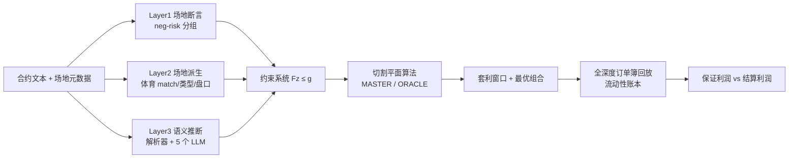

## TL;DR

预测市场里，一场足球赛可能同时开出"谁赢""比分""总进球数"几十个合约，每个合约有自己的订单簿，但交易所不保证它们的价格逻辑自洽。这篇论文证明了一件事：**当合约价格向量落在其"相干集"（coherent set）之外时，就存在无风险套利；最大保证利润恰好等于价格向量到相干集的 $\ell_1$ 距离**。作者把这个几何结论变成整数规划问题，用切割平面算法扫描了 Polymarket 42 天、73.22 亿条订单簿消息的数据：检出 491,827 个套利窗口，其中 125,095 个可以在全深度订单簿上实际成交；在已结算的窗口里，一个理想套利者累计锁定 **250 万美元**保证利润，峰值占用资本 1110 万美元对应 **3.5%/周** 的无风险回报。更扎心的是第三个发现：**关系越难被发现，套利窗口活得越久**——交易所公开的关系中位数只活 2.9 秒，而从合约文本里靠 LLM 挖出来的关系，窗口中位数活 31 秒，且最少有人真正去吃。

## 论文信息卡

- **标题**：Combinatorial Arbitrage in Prediction Markets
- **作者**：Hongjian Shi（慕尼黑工业大学数学系）、Daojing Zhai（纽约城市大学 Baruch 学院）
- **发表渠道**：工作论文（working paper），首版 2026-9-15，本版 2026-10-17，未经同行评审
- **原文链接**：https://daojingzhai.github.io/papers/PredArbitrage.pdf
- **数据**：Polymarket，2026-6-23 至 2026-8-3（42 天）：约 74.5 万个二元合约、73.22 亿条订单簿消息、2.27 亿笔链上成交事件（对应 1.4353 亿笔成交、52 亿美元名义成交额）
- **关键词**：预测市场；组合套利；市场微观结构；大语言模型；限价订单簿

## 背景

预测市场正在成为一个新的资产类别。Polymarket 和 Kalshi 两家的月名义成交额，从 2025 年年中的不足 50 亿美元涨到 2026 年 7 月的 500 亿美元以上（Pew，2026-9-23）。散户、华尔街对冲基金和专业做市商都涌了进来，预测合约越来越像标准的金融工具：对冲事件风险、价格发现、聚合分散信念。

但这个市场有一个结构性的"bug"。每个预测合约是一个完全抵押的二元期权：1 美元可以拆成 1 份 YES token + 1 份 NO token，结算时赢的 token 兑 1 美元。合约在自己的中央限价订单簿里交易，YES 的价格通常被解读为市场隐含概率。**问题是，同一个现实事件会衍生出大量合约**——一场足球赛有"胜者""精确比分""总进球数""两队都进球"等等，这些合约的结算 payoff 被逻辑关系绑在一起：精确比分 0–2 就不可能同时总进球超 2.5 个。

然而交易架构完全不认这些关系：每个合约有自己的订单簿，撮合引擎既不跨订单簿强制价格相干，也没有原子化的多腿组合单。**于是价格可以逐个合约看都合理，但没有任何一个统一的信念能同时解释它们**——这就是组合套利（combinatorial arbitrage）的来源。交易所只把恢复相干的工作留给了套利者。

这跟传统的"一价定律"违反（国债现货与期货基差、CIP 偏离）有两个关键区别：第一，关系是**未知的**，要在几十万个合约里自己挖；第二，关系比"等价"丰富得多：互斥、划分、蕴含、合取。以前的研究（Saguillo 等，2025）用 LLM 找过市场两两之间的依赖，但本文是第一篇把**多种逻辑关系放进同一个约束系统、并用全深度订单簿测算可执行利润**的工作。

## 方法拆解

论文的方法分三块：价格相干性的数学刻画、约束系统与整数规划求解、把报价替换成全深度订单簿。下面一步步讲透。

### 第一步：套利 = 价格不相干

核心思想来自 de Finetti（1937）的 Dutch-book 论证。把所有可能的状态记为 $\Omega$，每个合约 $i$ 在状态 $\omega$ 下的 payoff 是 $\phi_i(\omega)\in\{0,1\}$。把所有状态下允许的 payoff 向量取凸包，得到**相干集** $M := \text{conv}\{\phi(\omega)\}$。$M$ 里的每一点都是某种信念下的期望 payoff 向量。

**命题 1（无套利 $\iff$ 价格相干）**：报价向量 $p$ 不存在套利，当且仅当 $p \in M$。直觉很干净：如果存在某个概率分布让每个合约的价格都等于其期望 payoff，那报价就"自洽"；如果 $p$ 落在 $M$ 外面，分离超平面定理直接给出一个组合，它的worst-case 终端 payoff 恒高于建仓成本——这就是套利。

**命题 2（保证利润 = $\ell_1$ 距离）**：在单位头寸归一化（$\|y\|_\infty \le 1$）下，**最大保证利润恰好等于报价向量到相干集的 $\ell_1$ 距离**：$\max_{\|y\|_\infty\le 1}\min_\omega (y^\top \phi(\omega) - p^\top y) = \min_{\mu\in M}\|\mu - p\|_1$。最优组合也很直白：所有定价低于最接近的相干价格 $\mu^\star$ 的合约买入，高于的全卖出。

论文给了两个足球合约对的几何实例（2026 年 6–7 月实盘数据）。第一对："精确比分新西兰 0–2 比利时" vs "新西兰对 比利时总进球超 2.5"。0–2 意味着总共 2 球，不可能超 2.5，所以允许的 payoff 向量只有 (0,0)、(1,0)、(0,1)，相干集是蓝色三角形。费用调整后的买价向量 (0.1756, 0.7850) 落在里面；五分钟后报价变成 (0.2247, 0.8973)，落到三角形外，$\ell_1$ 距离 0.1220——于是**同时卖出两个合约各 1 份，费用后保证赚 0.1220 美元**。第二对嵌套合约"总进球超 3.5" vs "超 2.5"（前者蕴含后者），报价偏离对角线 0.1479，卖超 3.5、买超 2.5 保证赚 0.1479 美元。

### 第二步：逻辑关系变成约束行，整数规划求最优组合

两三个合约可以用几何看，合约多了就必须形式化。每种逻辑关系编译成线性约束行（表 2 的核心内容）：

- **互斥**（A、B 至多一个结算 YES）：$z_A + z_B \le 1$；报价违反条件 $\tilde b_A + \tilde b_B > 1$（买价之和超 1），许可交易：卖 A、卖 B 各 1 份
- **划分**（$A_1,\dots,A_n$ 恰好一个 YES）：$z_{A_1}+\cdots+z_{A_n} = 1$；$\sum \tilde b_{A_i} > 1$ 则全卖，$\sum \tilde a_{A_i} < 1$ 则全买
- **蕴含**（A 结算 YES 则 B 必 YES）：$z_A \le z_B$；$\tilde b_A > \tilde a_B$ 时卖 A、买 B
- **合取**（$C = A \land B$）：$z_C \le z_A$、$z_C \le z_B$、$z_C \ge z_A + z_B - 1$

把所有约束行叠成 $Fz \le g$，允许的 payoff 集就是 $\Phi = \{z \in \{0,1\}^I: Fz \le g\}$。注意一个很漂亮的结论（命题 4）：**漏掉有效关系（Type II 错误）只会扩大 payoff 集，这在数学上是保守的**——在不完备系统下被判定为套利的组合，在真实系统下依然是套利，只是你会错过一些机会。相反，**混入无效关系（Type I 错误）会伪造保证利润**：排除了真实可能的状态，组合在被排除的状态下可能大亏——"在压路机前面捡硬币"。所以论文的策略是：覆盖面尽量广，但每条关系入库前必须经过对应层级的严格审查。

求解用**切割平面算法**（Kelley 1960 的方法）：MASTER 步骤在已知 payoff 向量集合 $\Phi_{\text{work}}$ 上选最优组合和"声称的"最坏 payoff $\eta$；ORACLE 步骤解内部整数规划找让当前组合 payoff 最低的允许向量 $z_{\text{new}}$。如果 $y^\top z_{\text{new}} < \eta$，声称被证伪，把 $z_{\text{new}}$ 加入工作集继续；否则当前组合就是全局最优。因为 $\Phi$ 有限，算法有限步终止。为什么不用暴力枚举？一个 6 合约的连通分量只有 64 个 payoff 向量，但样本里有约 35.9 亿次最佳报价更新要评估，枚举的开销会爆炸到 2300 亿次——切割平面 + 跨报价状态的缓存才是可行的工程方案。

### 第三步：从报价到全深度订单簿

报价基准有两个缺陷：执行成本取决于买卖价差、各档深度和 taker 费；单位头寸归一化只给出方向，给不出规模。于是论文把线性成本 $p^\top y$ 换成真实的订单簿执行成本 $K(y) = \sum_i K_i(y_i)$：买 $s$ 份就沿着 ask 档位一格格往上走，卖就沿着 bid 往下走，超出显示深度的交易成本记为 $+\infty$。可执行集 $D$ 就是各合约显示深度围成的盒子。

**命题 3**：不存在可执行套利，当且仅当存在一个统一信念给每个合约的估值都落在费用调整后的买卖价差之内。最佳报价决定**套利是否存在**，全深度决定**最优规模和总保证利润**——价差大但深度浅的机会，可能不如价差小但深度厚的。

实证测量分三步走：① 只用最佳报价检出"套利窗口"（保证利润为正的时段），共 491,827 个窗口；② 在窗口内回放全深度订单簿消息，每次更新都重优化各腿数量（方向保留），用共享流动性账本扣掉已消耗的深度防止重复计数，得到可执行规模和保证利润；③ 等合约结算后，比较保证利润与结算时利润。

### 关系挖掘的三层架构

这是论文工程量最大的部分，共挖出 194 万条关系，约简后 57.3 万条、编译成 60.3 万行约束：

- **Layer 1 场地断言**：Polymarket 的 negative-risk 分组（同一 `negRiskMarketID`）被场地视为互斥。但分组本身只排除"多于一个 YES"，不排除"全 NO"，所以作者逐条读了全部 20,866 个分组的完整规则：20,118 个确认为穷尽划分（编成等式约束，如阿尔及利亚–奥地利世界杯"阿尔及利亚胜/平局/奥地利胜"编成 $z_{Alg}+z_{Draw}+z_{Aut}=1$），748 个只保留互斥不等式。
- **Layer 2 场地派生**：体育合约的场地类型化字段（比赛、合约类型、盘口）映射到统一的"比分状态"，确定性地导出关系，数量最多（复原 135.8 万条，约简后 43.3 万条）。Layer 2 是唯一能产出全部四种逻辑关系类型的层，其中蕴含关系 24.7 万条最多。
- **Layer 3 语义推断**：合约自然语言文本。标准化数值阈值用解析器机械处理（"比特币 7 月 28 日高于 65,000" 蕴含 "高于 64,800"）；自由文本用 5 个开源 LLM 做提案（Qwen3-32B、Qwen3-235B-A22B、Llama-4-Maverick、DeepSeek-V4-Flash、GLM-5.2），再用两个不同厂商的前沿模型做独立审计（Claude Fable 5.1 和 GPT-5.6 Sol/GPT-6 Astra，最高推理档位），**只有双审计一致确认的提案才入库**。两两关系提案 239,653 条中确认 102,288 条（42.7%），GLM-5.2 确认率最高（64.6%）；多元关系确认率只有 4.9%。值得一提的是，比特币/以太坊的价格阈值合约通过"阈值链 + 时间嵌套"连成两个巨型连通分量（19,188 和 15,566 个合约），而 87% 的连通分量不超过 10 个合约。

## 实验与数据

### 利润：250 万美元保证利润，3.5%/周

42 天样本中，491,827 个检出窗口里 125,095 个（25.4%）有可执行成交，其中 112,376 个（89.8%）的所有腿都已结算。结算样本的核心数字：

| 关系层 | 保证利润 | 结算时利润 | 占用资本 | 保证回报率 |
|---|---|---|---|---|
| 场地断言 | 85.2 万$ | 97.1 万$ | 2260 万$ | 3.8% |
| 场地派生 | 146.7 万$ | 229.1 万$ | 7902.7 万$ | 1.9% |
| 语义推断 | 17.9 万$ | 36.4 万$ | 1208.9 万$ | 1.5% |
| **合计** | **249.8 万$** | **362.6 万$** | **1.137 亿$** | **2.2%** |

几个关键解读：

1. **理想套利者画像**：拿 1110 万美元（峰值占用资本），吃掉每个机会的全部显示深度，结算后资金回笼再投，6 周累计锁定 250 万美元保证利润，对应 **3.5%/周**；结算时利润更高（362.6 万美元，4.8%/周）——**没有任何一个已结算窗口的结算利润低于其保证利润**，这是关系系统有效性的强验证。
2. **利润高度集中**：窗口中位数保证回报只有 0.5%，但一半的累计利润来自保证回报 **>6.5%** 的窗口；按利润加权的首笔成交中位数回报达 10.4%。肥尾，不是平均主义。
3. **只吃第一口也有 110 万美元**：每窗口首次成交的保证利润合计 110 万美元（资本 4060 万美元），剩下的 139 万来自窗口内的后续成交。
4. **资本占用**：场地断言层的卖出腿可以用"篮子铸造"（1 美元铸出分组内每份合约 1 份 YES）降低抵押，按 1 天计持有期；场地派生层窗口级持有期中位数约 3 小时，语义推断层约 7 天（选举、公司估值类合约结算远）。资本加权平均持有期：累计口径 1.6 天、首笔口径 0.8 天。

### 鲁棒性：延迟 1 秒，79% 的利润还在

真实套利者不是理想的，论文做了三组压力测试：

- **撤单重挂**：做市商可能撤单再挂，把消失又回来的深度不算新流动性（10 秒/1 分钟/2 分钟保留期），累计利润变化在 1% 以内——结论稳。
- **部分参与**：只吃每腿最优价格的 50% 深度（假设对手抢走另一半），利润保留 56.5%，且因为吃的是最优价格，资本回报率反而从 2.2% 升到 2.5%。
- **下单延迟 1 秒**：54% 的订单全额成交、84% 的数量成交，结算利润保留基线的 79%，22% 的订单在结算时亏损。腿的执行不均衡会打破"保证"，这是多腿套利的真实代价。

### 持续性：关系越难挖，窗口活得越久

这是全篇最漂亮的经济学发现。47% 的可执行窗口存活不到 0.3 秒（只贡献 8% 的利润）；看存活 ≥0.3 秒的窗口：

| 关系层 | 中位数时长 | 存活 ≥10 秒占比 |
|---|---|---|
| 场地断言（交易所直接公布） | 2.9 秒 | 32% |
| 场地派生（要自己从字段重建） | 6.3 秒 | 44% |
| 语义推断（要读文本/LLM） | **约 31 秒** | **62%** |

排序恰好对应"发现关系所需的工作量"：第一层交易所直接公布，第二层要从 match 字段重建，第三层要读懂 resolution 文本。控制组合特征、日内固定效应后，相对场地断言层，场地派生窗口长约 **2 倍**、语义推断窗口长约 **10 倍**；组合每多一条腿，时长 +2%、存活超 10 秒的概率 +0.5 个百分点。作者的解读很克制：层与层之间在合约、流动性和执行机制上也有差异，所以这是条件关联而非因果识别，但证据与"发现成本 + 执行成本共同限制套利"一致——呼应 Grossman-Stiglitz 的信息成本思想。

### 谁在吃：854 个地址，前 10 名吃掉 78%

用 2.27 亿笔链上成交事件反查：在窗口开前后（前 5 秒到关闭后 30 秒），同一 taker 地址是否按组合方向交易了**所有腿**。

- 场地断言层：44% 的窗口有匹配交易（反向安慰剂只有 7%），中位滞后 2.7 秒；
- 场地派生层：15%（安慰剂 6%），中位滞后 1.0 秒；
- 语义推断层：9%（安慰剂 <1%），中位滞后 3.1 秒。

关系越明确，真实套利交易越多、窗口死得越快——与持续性结果互相印证。参与高度集中：全部三层只有 **854 个地址**做过匹配交易，前 10 名占了 78% 的匹配窗口。这是典型的专业玩家市场，不是散户游戏。

## 相关工作对比

与前人工作的关键分野在于"关系发现 × 可执行度量"的闭环：

- **Saguillo 等（2025，AFT）** 用 LLM 找 Polymarket 市场间的依赖，度量了市场内和等价 payoff 合约对之间的套利。本文向前走了三步：关系类型从"等价"扩展到互斥/划分/蕴含/合取四类并**联合求解**（一个约束系统里同时考虑互相作用的关系），利润从"报价层面"推进到**全深度可执行层面**，数据规模从成交事件扩展到 73.22 亿条订单簿消息。
- **Gebele & Matthes（2026）** 识别跨场地的等价/子集合约对，讲"语义非同质化"与一价定律违反；**Capponi 等（2025）** 用 agentic AI 做关系发现和统计交易。本文的差异是立场：不做做市商、不追求价格相干，而是**站在交易者一边**——价格已经在各自订单簿里形成了，挖关系、组组合、测可执行利润。
- 与经典文献的对话：这是 Lamont-Thaler"一价定律违反"在预测市场的新案例，但传统研究（国债基差、CIP 偏离）把 payoff 关系当已知，本文把"发现关系"本身作为核心成本；与 Moskowitz（2021）用体育博彩检验资产定价、发现动量收益跨不过交易成本形成镜像——本文的机会是**跨过价差和费用之后依然存在**的，所以交易成本解释不了，必须引入发现成本。
- 方法论上，Hanson（2003）、Dudík 等（2012）、Kroer 等（2016）的组合做市商设计用约束生成/整数规划**维持**价格相干；本文把同一套数学工具反过来用——**检测**不相干并从中获利。

## 局限与开放问题

- **理想化套利者假设**：利润数字假设吃掉全部显示深度、且后续报价如观测所示；真实世界有竞争、滑点和对手方，鲁棒性测试只是部分回答。
- **多腿执行风险**：各腿在独立订单簿成交，没有原子组合单；延迟测试显示 22% 的延迟订单在结算时亏损，"保证"二字只在同步成交时成立。
- **二元结算条件**：保证利润以合约按 0/1 结算为前提；作废（void）合约按 0.5 赔付，未结算窗口被排除在利润统计外。
- **关系系统的完备性**：语义层覆盖不完备（候选检索、模型弃权、算力限制都会漏），按命题 4 这只会低估利润；但 2026-9-22 的事后审计确实揪出 6 条无效关系并剔除了相关窗口——Type I 错误真实存在过。
- **因果识别**：持续性差异是条件关联，层间在流动性、合约类型、篮子转换机制上本就不同，发现成本与执行成本没有被干净地分离。
- **外部有效性**：样本是 2026 年夏季 42 天的 Polymarket；Kalshi 等中央清算场地的成交无法关联到账户，结论能否外推未知。
- **开放问题**：交易所是否应该提供原子多腿订单或跨合约相干检查？LLM 关系挖掘的算力投入产出比如何？当更多玩家部署同类系统时，3.5%/周的利润多久会被压缩到零？

## 一点思考

这篇论文最让我印象深刻的不是 250 万美元这个数字，而是它把"信息成本"量化成了秒数：交易所公布的关系 2.9 秒就被吃掉，LLM 才能挖出来的关系能活 31 秒——**在预测市场这个战场上，alpha 的半衰期直接取决于你的关系发现管线比别人深多少**。对策略的启发也很实在：别只盯着"等价合约"的价差，互斥/蕴含/合取这些高阶关系才是组合套利的主战场（场地派生层贡献了 59% 的利润）；但执行层面必须正视多腿的非原子性，延迟 1 秒就有 22% 的单子转盈为亏，基础设施的延迟预算和腿间对冲逻辑，重要性不亚于信号本身。我的判断是：**预测市场的组合套利现在处于"有组织套利者"的红利期——854 个地址分食、前 10 名拿走 78%，散户基本没有入场券；但随着这类 LLM+订单簿回放管线变成标配，利润会快速向延迟和资金规模收敛，留给后来者的窗口只会越来越短**。

## 原文链接

- 论文全文（PDF）：https://daojingzhai.github.io/papers/PredArbitrage.pdf
- 作者主页（含论文页面）：https://daojingzhai.github.io/
