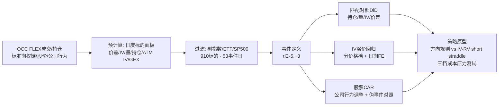

## TL;DR

机构在场外"定制"的期权，会在标准期权市场留下可测量的脚印。UC Berkeley 与 NewMark Risk 的这项实证研究，用 250 个交易日、910 只个股的 OCC 期权数据做了匹配双重差分：FLEX 期权合约生效后，**同一标的的标准期权链持仓量（open interest）相对匹配对照组多涨约 36%**（β=0.3061，p=0.0042），而隐含波动率、买卖价差都没有稳健变化——说明足迹出现在**库存**上，而不是价格上。同时，FLEX 事件高度**自选择**进高 IV 环境：中等价格档个股的 ATM IV 溢价 0.1235（p=0.003），去掉最高 IV 的样本后依然显著。正股方向上只有事件当天 -0.85% 的 CAR 差值，1–5 天全部消失。策略层面：方向性规则全军覆没；**事件日 IV-RV 利差能预测执行成本压力下的 short straddle 收益**（斜率 0.0366，p=0.01），但把买卖价差、手续费和一天延迟全部加上后，宽口径信号转负，只有 11 笔"高利差+流动性好"的子集还站着——波动率 carry 是真信号，但样本太小，还不是能上生产的策略。

> 📄 论文：*FOMO: FLEX Options and Market Outcomes*
> 👤 作者：Shivesh Prakash（UC Berkeley Haas）、Frank Ferstler、Nicholas Pezolano（NewMark Risk）
> 📅 arXiv 2610.13044，2026 年 10 月 9 日（Pricing of Securities / Statistical Finance / Trading and Market Microstructure）；UC Berkeley MFE 与 NewMark Risk 的行业合作项目，工作论文
> 🔗 [arXiv 摘要页](https://arxiv.org/abs/2610.13044) · [作者主页论文 PDF](https://shivesh777.github.io/flex_options/assets/paper.pdf)

## 背景：一个长得很快、但没人系统研究过的市场

FLEX 期权是交易所里的"定制款"：行权价、到期日、行权方式、结算条款都可以由交易双方自己定，但保留交易所交易、中央清算和统一报告。Cboe 的数据显示，FLEX 日均成交从 2014 年的约 6 万张涨到 2024 年的近 80 万张，年化增速 26%，而同期全部上市期权只有 7.7%。机构用它做对冲、结构化产品、defined-outcome ETF、stock-loan 和 conversion/reversal，凡是标准期权链给不出合适条款的地方，FLEX 就派上用场。

奇怪的是，学术界对这个市场几乎没有直接的实证事件研究。原因很现实：FLEX 的合约条款是定制的、交易是偶发的、标识符要映射回标的，经济动机是机构的产品设计而非方向投机——做研究得把 FLEX 成交文件、日持仓文件、标准期权链、股价、公司行为调整五个通常各玩各的数据源拼在一起。论文的四个问题很实在：FLEX 事件会不会带动标准期权的流动性、成交量、IV 或持仓？FLEX 标的的高 IV 是个别离群值还是系统性选择？公司行为调整后的股票收益有没有反应？FLEX 信号更适合做方向交易还是波动率 carry？

## 方法拆解：把五套数据源拼成一个事件面板

**第一步：搭数据。** 样本窗是 2025 年 3 月 31 日到 2026 年 3 月 27 日，共 250 个交易日。数据源是 OCC 的 FLEX 成交（consolidation）文件、日 FLEX 头寸文件、标准期权链日文件、日股价和公司行为调整，全部来自 OCC、Cboe 和 NewMark Risk。原始期权链每天约 91 万行，反复全量分析不现实，所以作者先写了个预计算脚本，把每个标的每天聚合成一行：中位数相对买卖价差 $\text{Spread}_{it}=\text{median}_j (Ask_{ijt}-Bid_{ijt})/mid$、中位数 IV（只取 $0<IV<5$）、总成交量、总持仓量、ATM IV（行权价在现价 ±5% 内）、无符号的 gamma 敞口 $GEX_{it}=\sum_j \Gamma_{ijt}\times OI_{ijt}$，外加 25-delta 偏斜、期限结构斜率等。

**第二步：过滤样本。** 原始面板有 1541 个期权标的、75 个 FLEX 标的。作者剔除了指数、ETF/ETN 和全部 477 只 S&P 500 成分股（共 632 个剔除），理由很直白：在 SPX、QQQ 这种深度的市场里，一天的 FLEX 成交根本不可能在价格上留下可识别的冲击。过滤后剩 910 个标的、219915 行期权聚合、68 行 FLEX 成交、41 个 FLEX 标的、53 个事件日。价格档按标的中位数价格分位数划分（注意：是价格档，不是真实市值档）。

**第三步：定义事件。** 一个 FLEX 事件就是（标的，FLEX 成交生效日）二元组，事件窗取生效日前 5 天到后 3 天。描述性统计：平均每个事件 1.28 行合约（中位数 1，最多 6），put 占比均值 0.41（call-only 或 put-only 的日子居多，呈双峰），平均剩余期限 121 天（右偏）。

**第四步：三套识别工具。** 一是事件前后配对检验（前 [-5,-1] 均值 vs 后 [0,+3] 均值，配对 t、Wilcoxon、Cohen's d，再做 Benjamini–Hochberg 多重检验校正）。二是**匹配对照双重差分**：对照组从无 FLEX 标的里按共同支撑选，要求基线价格、中位数价差、中位数 IV、log 成交量、log 持仓量都相近；主模型是交错采用的双向固定效应 $y_{it}=\alpha_i+\lambda_t+\beta(Treated_i\times Post_{it})+\varepsilon_{it}$，标准误按标的聚类；再加动态版事件研究（以 $\tau=-1$ 为基准期）做前趋势检验。三是 IV 溢价回归：$IV^{ATM}_{it}=\alpha_t+\delta q(i)+\theta FLEX_i+\varepsilon_{it}$，带日期固定效应，分价格档估计。

**第五步：股票与策略。** 股票收益先做公司行为调整 $r^{adj}_{it}=\log(P_{it}/P_{i,t-1})-\log(A_{it})$，再减 beta 调整后的市场收益得异常收益，累加成 CAR，处理组和匹配的伪事件对照组对比。策略是"研究原型"而非可执行策略，分三档成本模型：研究代理（straddle 隐含波动给 0.85 折扣）、执行压力版（买卖价差 $s_e=\min(0.95,1.25q_e)$ 加每张合约费用）、延迟版（信号晚一天执行）。straddle 收益代理是 $\Pi^{proxy}_e=0.85\times M^c_e-|r_{i,t_e+1}|$，其中 $M^c_e=0.8\times IV_e\times\sqrt{1/252}$ 是一日期权隐含波动幅度。最后用事件日 IV 减过去 20 天已实现波动率（IV−RV 利差）对执行压力版收益做回归。

## 实验与数据：足迹在持仓里，不在价格里

**最硬的结果：持仓量。** 匹配 DiD 里，$\log(1+OI)$ 的系数是 **0.3061**（标准误 0.107，t=2.86，p=0.0042，多重检验校正后 p=0.0168），对应持仓量多涨约 36%。成交量系数 0.2711 但 p=0.0724、校正后 0.1449，只能算"有迹象"；中位数 IV（0.0325，p=0.24）和相对价差（0.0351，p=0.28）都不显著。动态事件研究的前趋势检验：价差、成交量、持仓量的 p 值分别是 0.10、0.68、0.20，都没问题，只有 IV 有前趋势警告（p=0.07）——所以 IV 只能当**选择效应**讲，不能当因果讲。配对检验里没有任何一个指标能过 BH 校正（IV 下降 2.5%，p=0.088，校正后 0.35）。

这个"持仓动、价格不动"的组合恰恰是全文最有信息量的地方：FLEX 合约生效后，做市商或机构大概率在标准期权链上建对冲/备兑/补充头寸，足迹沉淀为**库存**而不是当天的成交爆发。作者还发现一个佐证：事件的 $\log$ 合约行数能预测事件窗口的 $\log(1+量)$ 变化（β=0.1479，p=0.0036）——FLEX 结构越复杂，标准链上的量跟得越多。

**IV 是选择，不是冲击。** 描述性上 FLEX 标的的 IV、成交量、持仓全都更高（Mann-Whitney p≈0）。分价格档看，中等价格档的 ATM IV 溢价 **0.1235**（p=0.003，日期固定效应，N=100874）；标的层面的中位数 ATM IV 差 0.1723（MW p=0.0025），**去掉最高的那个 FLEX 标的（METC）后还有 0.1708（p=0.0063）**——不是离群值驱动的。高价档只剩 5 个 FLEX 标的，结果脆弱；低价档反而没有正溢价，因为无 FLEX 的小盘宇宙里投机性高波动名字本来就多。解读很干净：机构只在"标准链流动性够对冲、但条款又不够用"的标的上定制 FLEX，FLEX 暴露于是成了一个**高 IV 状态的示性器**。

**指数产品的 put-call 构成是另一条线。** 在 2267 个有 FLEX 成交的产品日里，FLEX 的合约量 put 占比平均比同日标准链**低 19.7 个百分点**，两者日度相关只有 0.063——FLEX 订单流和标准链订单流根本不是一回事。AM 结算的 SPX 是 51.7% vs 61.6%，PM 结算的 SPXW 只有 23.0%（按保费 14.3%），NDXP 6.9%、RUTW 6.6% 都是 call 主导，IBIT 20.6% vs 35.5%。这是机构 payoff 需求构成的证据，不是价格冲击的证据。

**股票方向：当天有一点，过夜就没了。** 公司行为调整后的 CAR0，FLEX 组 -0.7179% vs 对照组 +0.1368%，差值 **-0.85 个百分点**（MW p=0.0442）；但 CAR+1（+0.28%，p=0.53）、CAR+3、CAR+5 全不显著。53 个事件窗里只有一个在 ±5 天内有公司行为，所以不是除权除息的机械效应。没有任何事件特征能预测 CAR+3——FLEX 不是股票方向信号，这一点和 Muravyev 等人"期权市场独立价格发现很弱"的结论一致。

**策略：方向全灭，波动率 carry 半活。** 六个原型里三个方向规则（call 压力做多、非流动 put 压力做空、flow+动量反转）夏普 0.17–0.61，p 值全在 0.5 以上，S1 最大回撤 -29%、S4 最大回撤 -21%。**富 IV short straddle** 在研究代理下很漂亮：40 笔，平均每笔 +1.535%，胜率 80%，夏普 3.15（p=0.0031）；但加上买卖价差和费用后只剩 +0.47%、夏普 0.93（p=0.36）；再加一天延迟直接转负 -0.47%、夏普 -0.80。真正穿透三层压力的只有 **IV−RV 回归**：$\Pi^{exec}_e=-0.0030+0.0366(IV_e-RV20_e)$，斜率 HC3 稳健 p=0.01（N=51）。按 IV−RV 利差分四档，最高档（利差 0.576）平均每笔 +2.11%、胜率 77%，最低档（-0.219）是 -0.93%、胜率 46%，单调性很好。双重条件"高 IV−RV + 价差≤75 分位"的 11 笔子集在三档成本下分别是 +3.57%/+2.61%/+2.07%，延迟版 p=0.031——信号是真的，但 11 笔样本说什么"可上生产"都是耍流氓，作者自己也只敢叫"信号筛选"。

## 相关工作对比：站在四条文献的交叉口

需求压力线：Bollen–Whaley 证明净买入压力会扭曲 IV 曲面，Garleanu–Pedersen–Poteshman 把做市商库存约束写进定价模型——FLEX 论文是这条线的"机构定制版"：看不见 signed 需求，但看得见定制暴露，而定制暴露选进了高 IV 状态，中档价格档的证据最干净。

波动率利差线：Goyal–Saretto 发现历史波动率与 ATM IV 之差能解释期权截面收益——本文的 IV−RV 回归（β=0.0366）正是这个思想的事件条件化版本，贡献在于用 FLEX 事件回答了"什么时候去看这个利差"。

价格发现线：Pan–Poteshman、Johnson–So 等人认为期权量/IV 含股票预测信息，但 Muravyev–Pearson–Broussard 警告剔除股票信息后独立价格发现很弱——本文的 CAR 证据站在后者一边：当天 -0.85% 之后全无持续性，方向 alpha 不存在。

方法线：事件研究用 MacKinlay 框架，匹配用 Abadie–Imbens 的逻辑，DiD 推断听 Bertrand–Duflo–Mullainathan 的（聚类标准误），交错 DiD 的异质性处理效应问题用 Sun–Abraham/Callaway–Sant'Anna 的思路做动态前趋势自查——工具箱是教科书级的，诚实度也是：IV 的前趋势警告、gamma 代理的零结果（系数 -7.14×10⁻¹⁰，p=0.81，因为没签名的 dealer 库存方向）都如实报告了。

## 局限与开放问题

- **样本太小**：有效事件只有 53 个，策略回测的子集只剩 11 笔，任何"显著"都要打折看。
- **处理非随机**：FLEX 事件是机构自选的，IV 结果只能讲选择效应；动态 DiD 里 IV 的前趋势检验 p=0.07，已经亮黄灯。
- **缺关键变量**：没有真实市值数据（价格档只是代理）、没有 dealer 签名的库存方向（gamma 检验因此是零结果）、没有逐腿的执行数据（straddle 收益全是代理）。
- **单一样本期**：2025.3–2026.3 一年，跨周期稳健性未知；流动性截断（价差 75 分位）用的是全样本中位数，有前视嫌疑。
- **可挖的方向**：区分股票/ETF/指数 FLEX 的不同机制；拿 OPRA 的逐笔报价和 FLEX 拍卖的精确时间戳重做事件研究；把 defined-outcome ETF 的定期调仓/展期窗口接进来，看 FLEX 流能不能解释那部分可预测的再平衡压力。

## 一点思考

这篇论文最有价值的不是那个 36% 的持仓效应，而是一种研究姿态：**把"看不见的机构需求"变成"看得见的状态变量"**。FLEX 事件本身不可交易（你不可能提前知道机构哪天定制），但它验证了一个可交易的逻辑——IV 相对 RV 的高估程度才是 short vol 真正的入场券，而不是 IV 的绝对水平。对策略的启发很直接：做波动率 carry 时，用"事件/状态筛选器"先圈定候选池，再用 IV−RV 利差排序，比全市场无脑卖 straddle 的夏普结构好得多；但执行是全部——这篇论文用三档成本模型亲手把自己的宽口径信号"杀"了一遍，这种诚实比夏普 3.15 的标题数字可贵。我的判断：**FLEX 是个好望远镜，不是瞄准镜**——它帮你找到波动率贵的地方，但扣动扳机还得靠自己的执行系统和样本外验证。

## 原文链接

- arXiv 摘要页：https://arxiv.org/abs/2610.13044
- PDF 全文（作者主页）：https://shivesh777.github.io/flex_options/assets/paper.pdf
- 数据来源：OCC FLEX 成交/持仓文件、Cboe、NewMark Risk；样本窗 2025-03-31 至 2026-03-27
