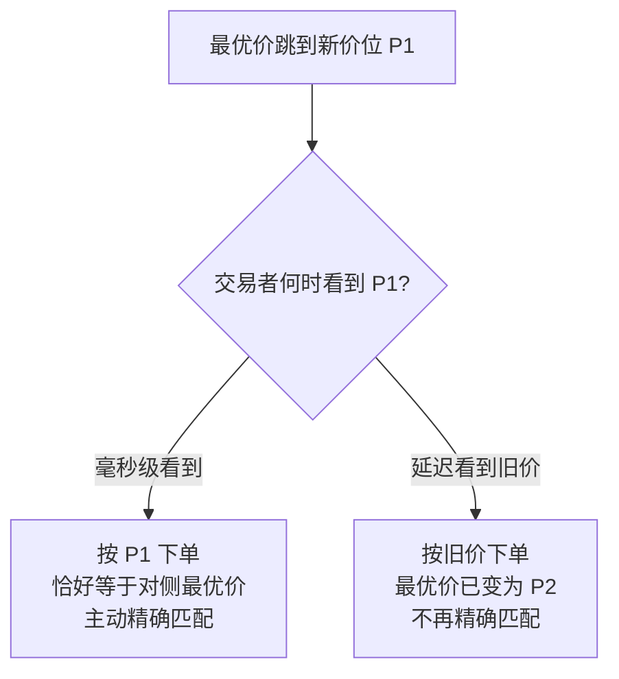

## TL;DR

在中国市场找高频交易，不能照搬美国那套“看谁撤单快、谁报单多”的办法：没有指定做市商、没有返佣、T+1 锁住日内周转，这里的速度优势未必表现为做市，而更可能表现为抢方向。复旦与香港城市大学的研究者换了一个识别思路：用毫秒级重建的订单簿去看，每一笔限价单的价格是否恰好等于提交那一刻的对侧最优价——能持续做到这一点的单，大概率来自能实时处理订单簿的低延迟交易者。他们在深交所 2023 年 7 月至 2025 年 10 月的样本里验证了这个行为签名，并用开盘时 10 个交易通道的延迟先后回落构造双重差分：延迟先改善的那组股票，短时价格波动上升约 1.03bp、宽报价出现频率上升约 2.96 个百分点、做市商 1 秒实现价差下降约 1.35bp，但平均报价价差和有效价差几乎不动、定价误差小幅下降。结论不是“高频有害”或“高频有益”的单向判断，而是：速度的影响取决于它被部署成什么交易，而部署方式由市场制度塑造。

## 论文信息卡

- **标题**：Tracking High-Frequency Trading Activity in China and Its Effects on Market Quality
- **作者**：Li Guo、Frank Weikai Li、Ding Qi、Lijian Sun
- **单位**：复旦大学经济学院（Li Guo 另属上海国际金融与经济研究院）、香港城市大学
- **发表渠道**：arXiv 工作论文，arXiv:2610.33400 [q-fin.TR] v1，2026 年 10 月 24 日提交，尚未见期刊或会议录用信息
- **原文链接**：https://arxiv.org/abs/2610.33400

## 背景

高频交易研究有个老难题：交易所不会公开告诉你谁是高频交易者。美国研究者通常退而求其次，用报单量、撤单率、立即成交单（IOC）这类公开特征做代理。但这些特征测的是“快”和“多”，未必测得出“信息处理能力”——散户手快也可能撤单快，算法报单不多也可能下单极准。

搬到中国，还会多出三层制度障碍。第一，A 股实行 T+1，当天买入的股票一般要下一个交易日才能卖出，这让“低库存、快周转”的连续双边做市变得昂贵，速度的自然用途从做市转向抢方向。第二，普通 A 股没有指定做市商、没有 maker-taker 返佣，持续挂单赚返佣的商业模式不存在。第三，深交所没有美国式“只按指定最优价成交、剩余自动撤销”的价格保护型 IOC 指令，其市价单可能跨多个价位成交，不适合识别“追求精确最优价”的行为。

与此同时，中国市场的数据结构本身提供了一个识别缺口。普通投资者通过常规行情软件看到的，是每 3 秒左右更新一次的快照；而有技术能力的机构可以用完整逐笔订单流，以毫秒级重建真实订单簿。同一时刻，两种参与者看到的“最优价”可能根本不一样。作者正是从这个缺口入手：你能下在“真正的”最优价上，本身就是低延迟信息处理能力的证据。

## 方法拆解

### 第一步：毫秒级重建订单簿，定义“精确匹配”

数据基础是深交所 Level-2 逐笔数据，包含三条数据流：每 3 秒的订单簿快照、每次提交的订单记录、每笔成交与撤单记录。作者用逐笔订单流重建出毫秒精度的连续订单簿，得到每一笔限价单提交前一刻的真实最优买卖价。

在此基础上定义两个变量。主动精确匹配：买单价格恰好等于重建订单簿中的最优卖价，或卖单价格恰好等于最优买价。被动精确匹配：订单价格恰好等于同侧最优价，即挂在己方最优价上等待成交，作为对照。市价单因为没有明确的数值限价，被排除在主分析之外。

这个定义的经济学直觉是一场“赛跑”。假设最优价刚从旧价位跳到新价位 P1，低延迟交易者几乎立刻看到 P1，于是按 P1 下单，恰好等于对侧最优价；高延迟交易者收到的是旧信息，等它下单时最优价可能已经变成 P2，它按 P1 下的单就不再是精确匹配。作者引用的一项估计是，平均一次这样的赛跑只值半个 tick 多一点——偏离最优价一点点，成交结果就会实质不同。所以“是否精确”捕捉的不是单纯的手速，而是实时处理订单簿并选出正确价格的能力。

### 第二步：样本与清洗，规模大到必须抽样

基线样本覆盖 2023 年 7 月 1 日至 2025 年 10 月 31 日的深交所股票，并按惯例剔除按前一日市值计最小的 30% 股票——作者援引的理由是，中国市值最小的股票常含有显著的壳价值，会污染基于交易的分析。重建出的连续交易订单总数约为 474 亿笔，规模大到订单层面回归无法全量计算，于是作者采用约 0.1% 的系统抽样（不依赖订单特征、保留跨时间和跨股票的覆盖），再剔除市价单，最终得到 42,506,216 笔限价单、2,760 只股票、566 个交易日。

样本里的一个直观数字是报价更新的频率。开盘后第一个小时，按市值分组的平均最优报价更新频率约为每秒 1.3 至 7.1 次，其中 51.5% 至 64.9% 的更新发生在前一次更新后 100 毫秒以内。论文用宁德时代 2025 年 10 月 10 日的例子做了直观对照：3 秒快照里风平浪静的一段，在重建的报价里 50 毫秒内就有 22 次更新——这正是两种参与者看到的盘口之间的鸿沟。

### 第三步：四组验证，确认这个签名真的代表高频行为

作者没有直接宣称精确匹配就是高频交易，而是做了四组验证，每组都控制了股票与日期固定效应，并对“更激进一分钱”“非整手”“大单”等容易混淆的订单特征做了对照。

第一组是反应速度。被解释变量是订单是否在最近一次最优价或量变化后 100 毫秒内提交。主动精确匹配的回归系数在完全控制后为 0.192，是全部订单特征中最大的，相当于在 100 毫秒内反应的概率高出约 19 个百分点；中位反应时间上，主动匹配单只有 0.02 至 0.04 秒，非主动匹配单为 0.06 至 0.15 秒。有意思的是，被动匹配单的反应速度与主动匹配单相近——光看“快”分不出主动与被动，区分关键在价格位置和方向。

第二组是撤单速度。在已撤单订单中，主动匹配单在 100 毫秒内撤单的系数为 0.054，显著高于被动匹配单的 0.010；中位撤单时间上，主动匹配单为 3 至 8 秒，非主动匹配单为 36 至 43 秒。不过作者也如实报告了一个反例：比对侧最优价激进恰好 1 分的单，撤单系数（0.065）比主动匹配单还高——撤单维度上主动匹配不是唯一最快的类别，不宜夸大成“全方位最快”。

第三组是下单时的盘口条件。作者构造了方向调整后的深度不平衡指标：深度越有利于订单方向，指标越正。主动匹配单对这个指标的系数为 0.098，在全部特征中正向载荷最大；对相对价差的系数为 -0.595，在全部特征中最负——这类单不成比例地出现在“深度站在自己这边、价差又窄”的时刻，符合高频交易在交易成本受限条件下择时交易的模式。被动匹配单恰恰相反，出现在深度不利的方向上，价差敏感性也弱得多。

第四组是收益预测力。收益定义为提交后首个有效中间价到未来某一时刻中间价的方向调整收益（单位 bp），起点取提交后而非提交前，是为了剔除订单自身的即时冲击。10 秒收益上，主动匹配单的系数在完全控制后为 2.16bp，1% 显著；被动匹配单控制后转为 -0.21bp，说明它最初的正关联只是沾了价格位置特征的光。更关键的是期限结构：从 100 毫秒的 1.67bp、1 秒 2.28bp、10 秒 2.27bp，到 60 秒 3.21bp、10 分钟 3.75bp，预测力随期限延长而增大、而非衰减——这不是一闪而过的噪音形态。按数量与对侧最优深度的关系分组后，数量小于深度的主动匹配单 10 秒收益为 +2.71bp，等于深度的为 +1.82bp，大于深度的反而为 -4.41bp，与“高频交易强调库存与执行风险控制，不太会提交超过可得深度的单”是一致的。

作者还给出了一个经济量级换算：把每只股票每日的主动匹配单 10 秒收益平均、再跨股票等权平均，得到平均日收益 4.125bp；受 T+1 限制，假设每只股票每日仅一次代表性交易机会，复利后平均月收益 0.84%、年化 10.95%。但作者明确标注这只是信号量级，不是可实现利润——未扣除买卖价差、佣金、交易税，也未考虑卖空约束与 T+1 对执行的限制。引用这个年化数字时必须同时写清限定，否则就是误导。

### 第四步：开盘通道延迟，构造双重差分

相关性再强，也还不是因果。作者利用深交所的一个制度事实构造了自然实验：每只股票被分配到 10 个交易通道之一，分配由交易所决定、在一个交易日内固定、跨日可变。开盘时订单提交激增会导致拥堵，订单信息传播延迟在开盘后一段时间内升高，通常在 30 至 90 秒后回落。

具体分组方法是：对开盘后 10 至 60 秒内各通道的每秒中位延迟路径做 k-means 聚类，形成两组，先跌破 3 秒的那组定义为快组，另一组为慢组。事件时间以 09:30:00 为起点，快组首次跌破 3 秒的时刻记为处理时点，样本在慢组穿越时刻截断，避免慢组改善后的数据污染估计。最终估计样本来自 2025 年 10 月 10 日至 11 月 30 日的一份专有交易所托管数据流，经穿越时间差等筛选后为 24 个交易日。

这里的识别逻辑需要准确表述：作者把跨通道延迟差异理解为对延迟敏感交易的“鼓励”，而非直接随机分配高频交易。因果解释依赖平行趋势与不存在同期通道冲击的假设，而协变量平衡检验只能提供支持性证据——快慢组在规模、成交额、换手率、特质波动等方面的标准化差异大多在 0.02 以下，但这不等于随机化证明。

## 实验与数据

### 第一阶段：延迟改善确实带来了更多精确匹配单

双重差分的第一阶段检验的是：延迟先改善的那组股票，精确匹配活动是否真的上升。主动匹配份额（占限价单比例）上升 0.505 个百分点，事前联合检验 p 值为 0.228，是三项活动指标中最干净的证据。主动匹配数量上升 0.447 笔/股票-秒、被动匹配份额上升 0.515 个百分点，静态系数也显著，但事前检验分别以 p=0.028 和 p=0.038 被拒绝，作者只把它们作为支持性证据。引用时必须保留这个权重区分，不能把三者写成同等干净的因果证据。

### 第二阶段：市场质量的混合结果

第二阶段是全文最值得细读的一组结果，均为快组×处理后的静态双重差分系数。秒内中间价极差上升 1.029bp（1% 显著），延迟改善后，价格在秒内的波动幅度变大了。宽报价出现频率上升 2.964 个百分点（1% 显著，事前检验 p=0.720），是事前诊断最干净的结果之一；注意它的定义是“秒内是否出现买卖价差超过 1 个 tick”，衡量的是宽报价发生的频率，而非平均价差的宽度。平均报价价差为 -0.003bp，接近零且不显著，但它的事前检验 p=0.004 被拒绝，所以这个“零效应”本身的平行趋势存疑，引用时应补一句审慎限定。显示深度对数系数为 -0.014，仅 10% 显著，作者表述为“弱下降”。有效价差为 -0.049bp，不显著。

交易成本一侧的分解最说明问题：1 秒逆向选择上升 0.648bp（1% 显著），1 秒实现价差下降 1.345bp（1% 显著），三者满足会计恒等式——实现价差 = 有效价差 - 2×逆向选择（-0.049 - 2×0.648 ≈ -1.345）。直观含义是：成交之后 1 秒，流动性提供者的事后利润空间被压缩了，代价转移为逆向选择——成交的对手方更可能是掌握了短时信息的人。定价误差下降 0.045bp（1% 显著，事前检验 p=0.800），作者表述为“小幅下降”，且强调这反映的是交易价格相对有效价格的暂时偏离变小，而不是秒内波动变小——两者互补，并不矛盾。

把这些结果拼在一起，图景是混合的：价格在主动方方向上走得更远、宽报价更频繁、深度弱下降，但平均报价与有效价差变化不大，定价误差反而小幅改善。作者的综合判断是，速度对市场质量的影响取决于速度被部署成什么交易，而部署方式受市场制度塑造。

### 制度解释：为什么中国的高频长这样

作者把四项制度特征成组提出，作为“为什么延迟改善没有像发达市场文献里那样压窄价差”的解释框架，但同时明确区分：制度特征刻画的是延迟冲击起作用的环境，并不产生识别变异本身，所以这套解释应理解为作者提出的机制解释，而非双重差分直接检验的因果链。第一，T+1 限制日内快速库存周转，使连续、低库存的双边做市在库存承诺与资本占用上更昂贵。第二，没有指定做市商与返佣补贴，持续挂单做市的收益来源更窄。第三，缺乏价格保护型 IOC 指令，追求精确最优价成交的策略无法通过标准指令实现。第四，交易所对程序化交易实施严格监管，特别是高撤单率与短时间内的快速报单，提高了探索性下单与连续报价修正的成本。四者合力，降低了“速度→做市→价差收窄”这条经典渠道的相对吸引力，使信息时效性的改善更多被用于方向性流动性需求，而非连续做市。

## 相关工作对比

与发达市场的高频文献相比，这篇论文的创新点不在于发现了高频交易，而在于换了一个识别单位。此前公开代理变量大多从“交易者行为的量”入手——报单多、撤单快、消息量大——而这篇论文从“订单价格与重建报价的位置关系”入手，测的是信息处理的结果而非行为的强度。它的代价也很清楚：没有交易者身份标签，精确匹配终究只是行为签名，存在误分类可能，作者在结论中把“与交易者层面标识相连”列为未来研究方向。

与只做相关性验证的研究相比，这篇论文多走了一步：用开盘通道延迟差异构造双重差分，试图给出因果性证据。但这一步的干净程度是不均匀的——主动份额与宽报价、逆向选择、实现价差的事前诊断较好，而平均价差、主动数量、被动份额的事前检验未通过或边缘。读这篇论文时，区分“哪几项是干净证据、哪几项只是支持性证据”，比记住平均结论更重要。

与此前博客解读过的做市商实盘研究相比，两篇论文恰好互补：那篇用真实挂单揭示了“成交概率与成交后收益互斥”的做市困境，这篇则用订单簿重建揭示了“速度优势在中国更可能表现为方向性吃单而非做市”。两篇合起来看，速度的价值不在于快本身，而在于快被用在了盘口的哪一侧。

## 局限与开放问题

- **代理变量不是身份识别**：没有交易者身份标签，精确匹配只是延迟敏感高频活动的代理，存在误分类可能；未来工作需要与交易者层面标识相连。
- **因果链依赖识别假设**：双重差分把通道延迟差异视为“鼓励”，因果解释依赖平行趋势与无同期通道冲击；多项事前检验并不全通过，平均价差的零效应尤其应审慎对待。
- **仅识别开盘短窗口**：事件窗口为处理时点前后各 10 秒、且在慢组穿越时刻截断，不能外推为全天、长期或全市场的高频效应。
- **样本外推受限**：仅深交所、仅剔除最小 30% 市值后的股票、基线样本为 2023 至 2025 年、双重差分窗口为 2025 年 10 至 11 月，不能直接代表上交所、北交所或散户主导的小盘股。
- **收益换算不是利润**：4.125bp 日均、0.84% 月均、10.95% 年化均为信号量级换算，未扣除价差、佣金、税费与卖空约束，也未考虑 T+1 对执行的限制。
- **定价误差是模型生成变量**：它基于永久–暂时分解的滤波模型估计，覆盖率本身随交易活跃度变化，存在选择性覆盖问题，推断以估计参数为条件。
- **制度解释未经直接检验**：T+1、返佣、IOC、程序化监管这套解释刻画的是环境，而非双重差分本身检验的因果链，应写为作者提出的机制解释。

## 一点思考

这篇论文最值得交易者带走的不是 10.95% 这个数字，而是一个判断框架：评估任何“速度优势”之前，先问它在当前制度下能被部署成什么交易。在中国市场，速度的变现方式更可能是“在正确价位上抢到方向”，而不是“靠返佣和价差做市赚钱”——做市策略的回测若照搬美国市场的做市假设，很可能从一开始就测错了东西。对监管者而言，真正值得关注的也不是平均价差，而是宽报价频率与逆向选择这类“分布尾部”的变化：平均数不动，不代表市场质量没有变化。最后，对普通投资者最实在的提醒是：你看到的 3 秒快照盘口，和毫秒级参与者看到的盘口，根本不是同一个盘口——在开盘前后波动最大的几十秒里，这个差距最大。

## 原文链接

- 摘要页：https://arxiv.org/abs/2610.33400
- 全文 HTML：https://arxiv.org/html/2610.33400v1
