## TL;DR

日内自营交易到底靠什么赚钱？一篇 10 月 22 日刚挂上 arXiv 的论文，用某交易所 5 只股票、5 个交易日的全部逐笔数据，给出了少见的干净答案：它把机构交易员的买卖执行按 FIFO 配成一笔笔"匹配头寸"，然后同时测量两件事——开仓时"看对方向"的程度，以及头寸里"被动成交"的次数。结果两条都显著：预测能力提高一个标准差，每笔头寸多赚 1.02–1.19 个货币单位；头寸里有一次被动成交比零次多赚 1.28–1.31，有两次则多赚 5.08–5.13。更抓眼球的是，作者先拿前两天数据筛出一批"预测能力显著为正"的交易员，再用后三天数据跟单他们的执行流——假设策略年化夏普 16 到 63，扣掉交易成本依然离谱。这是第一次有人把"跟单机构"这个民间传说放进学术显微镜。

## 论文信息卡

- **标题**：Intraday Forecasting Ability and Liquidity Provision of Institutional Traders
- **作者**：Xinlei Hao（北京大学汇丰商学院）、Jiajun Guo（香港科技大学数学系）、Jussi Keppo（新加坡国立大学商学院）、Xianhua Peng（北京大学汇丰商学院 Sargent 计量经济与金融研究所）
- **发表渠道**：arXiv:2610.31141v1 [q-fin.TR]，2026 年 10 月 22 日提交；DOI: 10.48550/arXiv.2610.31141
- **关键词**：profitability, forecasting ability, liquidity provision, high frequency trading, proprietary trading, institutional traders；JEL 分类：G10, G12, G14
- **原文链接**：https://arxiv.org/abs/2610.31141

## 背景

机构和自营交易台的日内利润从哪来，是市场微观结构里吵了十几年的经典问题。直觉上有两个候选答案：第一，**看得准**——比别人早一步知道价格要往哪走，吃信息差；第二，**挂得好**——耐心挂限价单提供流动性，赚买卖价差。前人不是没做过：Brogaard、Hendershott 和 Riordan（2014，Journal of Finance）用 NASDAQ 的 HFT 标识数据研究价格发现；Menkveld（2013）解剖过单个高频做市商的利润构成。但这些工作有个共同软肋：数据里要么没有交易者身份，要么分不清一笔单子是自营还是代理客户做的——没有身份，就没法回答"到底是谁在持续地看得准"。

这篇论文的底气恰恰来自数据：某证券交易所提供的逐笔限价订单簿全事件数据，订单上带有一个 **trading capacity** 字段，能识别出哪些成交属于交易员的自营（proprietary）成分。有了身份 + 自营标识，作者才能做两件前人做不了的事：一是给每个交易员单独估计"预测能力"，看它是否持续；二是把买卖执行配成头寸，把"看得准"和"挂得好"放进同一个回归里比大小。对策略圈来说，这篇还有一层现实意义：市面上各种"机构订单流跟单"产品卖的就是这个故事，而这篇论文第一次用学术标准检验了它到底能赚多少。

## 方法拆解

整篇论文的研究设计可以画成一张图：

```mermaid
flowchart TD
    A[交易所高频数据<br/>5 只股票 × 5 个交易日<br/>全部 LOB 事件 + 开收盘集合竞价] --> B[按 trading capacity 字段<br/>剥离出自营交易成分]
    B --> C[26 个频率档<br/>1 秒至 30 分钟]
    C --> D[前 2 天：逐交易员估计<br/>corr&#40;flow_t, ΔVWAP_t+1&#41;]
    D --> E{5% 水平双侧检验<br/>显著且为正？}
    E -->|是| F[Group 1：有预测能力的交易员]
    E -->|否| G[Group 2：其余交易员]
    F --> H[后 3 天：跟单 Group 1 的执行流<br/>假设策略 → 年化夏普 16–63]
    B --> I[FIFO 配对买卖执行<br/>→ 匹配头寸 + realized P&L]
    I --> J[P&L 对预测能力代理回归<br/>1σ 提升 → +1.02–1.19]
    I --> K[P&L 对被动成交次数回归<br/>0 / 1 / 2 次被动 → 层层加码]
```

### 数据：5 天 × 5 股的逐笔全事件

数据覆盖 2010 年 11 月 22–26 日共五个交易日、五只股票（论文中记为 Stock-1 至 Stock-5，交易所名称未披露），包含全部限价订单簿事件。关键字段是每笔订单的 **trading capacity**，作者用它把"交易员自己的钱"（proprietary）和"替客户执行的单"区分开。时间维度上，作者构造了 26 个交易频率/预测区间档，从 1 秒一直拉到 30 分钟。

### 预测能力的定义：flow 能不能预告下一段的 VWAP

作者对"预测能力"的操作化定义很干净：对每个交易员，在每个等长区间内计算其**标准化 execution flow**（大致理解为该区间内他的净主动买卖方向与强度），然后看它与**下一区间 VWAP 变化**的相关系数 $\rho = \text{corr}(\text{flow}_t, \Delta \text{VWAP}_{t+1})$。相关系数为正且显著，意味着这个交易员的买卖方向系统性地"走在价格前面"。

筛选机制是经典的样本内/外划分：用**前两天**数据逐交易员估计相关系数，5% 水平下双侧检验显著为正的划入 **Group 1**（有预测能力的交易员），其余归入 Group 2。各股票机构交易员数：Stock-1 有 227 人、Stock-2 有 143 人、Stock-3 有 142 人、Stock-4 有 149 人、Stock-5 有 134 人。真正的考验是 Group 1 在**后三天**数据上是否依然灵验。

### 匹配头寸：把买卖执行 FIFO 配成一笔笔交易

这是论文方法上最巧妙的一步。原始数据是散的"执行"（一次买入成交、一次卖出成交），作者按 **FIFO**（先进先出）把同一交易员的买入和卖出执行配成对，形成"匹配头寸"（matched position），每个头寸都有一个 realized P&L。这样就把"交易员某天赚了多少钱"这种粗粒度问题，变成了"每一笔完整的买卖决策赚了多少钱"的细粒度问题。

配成头寸之后，两个解释变量就都能挂上去了：**预测能力代理**（与该头寸期限相匹配，三种构造方法互相印证），以及**流动性供给强度**——头寸内两条腿里**被动成交**（挂单等来的成交）的数量，只能是 0、1、2（记零次为 MM、一次为 SL、两次为 LL）。于是"看得准"和"挂得好"变成了同一回归方程里的两个系数，可以直接比大小。

## 实验与数据

### 预测能力是持续的，不是运气

第一个实证结果回答"预测能力是否存在且持续"。答案是肯定的：前两天筛出的 Group 1 交易员，在后三天里**加总的 execution flow 依然带有预测信息**。组别层面的相关系数在五只股票上、从 12 秒到 2 分钟的区间档上显著为正；在 Stock-1 和 Stock-2 上，显著区间从 1 秒一直延伸到 2 分钟。也就是说，确实存在一批机构交易员，他们的买卖方向在分钟级尺度上系统性地领先价格，而且这种能力不是前两天运气好撞出来的——它在样本外依然成立。

### 跟单实验：年化夏普 16–63

这是全文最具冲击力的部分。作者构造了基于 Group 1 交易员执行流的**假设性跟单策略**（论文中的策略 1 与策略 3），在 Stock-1、Stock-2 上、1 秒到 5 分钟的 23 个区间档上测试：年化夏普比率做到 **16 到 63**。论文还专门做了含交易成本的版本，结论不变——扣掉成本依然高得离谱。

需要冷静看待这个数字：16–63 的夏普是"上帝视角"策略——Group 1 名单来自事后筛选，执行流在现实中也不可能零延迟观测。但它作为**存在性证明**极具分量：机构执行流里确实 embed 着可观的、可被系统性提取的预测信息。

### P&L 回归：预测和做市各自值多少钱

匹配头寸的 P&L 回归是全文的定量核心。样本量很大：五个股票的匹配头寸观测数分别为 143,787、64,319、32,700、35,335、24,134，**合计 300,275 个头寸**。Table 23 的主要结果（All stocks 列）：

- **预测能力**：三种构造方法下，预测能力代理的系数为 **0.0241–0.0280**（Panel A）；换算成经济显著性，未标准化的代理每增加 0.01，对应每笔匹配头寸 P&L 高 **0.07–0.16** 个货币单位（Panel B）；**一个标准差的提升对应每头寸多赚 1.02–1.19 个货币单位**（Panel C）。回归的 pooled R² 为 7.82%–7.83%——对逐笔头寸 P&L 的横截面回归来说，这个解释力相当可观。
- **流动性供给**：一次被动成交（SL）相对零次（MM），P&L 高 **1.28–1.31**（Panels D/E）；两次被动（LL）相对零次高 **5.08–5.13**（Panels F/G）；LL 相对 SL 再高 **3.79–3.82**（Panels H/I）。注意 5.08 ≈ 1.30 + 3.79，数字内部是自洽的：两条腿都做市，收益大约是单腿做市的两倍再多一点。

把两组数字并排放：预测能力一标准差 ≈ +1.1，做市两次 ≈ +5.1。**在日内这个尺度上，"挂得好"的边际收益大约是"看得准"的四到五倍。** 这是全文对策略设计最有指导意义的一个定量结论。

### 交易员层面的加总：做市赚的钱不是纸面富贵

作者还做了交易员层面的加总分析：按流动性供给占比把交易员分组，比较各组加总 P&L。五只股票中有**四只**支持"做市比例更高的组平均加总 P&L 更高"。作者坦言这部分分析是描述性的（descriptive），但它至少说明：头寸层面的做市溢价没有在加总时被对冲掉或反转。

### 稳健性：附录开到了 M

论文正文 5 节之外，附录从 A 一直开到 M，包含 6 组稳健性检验：换第一时段的定义、换相关系数的定义、换超额收益的定义、用 TWAP、交易延迟一期、单位名义本金测试等。第 4.4 节还加了额外控制变量、换了固定效应、换了流动性供给的替代度量。核心结论在这些折腾下都站得住。

## 相关工作对比

和经典文献比，这篇的站位很清楚。Brogaard–Hendershott–Riordan（2014）用 NASDAQ 的 HFT 标识数据研究高频交易与价格发现，但 HFT 标签是交易所打的、且无法区分自营与代理；Menkveld（2013）解剖过单个高频做市商的利润，但那是 n=1 的案例研究。这篇的推进在于：**n 很大的交易员面板 + 自营标识 + 预测与做市双通道同时估计**。

和订单流信息含量文献（如 Evans–Lyons 的外汇订单流）比，区别在粒度：前人多用加总订单流解释价格，这篇下沉到**交易员个体**，并用"前两天筛选、后三天验证"直接检验预测能力的**持续性**——这是"聪明钱"叙事里最关键、也最少被验证的一环。真正的创新不是发现"预测赚钱"或"做市赚钱"（单独看都不新鲜），而是**第一次在同一套头寸级数据里把两条渠道分离、定价、排序**，还顺手给出了"跟单流"策略的夏普上界。

## 局限与开放问题

- **样本太小太老**：5 只股票 × 5 个交易日，数据还是 2010 年的。结论能否外推到今天的市场结构（HFT 占比、碎片化交易场所完全不同），论文没有回答。
- **交易所和货币单位均未披露**：复制和横向比较都受限，5.1 / 1.1 这些数字的绝对量级无从锚定。
- **跟单策略是"上帝视角"**：Group 1 名单来自事后筛选，现实中执行流的观测有延迟、跟单行为本身会磨损信号，16–63 的夏普不可直接复制。
- **因果识别有限**：P&L 回归本质上是描述性的（作者自己也承认了加总分析的描述性质），预测能力与盈利能力的相关性里可能混着交易员规模、风控等遗漏变量。
- **没回答预测能力的来源**：是信息优势（知道别人不知道的事）还是速度优势（知道得比别人早一秒）？这对监管和策略的含义完全不同，论文未作区分。
- **开放问题**：Group 1 的预测能力半衰期多长？在波动率放大的日子里两条渠道的相对重要性如何变化？这些都是自然的后续。

## 一点思考

这篇论文最值得带走的不是 16–63 的夏普（那个复制不了），而是 **1.1 vs 5.1 的排序**：在日内尺度上，把"看对方向"变成钱的效率，远不如"耐心提供流动性"。我的判断是：任何日内策略的研发都应该把"信号"和"执行"当成乘法关系来设计——再好的预测，如果全用吃单（aggressive）执行，利润会被冲击成本吃掉大半；而做市执行本身就是一台独立的印钞机。对散户的现实含义则偏冷：机构执行流在理论上是座金矿，但现实中你看不到实时流、等你看到时 alpha 早被吃掉了，这类研究的真正用户是交易所和自营做市商的执行优化团队，而不是跟单者。**"信号 × 被动执行"是日内策略设计的正确方向，但"跟单机构"作为散户策略基本是伪命题。**

## 原文链接

- https://arxiv.org/abs/2610.31141
