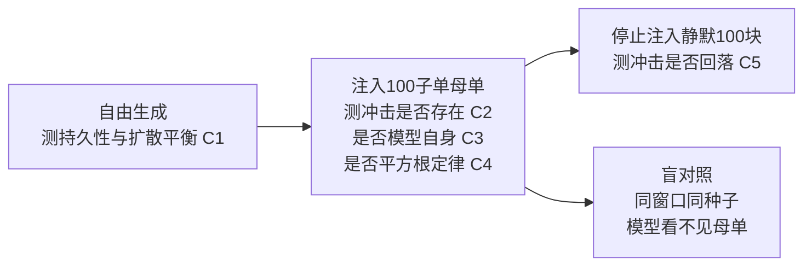

## TL;DR

一个只学过“下一个盘口消息是什么”的生成式模型，居然会对塞进去的大单做出系统性的价格反应。牛津 BOLD 实验室的 LOB-Impact 基准把 5 个神经订单簿生成器放到 5 只纳斯达克股票上，用 100 个子单组成的母单去“撞”它们：25 个格全部识别出了一条冲击定律，盲对照证明这反应是模型自己学出来的，不是盘口机械结构自带的。但这条定律是变形的——指数在 0.63 到 1.21 之间，而非真实市场的 0.5 左右；振幅最高达真实水平的十几倍；执行结束后价格基本不回落。结论很干净：冲击会涌现，但形状和衰减都不对，这类模拟器现在还不能直接拿来训练执行交易员。

## 论文信息卡

- **标题**：LOB-Impact Benchmark: Emergent Market Impact in Generative Limit Order Book Models
- **作者**：George Nigmatulin、Valentin Mohl、Sascha Frey、Kang Li、Aramis Marti-Shahandeh、Mihai Cucuringu、Anisoara Calinescu、Jakob Foerster、Stefan Zohren
- **单位**：牛津大学 BOLD 实验室（工程科学、计算机科学、统计系），Cucuringu 另属加州大学洛杉矶分校数学系与牛津曼定量金融研究所
- **发表渠道**：第 7 届 ACM 金融人工智能国际会议（ICAIF '26，2026 年 11 月，米兰）；arXiv 2610.27100，2026 年 10 月 19 日提交
- **原文链接**：https://arxiv.org/abs/2610.27100
- **数据与代码**：2026 年 1 月 LOBSTER 盘口消息数据；基准开源于 https://github.com/george-nigmatulin/lob-impact

## 背景

限价订单簿（LOB）就是买卖盘口随时间变化的完整消息流：挂单、撤单、成交，一条接一条。近几年，S5、Mamba 这类状态空间模型被当成“下一个 token 预测器”来训练，输入是 token 化的盘口消息，输出是下一条消息。它们生成的行情在分布上越来越像真的：价差、成交量、消息间隔都对得上。于是很自然的下一步是把它们当成强化学习交易员的“世界模型”，让执行算法先在模拟器里练几百万次，再上真实市场。

问题是，“长得像”不等于“推起来像”。执行算法最关心的不是模拟器平时吐出的行情漂不漂亮，而是当它把大单拆成小单往市场里送时，价格会怎么动、动多少、停手后又怎么回来。真实市场对此有一条反复验证的经验定律：平方根定律。机构不会一次性砸出大单，而是拆成母单（metaorder）；母单造成的预期价格位移 $I(Q)=\sigma\cdot Y\cdot(Q/V)^{\beta}$，其中 $\sigma$ 是日波动率，$Q$ 是母单规模，$V$ 是日成交量，振幅 $Y$ 约为 0.5，指数 $\beta$ 约为 0.5——单量翻 4 倍，冲击只翻约 2 倍。

这条定律背后是一对张力：订单流符号高度持续，上一笔是买、下一笔大概率还是买；若每一笔都永久推高价格，价格早就趋势性飞走了。真实市场能保持扩散，是因为流动性在母单身后不断回补，执行一停，冲击就往回落一半到三分之二。此前评估生成器的方法，包括 LOB-Bench，主要比的是生成流与真实流的分布，天然看不见“你动它、它如何回应”的反事实——这正是 LOB-Impact 要补的缺口。

## 方法拆解

这篇论文的方法论值得细讲，因为它本质上是一套“给模拟器做冲击体检”的协议，而不只是跑一次实验。基准接受四个输入：待测模型、一只股票、该股票自己的校准参数、以及每个方向每个阶段的 rollout 预算。所有下游设定——注入时刻表、校准、估计器——都由股票和协议事先固定，绝不随模型调整，避免了“为某个模型量身定做测试”的嫌疑。

第一步是按股票校准。三个关键数全部取自 2026 年 1 月的 LOBSTER 数据（评估月被排除在训练之外）：子单规模取该股票市场单的中位数；参与率固定为 $\eta=10\%$，落在经纪商数据库 3%–40% 的真实区间内；子单间隔 $\Delta_N$ 由恒等式 $\eta=1/(1+\Delta_N\phi)$ 推出，$\phi$ 为市场单占消息流的比例。母单长度固定为 100 个子单，与实证样本里隐藏单 73–100 笔的平均长度一致。按此口径，五只股票的生成负担差别很大：EA 约 1.2 万条消息，NVDA、MSFT 约 2.5 万条，AMD 约 4 万条，GOOG 高达 7.3 万条。

第二步是三阶段实验，对应五条可验证的主张（C1–C5）。自由生成阶段测订单流符号自相关衰减指数 $\gamma_{\mathrm{flow}}$ 对照价格 Hurst 指数 $H$（0.5 为扩散），以及无注入时的自由漂移：若模型一边订单流高度持续、一边价格还超扩散，就等于在自己的市场里内置了免费午餐。母单注入阶段先给一段真实行情作条件窗口，然后交替注入一个激进子单和 $\Delta_N$ 条模型生成的消息；100 子单的累积形状读冲击指数和振幅，10 子单加 100 个静默块的形状读执行结束后的松弛。买卖两个方向都跑，最后用 $I=\frac{1}{2}(I_{\mathrm{buy}}-I_{\mathrm{sell}})$ 反对称化，方向无关的漂移在相减中抵消。松弛的真实参照是：冲击在 1–2 个执行时长内回落到峰值三分之二左右，到第 10 个时长回落到约一半。

第三步是盲对照，这是全篇最关键的设计。光测出一条冲击曲线是不够的：注入的子单本身就会吃掉最优报价层，价格机械地动一下，哪怕模型完全不反应也会留下一条曲线。作者因此让每一次累积注入都跑两遍：可见跑和盲跑。盲跑里订单照样在模拟器里成交，但模型输入的消息流和盘口状态里都不带这些订单——模型像是什么都没发生一样继续生成。可见峰值与盲跑基底之比（v/b）就是“模型自己贡献的冲击”的度量。没有这个对照，任何曲线都可以被盘口机械结构冒领。

第四步是先判存在、再量大小。估计器先做可识别性检验：对 $\delta$ 在 $[0.05,1.5]$ 的网格上直接最小二乘拟合 $I=a\,q^{\delta}$；真实定律会在某个 $\delta$ 处给出尖锐的最小失配，无信号时失配曲线是平的、振幅约等于零。振幅低于 0.05 或最优 $\delta$ 落在网格边界上，都判为“未识别”，不报数字。通过这一关后，才用实证文献的分箱估计器报数：18 个等量分位数箱、带符号的条件均值、对正均值做 OLS，标准误按交易日聚类 bootstrap——交易日才是独立单位，rollout 再多也替代不了天数。每只股票每方向每阶段跑 1024 个 rollout，覆盖 20 个交易日。校准验证也很扎实：把已知指数的定律植入真实回放点云，估计器能以最多 0.11 的向下偏误 recover；500 次零信号试验里一次假阳性都没有。

待测面板包括 5 个神经模型（S5-120M、S5-4k、Mamba3、Mamba3-4k、GDN，55M–120M 参数，共享 8 只大盘股语料，2022 年 1 月至 2025 年 12 月训练、2026 年 1 月评估月留出），以及 8 个基线：不能反应的历史回放（阴性对照）、写死永久冲击的启发式回放、写死理论衰减核的 Propagator 与 Obizhaeva–Wang 核（阳性对照），以及 CST、NMZI、Hawkes、QR 四个参数化/点过程模型。

## 实验与数据

自由生成阶段先露了馅。AMD 是全文逐段解读的股票，真实 AMD 流本身是平衡的：订单流符号持续（$\gamma_{\mathrm{flow}}=1.66$），价格扩散（$H=0.54$）。神经面板没有一个同时守住这两条腿：Mamba 家族订单流记忆比真实更长（1.20 和 1.06），价格也更超扩散（$H=0.58$）；S5 家族记忆偏短（1.90、1.83），扩散倒是接近真实（0.55、0.54）；GDN 记忆全场最长（0.79），价格反而低于扩散（0.49）。更麻烦的是自由漂移：五个模型无注入时每轮漂移 +9 到 -251 个 tick。于是 C1 在神经面板全军覆没。

母单注入阶段是全文的核心结果。五个神经模型在 AMD 上全部通过可识别性检验，拟合出的指数分别是 S5-120M 0.66、S5-4k 0.79、Mamba3 0.87、GDN 0.90、Mamba3-4k 0.93，95% 日聚类 bootstrap 区间半宽只有 0.05–0.06，没有一个区间碰到 0.5。注意估计器的偏误是向下的——真实累积曲线只会比测到的更陡。指数偏陡意味着，在同样的参与率下，母单规模翻倍时，模型里的冲击增长比真实市场更快；执行算法如果按平方根定律去拆单、算成本，在模拟器里会被系统性地误导。

振幅的偏离更直接地折算成钱。AMD 上神经面板的 $Y$ 在 2.2 到 8.6 之间，而真实经验值约 0.5——每单位参与率要付出 4 到 17 倍的冲击成本；一个 100 子单母单在模拟器里推动价格 17–70 个基点，任何基线最多只有 11 个基点。盲对照确认这不是机械效应：25 个神经格的可见峰值全部至少是盲跑基底的 3 倍，16 个格超过 10 倍（AMD 上 v/b 分别为 S5-120M 21、S5-4k 26、Mamba3 9.5、Mamba3-4k 5.0、GDN 12）。所以 C2（冲击存在）和 C3（冲击是模型自己的）通过，C4（平方根定律）在 AMD 全军覆没。

基线的表现反向验证了估计器的诚实：历史回放拟合不出任何定律（振幅约 0.03，低于识别门槛），是正确的阴性答案；三个写死核的回放基线识别出的指数在 0.73–0.81、振幅 0.96–1.46，大致是真实盘口会收的价格；零智能的 CST、NMZI 和 Hawkes 在 AMD 上识别不出任何定律，QR 识别出一条指数 0.72 但振幅只有 0.09 的定律——有形状、几乎没有冲击。

AMD 的画像在另外四只股票上完整复制：25 个神经格全部识别出定律，指数按股票分别为 AMD 与 MSFT 0.63–0.93、GOOG 0.73–1.21、NVDA 0.97–1.15、EA 0.84–1.12，全部 25 个日聚类区间都不包含 0.5。按指数或振幅给模型排序，各股票名次高度一致（Kendall $W$ 分别为 0.82 和 0.81），说明测到的是模型固有的冲击成分。两个细节值得拎出来：第一，分布拟合与冲击准确度是两回事——LOB-Bench 分布排名与 $|\delta-0.5|$ 排名的相关性极不稳定（GOOG +0.54，MSFT -0.71），只看分布指标选模拟器会选错；第二，分布外泛化摧毁的是校准而非定律本身——EA 是唯一不在训练语料里的股票，模型在 EA 上依然识别出定律，但振幅飙升到 12–50，语料内股票上则是 2–19。

松弛阶段同样全军覆没。写死理论核的基线在相同时间表下终峰比为 Propagator 0.89、OW 0.81，永久冲击的启发式回放为 0.95——基线都落在合理区间，说明时间表本身没有问题。神经面板在 AMD 上的终峰比却是 S5-120M 1.19、S5-4k 1.15、Mamba3 1.16、Mamba3-4k 1.36、GDN 0.88，执行后斜率分别为 +0.6%、0.0%、+0.4%、+3.7%、-2.4%（每执行时长占峰值的百分比）。四个模型在停手后价格继续顺着母单方向走，唯一低于峰值的 GDN 又背着 -127 个 tick 的自由漂移，没法把下降归因于回补。于是 C5 也全军覆没，25 格签名极其整齐：C1 失败、C2 通过、C3 通过、C4 失败、C5 失败。作者的机制解释是“回补不足”：真实市场里每个子单的推动在下一个子单到来前就衰减一部分，$N$ 次推动才累积成 $\sqrt{N}$ 而非 $N$；生成器里订单流持续、回补不足，冲击就以更陡的指数累积，停手后也没有回落动力。作者把这 tentatively 归因于上下文窗口太短，但 4k 变体同样失败，只能说明归因尚未被证伪，还不能算证实。

## 相关工作对比

这篇论文的增量不在于“又一个生成器”，而在于把评估从“像不像”推进到“动起来对不对”。LOB-Bench（Nagy 等，ICML 2025）是分布基准的标杆，精确比较价差、成交量、到达间隔和不平衡分布，但它对干预是盲的：一个只会回放历史的模型分布上可以拿满分，却对任何注入都毫无反应，本文的回放基线正是用这个反例立论。母单尺度的先行工作有两个：MarS 报告了对 TWAP 订单的平方根形响应，Bodor 与 Carlier 在 10 子单母单上测得指数 0.55；但两者都没有分离机械冲击与间接冲击，也没有在“存在—归属—定律—松弛”链条上逐项设门。本文的贡献是把这条链条做成可复用协议：每只股票自动校准、每次累积注入配盲对照、每个格子只在通过识别检验后才报数。

与经典冲击文献的关系也值得点明：本文不是要推翻平方根定律，而是把它当作参照系——真实市场的 0.5 指数和 0.5 振幅、执行后回落到一半到三分之二，都来自 Almgren、Tóth、Bouchaud、Moro、Bucci 等人横跨股票、期货、外汇的实证结果。生成器偏离参照系本身不是罪过，关键是偏离是否会让下游执行策略学错东西。本文的回答是：会，而且偏离是系统性的，不是噪声。

## 局限与开放问题

- **单一操作点**：全部测量都在参与率 10%、激进子单、100 子单、单一母单形状下完成；指数本身依赖于这个操作点，极端成交量区间没有被探测。
- **单一月份与单一交易所**：数据是 2026 年 1 月一个月的纳斯达克数据；作者自己提醒，一个月如果偏离常态约一个月内标准差，指数就可能移出半宽区间。
- **逐段解读只做了 AMD**：其余四只股票只体现在总表里，跨股票结论依赖表格而非逐段分析。
- **松弛归因未证实**：4k 上下文变体同样失败，“窗口太短”是未被证伪的猜想，不是已验证的根因；更长上下文、更大模型的测试仍是开放项。
- **评估成本**：每只股票的完整战役计算量不小，神经模型在单张 H100 上每个累积 rollout 要 39–54 秒，4k 变体约 12 分钟，基准的普及程度取决于开源实现能否被低成本复现。

## 一点思考

对做策略和风控的人来说，这篇论文的实用含义比它的技术细节更重要。第一，不要把任何生成式盘口模拟器直接当成执行回测环境——分布指标再漂亮，也掩盖不了冲击指数偏陡、振幅偏大、不回落这三重变形，用它练出来的拆单策略在真实市场大概率会低估成本、高估容量。第二，选模拟器要加一道“冲击体检”：至少测指数、振幅、终峰比这三个数，缺一个都不算验过。第三，对模型开发者而言，真正的修复方向是学会回补而不是抹掉持续性——杀掉订单流记忆可以 vacuously 恢复平衡，却会丢掉市场最真实的统计结构。我的判断是：生成式订单簿模型作为研究工具已经成立，但作为执行训练场，至少要等到有模型能同时通过 C4 和 C5 之后再谈。

## 原文链接

- 论文：https://arxiv.org/abs/2610.27100
- 基准代码：https://github.com/george-nigmatulin/lob-impact
