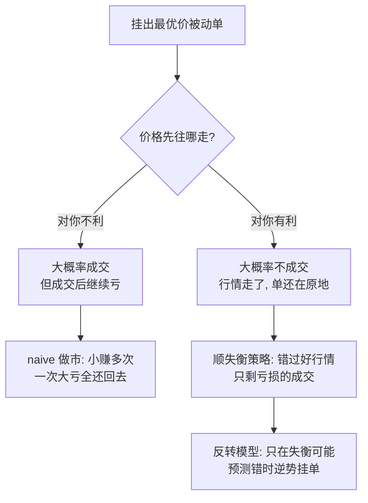

## TL;DR

做市商最想要的两样东西，在限价订单簿里天然互斥：成交概率高，意味着你大概率是被“有信息”的对手盘吃掉；成交后价格往对你有利的方向走，意味着你的单大概率根本成交不了。牛津团队在币安比特币永续合约上实盘挂了 23 万张最小单位被动单：随机挂单的 5 秒期望收益约为 -0.8bp，扣掉 0.5bp 返佣后仍为 -0.3bp；教科书式 naive 双边做市约 3 天 7 小时亏近 60%，年化夏普比率 -109。唯一的出路不是把单挂得更密，而是识别订单簿失衡“预测错了”的时刻——逆着失衡挂单、等价格反向走回来，论文称之为“反转”。在 0.24 的反转概率阈值上，平衡库存策略的平均每轮收益从 -0.44bp 翻转为 +0.71bp，夏普比率升至 11.97，但这建立在最小单量、最优费率之上，几乎不可能按比例放大。

## 论文信息卡

- **标题**：The Market Maker's Dilemma: Navigating the Fill Probability vs. Post-Fill Returns Trade-Off
- **作者**：Jakob Albers、Mihai Cucuringu、Sam Howison、Alexander Y. Shestopaloff
- **单位**：牛津大学统计系、牛津-曼量化金融研究所、牛津大学数学研究所、伦敦玛丽女王大学、纽芬兰纪念大学等
- **发表渠道**：arXiv:2502.18625v2 [q-fin.TR]，2025 年 2 月 25 日提交、2025 年 11 月 23 日修订
- **原文链接**：https://arxiv.org/abs/2502.18625

## 背景

做市商的教科书故事很好听：双边挂单赚价差加 maker 返佣，订单按泊松过程随机成交，中间价按布朗运动漂移，Avellaneda 与 Stoikov（2008）、Cartea（2016）等经典模型大体如此。但这个故事漏掉了最关键的一条力学：你的被动单之所以成交，往往是因为有人主动来吃它；而吃它的人，很可能刚看到你没看到的信息。

这就是“逆向选择”：买单成交的瞬间，卖方 taker 单已经把买一队列打薄甚至打穿，微观价格立刻向不利于你的方向移动；若价格变动还有持续性，几秒后的 markout 只会更差。反过来，若价格朝对你有利的方向走，你的单大概率会被甩在身后：价格先走了，你的单还挂在旧价位上，随后要么被撤单、要么看着行情走远。此前文献并非没有注意到这些碎片：DeLise（2024）称之为 maker 单的“负漂移”，Maglaras 等人（2021）用深度学习预测成交概率，但大多只盯住其中一端，从未把“成交概率”和“成交后收益”放在同一批真实成交数据里对齐。更麻烦的是数据偏误：真实做市商 95% 以上的单都会撤单，且只在自认为安全时才挂单，用他们的历史订单估计成交概率会系统性低估——Lokin 与 Yu（2024）用他人订单估计的均衡盘口成交概率不到 2%，而本论文无信号实验测得的同一情形约为 50%。

## 方法拆解

### 第一步：不用历史数据，直接上实盘挂单

论文的核心方法不是回测，而是一场实盘实验。主实验是“连续报价模式”：2024 年 2 月 12 日至 19 日，在币安 USDT 本位比特币永续合约上双边始终各挂一张最小单位被动单在最优价；成交立刻补单，价格走了就撤单重挂。一周共提交 232,897 单，成交 127,051 单，未成交撤单 105,846 单，成交率约 54.6%。对照实验是 2024 年 8 月 21 日至 31 日的“周期报价模式”：每 10 秒各挂一单，共 172,800 单、成交 95,998 单，两套结果基本一致，正文用连续报价模式汇报。

为什么非要实盘？论文否定了三种替代方案：合成单忽略自身对盘口的影响，且币安只有 L2 数据、无法精确追踪排队位置；观察他人订单带有信号偏误；仿真只是复现风格化事实。代价是结论只对最小单量成立。实验环境：价差几乎恒为 1 tick（0.1 美元，约 0.03bp），最优买卖队列通常各有几十万美元；最优费率下 taker 费 1.5bp、maker 费 -0.5bp（返佣），全部收益都按最优费率计算。

### 第二步：把一单拆成四个量

对每个被动单，论文定义了四个核心量：排在你前面的量为“前方流动性”$LA$，后面的量为“后方流动性”$LB$，排队位置 $QP = LA/(LA+LB)$（0 为队首，1 为队尾）；提交时的同侧队列规模 $Q^{near}$ 与对侧队列规模 $Q^{opp}$，失衡 $\text{imb}=(Q^{near}-Q^{opp})/(Q^{near}+Q^{opp})$；收益用 markout 衡量：成交价与成交 1 秒后中间价之差（按方向取号，单位 bp，不含返佣），更长窗口用 5 秒收益。

这套定义把直觉变成了可检验的命题：前方量越小，越容易被一笔 taker 单吃掉；对侧队列越大，价格越不容易朝对你不利的方向穿过去，你在队列里待得越久、被吃掉的机会也越多。成交时队尾位置越靠后，说明吃掉你的那笔 taker 单越大、冲击越强，成交后的漂移也越差。

### 第三步：先算成交概率，再算成交后收益，最后算策略

分析分三层递进：成交概率曲面（$Q^{near}$ 与 $Q^{opp}$ 各分 20 档分箱统计、OLS 拟合）；价格漂移（按成交时队列规模与排队位置分组，看 1 秒 markout 分布）；策略回测（先跑 naive 双边做市与三类失衡策略，再构造“反转”分类器——只在模型认为失衡会预测错时才逆着失衡挂单）。

### 第四步：反转模型到底怎么建

反转的定义很具体：先筛出提交时估计成交概率超过 80% 的单（共 182,381 单，平均对侧队列比同侧大 40%，即初始失衡本身不利），再看其中哪些单成交且在成交后第一次价格变动时仍有正收益——即“失衡预测错了、你还成交了”的子集，占比约 15%。前一半数据训练、后一半测试，特征共 173 个，全部是挂单时可得的量，分四组：价格动态、成交量模式、动量与盘口状态，时间尺度覆盖 100 毫秒至 5 分钟，每个尺度取连续三个互不重叠窗口，并把买卖方向统一折算为“同侧/对侧”，使模型对多空对称。

评估特意不用准确率：反转只占 15%，永远预测“不是反转”也能有 85% 准确率、却一单都不会成交。论文改用经济显著性：无方向策略（筛选后单子的 5 秒收益）与平衡库存策略（只在预测反转概率超过阈值时挂单、库存非零时只挂回补方向）两套口径，并对每个阈值做 t 检验。

## 实验与数据

成交概率的结果出乎意料地“简单”：同侧队列越大、成交概率越低，对侧队列越大、成交概率越高——同侧大、对侧小时低至约 30%，同侧小、对侧大时超过 90%，买卖均衡时约 50%。OLS 回归 $z=\beta_0+\beta_1 Q^{near}+\beta_2 Q^{opp}+\beta_3 \text{imb}$ 的 $R^2$ 高达 0.946，系数为 $\beta_0=0.5649$、$\beta_1=0.0159$、$\beta_2=0.1013$、$\beta_3=-0.3166$，同侧队列与失衡高度显著，对侧队列本身 p 值为 0.065、未达显著。言外之意很尖锐：成交概率根本不需要黑箱模型；但这份“可预测”恰恰是陷阱，因为它预测的是“会不会成交”，而不是“成交了赚不赚钱”。

价格漂移的分组结果把陷阱摊开来看。最有利的组合——同侧队列大、对侧队列小、成交时排在前 10%——1 秒 markout 平均也只有 -0.058bp，分布主体虽偏正、但均值仍被尾部拖成微负；同一组合排在后 25% 时，平均骤降至 -0.775bp。两边队列都大时，前 10% 为 -0.296bp、后 25% 为 -1.157bp；最不利的组合（同侧小、对侧大）里，前 10% 与后 25% 分别为 -0.539bp 与 -0.763bp，排队位置几乎不再重要。只有“大队列 + 队首 + 顺失衡”这一格勉强接近不亏，其余格子全是系统性亏损。全部随机单汇总，5 秒期望收益约为 -0.8bp，含返佣后 -0.3bp。

策略层面的结果更残酷。naive 双边做市（双边一直挂、成交后补单、无任何信号）在约 3 天 7 小时内累计亏损近 60%，年化夏普比率 -109，平均持仓约 11 秒：最常见的单次往返确实是小赚，但偶发的大亏把小赚全部淹没。三类失衡策略也全军覆没：顺失衡 taker 每轮税前约 +1bp、但每腿 1.5bp 的 taker 费吃掉全部利润，税后每轮均值 -1.9621bp；顺失衡 maker（无撤单）每轮 -0.4705bp、加撤单规则后 -0.4921bp，撤单只拦住了“失衡缓慢变坏”的那部分，对突发大单导致的跳价毫无办法。论文的诊断一针见血：taker 策略死于手续费，maker 策略死于成交概率。

反转模型是全篇唯一的转机，但幅度必须打折读。无方向口径下，阈值为 0 时每天 21,689 单、成交率 88.24%、5 秒收益 -0.74bp；逻辑回归阈值提到 0.24 时，每天只剩 882 单、成交率 86.73%、收益 -0.62bp（比随机单好约 0.12bp）；提到 0.30 时，每天 233 单、成交率 85.45%、收益 -0.32bp，t 统计量 3.06、p 值 0.0011，统计显著但绝对值仍为负；要到 0.36 以上才出现正收益，但每天只剩 69 单，样本已薄到难以依赖。平衡库存口径的 headline 数字更亮眼：阈值 0.24 时每天 654 次成交（327 个往返）、平均每轮 +0.71bp、标准差 13.69bp、平均持仓拉长到 267.66 秒、夏普比率 11.97，相对阈值 0 时的 -0.44bp、夏普 -109 是天壤之别。但均值 0.71bp 建立在标准差 13.69bp 之上，持仓从 11 秒拉长到 4 分半，等于用“等更久、赌更大波动”换来了均值翻正，随机森林在同一阈值下甚至仍为 -0.39bp，说明结果对模型与阈值都很敏感。

反转的系数画像是：近 15 秒价格来回震荡、最近 100 毫秒刚急跌、成交间隔短、最优价存活时间短——即“市场活跃、刚被孤立大单砸了一下、未形成持续抛压”。论文明确说这只是原理验证，不是可直接上线的策略。

## 相关工作对比

与此前文献相比，这篇论文的增量不在模型复杂度，而在数据与问题的对齐方式。Maglaras 等人（2021）用合成单加深度学习预测成交概率，Arroyo 等人（2023）用卷积-Transformer 做生存分析，两者都只回答“会不会成交”，没有把成交后的收益放在同一框架里检验。Lokin 与 Yu（2024）的排队模型同样基于他人订单，存在信号偏误，均衡盘口 2% 与 50% 的估计鸿沟就是明证。

与经典模型相比，本文的挑战更根本：Avellaneda–Stoikov 类模型假设成交按泊松过程随机发生、与中间价演变无关，实盘数据直接否定了这一点——成交事件本身就携带信息。论文的“无利可图原则”由此而来：预测能力与可 exploitation 性呈负相关，越容易预测的量，越难变成钱。

## 局限与开放问题

- **单市场、短窗口**：主实验是一周的币安比特币永续合约，复核实验是同年 8 月的 10 天；能否外推到股票、利率等市场，论文未披露。
- **最小单量**：全部结论基于最小单位订单，大单只能靠队列换算外推，真实冲击只会更差，夏普比率 11.97 不可按比例放大。
- **最优费率与忽略延迟**：收益按 taker 1.5bp、maker -0.5bp 的最优档计算；延迟被假设为可忽略，作者认为严谨处理会强化 maker 困境，但 taker 税前收益可能被高估。
- **测试期短、持仓拉长**：反转策略测试期约 3.5 天，0.24 阈值下持仓从 11 秒拉长到约 268 秒，标准差 13.69bp 远大于均值 0.71bp；换个波动率区间，结果可能大变。
- **数据不公开**：作者声明实验数据不公开，第三方无法直接复现；反转特征的经济解释也带有推测成分。
- **开放问题**：反转信号能否与撤单策略、跨市场信号结合？价差大于 1 tick 时“队首”还有同样价值吗？加入库存与资金成本后，0.24 阈值的正收益还剩多少？

## 一点思考

这篇论文最值得带走的不是反转模型本身，而是它对“回测幻觉”的釜底抽薪：任何只汇报成交概率、胜率或税前收益的做市研究，都可能只是在数那个注定要亏的另一半。我的判断是，散户与中小团队不应该把“挂单赚返佣”当作策略起点——没有私有信号与延迟优势时，naive 做市在统计上就是一条通往亏损的捷径。真正有价值的投入，是先花成本拿到无偏的成交数据，再回答“在什么条件下成交反而是好事”。

## 原文链接

- arXiv 摘要页：https://arxiv.org/abs/2502.18625
- HTML 全文：https://arxiv.org/html/2502.18625v2
