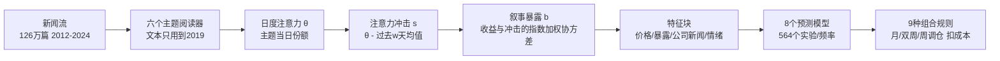

## TL;DR

**用现代语言模型读财经新闻做回测，有一个藏在特征里的作弊器：模型在训练时已经"读"过测试期的文本，所谓预测可能只是在回忆。** 这篇论文造了一个"时间纯洁"的编码器 NoLBERT——它只读过 1976–1995 年的文本，对 2012 年之后的世界一无所知，然后用它给 126 万篇新闻打主题标签，预测美国最大 1000 只股票的横截面收益。三个结论：① 去掉"事后诸葛亮"几乎不损失预测力，NoLBERT 的表现和最好的 LDA 相当；② **怎么度量注意力，比用什么模型度量重要得多**——把注意力冲击的基准窗口从 5 天拉长到 63 天，所有阅读器在所有频率上的预测力全部提升；③ 在验证集上表现最好的实验（EBM 模型），在测试期三个频率全部亏钱，亏掉的根源是模型学会了利用一个"被插补出来的噪声特征"。最终的等权组合在月度调仓下拿到 1.12 的净夏普比率，但它打不过纯价格模型，多重检验校正后也不再显著——这是一篇诚实的论文，alpha 有限，方法论的教训管饱。

## 论文信息卡

- **标题**：Reading the News Without Hindsight: NoLBERT Topics and the Cross-Section of Stock Returns
- **作者**：Kevin Foley、Jonathan Hartadi、Shivesh Prakash、Charishma Takkallapalli、Swapnil Vatsal（作者单位信息论文未披露）
- **发表渠道**：arXiv 预印本（arXiv:2610.22745v1，分类 q-fin.ST / cs.CL / cs.LG / q-fin.PM），2026-10-15 首版，未经同行评审
- **原文链接**：https://arxiv.org/abs/2610.22745
- **数据**：126 万篇财经新闻（2012–2024，FinMultiTime + FNSPID）× 美国最大 1000 只股票日收益（CRSP）；训练 2013–2019、验证 2020–2021、测试 2022–2024
- **关键词**：叙事资产定价；NoLBERT；前视偏差；对比微调；财经新闻；收益预测

## 背景

财经新闻里有没有 alpha？Tetlock（2007）早就发现报纸的悲观情绪能预测市场收益，随后被反转；Ke 等（2019）直接用收益监督文本表示；Bybee 等（2023）开了"叙事资产定价"这条线：用 LDA 给《华尔街日报》打主题，把每个主题每天获得的"注意力"变成冲击，再用股票收益对这些冲击的协方差作为因子暴露，做横截面定价。Transformer 编码器出现后，大家自然想用它替代 LDA——同一事件的两篇文章即使措辞不同，句子向量也能把它们拉到一起。

但这里埋着一个量化人最该警惕的坑：**前视偏差（look-ahead bias）长在了特征里**。一个 2021 年发布的编码器，在它训练时已经读过 2018 年的新闻了。你拿它给 2018 年的文章编码，得到的向量里已经混入了 2018 年之后发生的事。你把 2022–2024 留作测试集也没用——事后诸葛亮不在标签里，而在特征里。已有研究发现 LLM 能背出训练期内的经济数据（Lopez-Lira 等，2025），在训练期内的事件预测会被系统性高估（Sarkar and Vafa，2024）。

作者团队自己之前就踩过这个坑。他们 2026 年的早期研究比较了 LDA 和冻结的 MiniLM，发现 Transformer 略胜，但设计里有四个硬伤：主题模型在**全样本**上拟合、股票池用了年初还不存在的信息、部分超参数在评估期上挑选、组合收益没扣交易成本。这篇论文就是"还债之作"：更严的时间纪律、扣成本的组合、以及一个核心新武器——**点时编码器（point-in-time encoder）**。

NoLBERT（Kakhbod and Li，2025）是一个 DeBERTa-v3 base 模型（12 层、768 维、约 1.09 亿参数），训练目标是预测被 mask 的词，但**训练文本全部发表于 1976–1995 年**，1996 年的文本留作验证；连分词器（3 万词表）都是在这批老文本上训练的，不让任何后来的文本从词表里溜进来。GLUE 子集上它的表现不输 FinBERT，但它对 2012 年之后的金融世界是"失忆"的——这正是作者想要的。

## 方法拆解

论文的管线分六步，一步都不能有时序泄漏。下面按"阅读器 → 注意力 → 特征 → 模型 → 组合"的顺序讲透。

### 第一步：把 NoLBERT 从"会读书"变成"会归类"

NoLBERT 有个毛病：它预训练时没有句子级目标，直接拿它的 token 向量平均，两篇不相关的文章余弦相似度高达 0.53，而标题和它自己的导语也才 0.59——向量挤成一团，没法聚类成 60 个主题。作者用 SimCSE 式的无监督对比学习（Gao 等，2021）给它"整形"：

- **正样本**：同一篇文章的两个不同段落（只到 2019 年的文章，共 230,931 对，2048 对留作验证）；
- **负样本**：同 batch 里其他 31 篇文章的段落；
- **损失**：对称 InfoNCE，温度系数 $\tau=0.05$，batch 32；
- **训练**：全参数微调，AdamW（学习率 $2\times10^{-5}$），一块 RTX 3060 跑 150 分钟，6205 步（约 0.87 个 epoch）。

效果立竿见影：损失从 5.9 掉到 0.3（随机水平是 $\log 32 = 3.47$）；留出验证集上"最近邻恰好是原文另一段落"的比例从 0.08 升到 0.89（随机 0.03）；在模型从没见过的 2022–2024 年标题-导语对上也有 0.86。注意：**整个过程没用任何标签和收益**，唯一的监督信号是"文章边界"。

### 第二步：六个阅读器，同场竞技

六个"阅读器"给同一批文章打主题标签，全部只在 2019 年底之前的文本上拟合（每天最多抽 60 篇，共 140,209 篇），之后冻结、向后应用：

| 阅读器 | 主题数 | 做法 |
|---|---|---|
| LDA（日度抽样） | 60 | 词频 Dirichlet 混合，经典基准 |
| LDA（全部文章） | 60 | 同上，但拟合语料更大 |
| MiniLM | 60 | 句子向量 + k-means（2021 年发布，读过样本内文本） |
| FinBERT 分类器 | 20 | 金融文本微调的标题主题分类 |
| NoLBERT | 60 | 对比微调后的向量 + k-means |
| NoLBERT-20 | 20 | 同上，主题更少 |

### 第三步：从主题到"注意力冲击"

沿用 Bybee 等（2023）的框架，但加了一个关键旋钮。某主题 $k$ 在第 $d$ 天的注意力 $\theta_{k,d}$ 是当天文章在该主题上的平均权重；**注意力冲击**是它与过去 $w$ 个交易日均值的差：

$$s^{(w)}_{k,d} = \theta_{k,d} - \frac{1}{w}\sum_{j=1}^{w}\theta_{k,d-j}$$

再对市场收益正交化。某只股票对该叙事的**暴露**，是它过去 252 个交易日日收益与该冲击的指数加权协方差（半衰期 60 天）。$w$ 在 $\{1, 5, 21, 63\}$ 里按预先写好的规则在验证集上选：用 OLS/ridge/lasso 在训练集拟合，哪个窗口验证集平均 rank IC 最高、且在至少 4 个阅读器上打败 $w=5$，就用哪个。三个频率下选出来的都是 **$w=63$**——对过去一个季度的注意力做差，而不是对过去一周。

### 第四步：特征、模型与组合

特征块共 8 类：价格特征（beta、波动、动量、反转、市值等 8 个）、叙事暴露（K 个主题）、公司自身新闻（数量 + 主题分布）、安慰剂暴露（LDA 冲击平移 126 天，纯噪声对照）、FinBERT 情绪、Loughran-McDonald 词典情绪、标题 embedding 主成分（64 维）、新闻×价格交叉（6 个）。所有特征进模型前变成横截面排名、缩放到 $[-1,1]$。缺失值处理有个细节：**用同一天随机抽一只股票的整块特征来填补**——因为"没有新闻"本身可能和未来有关（被收购的公司就没有新闻了），不能简单填 0。

预测模型 8 个（OLS、Ridge、Lasso、IPCA、稀疏 IPCA、XGBoost、随机森林、EBM 可解释提升机），每个频率 564 个实验。超参数只在验证集上选，且取"验证误差离最优不到 $10^{-5}$ 的最正则化设置"——已经是在防过拟合了，但后文会看到，还是不够。

组合构建 9 种规则（十分位多空、缓冲多空、等权/市值加权等），月/双周/周三个频率，**扣 10bps 单边交易成本**（不含融券成本和冲击成本）。预测目标是股票相对横截面均值的超额收益——纯选股，不赌市场方向。

## 实验与数据

### 数据清洗本身就是一篇"避坑指南"

新闻端：93 个 ticker 的标题和正文错配（正文是几年后写的无关文章），占 2012–2023 文章的 7.3%——不修的话，未来的语言会泄漏进"截止 2019"的词表。2023-12-16 有一天是数据源的批量 dump，直接丢弃。最终 1,255,289 篇，每篇只读标题 + 正文前 500 字符；$d$ 日的新闻从 $d+1$ 收盘才开始用。

收益端有个触目惊心的教训：作者早期用的收益文件有个 bug——2017 年起，只有当年 6 月名单上的股票才有日收益，于是每年 1–6 月、那些"即将被踢出大盘股名单"的股票没有近期收益数据，而这些股票接下来会**每月跑输 3–5%**。树模型学会了识别它们，在纯价格特征上做出了 **1.56 的周度净夏普比率**——完全是数据 bug 印出来的假 alpha。换成完整收益文件后，这个幽灵消失了。**在相信任何回测之前，先查 plumbing**——这句话值得打印出来贴墙上。

### 发现一：验证集冠军，测试集全军覆没

这是全篇最有教育意义的结果。在每个频率下，验证集上 rank IC 最高的实验都是 EBM 模型（验证 IC 2.4 / 2.0 / 1.7），但它在测试期的多空组合净夏普是 **$-0.23$ / $-0.27$ / $-1.08$**——三个频率全亏。

EBM 是可加模型，可以精确拆开每个特征的贡献，一打开就找到病灶：验证集选了 10 个** pairwise 交互项**，它们占了模型输出的 98% / 58% / 79%；而这些交互项大多把价格特征或叙事暴露，和"公司新闻在某主题的占比"配对——后者在 40–50% 的股票上是**插补出来的噪声**。把交互项从拟合好的模型里直接删掉（不重新估计），夏普从 $-0.23$ 升到 $0.00$、$-0.52$ 升到 $0.23$、$-1.08$ 升到 $-0.41$。教训：**短验证集 + 高自由度模型 + 含插补噪声的特征 = 精准地选中过拟合**。选模型不如平均模型（后文组合部分印证了 Rapach 等 2010 年的老结论）。

### 发现二：63 天窗口，压倒一切

验证集规则选出的 $w=63$，在测试期带来了跨阅读器、跨频率的一致提升：

- 平均 rank IC 提升 **1.28 / 0.87 / 0.49**（月/双周/周，t = 1.8 / 2.0 / 1.7）；
- 多空组合年化净收益提升 **5.8 / 4.7 / 3.9 个百分点**；
- 在只差窗口的 46–48 对实验里，夏普比率提升的比例是 **91% / 80% / 85%**。

直觉：5 天冲击捕捉的是"这周炒什么"，63 天冲击捕捉的是"哪些主题正在获得**持续**的注意力份额"——后者才是能被股票暴露稳定承载的慢变量。它在测试期的两半（2022–2023 vs 数据源变更后的 2024）都稳定：63 天冲击的月度 IC 是 1.7 和 1.8，而 5 天冲击在 2024 年直接翻负（$-2.7$ / $-1.6$ / $-1.2$）。**特征工程打败了模型选择**——这是全文最实在的一句。

### 发现三：NoLBERT 稳定，但没赢；组合赢了，但不显著

阅读器本身的对比：LDA 主题最连贯（NPMI 0.58 vs NoLBERT 0.48、MiniLM 0.49）；NoLBERT 主题最稳定（换种子重聚类后 69% / 80% 的文章留在原主题，LDA 只有 58%），主题大小最均匀。但预测上，用 63 天冲击后所有阅读器 IC 全为正，LDA 和 NoLBERT 领先（月度平均 IC：LDA 2.85、NoLBERT 2.59；双周 2.01、1.34；周 0.94、1.01），阅读器两两之间**没有显著差异**。核心信息是：点时限制（只读 1995 年前的文本）没有可检测的预测力代价——去"事后诸葛亮"是免费的，但也没证据说它让预测变好。

最终的等权组合（所有阅读器 × 所有模型，63 天冲击）在月度调仓下：rank IC 3.9（t = 2.91），十分位多空净夏普 **1.12**、缓冲版 **1.19**；缓冲组合年化净收益 12.4%、波动 10.4%、最大回撤 8%。但三个冷水：① 它**打不过纯价格组合**（p = 0.46）；② 用 Bailey–López de Prado 的**膨胀夏普比率**校正后，没有一个结果接近显著；③ 每个频率约 600 个实验，按 White 现实检验，无技能策略的最优夏普期望值是 2.2–2.7，没有任何单个实验通过 10% 的错误发现率。周度频率下成本吃掉大半收益（毛夏普 1.02 → 净 0.30）。

还有一个稳健性细节值得所有做 ML 回测的人记住：把 9 个实验换 10 个随机种子重跑，树模型的夏普能波动 **2.5**（月度 XGBoost 价格+LDA 文本：$-1.00$ 到 $1.47$）——**种子噪声和三年样本的抽样误差一样大**。你论文里那个漂亮的夏普，可能是种子抽得好。

## 相关工作对比

- **Bybee 等（2023）**：叙事资产定价的开山框架（WSJ + LDA + 注意力冲击 + 因子暴露）。本文沿用了它的管线到"暴露"为止，但把主题来源换成六个阅读器、把单一定价模型换成 8 个预测模型、把组合扣成本实盘化，并补上了严格的时间纪律。
- **Chen 等（2022）**：用大语言模型 embedding 直接预测横截面收益。本文把它作为"标题 embedding"特征块纳入比较——结果是 embedding 类特征并不突出。
- **Kakhbod and Li（2025，NoLBERT 原论文）**：提供了点时编码器，证明它在 GLUE 子集上不输 FinBERT。本文是第一个把它用到资产定价回测里的工作，并证明了"时间纯洁性"在预测任务上近乎免费。
- **He 等（2025）**：用年代受限文本训练模型，发现新闻收益预测里的前视偏差"不大"。本文的结论与之相容且更进一步：偏差也许不大，但纪律本身不花钱，那就没有不做的理由。
- **方法论文献**：预测用 Gu 等（2020）的 ML 资产定价工具箱 + Kelly 等（2019）的 IPCA；多重检验用 Harvey 等（2016）、White（2000）现实检验、Hansen（2005）SPA；组合思想呼应 Rapach 等（2010）"平均预测胜过挑选预测"。

## 局限与开放问题

- **统计功效不足**：测试期只有 36 个月，年化夏普的标准误约 0.58，真夏普要到 ~1.7 才有 80% 把握被检测到；阅读器之间、组合 vs 价格模型的差异都不显著。
- **搜索空间巨大**：每频率约 600 个实验 × 9 种组合规则，没有实验通过错误发现率校正；等权组合是跑完主实验后才构造的，它的 p 值没有为"构造组合"这个选择本身做校正。
- **文本侧仍有泄漏**：MiniLM 和 FinBERT 训练时读过样本内文本；所有阅读器 2019 年后不再重拟合，在后期文本上的主题连贯性下降 29–37%。
- **数据源非点时**：新闻源是事后从 ticker 页面采集的，被收购的公司没有文章，重仓覆盖的公司只保留近期的文章——公司层面新闻 40–50% 靠插补；2024 年换了第二个采集源（ticker 更少、无标题）。
- **成本与样本**：交易成本是固定的 10bps、无融券成本、无冲击成本；股票池限于最大 1000 只；每个实验只跑一个种子（而种子本身能带来 2.5 的夏普波动）。
- **开放问题**：按同样配方微调一个现代编码器（如 Llama 系）做点时版本，能否与 NoLBERT 拉开差距？主题随时间在线更新会不会更好？63 天窗口的最优性在其他市场（A 股、加密货币）是否成立？

## 一点思考

这篇论文的 alpha 结论是克制的，但它的方法论教训每一句都值得量化从业者抄下来。**第一，验证集选冠军是个陷阱**：两年验证期配高自由度模型，选出来的不是"最好的模型"而是"最会背验证集的模型"，EBM 的交互项精准地咬住了插补噪声——特征里 40% 的缺失不是小事，它是模型作弊的入口。**第二，慢变量打败快变量**：63 天注意力冲击稳定地打败 5 天冲击，说明新闻 alpha 不在"今天炒什么"的脉冲里，而在"什么叙事正在持续获得注意力"的趋势里，这对做另类数据的人是直接的特征工程指导。**第三，前视纪律免费**：NoLBERT 证明去掉事后诸葛亮不损失预测力，以后任何 LLM 读新闻的回测论文，如果还用读过测试期的模型做特征，都应该被要求重做。我的判断是：**这篇论文最大的贡献不是 1.12 的夏普（它自己都承认打不过价格模型、通不过多重检验），而是给"LLM + 新闻 alpha"这个热门方向立了一套可复现的诚实基准——数据 bug 自曝（1.56 的假夏普）、验证集冠军亏钱、种子噪声 2.5，这些"家丑"比 alpha 数字更有价值**；真要做策略，方向是 63 天这类慢注意力特征 × 等权组合 × 月度调仓，别在验证集上挑模型。

## 原文链接

- 论文摘要页（arXiv）：https://arxiv.org/abs/2610.22745
- HTML 全文：https://arxiv.org/html/2610.22745v1
