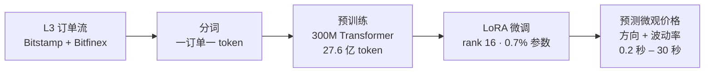

## TL;DR

语言模型“先预训练、再微调”的路子，搬到订单流上也成立——但只在亚秒级成立。一个 3 亿参数的 Transformer 先在 Bitstamp 和 Bitfinex 两家交易所 27.6 亿个 Level-3 订单事件上学“下一个订单是什么”，再用 LoRA 微调去预测 BTC 微观价格未来 0.2–1 秒的方向与波动率。方向预测的相关系数在 0.2 秒达到 0.44、0.5 秒 0.45、1 秒 0.39，显著跑赢订单簿失衡（0.23 左右）和基于订单流失衡特征的梯度提升树；波动率只在 0.2–0.5 秒赢过 GARCH，1 秒打平，2 秒之后反被 GARCH 拉开。更关键的是两点：第一，这套预测能零样本搬到没微调过的 ETH 和 SOL 上；第二，它算不上交易信号——预测的波动幅度不到 1 个基点，过不了 2 个基点的单边成本，真正的用处在执行与做市。

## 论文信息卡

- **标题**：Fine-Tuning an Order-Flow Foundation Model for Sub-Second Forecasting（微调订单流基础模型做亚秒级预测）
- **作者**：Fedor Shabashev（独立作者）
- **发表渠道**：arXiv 预印本，q-fin.TR，2026 年 11 月 10 日提交
- **原文链接**：https://arxiv.org/abs/2611.14117

## 背景

限价订单簿的价格预测是微观结构里最拥挤的方向之一。Cont 等人 2014 年的订单流失衡（OFI）、Kolm 等人 2023 年的多层深度 OFI、DeepLOB 的卷积循环网络，都证明盘口状态能在几秒内预测价格。但这些模型全是“从零开始的有监督学习”：为一个目标、拿标注数据、训一个专用模型。

2026 年另一条线冒了出来：把订单流当成语言来建模。Nagy 等人 2023 年先做了 token 级自回归生成模型，TradeFM（Kawawa-Beaudan 等，2026）把它放大成基础模型——一个订单一个 token，模型只学“下一个订单是什么”。这类模型能逼真地复现订单流分布，但有个硬伤：交易员真正的问题不是“下一个订单是什么”，而是“200 毫秒后价格会往哪走”。下单本身就要 100 毫秒以上，只会预测下一个订单的生成模型，根本够不着实战 horizon。TradeFM 把“任务微调”明确留作未来工作；MarS 则绕开微调，从生成器里滚 128 条模拟轨迹再投票——权重一动不动。

这篇论文补上的正是这块缺口：第一次有人把自回归订单流基础模型拿出来，真正微调成一个价格预测器，并和全套经典方法硬碰硬地比了一场。

## 方法拆解

### 第一步：把订单流切成 token

数据是 Bitstamp 和 Bitfinex 两家交易所的全部 Level-3 事件（挂单、改单、撤单、成交），主模型语料约两周（2026 年 9 月 20 日–10 月 2 日），共 27.6 亿个训练 token。加密市场的订单流比美股还密：Bitstamp 的 BTC/USD 中位数每秒 199 个事件，而 NASDAQ 最活跃的 SPY 是 62、AAPL 是 52；不过美股更“尖峰”，AAPL 单秒突发能超过 28000 个事件，BTC 的突发峰值约每秒 1000 个。

分词沿用 TradeFM 的做法，一个订单一个 token，字段是（动作，方向，时间间隔，价格偏离，数量），词表 16384。三个针对加密市场的改动：成交本身不占 token（它消耗的流动性体现为 resting 订单的消失）；改单被拆成“撤掉旧单 + 挂新单”；毫秒级时间戳会让大批连续事件落在同一毫秒，作者把时间间隔 bin 0 预留给“零间隔”。价格锚不用容易失真的买卖中间价，而是成交量的指数加权均价（EW-VWAP，30 秒半衰期），因为它对单边盘口或瞬间空盘更稳健。

### 第二步：预训练一个 300M 的“订单流语言模型”

主干是标准的 Llama 结构 decoder-only Transformer（RoPE、GQA、SwiGLU、RMSNorm），上下文 1024 个 token，3 亿参数，在 27.6 亿 token 上训 4 个 epoch，held-out 集上的 next-token 损失（NLL）为 2.309。规模实验显示这是一个数据受限的区间：数据从 12.3 亿加到 27.6 亿，NLL 从 2.742 降到 2.309；而模型从 300M 加到 460M，NLL 只从 2.309 降到 2.294。

更有意思的是一组“新旧对照”：在数据量相同的情况下，语料截止日离评估日近 15 天，值 0.5 个 nats；同样截止日下多加数据，只值 0.16 个 nats。订单流预训练里数据的“新鲜度”比“多少”更值钱。

### 第三步：LoRA 微调成预测器，顺带堵住泄漏

微调只训 LoRA 适配器（rank 16，占 0.7% 参数）加一个小预测头，目标是每个 token 时刻之后 200 毫秒、500 毫秒、1、2、5、10、30 秒的微观价格（microprice）收益率一阶矩和二阶矩（已实现波动率）。损失函数特意不用高斯 NLL——作者复现了 Seitzer 等人 2022 年指出的塌缩问题（优化器会通过放大方差来压掉均值），改用解耦的 Huber 损失。

这篇论文最见功力的部分其实是防泄漏的工程细节。订单簿每分钟用快照重新播种，防止重建误差累积；每个 token 的前向目标锚定在它真实的交易所时间戳上——因为分词器丢弃的事件也会推进时钟，用 token 间隔累加来还原时间会漂移 2.25 秒，相当于把“未来”窗口挪进了 token 自己的过去，目标直接被污染；评估全部用 embargoed 的时序后段 holdout，并用移动块 bootstrap 做成对比较，统计上对标 Diebold–Mariano 检验的思路。

*图：微调与评估的时间轴。主干的预训练语料在 10 月 2 日截止，适配器只在 10 月 3–5 日上微调一次，此后原样搬到 10 月 8、11、14、17 日的评估窗口；每个窗口的基线都用窗口内数据重新拟合（来源：论文原文）*

### 先验证：生成器本身够逼真吗

在问“表征里有什么”之前，作者先检查预训练模型是不是一个合格的生成器。把模型 rollout 喂进撮合引擎，与真实延续、以及一个只复现边缘分布的零智能（zero-intelligence）基线对比：价差的 K-S 距离模型 0.20、零智能 0.53；深度失衡 0.19 对 0.56；resting 订单数 0.04 对 0.79；模型的中位价差 2.22 个基点、resting 订单 219 笔，基本贴合真实值（1.84 个基点、219 笔），而零智能的盘口只剩 28 笔就塌了。价格过程也复现了典型事实：收益率近零自相关、绝对收益率自相关缓慢衰减。

但也有一个诚实的注脚：典型 rollout 的波动率只比真实高 1.2 倍，可少数“持续同向扫盘”的 rollout 会把价格推得比真实深得多，汇合后的波动率比值被抬到 15 倍——而且 next-token 损失越低，这个毛病并不见好。生成式模拟与判别式预测在此分叉：预测应该从表征里直接读出来，而不是靠 open-loop rollout 滚出来。

## 实验与数据

### 方向预测：亚秒级全胜，5 秒后见顶

下表是 10 月 5 日 embargoed holdout 上的方向预测相关系数（预测值与未来微观价格收益率的相关系数，点估计 ±95% 区间半宽）：

| Horizon | OBI（最强） | 梯度提升树 | 冻结探针 | 微调 LoRA |
| --- | --- | --- | --- | --- |
| 0.2 秒 | 0.23 ± 0.04 | 0.39 ± 0.04 | 0.33 ± 0.04 | **0.44 ± 0.06** |
| 0.5 秒 | 0.24 ± 0.04 | 0.37 ± 0.03 | 0.38 ± 0.03 | **0.45 ± 0.03** |
| 1 秒 | 0.23 ± 0.05 | 0.31 ± 0.03 | 0.34 ± 0.03 | **0.39 ± 0.03** |
| 2 秒 | 0.23 ± 0.03 | — | 0.29 ± 0.03 | **0.31 ± 0.03** |
| 5 秒 | 0.21 ± 0.05 | — | 0.23 ± 0.04 | 0.24 ± 0.03 |
| 10 秒 | 0.17 ± 0.05 | — | 0.15 ± 0.05 | 0.10 ± 0.10 |
| 30 秒 | 0.13 ± 0.06 | — | 0.12 ± 0.05 | 0.09 ± 0.19 |

成对差距（同一批 bootstrap block 上模型减基线）更能说明问题：0.2 秒上模型比 OBI 高 +0.22（区间 [0.17, 0.26]）、比梯度提升树高 +0.05（[0.03, 0.08]）；0.5 秒 +0.21 / +0.07；1 秒 +0.16 / +0.08——亚秒级三个 horizon 全部显著。梯度提升树已经到 0.39，说明线性快照（OBI）漏掉的信息，一大半能被好的手工特征追回来；微调模型相对它的优势稳定在 +0.05–0.08，不随 horizon 变短而放大。

5 秒是个分水岭：模型与 OBI 打平（差距 +0.03，区间跨零）；10 秒、30 秒 LoRA 反而掉到 OBI 之下，而冻结探针在 10 秒以上仍能跟 OBI 打平。作者没有强行解释 LoRA 在长 horizon 上的退化，留作未解问题——但结论很干净：这个模型的 edge 只活在 1 秒以内。

*图：亚秒级结果。左：方向预测上微调模型在每个 horizon 都赢过最强的订单簿失衡基线，差距越往短端越大；右：波动率上模型只在 0.2–0.5 秒（阴影区）赢过 GARCH，5 秒后被反超（来源：论文原文）*

### 波动率：赢在起跑线，输在 1 秒后

波动率的格局更薄：0.2 秒模型 0.52 对 GARCH 0.43、持续性基线 0.46；0.5 秒 0.46 对 0.37 / 0.37；1 秒 0.37 对 GARCH 0.38 打平；2 秒 0.29 对 0.45、5 秒 0.37 对 0.46，全面落后。机制解释是：波动率聚类有个现成的充分统计量——近期已实现波动率，GARCH 是直接拿到的，而模型只能通过 16-bin 量化的 token 间接读到。超过一两秒，波动率预测拼的就是这个统计量，生成式表征没有额外信息可挖。

### 信号是“即时延续”，不是“持久 alpha”

把目标窗口往前滑动、看相关性随 lead time 怎么衰减：相关性在一个 horizon 的 lead 内就掉 60%–80%，两个 horizon 后基本归零。也就是说模型预测的是“订单流马上要接着往这个方向挤”，而不是什么能持续几秒的慢信号。这也解释了为什么静态快照和窗口平均特征抓不到它——信号活在事件序列的细粒度时序里。

### 五个窗口复现：绝对值会飘，差距稳得住

单一个 3 小时 holdout 分不清真 edge 还是“某个下午运气好”，作者把同一套比较搬到 10 月 8、11、14、17 日四个不重叠窗口（共 34 小时）。适配器还是 10 月 3–5 日训的那一个、原封不动搬到 12 天之后，而 OBI、梯度提升、GARCH 每个窗口都重新拟合——比较本身就是偏向基线的。结果：方向上对 OBI 的 15 个“窗口 × horizon”格子全部显著（0.2 秒差距 +0.215–+0.279），对梯度提升树同样 15 格全胜（+0.039–+0.143），而且后四个窗口的平均优势比 10 月 5 日更大。绝对相关系数在不同窗口间飘得厉害（模型 0.2 秒方向 0.390–0.509，OBI 0.132–0.261），成对差距却稳在 +0.215–+0.279 之间——这正是“成对比较”这个统计设计的价值。

波动率的复现要弱一档：0.2–0.5 秒上五个窗口里四个显著赢 GARCH，10 月 17 日那个窗口打平；1 秒上五次里只有一次显著。作者据此主动降调了二阶矩的 claim：模型在最短 horizon 上多数市况下优于 GARCH，但不是全部。

### 防泄漏的硬检验：在训练结束后的全新数据上打分

最强的反泄漏检验，是拿训练结束 130 分钟之后才采集的数据来打分：0.2 / 0.5 / 1 秒的方向相关系数是 0.47 / 0.49 / 0.46，波动率 0.52 / 0.48 / 0.43——不降反升，达到或超过 holdout 水平。如果 holdout 成绩是泄漏吹出来的，这里应该直接塌掉。结构上也有第二道保险：主干预训练语料 10 月 2 日组装完毕，早于全部微调数据（10 月 3–5 日），holdout 序列不可能在预训练里被背下来。

### 零样本跨资产：BTC 上训的头，ETH 和 SOL 照样能用

主干在 73 条资产流上预训练过（Bitstamp 40 条、Bitfinex 33 条），ETH 和 SOL 都在其中，但 LoRA 和预测头只在 BTC 上微调。原样搬到 Bitstamp 的 ETH/USD 和 SOL/USD 上：方向相关系数 ETH 为 0.26–0.33、SOL 为 0.13–0.32，而各自的 OBI 基线只有 ≤0.14 和 ≤0.05；波动率相关系数两边都在 0.39 以上。方向能力比 BTC 上弱约 40%，200 毫秒的 edge 随流动性递减（BTC > ETH > SOL），但在 0.5–1 秒上，盘口更薄的 SOL 迁移得和 ETH 一样好。微调学到的映射是资产通用的，流动性决定的是 horizon 能压多短——这是基础模型主张最强的一版证据。

### 预训练到底值不值：消融说了算

把同一套结构从零开始训（17M 参数、同样 token、同样头、3 个种子）：方向相关系数只有微调模型的一半左右，从没赢过 OBI，还比梯度提升树低 0.2；把从零训的模型放大到 300M，它直接塌到随机水平，而预训练 + LoRA 在同样结构上达到 0.44。预训练对方向预测在每个 horizon 上都是 load-bearing，对波动率只在 1 秒以下有帮助。另一组对照：四个预训练质量不同的主干（next-token 损失跨度很大），下游方向相关系数随主干质量单调上升，四个主干模型的种子全都超过最弱主干的全部种子；而冻结探针的下游相关性不随主干质量变化——更丰富的表征要靠适配器才能榨出来，线性读出榨不到。

### 能交易吗？不能；能用吗？能，但得算延迟账

作者算了一笔冷静的账：亚秒级预测的波动幅度不到 1 个基点，而单边成本是 2 个基点（1–2 个基点价差的一半，加约 1 个基点的 taker 费）。信号是真的、没泄漏、跨资产通用，但不是方向性 alpha；它的合理用途是执行（提前预判逆向选择）和做市。这个天花板是“幅度”问题不是“精度”问题——数据再多、相关系数再高，也抬不动一个亚基点级别的移动。

延迟账也算过：H100 上 LoRA 合并进主干权重 + CUDA graph 捕获后，端到端 p50 为 4.0 毫秒、p99 为 4.1 毫秒，相当于最短 horizon（200 毫秒）的 2%，可持续 247 事件/秒——盖得住 BTC 中位数 199 事件/秒，但盖不住约 1000 事件/秒的突发峰值，那时只能对事件做抽样预测。分词与预测头的耗时在端到端里可以忽略，瓶颈全在主干前向。

## 相关工作对比

这篇论文的站位，用一张对照表最清楚：有监督 LOB 预测（DeepLOB、深度 OFI）是为单一目标从零训专用模型，没有利用无标注订单流的生成式预训练；生成式 LOB 模型（TradeFM、MarS、LOB-Bench）优化的是分布逼真度，TradeFM 明确把微调留作未来工作，MarS 靠 128 次 rollout 模拟读预测、权重不动，还要吃 open-loop 的深扫波动率误差；时间序列基础模型（Chronos、TimesFM、Moirai）处理的是规则采样的标量序列，不是事件级的 Level-3 订单流；最接近的先行者是 LOBERT——1.1M 参数的 BERT 式编码器，在四只 NASDAQ 股票上微调预测中间价方向，但规模、资产覆盖和自回归生成式预训练都不在一个量级。这篇的增量正在于把“生成式预训练 + 任务微调”这条在语言和视觉里走通的路，第一次完整地搬到订单流上，并给出了“只在亚秒级成立”的精确边界。

## 局限与开放问题

- **单一资产、单一窗口**：微调只在 Bitstamp 的 BTC/USD、一个两天窗口上做；五个评估窗口全是同一标的、同一交易所、四周内的行情，机制覆盖面窄。
- **语料只有两周**：一个市场机制下的预训练，探针不随主干质量变化可能只是规模受限，而非本质结论。
- **波动率 claim 是市况依赖的**：五个窗口里有一个打平 GARCH；长 horizon 的波动率比较在 3 小时窗口尺度上本身就不稳定，GARCH 自己的 5 秒 skill 在两个窗口间就能大幅摆动。
- **长 horizon 的 LoRA 退化没解释**：10 秒、30 秒上 LoRA 掉到 OBI 之下、探针却不掉，原因未隔离。
- **绝对幅度很小**：方向相关系数 0.44 听起来漂亮，但对应的是亚基点级别的价格移动；GARCH 在 0.2 秒区间本就不是它的主场，赢它要打折扣。
- **未来工作**：100 天以上的预训练语料、逐资产微调 vs 零样本迁移的对照、更大的模型、把订单簿初始状态喂进模型、把 1024 token 的上下文窗口拉长（对 BTC 来说只覆盖几秒订单流）。

## 一点思考

这篇论文真正的价值不在“又一个预测模型”，而在于验证了“预训练—微调”这条路在订单流上走得通，且预训练质量能传导到下游——订单流基础模型的军备竞赛才刚开始，而数据的新鲜度和规模比模型规模更值钱。但它也划清了能力的边界：方向信号只活在 1 秒以内、且过不了交易成本，波动率 1 秒之后就交给 GARCH，对策略研究者来说，这等于说亚秒级 alpha 的正确打开方式是执行优化和做市风控，而不是方向性下注。最值得跟进的是零样本迁移：如果一个只在 BTC 上微调的头能在 SOL 上工作，跨资产、跨交易所的统一执行模型就有了现实路径；反过来，单资产两周数据的结论能走多远，还得看更大规模、多资产微调的复现。对个人交易者而言结论很冷：0.44 的相关系数预测的是不到 1 个基点的移动，没有交易所级别的延迟和费用结构，这篇论文的方法论意义远大于实盘意义。

## 原文链接

- 论文：https://arxiv.org/abs/2611.14117
- HTML 全文：https://arxiv.org/html/2611.14117v1
