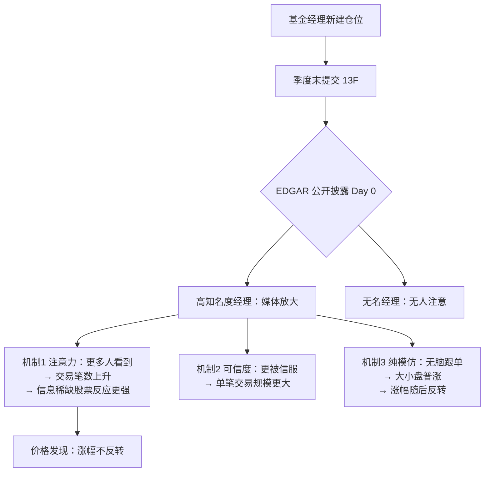

## TL;DR

明星基金经理披露新建仓真的能带动股价：2000–2025 年美股数据显示，最高知名度组（巴菲特、Icahn、Burry、Ackman、Peltz）披露后 5 天，被披露股票比"无名但同等水平"基金披露的多涨 2.3%，涨幅持续数月且不回调。涨幅几乎全部来自"注意力-信息"通道——明星自带流量，把散户注意力引向这些股票，沉睡的信息被重新定价；纯跟风解释不了"不反转"和"信息越稀缺涨幅越大"这两个事实。机械跟单的毛 alpha 看似诱人（21 天持有期日均 9.8bp），但计入披露日收盘价与交易成本后大概率不可交易。

## 论文信息卡

| 项目 | 内容 |
|---|---|
| 标题 | The Buffett Effect |
| 作者 | Pawel Robert Smolinski（格但斯克大学经济系）、Siddharth Saridevi（南加州大学 Marshall 商学院） |
| 发表渠道 | arXiv 工作论文 2610.17231，2026 年 10 月 12 日 |
| 研究对象 | 2000–2025 年美股 13F 持仓披露，48 家基金、32,785 个披露事件 |
| 原文链接 | https://arxiv.org/abs/2610.17231 |

## 背景：一个流传了几十年的市场传说

"巴菲特买了啥，跟着买就对了"——这句话在美股流传了几十年。美国证券法要求大机构每季度向 SEC 提交 13F 表格公开持仓，每到财报季，媒体就会逐字解读伯克希尔的 13F：巴菲特新建仓了哪只股票，散户就一拥而上。传说管这叫"巴菲特效应"。

但传说一直缺两样东西。第一，系统性证据：之前的研究要么只盯巴菲特一个人（Martin 和 Puthenpurackal 2008、Zhang 2022 都发现模仿巴菲特持仓历史上有利可图），要么研究"抄普通基金作业"（Frank 等 2004、Cao 等 2021）。没有人回答过最关键的问题：**市场反应的强度，到底和披露者的"名气"有没有关系？**第二，机制：就算真有超额收益，它是信息（明星的研究确实有含金量），还是纯粹的注意力泡沫？这两者的交易含义天差地别——前者是 alpha，后者是接盘侠的狂欢。

这篇论文就是冲着这两个空白去的：第一次把"投资者知名度"做成可度量的连续变量，用 25 年数据检验它和披露后股价反应的关系，并设计三组可证伪的预测来拆解机制。

## 方法拆解：怎么把"名气"变成可检验的变量

### 第一步：先圈定"披露自带信号"的基金

不是所有 13F 披露都值得研究。量化基金动辄持有上千只股票、每季度大换仓，它披露的某只新建仓基本不携带方向性观点；捐赠基金、养老金、主权基金的 13F 同理。论文用四条硬门槛筛选"主动选股型"基金：13F 历史不少于 12 个季度、最近 filing 距样本结束不超过 8 个季度、平均持仓不超过 100 只多头、平均每季度新建仓加清仓不超过 20 个，再人工剔除结构上不做主动选股的机构。留下来的，才是"披露=看多信号"的基金。

### 第二步：从 215 个维基词条里筛出 24 位明星

起点是英文维基"American hedge fund managers"分类下的 215 人（2026 年 5 月访问），两轮手工清洗：先去掉已故/退休的、非资管人士、匹配不到 13F 主体的；再过一遍主动选股筛选——这一步筛掉了绝大多数名人，因为名人们大多管的是量化、多策略或宏观大船：文艺复兴、Citadel、桥水、贝莱德、已转家族办公室的 Druckenmiller，全部出局。最终剩下 24 家，从巴菲特、Icahn、Burry、Ackman、Peltz，到 David Goel、Joon Yun 这种圈内有名、圈外无闻的经理。

### 第三步：给"名气"造一个指数

这是全文最巧妙的一步：用两个公开指标合成"投资者知名度指数"——经理英文维基页面 2015–2025 年的月均浏览量，加上 ProQuest 新闻数据库 2000–2025 年的新闻提及总数。两者取对数、标准化为 z 分数再平均，两个分量高度一致（Spearman 0.832）。巴菲特断层第一：z=2.33，月均 32.4 万次维基浏览、58.4 万次新闻提及；第二名 Icahn 的 z 只有 1.36。

### 第四步：找 24 个"无名双胞胎"做对照

光有名人组不够——披露后上涨可能只是"主动选股基金的披露本来就有信息含量"，跟名气无关。作者又找了 24 家真实存在的主动选股基金：集中、低换仓，但从没进过维基名人名单、没有任何公众知名度。用最优匹配按组合规模、集中度、存续期给每位明星配一个"双胞胎"，三组特征统计上都没有显著差异。这是全文因果推断的地基：**两组唯一系统性的差别，就是经理的公众知名度。**

### 第五步：双重差分事件研究

每个（基金，股票）对被标记为"新建仓"（看多披露）或"清仓"（对照事件），事件日为 EDGAR 实际提交日。核心指标是 Carhart 四因子调整后的累计异常收益 CAR；估计量是一个双重差分：先算同一家基金"新建仓相对清仓"的反应差，再算明星组相对对照组的反应差——这个交互项就是 disclosure premium（披露溢价）。主窗口取披露日及之后 1/3/5 天，事后看到 30 天，事前看 [-10,-1] 排查预趋势。

### 第六步：三种机制，各下可证伪的赌注

*图解：从建仓到披露再到价格反应的完整链条。关键分叉在披露日——知名度决定注意力，决定价格是否反应；三种机制对"笔数 vs 规模""信息稀缺 vs 充分""反转 vs 不反转"给出了互相排斥的预测。*

- **机制 1（注意力）**：名气降低了注意力的成本，更多人看到披露 → 预言：交易笔数上升，且在信息稀缺的股票（小市值、低流动性、分析师覆盖少）上效应更强。
- **机制 2（可信度）**：名气=过往业绩带来的信任加成 → 预言：单笔交易规模更大，笔数差异不大。
- **机制 3（纯模仿）**：羊群无脑跟单，与信息无关 → 预言：大小盘普涨，且涨幅一定会反转。

## 实验与数据：数字怎么说

### 主结果：披露溢价真实存在，且随名气单调上升

| 对比组 | CAR[0,1] | CAR[0,5] | CAR[0,10] | CAR[0,20] |
|---|---|---|---|---|
| 明星组 − 对照组 | +0.25%** | +0.42%** | +0.57%** | +0.78%* |
| 知名度前半 − 对照组 | +0.49%** | +0.87%** | +1.02%** | +1.06%* |
| 知名度后半 − 对照组 | −0.05% | +0.18% | +0.38% | +0.53% |
| 最高知名度组(z≥1) − 对照组 | +1.42%*** | +2.31%*** | +2.55%*** | +3.09%*** |

（Carhart 四因子 CAR，双重差分；*/**/*** 为 10%/5%/1% 显著。）

三点值得细看。第一，**效应只属于头部**：知名度后 12 名和对照组在任何窗口都没有显著差异——"有点小名气"和"完全无名"没区别，溢价是顶流专属。第二，**梯度连续**：24 家明星内部，知名度每高出一个组内标准差，两天 CAR 就多 +0.37%（p=0.005）。第三，**涨幅不回调**：披露后 20 天累计溢价越走越高——这是杀死"纯模仿"机制的关键证据。

### 机制裁决：注意力赢了，模仿输了

把最高知名度组的溢价按股票特征做中位数分组，结果一边倒地支持机制 1：信息越难获得的股票，披露带来的涨幅越大——接近翻倍。而纯模仿机制预言的"大小盘普涨"并没有出现。

| 股票特征分组 | CAR[0,1]：信息稀缺侧 | CAR[0,1]：信息充分侧 |
|---|---|---|
| 市值小 vs 大 | **+2.21%** | +1.10%（差异 p=0.009）|
| 非流动 vs 流动 | **+2.09%** | +1.10%（差异 p=0.048）|
| 分析师覆盖稀缺[0,5] | **+3.28%** | +1.72% |

交易层面的数据补上了另一块拼图：高知名度披露之后跟进的是**散户的模仿交易**，增加的是**交易笔数**而非单笔规模——这同时否定了机制 2（可信度应该推大单笔规模）和机制 3（纯模仿应该反转）。

### 跟单组合：alpha 真的存在，但别急着下单

作者还做了"机械跟单"组合：披露后第一个交易日买入新建仓股票、持有固定天数，日均 Carhart alpha 如下：

| 组合 | 持有 21 天 | 持有 63 天 | 持有 126 天 |
|---|---|---|---|
| 高知名度组买入 | +9.8bp/天*** | +4.4bp/天*** | +1.4bp |
| 对照组买入 | +0.3bp | +0.5bp | +0.8bp |
| 多空（高知名度−对照） | +10.4bp/天*** | +4.8bp/天*** | +0.8bp |

21 天多空 alpha 年化约 +26%，看起来极其诱人。但论文自己泼了三盆冷水：headline 数字里包含了**披露日收盘价本身的涨幅**，真实跟单者拿不到这个价，延迟一天入场后 63 天 alpha 只剩 +3.2bp/天；组合平均只持有约 10 只股票、每期全仓换手、且只在财报季有仓位；溢价恰恰集中在小市值、低流动性股票——交易成本最高的股票。毛 alpha 很可能被成本吃光：**这些 alpha 度量的是价格调整的持续性，而不是一个可执行的交易策略。**

## 相关工作对比

### 以前不是有人研究过"抄巴菲特"吗，有什么不一样？

之前的研究都是**单一个案**：只盯巴菲特一个人，无法检验"名气"本身。本文第一次把知名度做成连续变量，用 24+24 双重差分证明反应强度随知名度单调上升，且"半红"经理和无名经理没区别——效应是头部专属。

### 名嘴荐股、名人推文不也会让股价异动吗？

会，但性质完全不同。Cramer 在电视上推荐的股票隔夜大涨、随后**反转**（Engelberg 等 2012）；Musk 的加密推文、Trump 的推文也只有交易量效应、没有持续的价格效应。本文的关键区分正在于此：巴菲特效应**不反转**，涨幅持续数月。反转=泡沫，不反转=定价——这是区分"纯模仿"和"信息定价"的试金石。

### 13F 跟单策略早就被写烂了，还有 alpha 吗？

Frank 等（2004）发现抄普通基金披露长期能跑赢，听起来 alpha 早被挖光了。本文的补充很精准：跟单**无名基金**的披露 alpha 为零，alpha 只存在于最高知名度组——以前文献测到的可能是个混合平均数，把顶流的光环平均给了所有人。

## 局限与开放问题

- **效应由 5 个人驱动**：最高知名度组只有巴菲特、Icahn、Burry、Ackman、Peltz 五位经理，附录显示 Icahn 甚至不贡献溢价——有效样本很小，对样本选择敏感。
- **样本是"精制"的**：从维基名单到双胞胎匹配全是人工筛选，换规则名单会变；jackknife 和随机化推断虽通过，底子仍是 curated sample。
- **分不清"多少人跟"和"每人跟多少"**：交易数据看不到账户，触达人数和下注力度的干净分离需要账户级数据，作者自己承认这是开放问题。
- **headline alpha 不可交易**：计入披露日收盘收益、零成本假设，真实跟单者能拿到的要打对折再打对折。
- **只覆盖美股 13F**：A 股的龙虎榜、公募基金季报披露有没有类似的"顶流溢价"，是个现成的 follow-up 题目。

## 一点思考

"注意力是稀缺资源"这句话，在策略里第一次有了可交易的形状：信息本身不值钱，被注意到的信息才值钱——选股因子不妨加一个"披露注意力"维度，它和传统基本面因子的相关性大概率很低。但别急着写跟单程序：论文的毛 alpha 建立在披露日收盘价和零成本假设上，而真实世界里这两项恰恰是最贵的。对散户的启示则是反向的：当你因"巴菲特买了"而心动时，你大概率是注意力链条的最后一环——定价发生在披露后数周，你只是在为别人的先手提供流动性。

## 原文链接

- 摘要页：https://arxiv.org/abs/2610.17231
- PDF 全文：https://arxiv.org/pdf/2610.17231
