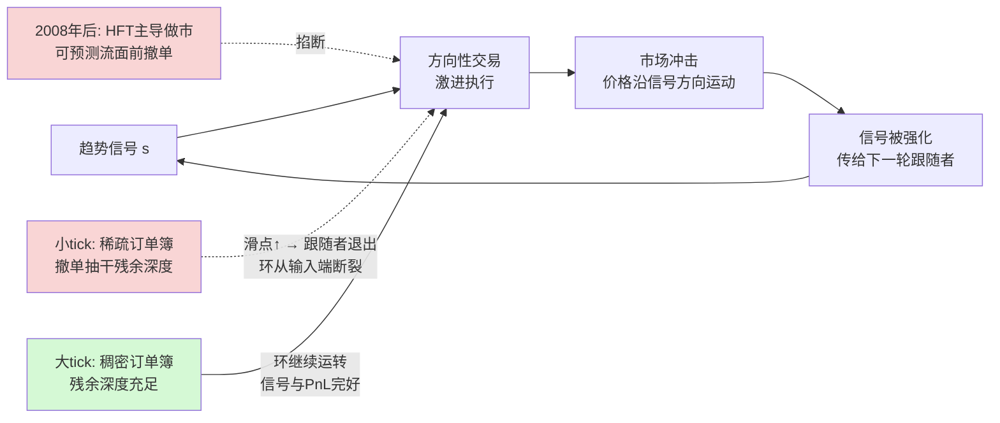

## TL;DR

趋势跟踪曾经是金融里最硬的异象之一：两百年里平均赚钱，横跨几乎所有流动市场。但 2008 年之后，短期趋势（几天到几周的信号）在大部分市场上停止工作，CTA 行业指数原地踏步了十五年。Bouchaud、Eisler 等人用约 100 只最流动的期货合约、1995–2025 年的日数据，加上 SG CTA 指数和行业 AUM 做对照，系统地检验了四个候选解释——容量拥挤、市场电子化、订单流结构变化、微观结构机制——前三个在时序、量级或截面上全部被证伪。真正的分界线是一个便宜到令人意外的变量：**波动率归一化的 tick 大小** $\Psi/\sigma$。2008 年后，小 tick 合约的趋势 PnL 在所有信号速度上**全部归零**（相对退化约 100%），大 tick 合约的趋势收益**基本完好**（Sharpe 1.0–1.2，退化 0–30%），资产类别和流动性都做不出这个二分。机制是：2008 年后做市从"扛库存的老派做市商"切换成"日内平仓的 HFT 做市商"，后者在可预测的方向性流面前系统性撤单；撤单在稀疏的小 tick 订单簿上是致命的——残余深度被抽干，趋势跟踪者要么"走穿整个 book"付出巨额滑点，要么直接退出；退出之后，**信号本身也死了**，因为趋势的存在就依赖于"信号→方向性交易→市场冲击→信号被强化"的自循环。限价单不是出路：被动执行既要付错失机会成本，又放弃了冲击强化通道。结论是结构性的：除非流动性供给发生结构性变化，否则不会自愈。

> 📄 论文：*Is Trend Still Your Friend?: A Microstructural Account of the Demise of Short-Term Trend-Following*
> 👤 作者：Jutta G. Kurth（Institut Louis Bachelier Econophysics Lab；École polytechnique LadHyX）、Zoltan Eisler（Imperial College London 数学系）、Adam Rej（Capital Fund Management）、Jean-Philippe Bouchaud（Institut Louis Bachelier；Capital Fund Management；法国科学院）
> 📅 arXiv 2607.01550，2026 年 7 月 2 日（Trading and Market Microstructure / q-fin.TR）
> 🔗 [arXiv 摘要页](https://arxiv.org/abs/2607.01550) · [HTML 全文](https://arxiv.org/html/2607.01550)

## 背景：最硬的异象，十五年的熄火

趋势（momentum / trend following）是金融实证里生命力最强的异象：过去赢家继续跑赢过去输家，直接违背有效市场假说的"显而易见的信息（过去的价格）早该被定价"的断言，但证据横跨几乎所有流动市场、往回看至少两百年（Lempérière 等，2014；Hurst 等，2017）。Moskowitz 等（2012）在 58 个工具、三个半十年的样本上记录了"time-series momentum"；Jegadeesh-Titman（1993）的股票截面动量更是教科书级。CTA 行业从 70–80 年代起商业化这套方法，到 90 年代收敛成标准配方：**头寸正比于"快均线减慢均线"，按波动率归一，分散到尽可能多的流动期货上。**

然后大约在 2008/09 年，画风变了。行业基准 SG CTA 指数在 2000–2010 年稳步上行之后，**整整十五年基本持平甚至为负**，只靠 2014 年和 Covid 期间两次宏观驱动的脉冲续命。论文用自建的高分辨率代理复刻了同一幅图，并提炼出四个约束任何解释都必须满足的"风格化事实"：① 断裂是**突变**的，像结构性机制切换，不像 alpha 渐进衰减；② **速度依赖**：几天到几周的快信号死得最惨，慢信号大体完好；③ **资产类别异质**：股指和外汇的趋势基本消失，国债和大宗商品（在他们的样本里）几乎不受影响；④ **没有恢复**：2018 年之后流动性明显改善、CTA 参与度下降，趋势 PnL 依然没有回来。

理解这篇论文的关键，是先接受作者的组织视角：**趋势首先是一个自实现的反馈环，而不是一个静态的统计异象**。信号触发方向性交易，交易的市场冲击把价格推向信号方向，信号因此被强化、传给下一轮跟随者。趋势的"存在"和"可赚钱"是同一枚硬币的两面——都要求跟随者能以合理成本激进执行，让冲击把交易变成价格、把价格变成新信号（这个视角在 ETF 语境下由 Van der Beck 等 2024 年精确化，更早可追溯到 De Long 等 1990 年的正反馈模型）。任何掐断这个环的东西——把执行成本抬到离场点，或者改变"激进流→价格"的关系——都会同时攻击收益和信号强度。而这正是全文的阅读透镜。

## 方法拆解：从信号定义到 tick 分层

**第一步：搭数据与信号。** 样本是约 100 个最流动的期货合约，日结算价，1995–2025，四个板块：大宗商品（CMD）、股指（IDX）、外汇（FXR）、国债/利率（YLD）。信号是业界标准配方 EWM-$\tau$-$4\tau$：未归一化信号 $\tilde{s}_{i}^{\tau}(t)=\langle p_{i}(t-1)\rangle_{\tau}-\langle p_{i}(t-1)\rangle_{4\tau}$（快慢指数移动平均之差），再除以它自身的指数加权移动标准差（窗口 $16\tau$）得到无量纲信号，最后在 $\pm 2$ 个标准差处截断。$\tau \in \{5,10,20,50\}$ 天，覆盖快到慢。

**第二步：两种组合 + 一个行业代理。** Type 1 是等风险组合 $\pi_{i}^{\tau}(t)=s_{i}^{\tau}(t)/\sigma_{i}(t)$；Type 2 是流动性加权 $\pi_{i}^{\tau}(t)=s_{i}^{\tau}(t)\,l_{i}(t)/(\sigma_{i}(t)\,L(t))$，其中流动性 $l_i$ 是 250 天 EWMA 的（剔除隐含交易的）成交量乘波动率——把组合放大到 CTA 行业体量时必须考虑冲击成本，流动性差的产品没法同等加仓。为了对标真实行业，作者按 BarclayHedge 的 CTA 行业 AUM $S^{\text{CTA}}(t)$ 做缩放，年化风险定在约 12%（从 SG CTA 指数反推）。算出来的**日参与率中位数约 0.9%**，和 Quantica Capital（2022）、Lorenzen 等（2025）的独立估计（CTA 行业占期货成交不到 1%）吻合——这个外部验证让后面的"容量证伪"很有底气。

**第三步：证伪 H1–H3 的三套检验。** 容量（H1）用平方根冲击律做量级测算：1% 参与率、约 9% 日换手率下，年化 Sharpe 拖累只有约 0.1，远不够解释 0.7→0 的塌陷；更狠的是**零延迟执行检验**——假设头寸能在信号当天的收盘价成交（机械地消掉一整天的冲击成本），2008 年后依然平直，说明死的不是"收成"而是"信号本身"。电子化（H2）用 CME 各板块电子成交占比的时间序列对照：电子化是渐进的，断裂是突变的；板块时序也对不上（股票电子化比断裂早五年以上，外汇大致同期，利率期货电子化早却没死）。订单流（H3）用 5 分钟 bar 上的 book/trade 不平衡指标 $I^{\text{book}}$、$I^{\text{trade}}$，看它们和 CTA 头寸变化 $\Delta\pi^{\text{CTA}}$ 的相关性：2010 年前后 book 不平衡相关性确实变号了（快信号），但按资产类拆开后处处是反例——商品的相关性剧烈变号但 PnL 毫发无损，股指是反向模式但同样死亡。

**第四步：tick 分层——全文的核心操作。** 对每个合约 $i$、每个月 $m$，定义平均 tick-波动率比 $\bar{\rho}_{i,m}=\frac{1}{D_{m}}\sum_{t}\Psi_{i}(t)/\sigma_{i}(t)$（$\Psi$ 是合约 tick 大小，$\sigma$ 是日波动率估计），每月按 $\bar{\rho}$ 排名做中位数二分：下半是小 tick（ST），上半是大 tick（LT）。分层是**因果式**的（只用当月及之前信息），合约在样本里很少跨层。注意 ST/LT 指 tick 大小，不是"短/长趋势"。

## 实验与数据：tick 大小把市场切成两半

**断裂的基准线。** EWM-5-20 的累积 PnL 从 2009 年起基本走平（回测甚至可以拉到 1950 年），5 年滚动 Sharpe 从历史 1–2.5 的区间塌到 2010 年后**统计上和零无异**。速度依赖极其干净（表 1）：2009 年前 Sharpe 随 $\tau$ 单调递减（$\tau$=5 时 0.84±0.27，$\tau$=50 时 0.70±0.27）；2009 年后排序**反转**，最快的信号塌到 0.12±0.24，最慢的还有 0.40±0.26。按资产类拆：IDX 和 FXR 的趋势基本消失，YLD 和 CMD 没有可察觉的退化。

**核心结果：tick 二分。** 按月度 tick 分层后，快信号在小 tick 合约上的 PnL 在 2008 年后**彻底归零**——而且是在所有信号速度上一致成立；大 tick 合约的累积 PnL 几乎不受断裂影响，继续按断裂前的斜率累积，连最高频的信号都完好。量化下来：断裂前等风险组合的 Sharpe，ST 约 0.8、LT 约 1.4；断裂后 ST 塌到零附近（最快信号轻微为负），LT 还在 1.0–1.2。**相对退化幅度：ST 约 100%，LT 只有 0–30%。** 流动性加权组合（Type 2）结论定性相同，说明这不是等权重的假象。

**为什么不是流动性和资产类别？** 自然的怀疑是 tick 只是流动性的代理（两者 log-log 相关 -0.35±0.08，且圈内人都知道"趋势在流动性差的产品上还管用"）。但按流动性分层**切不出**这个二分：流动性分层的 PnL 在不同速度上不一致，不是所有流动合约的快信号都死了，高/低流动性子组合之间也没有干净排序。结论很硬：**tick 大小——而不是流动性、资产类别或电子化时点——是解释趋势存活的最佳截面变量**。之前看到的资产类别异质性，在这个视角下只是下游症状：IDX 和 FXR 扎堆在小 tick 层，YLD 和大部分 CMD 扎堆在大 tick 层。

**两处合约内验证，把机制钉死。** 第一，按合约内波动率高低分层（因果式、按合约按年中位数）：小 tick 合约在**低波动期**的表现像大 tick 合约一样继续赚钱——正是 LeBaron 效应，也正是 $\Psi/\sigma$（而不是 $\Psi$ 本身）才是操作变量的机械预测：波动率下来，tick-波动率比上去，小 tick 合约在微观结构上"变成"了大 tick 合约。第二，按日收益大小分层：断裂**只发生在大幅度收益日**（>1σ），小于 1σ 的小日子对 PnL 的贡献在断裂前后基本不变。死掉的不是"小碎步"，恰恰是"大行情"——也就是旧机制下本该由扛库存做市商吸收的那部分方向性大波动。

**订单簿旋转：撤单的指纹。** 把 H3 的订单流诊断按 tick 分层重做（图 12）：大 tick 合约上，快信号的 $\text{Corr}(\Delta\pi^{\text{CTA}},I^{\text{book}})$ 从 2010 年前的约 -3%/年（book 厚在趋势同侧：$\Delta\pi>0$ 的买入日 $V^{\text{ask}}>V^{\text{bid}}$，流动性供给给趋势跟随者）翻转为之后的约 +4%/年（$V^{\text{ask}}<V^{\text{bid}}$，**book 旋转到了趋势的反侧**）；小 tick 合约上相关性一直为正，2010 年后量级还变大了——本来就不厚的同侧深度变得更浅。

**冲击曲线压平：成本搬家了。** 图 14 把 5 分钟归一化收益对同期 book 不平衡做分箱回归：2011 年前小 tick 曲线陡峭为负——这是**逆向选择**的形状，挂在 bid 上的限价单大概率以高于 bar 收盘的价格成交，做市商在付库存成本；2011 年后这条曲线几乎**压平成零**。作者的解读很漂亮：这就是撤单的机械指纹——以前会被激进趋势流"碾过"的深度，现在根本不会在 book 里停留足够久以进入不平衡统计。**成本没有消失，它从做市商的库存搬到了趋势跟随者的滑点上。** 而大 tick 的曲线一直为负：价差足够宽，做市商即使被逆向选择吃掉一块，整体还是赚钱的，所以深度留得住。

**限价单不是出路（6.4 节，实践者必读）。** 快趋势跟随者能不能改用被动限价单绕开小 tick 约束？作者给了两个互相加强的否定理由：(a) 对趋势跟随者，被动执行的主成本不是通常意义的逆向选择，而是**错失机会成本**——信号越准，被动买单越是"该填的时候填不上（价格沿信号方向跑了）、不该填的时候被砸中（价格穿过它下跌）"，省下的滑点会变成隐形的踏空；(b) 更深层的原因：被动单**不贡献** $I^{\text{trade}}$ 方向的冲击，不喂给自强化通道——用限价单等于亲手掐断自己赖以生存的环。激进执行被小 tick book 的稀薄卡死，被动执行既贵又自断通道：**2008 年后的小 tick 断裂是结构性的，不是执行实现方式的人为假象。**

## 相关工作对比：站在五条文献的交叉口

**趋势实证线**：Lempérière 等（2014）的两百年证据、Moskowitz 等（2012）的时序动量、Hurst 等（2017）——本文是这条线的"死亡证明 + 验尸报告"，把描述性统计推进到了可证伪的机制解释。

**正反馈/冲击线**：De Long 等（1990，噪声交易者正反馈）、Van der Beck 等（2024，ETF 语境下的自实现精确化）、Patzelt & Bouchaud（2018）——本文把"冲击→信号强化"写成了截面预测：环断不断，取决于 book 几何。

**容量线**：Volpati 等（2020）、Quantica Capital（2025）——本文用四项证据系统证伪：AUM 时序反了（2012 年 plateau、2022 年见顶，都在 PnL 走平之后）、2018 年后流动性改善无恢复、平方根冲击测算的量级不够（~0.1 vs ~0.7）、零延迟执行下信号本身已死。作者也诚实地承认 Quantica 的原文并没有主张全行业容量解释断裂，并保留了"大 AUM 下被迫集中到最流动商品、侵蚀分散化收益"作为次要并存效应。

**HFT/做市线**：Kirilenko 等（2017）、Menkveld（2013）、Hendershott & Riordan（2013）记录 HFT 做市的日内平仓模式；Korajczyk & Murphy（2019）、Van Kervel & Menkveld（2019）记录 HFT 在大机构单面前的撤单——本文把这批文献的"撤单"观察第一次接到了趋势死亡的因果链上。

**行为金融替代机制**：Hong & Stein（1999）、Daniel 等（1998）、Bouchaud 等（2019）的渐进信息吸收，Hong 等（2000）的异质信息扩散——作者明确不 claim 冲击环是唯一机制，承认这些通道共存（信息扩散播种趋势、冲击环放大趋势），并在附录 D 拿出直接证据：预期型交易（提前布局大行情）那个通道本身也在相近时点衰减了。论文的解读是冲击环成分在小 tick 上被不成比例地削弱，而不是其他机制不存在。

## 局限与开放问题

- **机制证据是间接的**：全文没有 HFT 库存或逐笔撤单的直接数据，"撤单"是 book 旋转 + 冲击曲线压平推出来的推断，作者自己把"用 HFT 库存数据围绕 CTA 大调仓事件做直接检验"列为首要开放问题。
- **样本边界**：全是电子化交易所的期货，股票现货、OTC 市场的结论外推未知；约 100 只合约的截面不算大。
- **分层阈值粗糙**：中位数二分是粗操作，但附录 F 在资产类内部再做 tick 分层后结论不变，说明依赖近似单调而非某个神奇阈值。
- **身份 vs 行为没区分**：到底是"换了一批从来不吃方向流的 HFT 新玩家"，还是"老玩家在 2008 年库存亏损后收紧了风险偏好"，论文说两者都可能、论证不依赖区分——但这对监管含义很关键。
- **各机制的权重没定量**：冲击环 vs 信息扩散 vs 预期交易各占趋势的多少，论文没有给数字，附录 D 的证据是定性的。
- **可挖的方向**：HFT 参与度门槛之下的微观结构缝隙（"趋势的避难所"）是否存在；tick 机制切换的市场是天然实验场；同一机制是否在打击其他产生可预测方向流的系统化策略、反向吃这种流的策略是否拿到了对称的顺风。

## 一点思考

这篇论文最值钱的不是"趋势死了"这个标题党结论——慢信号和大 tick 上的趋势活得好好的，死的是特定微观结构下的快趋势。它真正交付的是一个**可操作的变量**：$\Psi/\sigma$。对策略的启发很直接：先给自己的合约池按 tick-波动率比分层，小 tick 上的快信号在样本外验证之前一律视为已死；容量估计必须按 tick 分层重做，总体 0.9% 的参与率在小 tick 子集里可能早就撞墙。对风控的启发是：别再盯着"拥挤度"这种总量指标，**结构比总量重要**。我的判断：**趋势没有死，它只是搬家了**——从稀疏的 book 搬到稠密的 book，从快信号搬到慢信号，从"谁都能做的 beta"变成"挑对战场的 alpha"。还在小 tick 上跑短趋势的 CTA，亏的不是运气，是机制。

## 原文链接

- arXiv 摘要页：https://arxiv.org/abs/2607.01550
- HTML 全文：https://arxiv.org/html/2607.01550
- 数据：约 100 只流动期货日结算价（1995–2025）、SG CTA 指数（2000–2025，Société Générale Prime Services & Clearing）、BarclayHedge CTA 行业 AUM；订单流诊断用 5 分钟成交量加权 bar
