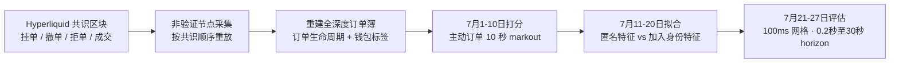

## TL;DR

传统订单簿预测只看市场整体在做什么：买卖盘失衡、订单流失衡、近期波动。这篇论文问了一个更直接的问题：如果我们知道“是谁”在下单，预测会不会更好？在去中心化永续合约交易所 Hyperliquid 上，答案是肯定的——因为它的 Level-4 数据公开了每个订单背后的钱包地址。作者先用 7 月 1–10 日的主动订单十秒 markout 给钱包打分，再看这批高分钱包在 7 月 21–27 日的活动能否改进预测：1 秒 horizon 上，岭回归的样本外 $R^2$ 从 10.88% 升到 12.31%，相对提升 13.2%；梯度提升树也从 19.48% 升到 20.65%。关键在于，这份增量通过了 200 个按规模与活跃度匹配的安慰剂组合对照，仍高出最好安慰剂约六成，说明它不只是“大钱包比较活跃”带来的假象。但作者也坦承，这只是相对于一个文献基准的预测增量，不是可执行的盈利策略，更不是对内幕信息的认定。

## 论文信息卡

- **标题**：Beyond Anonymous Order Flow: Wallet Identity as a Feature for Short-Horizon Return Prediction（匿名订单流之外：钱包身份作为短期收益预测特征）
- **作者**：Jingqiu Ding（苏黎世联邦理工学院）、Daojing Zhai（纽约市立大学巴鲁克学院）
- **发表渠道**：arXiv 预印本，q-fin.TR / q-fin.ST，2026 年 11 月 3 日提交
- **原文链接**：https://arxiv.org/abs/2611.05218

## 背景

短期收益预测是市场微观结构里最成熟、也最拥挤的方向之一。Cont 等人的订单流失衡、Kolm 等人的深度订单流模型都证明：盘口的买卖失衡、成交的方向与规模，确实能在几秒、几十秒内预测价格的下一步。但这些模型都有一个共同的盲点：它们把订单流加总成市场的整体画像，却丢掉了“谁下的单”。

从交易理论看，这个丢弃并不无辜。Bagehot、Kyle、Glosten 与 Milgrom 的经典逆向选择模型早就指出，对手方不是同质的：有些交易者下单是因为掌握了信息，有些只是为了对冲库存或执行既定计划。做市商亏钱，往往就亏在接了前一类人的单上。问题在于，传统交易所的公开行情不暴露账户，账户层面的研究只能靠券商、监管或交易所内部数据完成，普通研究者复现不了。Hyperliquid 改变了这个约束：它是一个带中央限价订单簿的去中心化永续合约交易所，共识排序的区块里记录了每一次挂单、撤单、拒单与成交，以及背后的钱包地址。钱包是假名，不是法律身份，一个实体可以控制多个钱包，一个钱包也可能聚合多个主体，但作为行为标识，它足够稳定、足够公开。

这正是这篇论文的切入点：把预测的单位从“市场”下沉到“钱包”，检验钱包历史是否包含匿名盘口没有的信息。

## 方法拆解

### 第一步：重建一本带钱包标签的订单簿

作者通过一个非验证节点持续采集 Hyperliquid 的共识事件，再按共识顺序重放，逐笔重建全深度订单簿，并把每个订单、每笔成交与钱包地址配对。7 月 1–27 日的样本覆盖十个最活跃的永续市场，共 171 亿条消息、1430 万笔主动订单、147,113 个钱包、843 亿美元主动成交名义金额；建模只用其中消息量最大的三个市场——BTC、ETH、SOL，其中 BTC 一个市场就占了 468 亿美元。

重建质量是这类论文的生死线，作者交代了三道校验：2790 万笔交叉成交全部能与做市方记录配对，零 unmatched；把 7 月 12 日单独从空簿重放，与连续重放相比，132 万个可比区块里 99.994% 的买卖价、中间价与价差完全一致；还有一道十秒预言机门——重建中间价必须连续十二个十秒 tick 都在预言机中间价 25 个基点以内才放行，门关闭时间占全部币种时间的 0.97%，评估窗口内为 1.83%。作者也诚实地指出，这道门是粗粒度校验：25 个基点的容忍度比要研究的 markout 效应本身还大，中间价对得上不代表每个挂单都对。

时间口径同样关键。Hyperliquid 的区块按共识时间到达，间隔并不均匀：2270 万个区块间隔的中位数是 67.6 毫秒，90 分位数 93.6 毫秒，91.3% 不超过 100 毫秒。作者因此不用“下一个区块”这种不规则 horizon，而是把所有特征与目标都对齐到 100 毫秒的固定日历网格上——状态变量取网格时刻前最新已提交区块的收盘值，流量变量汇总上一个完整 100 毫秒区间，杜绝未来事件漏进特征。


*图：共识区块与区块间隔分布。(a) 2026 年 7 月 15 日连续四个 BTC 区块的事件构成；(b) 全部 2270 万个区块间隔的累积分布，中位数 67.6 毫秒，91.3% 不超过 100 毫秒（来源：论文原文）*



### 第二步：用十秒 markout 给钱包打分

打分只用主动订单——也就是主动穿过价差、要求立即成交的单子。理论上，这类单子最能暴露交易者的方向性判断。单笔订单 $e$ 的十秒 markout 定义为：

$$x_{e}=10^{4}\,q_{e}\,\frac{m_{t_{e}+10s}-m_{t_{e}^{-}}}{m_{t_{e}^{-}}}$$

其中 $q_e$ 为方向（买 +1、卖 -1），$m_{t_e^-}$ 为事件区块之前最后一个区块收盘时的中间价，$m_{t_e+10s}$ 为十秒后最新已提交区块的中间价。markout 为正，意味着十秒后中间价朝着主动交易者的方向移动了——做市商接了这单，十秒后就处于浮亏。

钱包分数是它在 7 月 1–10 日所有合格主动订单的按名义金额加权平均 markout：

$$\alpha_{w}=\frac{\sum_{e\in w}n_{e}\,x_{e}}{\sum_{e\in w}n_{e}}$$

只统计至少下了 100 笔合格主动订单的钱包，排除 TWAP 子单与清算事件，最终得到 2,314 个被打分钱包；分数最高的 10%（231 个）构成核心的“毒性组合”，最高的 20%（462 个）作为备选尾部切分。作者刻意把“毒性”限定为描述性标签：它只表示 markout 异质性，不等于认定某个钱包是单一交易者，更不等于认定它掌握内幕信息。

### 第三步：匿名基准 vs 身份增强，做受控对比

预测实验的设计干净而克制：匿名模型与身份增强模型看到的是同一条公开行情，唯一差别是后者多了一组变量。匿名组是文献里的标准十变量：最优报价深度失衡、5 个基点内的近触深度失衡、1 秒与 30 秒的报价更新订单流失衡、最新一笔成交方向、1 秒与 30 秒主动成交名义金额、前 1 分钟收益率、1 分钟已实现波动与报价价差。身份组把其中可配对的七个变量换成“毒性组合专属版”，再加四个没有匿名对应物的变量：1 秒与 30 秒内毒性组合买卖方去重钱包数之差（买方广度）、毒性组合在最优报价深度的份额、以及它对最优报价失衡的贡献。

两种学习器用同一套特征定义：岭回归配三个不惩罚的币种截距，惩罚系数在 7 月 12–20 日九个扩展折里按日验证均方误差之和选出；LightGBM 用学习率 0.05、127 个叶子、每叶至少 5000 个样本、特征采样 0.9、每轮 bagging 0.8、最多 2000 轮、50 轮早停，1 秒模型在匿名组停于 192 棵树、完整模型停于 415 棵树。目标是未来中间价收益率，$R^2$ 按相对零预测的平方误差定义，统计推断用七个评估日的成对日均方误差差分，$t$ 值因此只是描述性的。

## 实验与数据

### 钱包排名真的能跨窗口存活吗

先回答第一个问题：打分是不是一次性的运气。在 7 月 1–10 日与 7 月 11–20 日两个窗口都达到 100 单门槛的 965 个钱包里，排名的 Spearman 相关系数是 0.52。把每个窗口按奇偶日拆半重打分，拆半相关系数为 0.52 与 0.48，按 Spearman–Brown 公式折算的完整窗口信度基准约 0.68 与 0.65——跨窗口 0.52 大约是这个基准几何均值的 78%，作者提醒这只是启发式换算，不是严格的信度上限。

更重要的是，排名的经济含量集中在尾部。控制市场、时间、订单规模、波动与价差后，验证窗口的调整后 markout 在前十五个二十分位基本平坦，到第二十个二十分位突然跳升到 3.11 个基点。按十分位看，D10 的验证 markout 为 2.20 个基点，D9 为 1.09 个基点，D8 及以下全部在 0.60 个基点以下。也就是说，预测价值不在“全体钱包的连续排名”里，而在“最毒的那一小撮”里，这也正是预测实验只跟踪前 10% 的原因。


*图：钱包毒性的持续性与期限结构。(a) 打分窗口对验证窗口的钱包分数；(b) 按打分窗口二十分位分组的验证期调整后 markout，顶部二十分位跳升至 3.11 个基点；(c) 各十分位的 markout 随期限变化，D10 持续走高而不反转（来源：论文原文）*

这种毒性也不是一闪而过的价格冲击。D10 的 markout 从 0.5 秒时的约 1.25 个基点升到 10 秒时的 2.11 个基点，到 5 分钟仍保持高位；D9 从约 0.65 个基点升到 1.2 个基点；D1–D8 的其余部分与按既定时间表执行的 TWAP 子单一道，始终贴近零。如果只是主动单子自己把价格短暂推开，markout 应该很快反转，而不是这样一路走高再维持。持续性还有另一个支撑：231 个毒性组合钱包里 91.3% 在验证窗口继续交易，是所有十分位里续存率最高的；单是这个组合就占了打分窗口 31.0%、验证窗口 25.1% 的自主主动成交名义金额。

一个自然的质疑是跨市场套利：这些钱包会不会只是比 Hyperliquid 更快地反应了其他市场的价格？数据给出相反迹象：毒性组合的订单只有 41.3% 落在外部预言机缺口的一侧，低于最底层十分位的 57.9%；加入预言机缺口控制后，D10 与 D1 的日均 markout 差只从 1.72 微移到 1.75 个基点；在缺口不超过 1 个基点的子样本里，D10 仍有 2.12 个基点、D1 只有 0.16 个基点。不过预言机每十秒才采样一次，亚秒级的跨市场套利并不能被这组控制排除。

### 身份特征到底加了多少预测力

主结果见下表（评估窗口 7 月 21–27 日，三个模型市场，100 毫秒网格）：

| Horizon | 岭回归：匿名 $R^2$ | 岭回归：+身份 | 相对提升 | 梯度提升树：匿名 $R^2$ | 梯度提升树：+身份 | 相对提升 |
| --- | --- | --- | --- | --- | --- | --- |
| 0.2 秒 | 6.91% | 8.20% | +18.7% | 19.26% | 21.32% | +10.7% |
| 0.5 秒 | 10.16% | 11.76% | +15.8% | 21.00% | 22.94% | +9.2% |
| 1 秒 | 10.88% | 12.31% | +13.2% | 19.48% | 20.65% | +6.0% |
| 2 秒 | 10.60% | 11.66% | +10.0% | 16.35% | 17.04% | +4.2% |
| 5 秒 | 9.17% | 9.79% | +6.7% | 12.00% | 12.36% | +3.0% |
| 10 秒 | 7.18% | 7.56% | +5.2% | 8.55% | 8.76% | +2.5% |
| 30 秒 | 3.56% | 3.67% | +3.0% | 3.74% | 3.84% | +2.7% |


*图：样本外 R² 随期限的变化，岭回归与梯度提升树。阴影为前 10% 钱包身份特征相对匿名基准的增量，增量在 0.2–1 秒最大、随期限拉长而衰减（来源：论文原文）*

有几个细节值得单独拎出来。第一，只用身份特征、不看匿名特征，1 秒 $R^2$ 就有 10.06%，接近匿名组 10.88% 的水平——只盯着 231 个钱包的活动，几乎就能复现整个市场的短期预测力。第二，身份增量随 horizon 衰减得非常干净：岭回归相对提升从 0.2 秒的 18.7% 一路降到 30 秒的 3.0%，树模型从 10.7% 降到 2.7%，符合“毒性信息进场后迅速被市场消化”的直觉，也与 Kolm 等人关于订单簿预测有效期只有约两次平均价格变动的结论一致。第三，把组合从前 10% 放宽到前 20%，1 秒岭回归相对提升几乎不变（13.1%），说明尾部之外的钱包加进来并无额外信息。第四，整体拟合呈轻微驼峰：$R^2$ 在 0.5–1 秒见顶，之后随 horizon 拉长而下降，30 秒之后作者不再报告，因为匿名 $R^2$ 已跌向 2%，相对提升的分母太小、失去可比性。

```mermaid
flowchart LR
    subgraph 岭回归 1 秒 R²
        A1[匿名 10.88%] --> B1[+ 身份 12.31%<br/>+13.2% · t=9.2]
    end
    subgraph 梯度提升树 1 秒 R²
        A2[匿名 19.48%] --> B2[+ 身份 20.65%<br/>+6.0% · t=5.0]
    end
    B1 --> C[身份单用已达 10.06%<br/>接近匿名组水平]
```

增量来自哪里？逐变量剔除的描述性分解给出了一个有趣的答案：匿名组里最大的变量是近触深度失衡，单独贡献 1.93 个百分点；加入身份特征后，它骤降到 0.24 个百分点，而报价更新订单流失衡从 1.64 降到 1.25、最优报价失衡从 1.03 降到 0.27。身份一侧的贡献则集中在毒性组合的 1 秒报价更新订单流（0.67 个百分点）与去重买方广度（0.37 个百分点）上，后者是匿名组完全没有的维度。作者的解读很克制：两组特征大体重叠，身份很可能只是同一股订单流的低噪声读数，而不是一条全新的信息渠道——只不过这个读数恰好更准。

### 安慰剂与延迟：增量经得起“只是更大更活跃”的质疑吗

最强的对照是 200 个安慰剂组合：从非毒性钱包里按打分窗口名义金额与订单数的十分位交叉匹配，逐一重建全部十一个身份变量，跑同一套评估——这一步重建了 51 个币种日的 4400 万个网格点、88 亿个组合观测，来自 126GB 的逐钱包报价带。结果是，1 秒岭回归里毒性组合的增量为 1.43 个百分点，而 200 个安慰剂里最好的只有 0.88 个百分点，毒性组合是其 1.6 倍、安慰剂最好成绩只达到真实增量的 61%；毒性组合在 10 秒以内的每个 horizon 都超过全部安慰剂，30 秒时前 10% 才落入安慰剂区间（前 20% 仍全部超过）。由于捐赠钱包不足，安慰剂组合的规模略小于毒性组合，这组比较是描述性的，不是等规模随机化检验，但方向很明确：只按规模与活跃度复制一个组合，复制不出这份预测力。


*图：毒性组合的身份增量与 200 个按规模与活跃度匹配的安慰剂组合的最大增量对比。10 秒以内毒性组合在每个期限都超过全部安慰剂（来源：论文原文）*

延迟测试同样支持增量比基准更“耐延迟”：把全部特征统一后移 200 毫秒、300 毫秒后，1 秒岭回归相对提升从 13.2% 分别降到 10.2% 与 9.1%，树模型从 6.0% 降到 4.5% 与 4.0%；而 300 毫秒延迟下匿名组 $R^2$ 本身从 10.88% 跌到 6.40%（岭回归）、从 19.48% 跌到 9.64%（树模型）。不过作者同样划清界限：这只是按共识时间戳做的模拟延迟，没有审计交易者本地实际收到行情的时间，不能证明这些状态在实盘里真的可用。

2025 年 12 月的早期样本提供了一个半独立的复现：263 亿条消息、2190 万笔主动成交、89800 个钱包，按同样的 12 月 1–10 日打分、11–20 日拟合、21–31 日评估，排名持续性为 0.47，1 秒岭回归 $R^2$ 从 12.36% 升到 14.16%，相对提升 14.6%。但这个复现是条件性的：去掉近触波动缩放后，增量变成 -1.17 个百分点；且缩放后的 12 月汇总没有经过端到端审计，作者明确说，在把它当作完全验证的复现之前，还需要一次新的面板到输出的审计。

## 相关工作对比

这篇论文的创新不在于发明了 markout、订单流失衡或 $R^2$ 对比——这些工具都来自文献。它的创新在于把三样东西第一次拼在了一起：公开的钱包级 Level-4 数据、跨窗口的钱包打分、以及与匿名基准严格对齐的受控预测对比。

与传统匿名预测模型（Cont 等、Sirignano 与 Cont、Kolm 等）相比，本文不是在匿名特征上加一层更深的网络，而是换了一个观测单位：从“市场在做什么”换成“哪批钱包在做什么”。与账户层面的经典研究（Kirilenko 等对闪崩的研究、Baron 等对高频交易者风险收益的研究、Barbon 等关于经纪商订单流泄漏的研究）相比，本文的标识符是任何人都能在公开行情里看到的，而不是只有券商或监管者才能拿到的内部数据——这让“身份”从一个特权变量变成了一个可复现的公开特征。与同一批 Hyperliquid Level-4 文献相比，Albers 等人介绍了这套数据、证明了拒单也能预测收益，Barone 与 Lillo 研究了公开执行意图如何降低交易成本，本文则补上了最直接的一块：钱包历史本身的预测增量。Cartea 等人 2026 年关于“毒性流检测”的工作与本文的打分思想最接近，但本文的落点是预测而非检测，且把对照做到了安慰剂组合的粒度。

反过来也要看到，本文的基准是作者自述的“基于文献的、非最大化的匿名基准”。如果匿名组也用上多层深度、撤单、拒单强度、跨市场变量——尤其是 Albers 等人已经证明有效的拒单特征——身份增量很可能缩小。论文的结论因此应准确表述为“相对于这个匿名特征集的增量”，而不是“身份超越一切匿名信息的证明”。

## 局限与开放问题

- **回顾性设定选择**：前 10% 的尾部切分、近触波动缩放、7 月评估窗口的选择，都是在看到结果之后定下来的。时间顺序上的训练/测试分离能防止直接拟合未来目标，但消除不了设定选择带来的乐观偏差。
- **只有七个评估日**：所有 $t$ 值都来自七个日度差分，日与日之间的依赖未被完全处理，且多重比较没有校正，$t$ 值只能作描述性参考。
- **数据缺口与陈旧状态**：预测网格在数据缺口与预言机门关闭期间沿用上一个已放行状态，没有做 markout 那样的时效筛除；7 月 25 日有 16 个区块的缺口、7 月 27 日有 28326 个区块的缺口，去掉这两天重算后 1 秒 $R^2$ 变为岭回归 11.72%→13.18%、树模型 19.75%→20.90%，方向不变，但完整的缺口掩码重跑仍未完成。
- **共识时间不等于收到时间**：全部时间戳都是链上共识时间，没有审计交易者本地实际收到行情的时刻，延迟测试不能替代端到端的可用性审计；评估在 7 月 27 日结束，是因为采集器退化、7 月 28 日失效，这个窗口选择本身也是事后作出的。
- **没有盈利结论**：论文没有算手续费、价差成本、排队优先级、库存约束与成交概率，$R^2$ 的提升不等于可执行的 alpha；作者明确表示，结果不识别私人信息，也不证明已实现交易利润。
- **身份的边界**：钱包不等于自然人，实体可以多钱包、钱包可以多主体；基于钱包身份的筛选既可用于防御性风控，也可能被用于对手方歧视，预测准确本身不产生规范性结论。
- **开放问题**：钱包的撤单与拒单行为是否还有额外预测力？滚动打分（而非冻结十天窗口）能否解决新钱包无法打分的问题？在更丰富的匿名基准面前，身份增量还剩多少？以及最关键的：一次事前锁定的、前瞻性的评估能否复现这组数字？

## 一点思考

对做市与风控而言，这篇论文最有用的不是 13.2% 这个数字，而是一种可操作的视角转换：与其只盯着盘口加总后的失衡，不如把“最近被市场证明过判断力”的那批对手方单独拎出来看——他们的报价更新与买方广度，是匿名失衡的一个低噪声版本。判断上，我认为这份增量大概率是真实的、但上限有限：安慰剂对照与延迟测试都排除了最粗糙的解释，可回顾性设定选择与非最大化基准又决定了它在更严格的检验下只会缩小、不会放大。真正值得跟进的，不是照抄前 10% 的切分，而是把“钱包历史”做成风控与报价里的一个持续特征——比如对毒性组合集中的方向提高报价保护、降低被动接单规模——同时牢记：这篇论文证明的是预测，不是利润，离交易信号还差着成本、延迟与成交三道关。

## 原文链接

- 论文原文：https://arxiv.org/abs/2611.05218
- HTML 全文：https://arxiv.org/html/2611.05218v1
